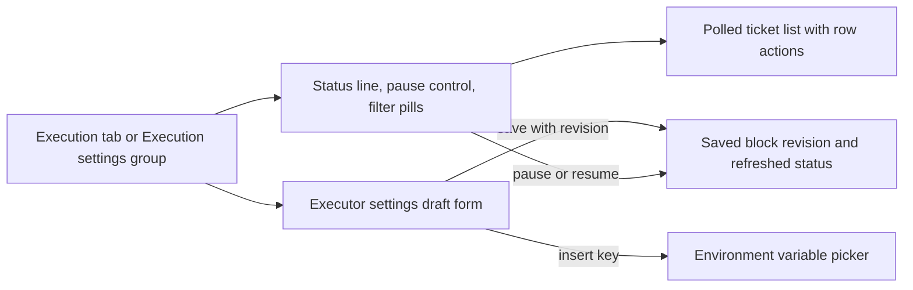

# execution.tsx

This file holds the two Execution screens of the management panel: the Execution status page, which shows what the Executor is doing right now and lets an operator pause or resume it, and the Execution settings group, which edits Executor capacity, the Ticket directory root, the prepare command, and blocked commands. Both exports are React views that read panel state, settings, and translations from shared contexts, so the file stays close to user-visible behavior instead of protocol plumbing. It is the place to start when you want to understand what an operator can see and change about execution.

## How the status view and settings form fit together

The panel routes the Execution tab and the Execution settings group into this file. The status side renders the Executor state and a polled, filterable Ticket list; the settings side renders a draft form whose environment picker feeds keys back into the prepare command, and both paths end in a refreshed view.

<!-- {
  "mermaid_info": {
    "name": "execution.tsx views at a glance",
    "nodes": [
      {
        "id": "trigger_001",
        "name": "Execution tab or Execution settings group",
        "path": "src/client/app.tsx",
        "hint": "Route branch that renders the Execution status page, and the settings shell that mounts the Execution settings group",
        "isJumpable": true,
        "position": { "startLine": 155, "endLine": 156 },
        "references": []
      },
      {
        "id": "status_002",
        "name": "Status line, pause control, filter pills",
        "path": "src/client/execution.tsx",
        "hint": "ExecutionStatus renders setup/paused/running status, capacity counters, the pause confirmation and the ticket filter pills",
        "isJumpable": true,
        "position": { "startLine": 14, "endLine": 51 },
        "references": []
      },
      {
        "id": "tickets_003",
        "name": "Polled ticket list with row actions",
        "path": "src/client/rows.tsx",
        "hint": "TicketLine rows; the status view passes question and onChanged for person-stage tickets to expose notes, answer links, retry and stop",
        "isJumpable": true,
        "position": { "startLine": 10, "endLine": 44 },
        "references": []
      },
      {
        "id": "settings_004",
        "name": "Executor settings draft form",
        "path": "src/client/execution.tsx",
        "hint": "ExecutionSettings builds a draft of the executor block and saves it through the shared block draft hook",
        "isJumpable": true,
        "position": { "startLine": 75, "endLine": 127 },
        "references": []
      },
      {
        "id": "env_005",
        "name": "Environment variable picker",
        "path": "src/client/execution.tsx",
        "hint": "EnvironmentVariables lists declared variables by owner and hands a chosen key back to insert into the prepare command",
        "isJumpable": true,
        "position": { "startLine": 54, "endLine": 74 },
        "references": []
      },
      {
        "id": "result_006",
        "name": "Saved block revision and refreshed status",
        "path": "",
        "hint": "The observable outcome: a new settings revision reported in the save bar, or a freshly reloaded Executor status after pause/resume",
        "isJumpable": false,
        "position": { "startLine": 0, "endLine": 0 },
        "references": []
      }
    ]
  }
} -->

    
        <a target="_self" href="#src/client/execution.tsx:1?class=graph" style="color: inherit; text-decoration: none;">Graph: execution.tsx views at a glance</a>
    

## At a glance

- **Primary role — Presentation**: the file renders two operator-facing screens and the controls inside them, including status wording, counters, filter pills, form fields and inline hints.
- **Secondary role — Orchestration**: it also sequences a few meaningful steps — pausing then reloading panel state, resetting paging when the filter changes, and wiring the settings draft to its save bar and revision history.
- **Confidence**: High — both exports are React components over panel contexts, and their behavior is corroborated by the API contract, route definitions, and the shared draft/settings helpers they call.

## What this file does

- Shows the current Executor status with a single line that resolves to "waiting for the deployment check", "processing paused", or "executor running", plus how many Tickets are executing against the configured worker limit and how many are queued.
- Offers pause and resume as a confirmed action, so an operator cannot stop processing with a single stray click.
- Filters the Ticket list into open, person, working, idle and ended views, with a short explanation on the idle view and a "load more" step of twenty additional Tickets.
- Lists Tickets as rows that link to a Ticket page, and gives person-stage Tickets the richer variant with notes, the answer link, retry and stop actions that refresh the list afterwards.
- Edits the Executor block of settings: worker model, maximum concurrent workers, Ticket directory root, prepare command, and blocked commands, with the working directory default (the installation's state directory under `work`) shown whenever the field is left empty.
- Lists every declared execution environment variable with its owner and a one-sentence description, and inserts a clicked key as `"$KEY"` at the caret of the prepare command.
- Exposes revision history for the executor block and the pause setting, so changes made here can be traced alongside the rest of the configuration.

## What the user experiences

- **Presents**: a status header with a settings shortcut, a tone-coloured status sentence, "executing" and "queued" counters, the pause/resume button, filter pills, and the Ticket list — or, on the settings side, a two-block form (Executor, Environment) with inline tips, per-field hints, a sticky save/discard bar, and a collapsible history panel.
- **Interaction**: clicking a filter pill switches the visible Ticket set and resets paging without adding a back step; the pause button opens a confirmation dialog and, once confirmed, toggles processing for the whole installation; typing in the form edits a local draft; clicking a variable key splices `"$KEY"` into the prepare command and returns the caret to just after the inserted text.
- **Prepared data**: the status view needs the polled panel state (pause flag, running count, worker limit, queued count, setup problem) and its own polled Ticket page; the settings view needs the settings provider's loaded blocks, environment metadata and source list, and throws if it is rendered outside that provider.

### Important interaction states

- With a setup problem the status line turns into a warning and the capacity counters disappear, while the pause control stays available.
- A paused installation shows a warning status and a "resume processing" action; the confirmation text changes to match the direction of the action.
- Filtering leaves the filters, and the empty state is a plain hint rather than an error; an error from the Ticket request is reported in place of the list.
- While a save is in flight, fields are disabled and the save bar reports progress; validation rejections, conflicts against a newer revision, and merge notices all surface in that same bar rather than in the form.
- Typed separators between blocked commands are preserved in the draft and only split when the draft is saved, so the field does not fight the person typing.

## Coordinated flow

1. The panel's route hands the Execution tab an optional Ticket filter (defaulting to open) together with the shared panel state and its reload function.
2. `ExecutionStatus` polls the Ticket list for the current filter and page size, derives the status wording from the setup, pause and load facts, and renders rows that can retry or stop person-stage Tickets and then refresh their own data.
3. Pausing posts the inverted pause flag and then reloads panel state, so the status line and counters change without touching any open settings draft.
4. `ExecutionSettings` builds a draft from the executor block, converts it back to the server shape on save (numeric workers parsed, blocked commands split), and leaves revision tracking, conflict rebasing, session persistence and the save-bar messages to the shared draft hook. Saving reports the new revision and, when the host restarts, says so in the bar.

The draft state machine and the sticky bar used here live in 
<a target="_self" href="#src/client/draft.tsx:175-203?class=code" style="color: inherit; text-decoration: none;">draft.tsx:175-203</a>
, and the per-block save wiring in 
<a target="_self" href="#src/client/settings-kit.tsx:33-42?class=code" style="color: inherit; text-decoration: none;">settings-kit.tsx:33-42</a>
.

## Key functions or classes

### `ExecutionStatus`

Renders the stored Executor status, capacity counters, pause/resume confirmation, filter pills and the paged Ticket list for the selected filter.

    
        <a target="_self" href="#src/client/execution.tsx:14-51?class=code" style="color: inherit; text-decoration: none;">Code: src/client/execution.tsx:14-51</a>
    

### `ExecutionSettings`

Edits the executor settings block as a draft (model, worker limit, directory, prepare command, blocked commands) and saves it with revision tracking, then shows the configuration history for the executor and pause entries.

    
        <a target="_self" href="#src/client/execution.tsx:75-127?class=code" style="color: inherit; text-decoration: none;">Code: src/client/execution.tsx:75-127</a>
    

### `EnvironmentVariables`

Renders a collapsible table of declared environment variables grouped by owner, marks variables whose source is switched off, and calls back with a key when the operator chooses one.

### `firstSentence`

Shortens a variable description to its first sentence for the table cell, with the complete description kept in the cell tooltip.

## Main inputs and results

- **Inputs**: the selected `TicketFilter`, the polled panel state (pause flag, running and queued counts, worker limit, setup problem) and the panel reload function for the status view; for the settings view, the loaded executor block with its revision, the environment root and variable groups, and the source list used to name variable owners.
- **Results**: a rendered status page with an auto-refreshing, filterable Ticket list and a working pause/resume action; a rendered settings form whose save produces a new executor revision plus a history entry, and whose environment picker writes an `"$KEY"` reference into the prepare command.
- **Visible side effects**: pausing or resuming affects processing for the whole installation and the counters update immediately after the reload; saving here reports whether the host is restarting; the directory, prepare command and blocked-command fields are panel-only settings, so these values cannot be changed from outside the management panel.

---
name: execution.tsx

update-time: 2026-11-02 10:51

description: This file holds the two Execution screens of the management panel: the Execution status page, which shows what the Executor is doing right now and lets an operator pause or resume it, and the Execution settings group, which edits Executor capacity, the Ticket directory root, the prepare command, and blocked commands. Both exports are React views that read panel state, settings, and translations from shared contexts, so the file stays close to user-visible behavior instead of protocol plumbing. It is the place to start when you want to understand what an operator can see and change about execution.

---
