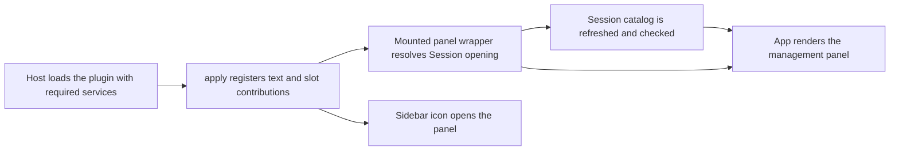

# index.tsx

This file is the browser-side entry point of the `dsh-superagent` DSH client plugin: it is what the host web client calls when it loads the plugin. It declares which host services must exist first, registers the bilingual UI text, and contributes three pieces of UI — the main management panel, a sidebar icon that opens it, and a configuration view inside the Plugin Manager. It also wraps the panel with the one piece of behaviour that needs to live above the React app: opening a DSH Session in the workspace and cancelling stale navigation attempts.

## Whole-unit functional diagram

The host's `apply` call is the single entry: every other node is a contribution registered from there. Opening a Session is the only path that leaves the plugin's own views, and it ends inside the DSH workspace.

<!-- {
  "mermaid_info": {
    "name": "Plugin registration and panel flow",
    "nodes": [
      {
        "id": "host_001",
        "name": "Host loads the plugin with required services",
        "path": "src/client/index.tsx",
        "hint": "The declared service dependencies that must exist before the plugin starts",
        "isJumpable": true,
        "position": { "startLine": 48, "endLine": 49 },
        "references": []
      },
      {
        "id": "apply_002",
        "name": "apply registers text and slot contributions",
        "path": "src/client/index.tsx",
        "hint": "Locale dictionaries plus the main panel, sidebar icon and Plugin Manager view",
        "isJumpable": true,
        "position": { "startLine": 50, "endLine": 58 },
        "references": []
      },
      {
        "id": "mounted_003",
        "name": "Mounted panel wrapper resolves Session opening",
        "path": "src/client/index.tsx",
        "hint": "Aborts stale navigation, maps navigation errors and reads the optional config form",
        "isJumpable": true,
        "position": { "startLine": 31, "endLine": 46 },
        "references": []
      },
      {
        "id": "icon_006",
        "name": "Sidebar icon opens the panel",
        "path": "src/client/index.tsx",
        "hint": "Hammer glyph registered as the sidebar panel icon",
        "isJumpable": true,
        "position": { "startLine": 24, "endLine": 28 },
        "references": []
      },
      {
        "id": "navigate_004",
        "name": "Session catalog is refreshed and checked",
        "path": "src/navigation.ts",
        "hint": "Shared helper that refreshes the catalog and raises a navigation error",
        "isJumpable": true,
        "position": { "startLine": 14, "endLine": 23 },
        "references": []
      },
      {
        "id": "app_005",
        "name": "App renders the management panel",
        "path": "src/client/app.tsx",
        "hint": "Root panel shell that receives the text, Session opener and deployment form",
        "isJumpable": true,
        "position": { "startLine": 173, "endLine": 189 },
        "references": []
      }
    ]
  }
} -->

    
        <a target="_self" href="#src/client/index.tsx:1?class=graph" style="color: inherit; text-decoration: none;">Graph: Plugin registration and panel flow</a>
    

## At a glance

- **Primary role — entry**: the host web client loads this module and calls its `apply` function, which is where all user-visible surfaces of the plugin begin.
- **Secondary role — orchestration**: the `Mounted` wrapper coordinates Session opening with cancellation, catalog readiness, and localized error reporting before the panel renders.
- **Secondary role — presentation**: the file supplies a sidebar glyph and mounts the panel component tree, so it owns what the user first sees.
- **Confidence**: High — the file's own doc comment, the `inject` declaration, the three `slots.register` calls, and the `package.json` `dsh.client` block all point to the same conclusion.

## What this file does

- Declares the host services the plugin needs (`slots`, `locale`, `sessions`, `uiWorkspace`), so the client integrates them instead of failing silently when one is absent.
- Registers the `zh`/`en` dictionaries under the `dshSuperagent` namespace and binds a translator, which is how every panel label becomes bilingual.
- Contributes the main management panel under the fixed panel key `dsh-superagent`, so the plugin appears as a first-class area in the DSH client layout.
- Adds a sidebar icon with an explicit ordering, giving users a one-click way to open that panel.
- Adds a Plugin Manager configuration row, which reuses the same deployment form as the panel's Settings tab, so plugin limits can be edited from either place.
- Turns a Session id into a workspace navigation request, with a clear localized message when the Session list is not ready or does not contain that Session.

## How the flow begins

- **Trigger**: the DSH web client loads the `./client` export of this package (`lib/client.js`) and invokes `apply` with a client context once the declared services are available.
- **First meaningful step**: `apply` registers the locale dictionaries, then contributes the three slot entries. Each slot contribution is wrapped so it is only installed when that slot surface exists in the host.
- **Outcome**: a "Superagent" sidebar icon, a matching main panel, and a configuration row in the Plugin Manager appear in the running client.

### How to invoke it

There is no command to run here — activation is done by the host. The package exposes this file as the client entry and lists its required client packages in its manifest:

See 
<a target="_self" href="#package.json:34-44?class=code" style="color: inherit; text-decoration: none;">package.json:34-44</a>
 for the web-platform client declaration and 
<a target="_self" href="#src/client/index.tsx:48-58?class=code" style="color: inherit; text-decoration: none;">index.tsx:48-58</a>
 for the injection list and the registration body.

## Key functions or classes

### `apply(ctx)`

Registers the plugin's text resources and its three slot contributions; this is the only function the host needs to call.

    
        <a target="_self" href="#src/client/index.tsx:50-58?class=code" style="color: inherit; text-decoration: none;">Code: src/client/index.tsx:50-58</a>
    

### `Mounted({ ctx, t })`

Wraps the panel: builds an abortable Session opener, converts navigation failures into localized messages, reads the optional configuration form, and hands all three to `App`.

    
        <a target="_self" href="#src/client/index.tsx:31-46?class=code" style="color: inherit; text-decoration: none;">Code: src/client/index.tsx:31-46</a>
    

### `HammerIcon({ size })`

Renders the inline SVG glyph used as the sidebar panel icon, sized by the host-provided icon owner props.

    
        <a target="_self" href="#src/client/index.tsx:24-28?class=code" style="color: inherit; text-decoration: none;">Code: src/client/index.tsx:24-28</a>
    

### `ClientContext`

The narrowed context type (`Context` plus `sessions`) that documents exactly which host services the rest of the file may rely on.

    
        <a target="_self" href="#src/client/index.tsx:19?class=code" style="color: inherit; text-decoration: none;">Code: src/client/index.tsx:19</a>
    

## Coordinated flow

1. A panel view asks to open a Session by id; `Mounted` first aborts any previous request, so only the latest click can navigate.
2. The shared helper 
<a target="_self" href="#src/navigation.ts:14-23?class=code" style="color: inherit; text-decoration: none;">navigation.ts:14-23</a>
 takes over: it refreshes the Session catalog when the list is not ready or the id is missing, and stops early if the request was cancelled.
3. The helper then reports either success by calling the workspace opener, or a typed navigation failure.
4. `Mounted` translates that failure into the user's language ("Session list not ready" or "Session not listed") and rethrows, so the panel's normal error display takes over; the workspace itself performs the visible navigation.

### Important branching or concurrency

Only one Session navigation is ever in flight, and unmounting the panel cancels the pending request — a guard that matters when the panel is closed mid-click. The configuration form is a second conditional: when the host exposes no writable `configForms` entry for `dsh-superagent`, `Mounted` passes `undefined` and the deployment view degrades to read-only display instead of failing.

## What the user experiences

- **Presents**: a hammer-labelled entry in the DSH sidebar, a full management panel behind it, and a Superagent configuration row inside the Plugin Manager.
- **Interaction**: clicking the sidebar icon opens the panel; within the panel, links that point at a Session navigate the workspace to that Session, and the Open button in Plugin Manager shows the same deployment fields.
- **Prepared data**: localized strings must be registered before any label renders, and `App` needs the translator, the Session opener, and the (possibly absent) deployment form to mount.

## Main inputs and results

- **Inputs**: the host client context (slot registry, locale registry, Session controller, workspace opener), the locale the user has selected, and Session ids chosen inside panel views.
- **Results**: three registered slot contributions rendered by the host, a bound translator shared by every panel view, and workspace navigation when a Session is successfully opened.
- **Visible side effects**: the Superagent icon appears in the sidebar at its declared order, the panel opens as a main panel area, and selecting a Session switches the DSH workspace to that Session.

---
name: index.tsx

update-time: 2026-11-02 10:55

description: This file is the browser-side entry point of the `dsh-superagent` DSH client plugin: it is what the host web client calls when it loads the plugin. It declares which host services must exist first, registers the bilingual UI text, and contributes three pieces of UI — the main management panel, a sidebar icon that opens it, and a configuration view inside the Plugin Manager. It also wraps the panel with the one piece of behaviour that needs to live above the React app: opening a DSH Session in the workspace and cancelling stale navigation attempts.

---
