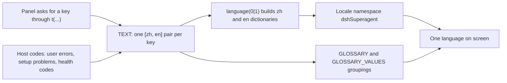

# locales.ts

This file is the single place where the dsh-superagent management panel keeps its words. Every label, tab, hint, warning, status word, rejection message and glossary definition lives here as a `[Chinese, English]` pair, keyed by a stable name such as `mode.auto` or `reason.not_a_member`. The panel never hard-codes copy: it asks for a key, and this file supplies the sentence in whichever language the interface is currently showing. A first-time reader should take away one idea: **keys are the contract, wording is data**, and both languages are always shipped together.

## Whole-unit functional diagram

The panel entry registers `{ zh, en }` under the `dshSuperagent` namespace, so every component's `t(...)` call resolves against this table. Some English strings are not written here at all but reused from the host's own templates, which keeps the panel, the log and the agent-facing messages worded identically. The glossary groupings are exported separately because the term table shows both languages side by side rather than one.

<!-- {
  "mermaid_info": {
    "name": "Copy resolution from keys to one interface language",
    "nodes": [
      {
        "id": "caller_001",
        "name": "Panel asks for a key through t(...)",
        "path": "src/client/index.tsx",
        "hint": "The panel entry registers the dictionaries and binds the namespace",
        "isJumpable": true,
        "position": { "startLine": 50, "endLine": 52 },
        "references": []
      },
      {
        "id": "text_002",
        "name": "TEXT: one [zh, en] pair per key",
        "path": "src/client/locales.ts",
        "hint": "All copy, grouped by panel area",
        "isJumpable": true,
        "position": { "startLine": 8, "endLine": 749 },
        "references": []
      },
      {
        "id": "host_003",
        "name": "Host codes: user errors, setup problems, health codes",
        "path": "src/core/errors.ts",
        "hint": "English templates owned by the host and reused for the English column",
        "isJumpable": true,
        "position": { "startLine": 2, "endLine": 47 },
        "references": []
      },
      {
        "id": "split_004",
        "name": "language(0|1) builds zh and en dictionaries",
        "path": "src/client/locales.ts",
        "hint": "Projects the pair table into two flat key-to-string maps",
        "isJumpable": true,
        "position": { "startLine": 750, "endLine": 752 },
        "references": []
      },
      {
        "id": "registry_005",
        "name": "Locale namespace dshSuperagent",
        "path": "src/client/locales.ts",
        "hint": "Typed namespace declaration consumed by the DSH client locale registry",
        "isJumpable": true,
        "position": { "startLine": 768, "endLine": 770 },
        "references": []
      },
      {
        "id": "visible_006",
        "name": "One language on screen",
        "path": "",
        "hint": "Abstract result: the panel reads in the language the person selected",
        "isJumpable": false,
        "position": { "startLine": 0, "endLine": 0 },
        "references": []
      },
      {
        "id": "glossary_007",
        "name": "GLOSSARY and GLOSSARY_VALUES groupings",
        "path": "src/client/locales.ts",
        "hint": "Term and value keys grouped by stage for the glossary modal",
        "isJumpable": true,
        "position": { "startLine": 754, "endLine": 766 },
        "references": []
      }
    ]
  }
} -->

    
        <a target="_self" href="#src/client/locales.ts:1?class=graph" style="color: inherit; text-decoration: none;">Graph: Copy resolution from keys to one interface language</a>
    

## At a glance

- **Primary role — presentation**: it owns the user-visible wording of the management panel, in both supported languages, including the words used for statuses, reasons and the glossary.
- **Secondary role — data contract**: it defines the key namespace (`DshSuperagentKey`) that the rest of the panel is typed against, and the pair shape that guarantees both languages exist for every key.
- **Confidence**: High — the file is a single self-contained dictionary plus its projection and glossary groupings, and its consumers, host-worded sources and invariants are all visible in the repository.

## What this file does

- Supplies every string the panel can display, organised by area: shared words, header and tabs, Overview, Source, Trigger, Eval, Execution, settings and drafts, prompts, deployment, reason codes, glossary, user and agent error codes, and setup/health codes.
- Keeps both languages in one line per key, so a translator or reviewer sees the Chinese and the English wording of the same label at once and cannot add one without the other.
- Localises *codes*, not just labels: reason codes, `userError.*`, `setup.*` and `healthCode.*` entries turn machine codes recorded elsewhere into readable sentences.
- Reuses the host's own English templates for error, setup and health codes, so the wording a person reads in the panel matches the wording in the log and in what agents are told.
- Provides language-aware separators (`、` versus `, `, `：` versus `: `), so joined lists and `key: value` lines read naturally in either language.
- Exports the glossary model: term keys grouped by stage flow, plus the small value groups (decision, ticket stage, assignment, report) the glossary presents as compact rows.

## What the user experiences

- **Presents**: one continuous interface in a single language at a time — tabs, sections, hints, inline warnings, status chips, filter labels, the reason sentence attached to each Decision, refusal messages, and the glossary with a status-colour legend.
- **Interaction**: the language itself is chosen in the DSH client, not in this panel. The dictionary always carries both, and the `lang` entry (`'zh'` / `'en'`) tells helpers which side is active so host-provided text, names and dates are shown in the same language as the surrounding copy.
- **Prepared data**: the caller supplies any placeholder values the sentence needs (`{count}`, `{status}`, `{ticket}`, `{model}`, `{error}` …), and the host supplies the codes for reasons, refusals, setup problems and health entries.

### Important interaction states

- When a code has no entry here, the panel does not show a blank: it shows the code itself, and for reasons it falls back to the sentence the host wrote. A missing translation is therefore visible, never silent.
- Sentences that describe interruption or risk — saving restarts the service and stops running Assignments, checking again does the same — are worded with the count of affected Assignments so the person sees the consequence before confirming.
- Setup problems and health codes appear with the same wording the operator will find in the log, which makes "what the panel says" and "what the log says" one statement rather than two.

## Information contract

- **Represents**: the copy deck of the panel — a mapping from stable key names to a two-element `[Chinese, English]` pair, declared read-only so the tuple order and arity are enforced at compile time.
- **Produced by**: this file itself, with the English column of the last three groups taken from host modules (`USER_ERRORS`, `SETUP_PROBLEMS`, `HEALTH_TEXT`).
- **Consumed by**: the panel entry that registers the dictionaries and binds the namespace, the text helpers that resolve reasons, setup problems, health entries and `group.key` value labels, the reason formatting path used by marks and badges, and the glossary view that renders terms in both languages.
- **Behavior-shaping parts**: the key suffix must equal the code the producer records (so `reason.*` mixes snake_case host codes with camelCase panel codes); placeholder names must be identical in both languages because the same values are substituted; and `lang` doubles as the data value that selects which language of a host-localised field to display.

### Compatibility notes

- The pair shape means an added key must arrive with both languages; the accompanying locale test asserts that no key is empty in either language and that both sides name the same placeholders.
- The same test asserts that every reason code the core records, every user error code the host can refuse with, and every health entry the panel shows has an entry here. Adding a new host code without a matching key shows up as a raw code in the interface.
- Because the English side of `userError.*`, `setup.*` and `healthCode.*` mirrors the host templates, changing host wording is meant to flow into the panel automatically rather than being re-typed.

## Key functions or classes

### `TEXT`

The dictionary: one commented section per panel area, one `[zh, en]` pair per key, closed with an assertion that every value is exactly a string pair.

    
        <a target="_self" href="#src/client/locales.ts:8-749?class=code" style="color: inherit; text-decoration: none;">Code: src/client/locales.ts:8-749</a>
    

### `DshSuperagentKey`

The union of all copy keys, derived from `TEXT`; every panel component and helper is typed with it, so a typo in a key fails at compile time instead of showing up as odd text.

### `language(index)`

Projects the pair table into a flat key-to-string map for one side; the only place the `[zh, en]` order is interpreted.

### `zh` and `en`

The two finished dictionaries handed to the client locale registry, built with `language(0)` and `language(1)`.

    
        <a target="_self" href="#src/client/locales.ts:750-752?class=code" style="color: inherit; text-decoration: none;">Code: src/client/locales.ts:750-752</a>
    

### `GLOSSARY`

Term keys grouped by the stage flow after the acting roles (roles, source, trigger, eval, execution); each key maps to a `term.<key>` label and a `meaning.<key>` definition.

    
        <a target="_self" href="#src/client/locales.ts:754-761?class=code" style="color: inherit; text-decoration: none;">Code: src/client/locales.ts:754-761</a>
    

### `GLOSSARY_VALUES`

Groups of enumerated value keys (decision, ticket stage, assignment, report) that the glossary shows as one line per group, each value appearing in both languages.

### Locale namespace declaration

Augments the client UI slot locale map so the `dshSuperagent` namespace is known to the type system, which is what makes `t(key)` type-checked throughout the panel.

    
        <a target="_self" href="#src/client/locales.ts:768-770?class=code" style="color: inherit; text-decoration: none;">Code: src/client/locales.ts:768-770</a>
    

## Main inputs and results

- **Inputs**: the active interface language chosen in the DSH client; placeholder values supplied by the caller for sentences that quote counts, statuses, tickets, models or errors; and host-owned English templates for refusals, setup problems and health entries.
- **Results**: the `zh` and `en` dictionaries registered as the `dshSuperagent` locale namespace, the `DshSuperagentKey` key type, and the glossary groupings the term view iterates over.
- **Visible side effects**: every panel surface reads in the selected language, and the glossary modal shows terms and meanings with Chinese and English side by side, followed by the status-colour legend.

For the surrounding module picture, see 
<a target="_self" href="#src/client/client.info.md?class=text" style="color: inherit; text-decoration: none;">client.info.md</a>
; the helpers that turn codes into sentences are in 
<a target="_self" href="#src/client/text.ts?class=code" style="color: inherit; text-decoration: none;">text.ts</a>
, and the invariants these keys must satisfy are checked by 
<a target="_self" href="#tests/locales.spec.ts?class=code" style="color: inherit; text-decoration: none;">locales.spec.ts</a>
.

---
name: locales.ts

update-time: 2026-11-02 10:52

description: This file is the single place where the dsh-superagent management panel keeps its words. Every label, tab, hint, warning, status word, rejection message and glossary definition lives here as a `[Chinese, English]` pair, keyed by a stable name such as `mode.auto` or `reason.not_a_member`. The panel never hard-codes copy: it asks for a key, and this file supplies the sentence in whichever language the interface is currently showing. A first-time reader should take away one idea: **keys are the contract, wording is data**, and both languages are always shipped together.

---
