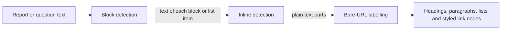

# markdown.ts

This small file is the text-to-display engine behind every report, question and event description in the panel. It takes a plain string written in a deliberately limited Markdown subset and converts it into two simple typed lists — blocks (headings, paragraphs, lists) and inlines (plain text, bold, inline code, links) — that React components can render directly. It never interprets raw HTML, so user- or model-generated text cannot inject markup. If you want to know how a sentence from a report ends up as a styled heading with a clickable link, this is the file to read.

## Whole-unit functional diagram

The path is a two-stage pipeline: `markdownBlocks` decides the large-scale structure line by line, then `inlines` (which falls back to `linkify`) decorates the text inside each heading, paragraph or list item. The result is plain data — nothing is drawn here, and nothing outside the browser is called.

## At a glance

- **Primary role**: Presentation — the file owns how Markdown-looking text is turned into the exact pieces a reader sees (what becomes bold, what becomes a heading, how a long URL is shortened into a readable label), without owning any DOM.
- **Secondary roles**: Data contract — it exports the `Inline` and `Block` shapes that other client components consume.
- **Confidence**: High — all four functions and their single consumer were read; the whole file is 43 lines and has no external dependencies.

## What this file does

- **Turns text into document structure.** Consecutive lines starting with `-` or `*` become bullet lists, lines starting with `1.` / `1)` become numbered lists, lines starting with one to six `#` become headings, and every other non-blank line becomes a paragraph.
- **Keeps lists honest.** A list block continues while neighbouring items share the same style; switching between bullets and numbers starts a new list, and any other line closes the current list.
- **Recognises a safe inline subset.** `**bold**`, `` `code` `` and `[label](https://…)` are detected, and anything left over is scanned for bare URLs.
- **Makes long URLs readable.** Explicit links keep the label the author wrote, while bare URLs are displayed as host plus a shortened path, with the full address preserved for the click target.
- **Refuses to interpret raw HTML.** Tags in the input are treated as ordinary characters, which is what makes it safe to feed it generated text.
- **Stays line-oriented.** Each non-blank line stands alone as its own paragraph, and blank lines end a list — worth knowing if a multi-line description renders as several short paragraphs.

## Key functions or classes

### `markdownBlocks`

Splits the input by newline and groups lines into heading, paragraph and list blocks, merging adjacent list items of the same kind.

    
        <a target="_self" href="#src/client/markdown.ts:26-42?class=code" style="color: inherit; text-decoration: none;">Code: src/client/markdown.ts:26-42</a>
    

### `inlines`

Splits one block's text into bold, code, link and plain-text nodes, delegating every remaining fragment to `linkify`.

### `linkify`

Splits plain text into text and bare-URL link nodes, deliberately leaving trailing sentence punctuation out of the URL.

### `shortUrl`

Builds the visible label for a link — host plus a path clipped with `…` — and falls back to the original string when the value is not a parseable URL.

## What the user experiences

- **Presents**: headings rendered as emphasised paragraphs, bulleted and numbered lists, bold and monospaced spans, and links whose visible label is a tidy host-and-path summary instead of a long raw address.
- **Interaction**: this file adds none of its own; it only prepares nodes. The clickable behaviour (opening links in a new tab) is applied by the consumer.
- **Prepared data**: a single string of text that has already been through the panel's marker substitution in the caller, plus a rendering component that maps each node kind to an element.

## Information contract

- **Represents**: `Inline` is a text / bold / code / link node; `Block` is a heading, paragraph, or list with an `ordered` flag and its item strings.
- **Produced by**: `inlines`, `linkify` and `markdownBlocks` in this file.
- **Consumed by**: the shared Markdown widget and the clamped-text widget, which iterate the returned arrays and pick an element per `kind`. See 
<a target="_self" href="#src/client/widgets.tsx:45-60?class=code" style="color: inherit; text-decoration: none;">widgets.tsx:45-60</a>
 for the rendering side.
- **Behavior-shaping parts**: `Block.kind` selects paragraph versus heading versus list markup, `Block.ordered` selects `<ol>` versus `<ul>`, and `Inline.kind` decides whether a part becomes text, `<strong>`, `<code>` or an anchor with `url` as its destination and `text` as its label.

## Main inputs and results

- **Inputs**: one `string` of Markdown-subset text per call; no configuration, options or external services.
- **Results**: `Block[]` from `markdownBlocks`, and `Inline[]` from `inlines` or `linkify` — plain arrays that callers map to elements.
- **Visible side effects**: none on their own; these are pure functions, and everything a person sees appears only once a consumer renders the returned nodes.

---
name: markdown.ts

update-time: 2026-11-02 10:50

description: This small file is the text-to-display engine behind every report, question and event description in the panel. It takes a plain string written in a deliberately limited Markdown subset and converts it into two simple typed lists — blocks (headings, paragraphs, lists) and inlines (plain text, bold, inline code, links) — that React components can render directly. It never interprets raw HTML, so user- or model-generated text cannot inject markup. If you want to know how a sentence from a report ends up as a styled heading with a clickable link, this is the file to read.

---
