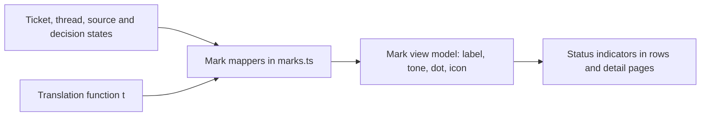

# marks.ts

`src/client/marks.ts` is the single place where the panel's raw domain states — a ticket's stage, a thread's polling state, a source's install state, or a decision outcome — become something a person can look at: a short localized label, a tone, a status dot and an icon. It contains no React, no fetching and no logic beyond small lookup tables, so it is the easiest file to read when you want to know why a status chip in the UI looks the way it does. Every list row, ticket header and source line in the client gets its status text and indicator from here.

## Whole-unit functional diagram

The left side is data the client already has after loading API rows; the mappers combine it with the active-language translation function and return a small plain object. Rendering components consume that object, so changing a mapping here changes what every consumer displays without touching them.

<!-- {
  "mermaid_info": {
    "name": "From domain states to status marks",
    "nodes": [
      {
        "id": "states_001",
        "name": "Ticket, thread, source and decision states",
        "path": "src/core/stage.ts",
        "hint": "Domain unions the mappers switch on (ticket stage, thread stage, source state, decision outcome)",
        "isJumpable": true,
        "position": { "startLine": 5, "endLine": 6 },
        "references": []
      },
      {
        "id": "mappers_002",
        "name": "Mark mappers in marks.ts",
        "path": "src/client/marks.ts",
        "hint": "ticketMark, threadMark, sourceMark, decisionMark and reportDot",
        "isJumpable": true,
        "position": { "startLine": 9, "endLine": 57 },
        "references": []
      },
      {
        "id": "labels_003",
        "name": "Translation function t",
        "path": "src/client/text.ts",
        "hint": "Typed translate function used to produce localized labels, plus valueLabel fallback",
        "isJumpable": true,
        "position": { "startLine": 15, "endLine": 20 },
        "references": []
      },
      {
        "id": "mark_004",
        "name": "Mark view model: label, tone, dot, icon",
        "path": "src/client/marks.ts",
        "hint": "The exported Mark interface returned to callers",
        "isJumpable": true,
        "position": { "startLine": 7, "endLine": 7 },
        "references": []
      },
      {
        "id": "indicators_005",
        "name": "Status indicators in rows and detail pages",
        "path": "src/client/widgets.tsx",
        "hint": "StageMark renders the dot/icon/label combination produced by these mappers",
        "isJumpable": true,
        "position": { "startLine": 104, "endLine": 107 },
        "references": []
      }
    ]
  }
} -->

    
        <a target="_self" href="#src/client/marks.ts:1?class=graph" style="color: inherit; text-decoration: none;">Graph: From domain states to status marks</a>
    

## At a glance

- Primary role: Presentation — the file owns how status information is worded, colored and symbolized, but never draws it itself; the actual chip and dot components live in `widgets.tsx` and `controls.tsx`.
- Confidence: High — the mapping tables are typed as exhaustive records over the imported domain unions, and five client modules (`rows.tsx`, `ticket.tsx`, `thread.tsx`, `app.tsx`, `source.tsx`) import these functions directly.

## What this file does

- Describes a ticket's stage as a label, tone, dot and icon — for example "Awaiting review" in warning colors, or "Executing" with a running indicator.
- Summarizes a thread's polling state (error, evaluating, queued, subscribed, dormant, unsubscribed) and folds in how many items are pending.
- Reports a source's install/health state (missing, off, error, setup, starting, paused, ready) as a dot plus short text.
- Names a decision outcome — accept, reopen, stop, ignore, unavailable — including the special `wouldAccept` case that means "an ignore that observe mode would have accepted".
- Reduces a raw assignment report string to a single dot state, which lets compact lists show progress without a full label.

## Key functions or classes

### `Mark`

The shared view-model shape: every full mark carries `label`, `tone`, `dot` and `icon`; several mappers return only the subset their consumer needs.

<a target="_self" href="#src/client/marks.ts:7?class=code" style="color: inherit; text-decoration: none;">marks.ts:7</a>

### `ticketMark`

Switches on the ticket stage: ended tickets show the recorded outcome, person-facing stages pick an icon and danger/warning tone from the pending action, working distinguishes queued from actively running, and idle falls back to "Waiting for a Trigger".

<a target="_self" href="#src/client/marks.ts:9-23?class=code" style="color: inherit; text-decoration: none;">marks.ts:9-23</a>

### `threadMark`

Looks up the thread stage in one table and interpolates the pending count into the translated label, returning dot, icon and label without a tone.

<a target="_self" href="#src/client/marks.ts:35-38?class=code" style="color: inherit; text-decoration: none;">marks.ts:35-38</a>

### `sourceMark`

Maps a source state to a dot and a localized label; `error`, `starting`, `paused` and `ready` are visually distinct while inert states share the idle dot.

<a target="_self" href="#src/client/marks.ts:46?class=code" style="color: inherit; text-decoration: none;">marks.ts:46</a>

### `decisionMark`

Returns a complete mark for a decision outcome and special-cases `wouldAccept`, whose label has no `decision.*` translation and is read from its own locale key.

<a target="_self" href="#src/client/marks.ts:55-57?class=code" style="color: inherit; text-decoration: none;">marks.ts:55-57</a>

### `reportDot`

Converts a report string into one of the five dot states — failed is an error, blocked or waiting a warning, ready done, anything else still ongoing.

<a target="_self" href="#src/client/marks.ts:24-25?class=code" style="color: inherit; text-decoration: none;">marks.ts:24-25</a>

## Main inputs and results

- Inputs: the active translation function `t` (typed at 
<a target="_self" href="#src/client/text.ts:9?class=code" style="color: inherit; text-decoration: none;">text.ts:9</a>
) plus already-loaded domain values — a ticket stage with its `ended` summary, a thread's `stage` and `pending`, a source `state`, a decision `outcome`, or a report string.
- Results: plain objects of `label`, `tone`, `dot` and `icon`, where the allowed values come from `controls.tsx` (`DotState`, `IconName`, `TagTone`).
- Visible side effects: none on its own — the file performs no I/O, keeps no state and mutates nothing, so identical input always yields an identical mark.

## What the user experiences

- Presents: the status wording and indicator attached to each ticket row, thread row and decision row, the ticket detail header, the source status line, and the short status text used next to the "ticket" term in the app shell.
- Interaction: nothing is clickable here; these are pure formatters, so clicking behavior in the UI comes from the surrounding row components.
- Prepared data: a translation function for the current language and the API row shapes from `api.ts` (
<a target="_self" href="#src/client/api.ts:119-141?class=code" style="color: inherit; text-decoration: none;">api.ts:119-141</a>
) must be available before a mark can be produced.

### Important interaction states

The visible differences readers will notice: a failed ticket switches the tone to danger and the dot to error while blocked or awaiting-answer stages stay in warning colors; `queued` looks neutral and idle while `working` is informational with a running indicator; and when a mark's dot is `ongoing`, `StageMark` replaces the icon with an animated dot instead of drawing the requested glyph. Unknown text falls back safely — `valueLabel` in 
<a target="_self" href="#src/client/text.ts:15-20?class=code" style="color: inherit; text-decoration: none;">text.ts:15-20</a>
 returns the raw key when no translation exists, so an unforeseen outcome still displays something rather than an empty chip.

---
name: marks.ts

update-time: 2026-11-02 10:56

description: `src/client/marks.ts` is the single place where the panel's raw domain states — a ticket's stage, a thread's polling state, a source's install state, or a decision outcome — become something a person can look at: a short localized label, a tone, a status dot and an icon. It contains no React, no fetching and no logic beyond small lookup tables, so it is the easiest file to read when you want to know why a status chip in the UI looks the way it does. Every list row, ticket header and source line in the client gets its status text and indicator from here.

---
