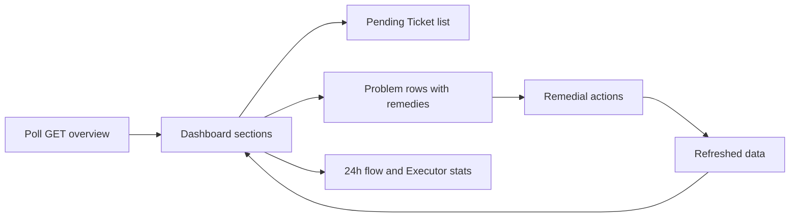

# overview.tsx

This file is the Overview tab of the `dsh-superagent` management panel — the first screen an operator sees. It polls a single `GET overview` endpoint and turns the answer into four stacked sections: the Tickets that are actually waiting for a human, the active system problems with their fix buttons, the last 24 hours of Trigger flow, and current Executor load. It deliberately contains no business rules of its own: the server decides what counts as a problem or which Tickets need a person, and this file only chooses how each case is worded, linked and acted upon.

## Whole-unit functional diagram

The page subscribes to `GET overview` on mount, spreads the response over its sections, and offers a concrete action on most problem rows. Because those actions mutate server state, each one finishes by calling the same `reload` that the poll timer uses, so the screen settles back into a freshly fetched state instead of a locally patched one.

## At a glance

- **Primary role (presentation)**: it renders the operator's status screen — what needs attention, why, and which control fixes it.
- **Secondary role (orchestration)**: it wires a polling loop, per-problem mutations, post-mutation refresh and route navigation into one coherent flow.
- **Confidence**: High — the whole file is a React view, and the polling/refresh/navigation collaborators are all readable in the imported client modules.

## What this file does

- **Shows who is waiting on a person.** Tickets whose stage is `person` are rendered as full `TicketLine` rows with their answer links and retry/stop controls; an empty list becomes a short "nothing needs you" hint instead of a blank section.
- **Explains every active problem in operator language.** Each problem from the server is matched to a title, an optional detail line (raw host text, a localized health code, or a localized reason), an optional hint, a navigation target and usually a remediation control.
- **Offers the fix next to the fault.** Setup problems get a re-check button, a paused Executor gets a confirmed resume, unavailable Evals get requeue/dismiss buttons, and missing sources or allowlists get a jump to the relevant settings page.
- **Summarizes the last day of flow.** Received, filtered, judged and accepted counts are rendered as compact stats; only the ones that correspond to a real filtered view (filtered, accepted, dropped) are clickable.
- **Reports Executor load in context.** Running/max workers, queued and idle counts appear together, and while setup is still pending the numbers are replaced by a waiting hint because nothing can run yet.
- **Degrades honestly.** A first load without data shows a loading hint, a poll error is shown as an alert above the sections while previous data stays visible, and the problems section is omitted entirely when there is nothing wrong.

## Key functions or classes

### `OverviewPage`

Renders the dashboard: it reads translations, the route navigator and the typed API caller from the panel context, takes the setup state from shared panel data, polls `GET overview`, and lays out the four sections with their counts, "details" links and stats.

<a target="_self" href="#src/client/overview.tsx:61-103?class=code" style="color: inherit; text-decoration: none;">overview.tsx:61-103</a>

### `ProblemLine`

Turns one server-reported problem into a single row. It switches on the problem kind to pick the title, the detail, the deep link and the action, and it owns the busy state of the requeue/dismiss buttons through the shared action runner.

<a target="_self" href="#src/client/overview.tsx:11-59?class=code" style="color: inherit; text-decoration: none;">overview.tsx:11-59</a>

## What the user experiences

- **Presents**: four titled sections with counts — pending Tickets, problems (only when non-empty), the last day of flow, and Executor load — plus small inline stats and text links to the detail pages.
- **Interaction**: clicking a Ticket or problem title navigates to the owning page; buttons re-check setup, resume a paused Executor (with confirmation), requeue or dismiss an unavailable Eval, or jump to the source/evaluation settings needed to make work possible.
- **Prepared data**: the page needs a successful `GET overview` response carrying `person`, `problems`, `flow` and `executor`, plus the shared panel setup state; nothing is rendered from partial data on first load.

### Important interaction states

- **Loading**: before the first response arrives, only a loading hint is shown.
- **Stale data with an error**: if a later poll fails, the error is displayed above the sections while the last successful numbers remain readable.
- **Setup pending**: the Executor stats are replaced by a waiting hint, because nothing is running until setup completes.
- **Busy actions**: requeue and dismiss disable themselves while their request is in flight, and fix actions that could interrupt running work ask for confirmation first.
- **Pause is not duplicated**: a paused Executor already appears as a problem row, so the Executor section keeps showing its counters rather than repeating the warning.

## Coordinated flow

1. **Poll starts the page.** On mount, `usePoll` calls `GET overview` and keeps re-fetching on its interval, backing off when the browser tab is hidden.
2. **Sections consume one snapshot.** The same response feeds the Ticket list, the problem rows, the flow counters and the Executor stats, so all four agree.
3. **A problem row dispatches an action.** `ProblemLine` either navigates to a settings or detail route, or calls a POST endpoint through the panel's typed caller (resume processing, requeue a Trigger, dismiss a Decision, re-check setup).
4. **The refresh closes the loop.** Successful actions call the page's `reload`, which reuses the polling queue, and the server's post-action state — not a local guess — becomes what the operator sees.

### Important branching or concurrency

Mutating requests run through the shared action runner, which refuses to re-enter while an action is already running and reports failures as a toast rather than breaking the page. Manual reloads are serialized behind the current poll, so a refresh triggered right after an action never races the in-flight request.

## Main inputs and results

- **Inputs**: the `GET overview` response (`person`, `problems`, `flow.received/filtered/judged/accepted/dropped`, `executor.running/maxWorkers/queued/idle`), the shared panel setup state, the current locale for all wording, and operator clicks on links and buttons.
- **Results**: a rendered overview screen; navigation to settings, source, evaluation, trigger, execution or Ticket detail routes; and POST requests that resume processing, requeue a Trigger, dismiss a Decision, or re-check setup.
- **Visible side effects**: a toast on action failure, a confirmation dialog for actions that can interrupt running work, and refreshed dashboard data after every successful action.

---
name: overview.tsx

update-time: 2026-11-02 11:03

description: This file is the Overview tab of the `dsh-superagent` management panel — the first screen an operator sees. It polls a single `GET overview` endpoint and turns the answer into four stacked sections: the Tickets that are actually waiting for a human, the active system problems with their fix buttons, the last 24 hours of Trigger flow, and current Executor load. It deliberately contains no business rules of its own: the server decides what counts as a problem or which Tickets need a person, and this file only chooses how each case is worded, linked and acted upon.

---
