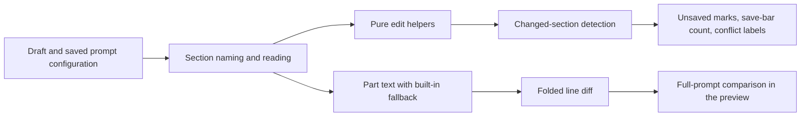

# prompt-config.ts

This file holds the pure, side-effect-free logic behind the management panel's **Prompts** page: it reads and edits a team's prompt configuration, decides what counts as an unsaved change, and computes the folded line diff the preview uses. Nothing here renders or fetches; every helper takes a configuration value, returns a new one, and is therefore easy to reason about and test. If you want to understand how a prompt edit in the panel becomes a save payload, start here rather than in the large UI file that calls it.

## Whole-unit functional diagram

The editor keeps two configurations side by side — the draft the user is typing into and the saved version it started from — and this module is the whole vocabulary between them: naming a section, applying an edit immutably, listing what differs, and turning two texts into a readable diff.

<!-- {
  "mermaid_info": {
    "name": "Prompt configuration editing flow",
    "nodes": [
      {
        "id": "editor_001",
        "name": "Draft and saved prompt configuration",
        "path": "src/client/prompts.tsx",
        "hint": "The Prompts editor normalizes the saved configuration and opens a draft from it",
        "isJumpable": true,
        "position": { "startLine": 29, "endLine": 45 },
        "references": []
      },
      {
        "id": "names_002",
        "name": "Section naming and reading",
        "path": "src/client/prompt-config.ts",
        "hint": "Lists team sections, skills and built-in parts, and reads one by name",
        "isJumpable": true,
        "position": { "startLine": 11, "endLine": 16 },
        "references": []
      },
      {
        "id": "edit_003",
        "name": "Pure edit helpers",
        "path": "src/client/prompt-config.ts",
        "hint": "Returns a new configuration for a section, skill or override edit",
        "isJumpable": true,
        "position": { "startLine": 22, "endLine": 41 },
        "references": []
      },
      {
        "id": "changed_004",
        "name": "Changed-section detection",
        "path": "src/client/prompt-config.ts",
        "hint": "Compares draft and saved configuration name by name",
        "isJumpable": true,
        "position": { "startLine": 43, "endLine": 46 },
        "references": []
      },
      {
        "id": "ui_005",
        "name": "Unsaved marks, save-bar count, conflict labels",
        "path": "",
        "hint": "What the reader sees once the changed names are known",
        "isJumpable": false,
        "position": { "startLine": 0, "endLine": 0 },
        "references": []
      },
      {
        "id": "text_006",
        "name": "Part text with built-in fallback",
        "path": "src/client/prompt-config.ts",
        "hint": "Reads a built-in part's text as the team's override, else the built-in one",
        "isJumpable": true,
        "position": { "startLine": 25, "endLine": 25 },
        "references": []
      },
      {
        "id": "diff_007",
        "name": "Folded line diff",
        "path": "src/client/prompt-config.ts",
        "hint": "Computes unchanged, inserted and deleted lines and folds long unchanged runs",
        "isJumpable": true,
        "position": { "startLine": 55, "endLine": 78 },
        "references": []
      },
      {
        "id": "preview_008",
        "name": "Full-prompt comparison in the preview",
        "path": "src/client/prompts.tsx",
        "hint": "Renders the diff against the saved version or the defaults",
        "isJumpable": true,
        "position": { "startLine": 221, "endLine": 246 },
        "references": []
      }
    ]
  }
} -->

    
        <a target="_self" href="#src/client/prompt-config.ts:1?class=graph" style="color: inherit; text-decoration: none;">Graph: Prompt configuration editing flow</a>
    

## At a glance

- Primary role: Domain rules — it encodes the editing rules of a prompt configuration: which names are sections, when an override exists, and when an edit counts as a change.
- Secondary roles: Utility — the line diff is a self-contained text algorithm used for any two prompt texts.
- Confidence: High — the whole file was read, together with its only consumer, the `PromptConfig`/`PromptsView` types and the tests that pin its behavior.

## What this file does

- **Names and reads every editable piece of the configuration.** The panel shows three kinds of entries: the team's own sections (`communication`, `scope`, `delivery`), team skills written as `skill/<name>`, and built-in parts written as `part/<key>`. Helpers list them in that order and answer "what text does this name currently have?".
- **Applies edits without mutating.** Editing a section, adding or removing a skill, and overriding a built-in part all return a fresh configuration object, so the editor can keep the saved version untouched for comparison.
- **Keeps overrides honest.** An override remembers which built-in text it was edited from, is rebased on request, and disappears when the team's text is the built-in text again.
- **Reports unsaved work.** `changedSections` produces the exact list the editor turns into per-item "unsaved" dots, the save bar's change count, and the names in a save-conflict message.
- **Formats user-visible labels.** Section names become translated labels, team skills get the prefix sessions register them under, and team part text is reconstructed with its heading so it can be compared with the composed prompt.
- **Validates a new skill name** against the pattern the server publishes, the skills already present, and the built-in skill names.

## Key functions or classes

### `sectionText(config, name)`

Returns the text behind any editor name — a team section, a team skill, a built-in part's override — or `undefined` when the team wrote nothing for it; this is what lets the editor fall back to another selection when a skill is removed.

    
        <a target="_self" href="#src/client/prompt-config.ts:14-16?class=code" style="color: inherit; text-decoration: none;">Code: src/client/prompt-config.ts:14-16</a>
    

### `withOverrides(config, parts?)`

Normalizes a configuration so that "no overrides" is an empty map rather than a missing field, optionally dropping overrides that name built-in parts the shown version no longer has — the case when a version is loaded from history.

### `withOverride(config, part, text, rebase?)`

The rule for built-in parts: keeps or creates the team's override with the built-in text it was edited from, rebases that base to the current one when asked, and removes the override when `text` is undefined or equal to the built-in text.

    
        <a target="_self" href="#src/client/prompt-config.ts:30-34?class=code" style="color: inherit; text-decoration: none;">Code: src/client/prompt-config.ts:30-34</a>
    

### `withSection(config, name, text)`

Writes text for a team section or a team skill, choosing the top-level field or the `skills` map from the `skill/` prefix.

### `withoutSkill(config, name)`

Removes a team skill from the configuration, leaving the other skills and every override in place.

### `changedSections(config, saved)`

Compares a draft with the saved version across both name lists and returns the names that differ; overrides are compared by their whole value so that a re-based override still counts as a change even when its text is unchanged.

    
        <a target="_self" href="#src/client/prompt-config.ts:43-46?class=code" style="color: inherit; text-decoration: none;">Code: src/client/prompt-config.ts:43-46</a>
    

### `partWith(part, base)`

Reconstructs a composed prompt part from its text, prefixing the heading when the part has one — skills have none — so a team section's saved and default forms are compared like the composed prompt is.

### `lineDiff(before, after)`

Turns two multi-line texts into an ordered list of unchanged, inserted and deleted lines, with long unchanged stretches folded to their first and last line plus a count.

    
        <a target="_self" href="#src/client/prompt-config.ts:57-78?class=code" style="color: inherit; text-decoration: none;">Code: src/client/prompt-config.ts:57-78</a>
    

## Main inputs and results

- Inputs: a `PromptConfig` value (which is just the API's `defaults` shape, from 
<a target="_self" href="#src/client/api.ts:138?class=code" style="color: inherit; text-decoration: none;">api.ts:138</a>
), a built-in part entry as `GET prompts` returns it (key, text, base, the roles that read it, template placeholders), an editor name, and the localized translator plus the name pattern the server publishes.
- Results: new configuration objects, the current text of a section, a sorted-by-construction list of changed names, localized labels, a validity answer for a new skill name, and a `DiffLine[]` array ready to render.
- Visible side effects: none from this file itself; its results drive the panel's unsaved dots, change tags, save-bar wording and the diff view in 
<a target="_self" href="#src/client/prompts.tsx:221-255?class=code" style="color: inherit; text-decoration: none;">prompts.tsx:221-255</a>
.

## Rules and decisions

- Decision: what is an editable prompt section, and what does it currently say? Answering it means resolving a name into one of three storage places: a top-level team section field, an entry in `skills`, or an entry in `overrides` keyed by a built-in part key.
- Important conditions: the `skill/` and `part/` prefixes decide where a value lives; a built-in part's effective text is the team's override if present, otherwise the built-in text the server sent; the configuration's own `skills` and `overrides` members are never treated as sections.
- Outcomes: editing produces either an updated section/skill text, an override with a recorded base, or the removal of an override — and nothing ever edits the input object in place.
- Invariant: an override exists only while the team's text differs from the current built-in text; the editor represents "no overrides" as an empty map even though the host stores none; and an override loaded from history for a part the shown version lacks is dropped, so the draft cannot reference a part that the panel does not display.

### Small example

Suppose a team edits the shared built-in part, then later the installation's built-in text changes. The override still points at the older base, so the panel can offer "keep mine" or "take the default". Taking the default removes the override entirely; keeping mine rebases the base, and the section is still reported as changed — because the stored override value, base included, no longer matches the saved one. These cases are pinned by 
<a target="_self" href="#tests/prompt-config.spec.ts:24-38?class=code" style="color: inherit; text-decoration: none;">prompt-config.spec.ts:24-38</a>
.

## Reusable capability

- Solves: showing what changed between two prompt texts without drowning the reader in identical lines — the same problem for the full-prompt preview and for the "the built-in text changed" notice.
- Input: two strings, such as the saved text and the draft text of one prompt part.
- Result: `DiffLine[]`, where each entry is an unchanged, inserted or deleted line, or a fold entry carrying how many identical lines were hidden.
- Main usage area: the diff renderer in 
<a target="_self" href="#src/client/prompts.tsx:249-255?class=code" style="color: inherit; text-decoration: none;">prompts.tsx:249-255</a>
, which prints `<ins>`/`<del>` lines and a localized "same lines" placeholder.

### Important usage constraint

Only runs of **more than four** unchanged lines are folded, and a fold hides the middle while keeping the boundary lines visible; the count is the number of hidden lines, not the run length. Within a replaced region the inserted line is emitted before the deleted one, so the preview reads top-down as "new line, then what it replaced".

---
name: prompt-config.ts

update-time: 2026-11-02 10:56

description: This file holds the pure, side-effect-free logic behind the management panel's **Prompts** page: it reads and edits a team's prompt configuration, decides what counts as an unsaved change, and computes the folded line diff the preview uses. Nothing here renders or fetches; every helper takes a configuration value, returns a new one, and is therefore easy to reason about and test. If you want to understand how a prompt edit in the panel becomes a save payload, start here rather than in the large UI file that calls it.

---
