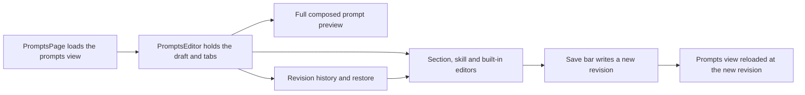

# prompts.tsx

`prompts.tsx` renders the **Prompts** group of the dsh-superagent management panel. It lets a person edit the team's prompt sections and team skills, override the built-in prompt parts, preview the fully composed orchestrator/worker prompt with diffs, and browse or restore earlier revisions. All three views sit on top of one shared settings draft, so every edit — including one loaded from history — is saved together as a new prompt revision. It is a pure panel file: it reads and writes through the typed API contract rather than owning prompt composition itself.

## Whole-unit functional diagram

The page fetches the prompts view once, hands it to an editor that owns the draft and the three tabs, and then routes the person's edits either into the section editors, into a composed-prompt preview, or into the history list. Restoring a revision feeds the draft just like a manual edit, and the shared save bar turns the accumulated draft into one new revision before reloading the view.

<!-- {
  "mermaid_info": {
    "name": "Prompts settings group flow",
    "nodes": [
      {
        "id": "page_001",
        "name": "PromptsPage loads the prompts view",
        "path": "src/client/prompts.tsx",
        "hint": "Fetches 'GET prompts' and shows a loading state until the view arrives",
        "isJumpable": true,
        "position": { "startLine": 20, "endLine": 27 },
        "references": []
      },
      {
        "id": "editor_002",
        "name": "PromptsEditor holds the draft and tabs",
        "path": "src/client/prompts.tsx",
        "hint": "Starts the shared draft, keeps the selected section, and switches between Edit, Full and History",
        "isJumpable": true,
        "position": { "startLine": 29, "endLine": 68 },
        "references": []
      },
      {
        "id": "edit_003",
        "name": "Section, skill and built-in editors",
        "path": "src/client/prompts.tsx",
        "hint": "Navigation list of team sections, built-in parts and team skills, plus the textarea editors",
        "isJumpable": true,
        "position": { "startLine": 70, "endLine": 175 },
        "references": []
      },
      {
        "id": "preview_004",
        "name": "Full composed prompt preview",
        "path": "src/client/prompts.tsx",
        "hint": "Requests 'POST prompts/preview' for the draft and diffs each part against saved text or defaults",
        "isJumpable": true,
        "position": { "startLine": 180, "endLine": 248 },
        "references": []
      },
      {
        "id": "history_005",
        "name": "Revision history and restore",
        "path": "src/client/prompts.tsx",
        "hint": "Pages earlier revisions, loads one into the draft, and lists sessions bound to a revision",
        "isJumpable": true,
        "position": { "startLine": 257, "endLine": 295 },
        "references": []
      },
      {
        "id": "save_006",
        "name": "Save bar writes a new revision",
        "path": "src/client/prompts.tsx",
        "hint": "Saves the draft config with its base revision and reports the delivery state",
        "isJumpable": true,
        "position": { "startLine": 34, "endLine": 38 },
        "references": []
      },
      {
        "id": "result_007",
        "name": "Prompts view reloaded at the new revision",
        "path": "",
        "hint": "The observable outcome: the panel shows the saved revision and clears the draft",
        "isJumpable": false,
        "position": { "startLine": 0, "endLine": 0 },
        "references": []
      }
    ]
  }
} -->

    
        <a target="_self" href="#src/client/prompts.tsx:1?class=graph" style="color: inherit; text-decoration: none;">Graph: Prompts settings group flow</a>
    

## At a glance

- Primary role: Presentation — the file is the visible Prompts settings screen: navigation of prompt parts, text editors, composition preview, diffs and history rows.
- Secondary role: Orchestration — it also sequences loading, drafting, saving, previewing and restoring, and decides which baseline a diff is taken against.
- Confidence: High — the whole file was read together with its helper modules `src/client/prompt-config.ts` and `src/client/draft.tsx`, the panel context in `src/client/provider.tsx`, and the route contract in `src/app/api.ts`.

## What this file does

- **Edits team prompt text.** A three-column editor view lists the team sections and every team skill, marking each entry whose text differs from the saved revision or from the built-in defaults.
- **Overrides built-in prompt parts.** Each built-in part shows its effective text, its placeholder requirements, whether it is read by the orchestrator, the worker or both, and a reset action; when the built-in text changed after the team edited it, the screen shows the change and offers "keep mine" or "take default".
- **Previews the composed prompt.** The Full tab composes the draft configuration through the host for the orchestrator, the worker, or any skill, then diffs each part against the saved revision or the defaults and can copy the whole composed text.
- **Browses and restores history.** The History tab pages older revisions, loads one into the draft, offers the built-in defaults as a starting point, and lists sessions still reading a given revision.
- **Keeps edits safe.** Every change goes into one draft bound to the loaded revision; the shared save bar reports unsaved changes, save conflicts, merges and pending context delivery.

## Key functions or classes

### `PromptsPage`

The exported entry point used by the settings shell: it requests `GET prompts`, keeps the resulting view and any error, and shows the editor only once the view exists.

    
        <a target="_self" href="#src/client/prompts.tsx:20-27?class=code" style="color: inherit; text-decoration: none;">Code: src/client/prompts.tsx:20-27</a>
    

### `PromptsEditor`

Creates the draft for the loaded revision, keeps the selected section valid, and decides what each tab renders plus the wording the save bar shows.

    
        <a target="_self" href="#src/client/prompts.tsx:29-68?class=code" style="color: inherit; text-decoration: none;">Code: src/client/prompts.tsx:29-68</a>
    

### `PromptSections`

Builds the left-hand navigation (team sections, built-in parts, team skills, and the add-skill form) and passes the effective selection to the matching editor.

### `TeamEditor`

The plain textarea for a team section or team skill, with a remove action for skills and a reset-to-default action for sections, plus a hint saying which roles read the text.

### `BuiltInEditor`

The editor for a built-in part's override: it treats an override equal to the built-in text as absent, surfaces required placeholders, and renders the "built-in text updated" banner with a line diff and the two resolution buttons.

    
        <a target="_self" href="#src/client/prompts.tsx:144-175?class=code" style="color: inherit; text-decoration: none;">Code: src/client/prompts.tsx:144-175</a>
    

### `FullPrompt`

Asks the host to compose the draft configuration, pairs the answer with the configuration it came from so diffs stay coherent, and labels every composed part as team, fixed or generated.

    
        <a target="_self" href="#src/client/prompts.tsx:180-248?class=code" style="color: inherit; text-decoration: none;">Code: src/client/prompts.tsx:180-248</a>
    

### `Diff`

Turns the helper's folded line diff into insertions, deletions and a collapsed "unchanged lines" marker.

### `PromptHistory`

Pages revisions, loads a chosen revision (or the defaults) into the draft, and lists sessions tied to a revision.

    
        <a target="_self" href="#src/client/prompts.tsx:257-295?class=code" style="color: inherit; text-decoration: none;">Code: src/client/prompts.tsx:257-295</a>
    

## What the user experiences

- **Presents**: a Prompts settings screen with three views — Edit (section/skill/override editors), Full (the composed prompt), and History (revisions and sessions) — plus a persistent save bar, changed markers per entry, and hints explaining which roles read a text.
- **Interaction**: typing in an editor changes the draft immediately; adding, removing or resetting a part, restoring a revision, choosing a preview target, switching the comparison baseline and copying the composed text all act on that same draft, and only Save or Discard ends it.
- **Prepared data**: the prompts view (current configuration, defaults, section list, built-in parts, history page, sessions, revision) must be loaded before anything renders; the Full view additionally waits for the host's composition of the draft.

### Important interaction states

- **Clean versus dirty**: the comparison baseline and the status line follow the draft; the "compare against saved revision" option only appears while there are unsaved changes, and the draft is stored for the browser session so a reload does not lose it.
- **Selected section disappears**: if the selected skill was removed or discarded, the screen falls back to the first team section instead of showing an empty editor.
- **Built-in text moved on**: a part whose built-in text no longer matches the text its override was based on shows the diff and asks the team to pick a side.
- **Save outcomes**: the save bar reports a conflict or merge from the draft layer, and after a successful save it tells the person whether the change is already delivered to the main session or still pending.
- **Loading failures**: the view shows a loading/error placeholder instead of a half-filled editor, and preview errors replace the composed text the same way.

## Coordinated flow

1. The settings shell renders `PromptsPage`, which requests `GET prompts` through the panel's typed caller and stores the view.
2. `PromptsEditor` normalizes the saved configuration, starts a draft keyed to the installation's master id, and keeps the selected section and current view (`edit`, `full`, `history`).
3. Edits dispatch into the draft together with a note recording where they came from (a history revision, the defaults, a section reset) and which section was open, so the save bar and the labels stay accurate.
4. Saving sends `PUT prompts` with the draft configuration and its base revision; a successful save reloads the view, while Discard throws the draft away and reloads the authoritative configuration.
5. The Full view asks the host to compose the draft (`POST prompts/preview`) each time the configuration changes and ignores answers that arrive after the configuration moved on.
6. The History view fetches older pages with an offset and pulls a chosen revision with `GET prompts?revision=…`, feeding it back into the draft as a normal edit.

### Important branching or concurrency

Unsaved edits survive newer server revisions because the shared draft layer rebases them three-way and reports merges or conflicts, which this file only has to phrase. The preview request is re-issued whenever the draft changes, and a late answer for an older configuration is discarded, so a diff never mixes two versions.

## Main inputs and results

- **Inputs**: the prompts view from `GET prompts` (current configuration, defaults, sections, built-in parts with their placeholders and roles, changed-default report, history page, sessions); the person's keystrokes and button presses; the installation master id used as the draft key; and the panel context providing the translator, typed caller, toast notifier and restart hook.
- **Results**: a browsable and editable representation of the prompt configuration, per-part diffs against the saved revision or defaults, a composed prompt that can be copied to the clipboard, and a new prompt revision written by `PUT prompts`.
- **Visible side effects**: a toast after saving (saved, or saved with context delivery still pending) and after copying, the "removed parts" hint for overrides a newer version no longer has, the draft kept in `sessionStorage` for the session, and reload behavior that may restart the host when a save requires it.

---
name: prompts.tsx

update-time: 2026-11-02 11:02

description: `prompts.tsx` renders the **Prompts** group of the dsh-superagent management panel. It lets a person edit the team's prompt sections and team skills, override the built-in prompt parts, preview the fully composed orchestrator/worker prompt with diffs, and browse or restore earlier revisions. All three views sit on top of one shared settings draft, so every edit — including one loaded from history — is saved together as a new prompt revision. It is a pure panel file: it reads and writes through the typed API contract rather than owning prompt composition itself.

---
