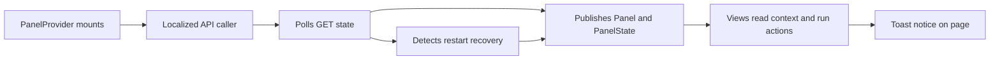

# provider.tsx

This file is the shared runtime layer for the `dsh-superagent` management panel. It publishes two React contexts — one holding panel services (translator, typed API caller, navigation, notifications, restart trigger) and one holding live server state — so any page component can read them without prop drilling. It also owns the panel's polling loop, detects when `dsh-superagent` comes back from a restart, renders the transient toast messages, and offers the `useAction` helper that every mutating control uses.

## Whole-unit functional diagram

The provider is mounted once by the root panel shell; from there it builds a translator-aware caller, polls the server state on a timer, watches the error transition that marks a restart, and republishes everything as context. Views then either read that context or run wrapped actions that push a toast back through `notify`.

## At a glance

- Primary role: Infrastructure — the file supplies the shared context, polling schedule, restart lifecycle and notification service that the rest of the panel is built on, rather than any single screen's behavior.
- Secondary roles: State storage — it retains the last successful server snapshot, its error, and a restart counter for the mounted panel. Presentation — it renders the toast that reports outcomes to the user.
- Confidence: High — the whole file was read together with its callers (`app.tsx`, `draft.tsx`, the views using `useAction`) and its dependencies (`api.ts`, `text.ts`).

## What this file does

- **Shares panel services once.** `PanelProvider` builds a single context object with the translator, the typed `call` function, `navigate`/`back`/`backLabel`, `openSession`, `notify` and `restart`, so no page has to receive them through props.
- **Shares live server state.** A second context exposes `state`, `error`, `reload`, `setup`, `running` (executor sessions in an active turn) and `restarts`, letting any view render loading, error or setup guidance consistently.
- **Keeps the panel fresh.** The provider polls `GET state` on a configurable interval (5 seconds by default) and exposes `reload` for on-demand refresh after a mutation.
- **Notices restarts of `dsh-superagent`.** When a request fails the poll drops to a 1-second cadence, waits for the server to answer again, increments `restarts`, and gives up after 30 seconds — this is what tells settings views to refetch after a restart.
- **Reports outcomes as toasts.** `notify(text)` shows a single floating message and replaces any previous one, which is how saves, refusals and action failures reach the user.
- **Wraps mutating actions safely.** `useAction` adds re-entrancy protection, a `busy` flag, an optional reload after success, and automatic error toasting.

## Runtime support

- Provides: two React contexts plus three reusable hooks (`usePanel`, `usePanelData`, `useAction`) and the toast host.
- Starts or activates: as soon as `PanelProvider` renders under the panel root; polling begins on mount and stops on unmount.
- Used by: the panel shell in 
<a target="_self" href="#src/client/app.tsx:185-187?class=code" style="color: inherit; text-decoration: none;">app.tsx:185-187</a>
, and every page module that calls `usePanel`, `usePanelData` or `useAction` (overview, eval, prompts, settings, thread, ticket, widgets).
- Operational effect: a single polling schedule for the whole panel, a locale-aware error/message pipeline, stylesheet injection for the panel, and restart-aware cache invalidation.

## Key functions or classes

### `PanelProvider({ t, interval, openSession, navigate, back, backLabel, children })`

The one entry point: builds the caller, runs the poll, keeps restart state, and wraps children in both contexts plus the toast host.

    
        <a target="_self" href="#src/client/provider.tsx:74-108?class=code" style="color: inherit; text-decoration: none;">Code: src/client/provider.tsx:74-108</a>
    

### `usePanel()` and `usePanelData()`

Read the service and data contexts respectively; both throw a clear error when a view renders outside the provider, which quickly explains a broken mount.

    
        <a target="_self" href="#src/client/provider.tsx:31-40?class=code" style="color: inherit; text-decoration: none;">Code: src/client/provider.tsx:31-40</a>
    

### `useAction(action, { reload })`

Returns `{ run, busy }`: `run` never starts a second concurrent execution, awaits the action, optionally reloads, and converts a thrown failure into a toast while returning `false`.

    
        <a target="_self" href="#src/client/provider.tsx:42-56?class=code" style="color: inherit; text-decoration: none;">Code: src/client/provider.tsx:42-56</a>
    

### `messages(t)`

Maps the active translator onto the message set the API client needs — offline, host-not-running, server errors, setup problems, and structured user refusals — so every failure surfaces in the user's language.

    
        <a target="_self" href="#src/client/provider.tsx:58-64?class=code" style="color: inherit; text-decoration: none;">Code: src/client/provider.tsx:58-64</a>
    

### `Toast({ text, onDone, holdMs })`

Renders the notice through a portal into `document.body` and clears it after the hold time, so it floats above the panel instead of being clipped by panel layout.

    
        <a target="_self" href="#src/client/provider.tsx:65-71?class=code" style="color: inherit; text-decoration: none;">Code: src/client/provider.tsx:65-71</a>
    

## What the user experiences

- Presents: a single transient notice near the top of the panel reporting the latest result — "Saved", "Saved; dsh-superagent is restarting", a refusal reason, or a raw error message.
- Interaction: the toast needs no user action; it fades out on its own, and a newer message immediately replaces the current one.
- Prepared data: the message text is already localized when `notify` is called, so the toast itself only displays a string; the panel's stylesheet is injected by the same provider, so notice styling is present on first paint.

### Important interaction states

While a restart is in progress the panel keeps polling once per second, so views can briefly show a "not answering / starting again" state before the recovery toast and refreshed data arrive. If the server does not come back within 30 seconds, the provider stops the fast polling and returns to the normal interval.

## Stored state lifecycle

- Stores: the last successful `GET state` snapshot, the current poll error, the restaurant/restart counter, and the currently visible toast — all held in React state for the mounted panel only.
- Read path: every descendant reads them through `usePanelData()`; the provider itself re-reads the snapshot on each poll and hands `reload` to views that need a manual refresh.
- Write path: polls produced by 
<a target="_self" href="#src/client/api.ts:67-98?class=code" style="color: inherit; text-decoration: none;">api.ts:67-98</a>
, explicit `reload()` calls after a mutation, `restart()` when a save triggers a host restart (see 
<a target="_self" href="#src/client/draft.tsx:167?class=code" style="color: inherit; text-decoration: none;">draft.tsx:167</a>
), and `notify()` for messages.
- Visible result: pages stay populated during a failed poll (the last good snapshot is kept), and views that depend on `restarts` refetch once the host recovers.

### Important persistence behavior

Nothing here writes to browser storage; the snapshot lives only as long as the panel is mounted, and a page reload simply starts a fresh poll. Unchanged poll responses are ignored, so views do not re-render every few seconds just because the interval ticked.

## Main inputs and results

- Inputs: the translator `t`; an optional polling `interval` (default 5000 ms); `openSession`, `navigate`, `back` and `backLabel` supplied by the panel shell; children to render; and server responses from the management API.
- Results: context values consumed by all panel pages, a `reload` function, a `restarts` counter used as a refetch key, the derived `setup` and `running` figures, and toast notifications.
- Visible side effects: a floating notice when something is saved or fails, a faster one-second refresh window during a restart, and the panel stylesheet being applied as soon as the provider renders.

---
name: provider.tsx

update-time: 2026-11-02 11:12

description: This file is the shared runtime layer for the `dsh-superagent` management panel. It publishes two React contexts — one holding panel services (translator, typed API caller, navigation, notifications, restart trigger) and one holding live server state — so any page component can read them without prop drilling. It also owns the panel's polling loop, detects when `dsh-superagent` comes back from a restart, renders the transient toast messages, and offers the `useAction` helper that every mutating control uses.

---
