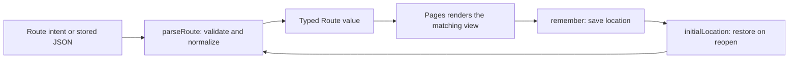

# route.ts

`route.ts` is the small shared vocabulary that lets the panel talk about "where the user is" without passing loose strings around. It defines the set of pages, the typed `Route`/`Location` shapes that every page component and the navigation layer agrees on, and the helpers that build and label those routes. It also owns the only persistence in the panel's navigation: the current route, back stack and last-opened settings group are saved in `sessionStorage` so a page reload returns you to the same view, while damaged or outdated stored values safely fall back to the overview page.

## Whole-unit functional diagram

Every incoming value — a request from the navigation layer or JSON read back from `sessionStorage` — passes through `parseRoute`, which either produces a valid `Route` or rejects it. The panel renders from the validated route, and each location change is written back to session storage so the next visit can restore it.

<!-- {
  "mermaid_info": {
    "name": "Route validation and location memory flow",
    "nodes": [
      {
        "id": "input_001",
        "name": "Route intent or stored JSON",
        "path": "",
        "hint": "A navigation request, a search-result click, or a previously stored location value",
        "isJumpable": false,
        "position": { "startLine": 0, "endLine": 0 },
        "references": []
      },
      {
        "id": "parse_002",
        "name": "parseRoute: validate and normalize",
        "path": "src/client/route.ts",
        "hint": "Accepts only known pages, ids and filters",
        "isJumpable": true,
        "position": { "startLine": 32, "endLine": 47 },
        "references": []
      },
      {
        "id": "route_003",
        "name": "Typed Route value",
        "path": "src/client/route.ts",
        "hint": "The discriminated union describing page, detail id and query",
        "isJumpable": true,
        "position": { "startLine": 11, "endLine": 17 },
        "references": []
      },
      {
        "id": "panel_004",
        "name": "Pages renders the matching view",
        "path": "src/client/app.tsx",
        "hint": "Switches on route.page and passes id and query to the page component",
        "isJumpable": true,
        "position": { "startLine": 141, "endLine": 170 },
        "references": []
      },
      {
        "id": "persist_005",
        "name": "remember: save location",
        "path": "src/client/route.ts",
        "hint": "Writes route, stack and settings group to sessionStorage",
        "isJumpable": true,
        "position": { "startLine": 65, "endLine": 67 },
        "references": []
      },
      {
        "id": "restore_006",
        "name": "initialLocation: restore on reopen",
        "path": "src/client/route.ts",
        "hint": "Reads the stored location once when the panel starts",
        "isJumpable": true,
        "position": { "startLine": 53, "endLine": 64 },
        "references": []
      }
    ]
  }
} -->

    
        <a target="_self" href="#src/client/route.ts:1?class=graph" style="color: inherit; text-decoration: none;">Graph: Route validation and location memory flow</a>
    

## At a glance

- **Primary role**: A shared data contract — this file defines *what a location in the panel is* (pages, detail ids, filters, settings groups) so the navigator and the page components exchange the same well-formed value instead of ad-hoc strings.
- **Secondary roles**: Stored state — it is the only place that reads and writes the panel's remembered location in `sessionStorage`.
- **Confidence**: High — the type definitions, the parser, the storage key and the read/write helpers are all in this 68-line file, and its consumers import exactly these names.

## What this file does

- Declares the panel's page list (`overview`, `source`, `trigger`, `eval`, `execution`, `settings`) and its settings sub-pages, so tabs and deep links cannot drift apart.
- Models each place as a typed `Route`: a list page with an optional filter, or a detail page with a record id — the compiler rejects a filter on the wrong page.
- Rebuilds a trustworthy route from untrusted input, keeping only recognized pages, non-empty ids and known filter/window/group values.
- Provides route builders (`settingsRoute`, `setupPage`) and a localized label helper (`routeLabel`) used by deep links, setup problems and the back button caption.
- Remembers the route, the recent history stack and the last settings group for the browser session, and restores them when the panel is reopened.

## Information contract

- **Represents**: the current place in the panel — which page is shown, whether it is a list or one specific record, and which filter or settings group applies.
- **Produced by**: the navigation layer in 
<a target="_self" href="#src/client/app.tsx:173-188?class=code" style="color: inherit; text-decoration: none;">app.tsx:173-188</a>
, clicks on search results, and deep links created with `settingsRoute` / `setupPage` by other pages.
- **Consumed by**: the page switch in 
<a target="_self" href="#src/client/app.tsx:141-170?class=code" style="color: inherit; text-decoration: none;">app.tsx:141-170</a>
, which reads `route.id` and `route.query` to pick a list view or a detail view, and the panel context that exposes `navigate(route, replace?)` to every component.
- **Behavior-shaping parts**: `page` selects the view; the presence of `id` switches a page from list to single-record mode; `query.filter`, `query.window`, `query.group`, `query.source` and `query.version` narrow what that view loads; `Location.stack` drives back navigation and `Location.group` reopens the settings tab where you left it.

### Compatibility notes

The docstring on `parseRoute` states the intended contract: values saved by older builds still load, and unrecognized query filters or removed tabs (the legacy `policy` tab is named) are simply dropped rather than breaking startup. Two further fallbacks are visible in the code — a missing or unknown settings group becomes `source`, and an empty-string `id` is treated as "no record selected". Storage format is unversioned, so any change to `Route` is expected to remain readable through the same tolerant parser.

## Stored state lifecycle

- **Stores**: one JSON value under the session key `dsh-superagent/route`, holding the current route, the back stack (the navigator trims it to the last 20 entries) and the last opened settings group.
- **Read path**: `initialLocation` runs once, when the panel root initializes its state. It parses the stored JSON, keeps only stack entries that still validate, and returns the home route with an empty stack if nothing usable is found.
- **Write path**: whenever the location changes, the panel root calls `remember` with the new `Location`.
- **Visible result**: reloading the panel in the same browser tab returns you to the same page, the same filter or record, and the same settings group, and the back button still walks the remembered history.

### Important persistence behavior

Route memory is deliberately best-effort: read and write failures are swallowed, so a blocked or full storage area can never prevent the panel from starting — you just begin at the overview page. Because the store is session-scoped, history is not shared across tabs and disappears when the tab closes.

## Key functions or classes

### `parseRoute(value: unknown)`

The single gatekeeper that turns an arbitrary value into a valid `Route` or `undefined`, dropping unknown pages, unknown filter values and empty ids.

    
        <a target="_self" href="#src/client/route.ts:32-47?class=code" style="color: inherit; text-decoration: none;">Code: src/client/route.ts:32-47</a>
    

### `initialLocation(): Location`

Reads the remembered location at startup and falls back to the overview page when storage is empty, unreadable or no longer valid.

    
        <a target="_self" href="#src/client/route.ts:53-64?class=code" style="color: inherit; text-decoration: none;">Code: src/client/route.ts:53-64</a>
    

### `remember(location: Location): void`

Persists the current route, stack and settings group for the session, ignoring storage errors.

    
        <a target="_self" href="#src/client/route.ts:65-67?class=code" style="color: inherit; text-decoration: none;">Code: src/client/route.ts:65-67</a>
    

### `settingsRoute(group, query?)`

Builds a settings route for a given group with optional source/version context, used by settings links and by pages that need to send the operator somewhere fixable.

### `setupPage(place)`

Maps a setup problem location (`deployment`, `github`, `feishu`) onto the settings page where it can be corrected: deployment goes to the deployment group, the others to the source group with the source pre-selected.

### `routeLabel(t, route)`

Produces the localized caption for a route — a thread or ticket term for detail routes, otherwise the tab name — which the navigator uses for the back button.

### `lastSettingsGroup({ route, group })`

Returns the settings group to reopen: the group of the current settings route if you are on it, otherwise the remembered one, otherwise `source`.

## Main inputs and results

- **Inputs**: an untrusted candidate route value (typically parsed `sessionStorage` JSON or an object built by the navigator), a `SettingsGroup`, a `SetupPlace`, the current `Location`, and the filter lists owned by other modules (`THREAD_FILTERS`, `TICKET_FILTERS`, `DECISION_FILTERS`) plus a translator for labels.
- **Results**: a normalized `Route` or `undefined` from `parseRoute`; a `Location` with route, stack and optional settings group from `initialLocation`; a session-storage write from `remember`; and localized route labels from `routeLabel`.
- **Visible side effects**: the panel reopens on the page, filter or record you last viewed, the back button keeps working after a reload, and setup problems can link straight to the settings group that fixes them.

---
name: route.ts

update-time: 2026-11-02 11:17

description: `route.ts` is the small shared vocabulary that lets the panel talk about "where the user is" without passing loose strings around. It defines the set of pages, the typed `Route`/`Location` shapes that every page component and the navigation layer agrees on, and the helpers that build and label those routes. It also owns the only persistence in the panel's navigation: the current route, back stack and last-opened settings group are saved in `sessionStorage` so a page reload returns you to the same view, while damaged or outdated stored values safely fall back to the overview page.

---
