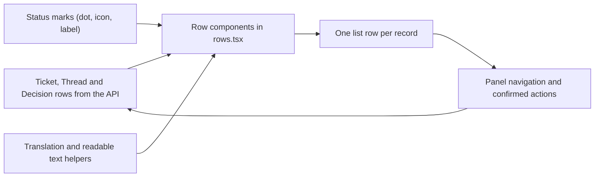

# rows.tsx

`src/client/rows.tsx` is the shared row renderer for the panel's three main list types: Tickets, Threads and Decisions. Each component takes a single typed record fetched from the API and turns it into one consistent list entry — a status marker, a clickable title, a short meta line, and (for Tickets) inline actions. It holds no page layout and no data fetching of its own, so it is the place to look when you want to know what a row in this UI *shows* rather than how a page is assembled. The file also carries two small helpers that fold consecutive automated messages into a single collapsed run.

## How a raw API row becomes a list row

A record arrives from `src/client/api.ts`, the row component maps its stage or outcome to a mark, borrows translated strings and cleaned-up text from `text.ts`, and paints a uniform `<li>` row. Clicking the row title navigates within the panel, and where actions exist (retry, stop), a confirmed action posts back to the API and then asks the page to refresh.

<!-- {
  "mermaid_info": {
    "name": "How rows.tsx turns API rows into list rows",
    "nodes": [
      {
        "id": "api_rows_001",
        "name": "Ticket, Thread and Decision rows from the API",
        "path": "src/client/api.ts",
        "hint": "Row types derived from the API response shapes of GET tickets, GET threads and GET decisions",
        "isJumpable": true,
        "position": { "startLine": 125, "endLine": 130 },
        "references": []
      },
      {
        "id": "row_components_002",
        "name": "Row components in rows.tsx",
        "path": "src/client/rows.tsx",
        "hint": "TicketLine, ThreadLine, DecisionLine and the ThreadChip fact chip",
        "isJumpable": true,
        "position": { "startLine": 10, "endLine": 116 },
        "references": []
      },
      {
        "id": "status_marks_003",
        "name": "Status marks (dot, icon, label)",
        "path": "src/client/marks.ts",
        "hint": "Pure mappers from Ticket stage, Thread stage and Decision outcome to a visual mark",
        "isJumpable": true,
        "position": { "startLine": 9, "endLine": 38 },
        "references": []
      },
      {
        "id": "readable_text_004",
        "name": "Translation and readable text helpers",
        "path": "src/client/text.ts",
        "hint": "Localized labels, actor names, reason text and placeholder cleanup",
        "isJumpable": true,
        "position": { "startLine": 11, "endLine": 43 },
        "references": []
      },
      {
        "id": "rendered_rows_005",
        "name": "One list row per record",
        "path": "",
        "hint": "The visible row a reader sees in a panel list",
        "isJumpable": false,
        "position": { "startLine": 0, "endLine": 0 },
        "references": []
      },
      {
        "id": "panel_actions_006",
        "name": "Panel navigation and confirmed actions",
        "path": "src/client/provider.tsx",
        "hint": "Panel context providing translate, route navigation and typed API calls",
        "isJumpable": true,
        "position": { "startLine": 9, "endLine": 18 },
        "references": []
      }
    ]
  }
} -->

    
        <a target="_self" href="#src/client/rows.tsx:1?class=graph" style="color: inherit; text-decoration: none;">Graph: How rows.tsx turns API rows into list rows</a>
    

## At a glance

- **Primary role — Presentation**: this file decides what one row looks like and which buttons or links appear on it, using already-fetched data.
- **Secondary role — Utility**: `automatedRuns` is a small, generic grouping helper reused by both the Thread timeline and the Ticket input list.
- **Confidence**: High — the full file was read, together with the helpers it calls (`marks.ts`, `text.ts`, `widgets.tsx`, `provider.tsx`) and the pages that render its rows.

## What this file does

- Renders **one Ticket row** with a stage mark, a title that opens the Ticket page, thread fact chips, an undelivered count, a question note or a relative timestamp, and optional Retry / Stop / session / "answer in source" controls.
- Renders **one Thread row** with the thread's stage mark, its latest message preview, the Ticket it currently fans out to (or its polling error), and a timestamp.
- Renders **one Decision row** with the outcome mark, the message preview, the human-readable reason, the matched rule names, and a title that jumps to the Ticket or to the triggering Thread.
- Renders a compact **source fact chip** (`ThreadChip`) summarising which source a thread came from and its key facts, linking out to the original item when a URL exists.
- Provides **run folding**: `automatedRuns` groups consecutive messages from the same automated sender, and `Earlier` renders the collapsed "earlier" ones behind an expand/collapse toggle.
- Marks rows that are only **context** (a quiet "context only" tag) so readers can tell subscribed targets from merely related ones.

## What the user experiences

- **Presents**: a single, uniform row shape for every list in the panel — the same left-hand status marker, bold openable title, quoted preview line and small grey meta line, whether the record is a Ticket, a Thread or a Decision.
- **Interaction**: clicking the title navigates (`execution` for Tickets and Decisions with a ticket, `trigger` for Threads and Decisions without one); Retry and Stop open a confirmation dialog, then post to the API and trigger the page's reload callback; the session button opens an Executor session; the source chip opens the external item in a new tab; "earlier" expands the folded automated messages.
- **Prepared data**: a fully typed row object from `src/client/api.ts` in hand, the panel context (translation function, `call`, `navigate`) available, and — for actions to appear at all — a `onChanged` reload callback passed by the page.

### Important interaction states

- `question` marks a row as one waiting on a human: the row gets a `data-state` attribute and the Ticket note is shown (cleaned of image/card/media placeholders) instead of the timestamp. The "answer in source" link appears only when the Ticket is at the `person` stage with an `answer` action and a reply URL.
- Passing `context` adds the quiet "context only" tag — used when a Thread or Ticket is shown only because it is related, not because it is an active target.
- When a Thread has a polling error, the error text replaces the fan-out label in the meta line; otherwise the first live Ticket title is shown, followed by a "+N more" style count when several Tickets would receive the message.
- The Ticket actions container is always rendered, even when empty, so every Ticket row keeps the same three-line height in dense lists.
- `Earlier` renders nothing at all when there is nothing folded, so a run of one automated message costs no extra control.

## Key functions or classes

### `TicketLine`

The most configurable row: it composes the stage mark, the navigable title, thread chips, optional question note, and the confirmable Retry/Stop actions.

    
        <a target="_self" href="#src/client/rows.tsx:10-44?class=code" style="color: inherit; text-decoration: none;">Code: src/client/rows.tsx:10-44</a>
    

### `ThreadLine`

Renders a Thread row, filtering out the Ticket currently being viewed when computing which Tickets the thread still reaches.

### `DecisionLine`

Renders a Decision row, including the reason text and matched rule names, and picks its navigation target from whichever of Ticket or Thread the decision belongs to.

### `ThreadChip`

Renders the source-and-facts chip, as a link with an external icon when the thread has a URL and as a plain chip otherwise.

### `automatedRuns`

A generic helper that collapses consecutive items from the same automated sender into a newest-item-plus-earlier-items run.

    
        <a target="_self" href="#src/client/rows.tsx:118-128?class=code" style="color: inherit; text-decoration: none;">Code: src/client/rows.tsx:118-128</a>
    

### `Earlier`

Renders the "N earlier automated messages" toggle and, once expanded, a plain list of timestamps and cleaned previews.

## Reusable capability

- **Solves**: a Thread or Ticket whose timeline is dominated by repeated machine messages, by showing only the newest message of each consecutive automated run.
- **Input**: an array of already-ordered items plus a `sender` function that returns a sender identifier, or `undefined` for items that must never be folded.
- **Result**: an array of runs, each holding the item to show and the older items that belong behind the "earlier" toggle.
- **Main usage area**: the Thread timeline (newest-first, so it reverses before grouping) and the Ticket input list, both of which then pass the folded items to `Earlier`.

### Important usage constraint

Grouping is strictly local and order-preserving: only *adjacent* items with an identical sender identifier are merged, and the helper does not sort anything. Callers must therefore hand over items in the exact display order, and must return `undefined` from `sender` for human or interactive items so they always stay visible as separate entries.

## Main inputs and results

- **Inputs**: one typed row (`TicketRow`, `ThreadRow`, `DecisionRow`, or a slice of `ThreadFacts` for the chip) per component; optional flags `question` and `context`; an optional `onChanged` reload callback for Ticket actions; and the panel context supplying `t` (translation), `call` (typed API calls) and `navigate`.
- **Results**: rendered `<li>` list rows with translated stage labels, cleaned message previews and localized timestamps — the same markup the panel's Ticket, Thread, Decision, overview and evaluation pages display.
- **Visible side effects**: in-panel navigation when a title is clicked, a confirmation dialog before Retry or Stop takes effect, a `POST tickets/:id/retry` or `POST tickets/:id/stop` request followed by the page's reload, opening an Executor session, external links opening in a new tab, and the expand/collapse of folded automated messages.

---
name: rows.tsx

update-time: 2026-11-02 11:03

description: `src/client/rows.tsx` is the shared row renderer for the panel's three main list types: Tickets, Threads and Decisions. Each component takes a single typed record fetched from the API and turns it into one consistent list entry — a status marker, a clickable title, a short meta line, and (for Tickets) inline actions. It holds no page layout and no data fetching of its own, so it is the place to look when you want to know what a row in this UI *shows* rather than how a page is assembled. The file also carries two small helpers that fold consecutive automated messages into a single collapsed run.

---
