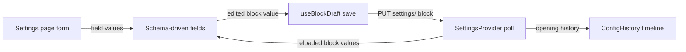

# settings-kit.tsx

`settings-kit.tsx` is the shared building kit behind every settings screen in the web panel. It supplies the settings context that loads the current configuration, a hook that turns edited form values into a saved settings block, and a set of field renderers that draw a form from a `FieldSpec` schema instead of hand-written markup. The three stage settings pages (Sources, Eval, Execution) all import from here, so one change to these controls affects all of them at once.

## Whole-unit functional diagram

A settings page wraps its blocks in `SettingsProvider`, which polls the current configuration. Each block renders its fields, and edits flow into `useBlockDraft`, which saves the block with the revision it was based on; the poll then brings back fresh values, and the same data feeds the configuration history timeline.

## At a glance

- Primary role: Presentation — it renders the settings forms people actually edit, including labels, hints, inline tips, disclosures and read-only facts.
- Secondary roles: API boundary — it publishes the components and hooks that the settings pages are written against. State storage — it owns the settings context and the draft key lifecycle used to persist unsaved edits.
- Confidence: High — the whole file was read, together with its draft/provider dependencies and all five consuming pages.

## What this file does

- **Loads settings once per settings screen.** `SettingsProvider` fetches the configuration, keeps it in React context, and shows a loading or error state so child blocks can assume data exists.
- **Turns edits into saved blocks.** `useBlockDraft` wraps the shared draft machinery with the right request and success message, so a page only has to describe how to save one block.
- **Renders a schema as a form.** `SourceField` maps each `FieldSpec` variant (`switch`, `select`, `number`, `text`, `fact`, `rows`) to the matching control, including localized labels and hint tooltips.
- **Edits record lists.** `RowsField` handles repeatable rows such as allowed senders or chat mappings: add, remove, choose from known labels, refresh those labels, and collapse long lists behind a summary.
- **Shows what changed over time.** `ConfigHistory` renders a collapsible revision timeline for the current block, with human-readable descriptions of each change.
- **Keeps keyboard users in place.** `Fields` disables the whole fieldset while a save runs and restores focus to the previously active input afterwards.

## Key functions or classes

### `SettingsProvider`

Loads the settings view through polling, keeps it in `SettingsContext`, and renders a load state until it arrives.

    
        <a target="_self" href="#src/client/settings-kit.tsx:23-32?class=code" style="color: inherit; text-decoration: none;">Code: src/client/settings-kit.tsx:23-32</a>
    

### `useSettings`

Reads the settings context and throws a clear error if a settings block is rendered outside the provider.

### `useBlockDraft`

Gives a specific block its draft state: current value, dirty/busy flags, submit and discard, a per-block session key, and the save request that reports whether a restart is needed.

    
        <a target="_self" href="#src/client/settings-kit.tsx:33-42?class=code" style="color: inherit; text-decoration: none;">Code: src/client/settings-kit.tsx:33-42</a>
    

### `Field`

Renders one labelled control, generating the input ID, attaching an optional hint tooltip and a note, and injecting the ID into the child control.

    
        <a target="_self" href="#src/client/settings-kit.tsx:56-63?class=code" style="color: inherit; text-decoration: none;">Code: src/client/settings-kit.tsx:56-63</a>
    

### `ModelField`

Edits the provider / model / reasoning-effort triple, offering the known model catalog as autocomplete suggestions, showing the current default model, and emitting `null` when every part is blank so the default is inherited.

    
        <a target="_self" href="#src/client/settings-kit.tsx:72-104?class=code" style="color: inherit; text-decoration: none;">Code: src/client/settings-kit.tsx:72-104</a>
    

### `SourceField`

The schema dispatcher: one function decides which control represents a field specification, and also receives the read-only "fact" values to display in place of an editor.

    
        <a target="_self" href="#src/client/settings-kit.tsx:240-278?class=code" style="color: inherit; text-decoration: none;">Code: src/client/settings-kit.tsx:240-278</a>
    

### `RowsField`

Edits a list of records keyed by the first column, keeping already-saved keys read-only, hiding options already used by another row, offering a label-refresh action, and collapsing lists longer than six rows.

    
        <a target="_self" href="#src/client/settings-kit.tsx:167-239?class=code" style="color: inherit; text-decoration: none;">Code: src/client/settings-kit.tsx:167-239</a>
    

### `ConfigHistory`

Shows a collapsible revision timeline for a set of blocks, optionally including every policy-changing save and highlighting the save that produced a given policy version.

    
        <a target="_self" href="#src/client/settings-kit.tsx:123-161?class=code" style="color: inherit; text-decoration: none;">Code: src/client/settings-kit.tsx:123-161</a>
    

## Main inputs and results

- Inputs: the saved block value and its revision (`useBlockDraft`), a `FieldSpec` plus the current and saved values and resolved `labels` (`SourceField`), an optional `refreshLabels` callback, the block names to show in history, and the numeric text typed into number inputs (parsed by `numberOf`).
- Results: `onChange` calls carrying the next value in the shape the block expects, a save request that returns the new revision and whether a restart is pending, and a rendered timeline of revisions, changed fields, policy versions and notified tickets.
- Visible side effects: a toast after a save (plain save or restarting), a fieldset that disables while saving and restores the previous focus, a read-only "fact" that hides unsaved derived values, and draft values restored after a page reload.

## What the user experiences

- Presents: labelled settings controls with tooltips and notes, a model picker with autocomplete, read-only computed facts with a link to the owning settings page, record editors with add/remove actions, and a collapsible configuration history timeline.
- Interaction: typing, toggling or selecting a value marks the block dirty and enables the save bar; saving sends the block with its base revision; refreshing labels updates the available choices; expanding history loads revisions on demand; expanding a long record list reveals the remaining rows.
- Prepared data: the settings view must have loaded, the field specification must declare each column's type, and label maps must be resolved before choices can be shown by name.

### Important interaction states

- While a save is in flight the fieldset is disabled, so controls cannot change underneath the request.
- A `number` field keeps an empty string when cleared rather than turning into `0`, letting the server report a missing required value.
- A `text` field that chooses from labels still shows a stale current value as an extra option, so an unknown saved value is never silently replaced.
- History states distinguish "no baseline recorded", "no changes", and "no entries for these blocks", so an empty timeline explains itself.

## Public contract

- Caller: the Sources, Eval, Execution and Deployment settings pages.
- Operation: mount a settings screen, edit one configuration block at a time, and optionally show that block's revision history.
- Accepted input: block names (`policy`, `eval`, `source:<id>`) and their saved values with revisions; field specifications with localized labels, hints and options; the block list for history, an optional `versions` flag and an optional policy version to focus.
- Result: controlled components that report edits through `onChange`, a draft object consumed directly by the save bar, and rendered history entries or a load/error state when data is unavailable.

## Stored state lifecycle

- Stores: the polled settings view inside `SettingsContext` for the duration of one settings screen, plus unsaved edits written to browser session storage under a key built from the current master ID and block name.
- Read path: the provider loads settings on mount and refreshes when the server reports a restart; a block's draft key is read on first render so pending edits reappear.
- Write path: every control change is collected in the block draft, and saving submits the value with the revision the draft was based on.
- Visible result: unsaved edits survive a reload or tab switch, concurrent remote changes are merged or reported as a conflict rather than silently overwritten, and a restarting save notifies the user instead of leaving the form disabled.

---
name: settings-kit.tsx

update-time: 2026-11-02 10:59

description: `settings-kit.tsx` is the shared building kit behind every settings screen in the web panel. It supplies the settings context that loads the current configuration, a hook that turns edited form values into a saved settings block, and a set of field renderers that draw a form from a `FieldSpec` schema instead of hand-written markup. The three stage settings pages (Sources, Eval, Execution) all import from here, so one change to these controls affects all of them at once.

---
