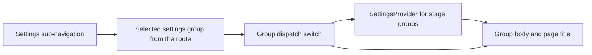

# settings.tsx

This file is the small "shell" behind the panel's Settings tab: it draws the left-hand list of settings groups, shows the current group's title, and decides which settings screen to render below it. Everything else about settings — the actual forms, saving, history — lives in the screens it mounts (Sources, Eval, Execution, Prompts, Deployment). Read this file when you need to know how a settings group is chosen, which props each group receives, or where to add a new settings sub-page.

## Whole-unit functional diagram

The selected group arrives from the parsed route, the sub-navigation buttons request a different group, and the dispatch switch decides which screen is rendered. Stage groups (Sources, Eval, Execution) are wrapped in a shared settings data provider before their body is shown under the group title.

<!-- {
  "mermaid_info": {
    "name": "Settings tab shell flow",
    "nodes": [
      {
        "id": "group_001",
        "name": "Selected settings group from the route",
        "path": "src/client/app.tsx",
        "hint": "The Settings tab passes the group taken from the parsed route",
        "isJumpable": true,
        "position": { "startLine": 157, "endLine": 158 },
        "references": []
      },
      {
        "id": "dispatch_002",
        "name": "Group dispatch switch",
        "path": "src/client/settings.tsx",
        "hint": "Chooses the settings screen for the requested group",
        "isJumpable": true,
        "position": { "startLine": 17, "endLine": 25 },
        "references": []
      },
      {
        "id": "nav_003",
        "name": "Settings sub-navigation",
        "path": "src/client/settings.tsx",
        "hint": "Buttons for every settings group that navigate to that group",
        "isJumpable": true,
        "position": { "startLine": 26, "endLine": 32 },
        "references": []
      },
      {
        "id": "provider_004",
        "name": "SettingsProvider for stage groups",
        "path": "src/client/settings-kit.tsx",
        "hint": "Loads the shared settings snapshot used by the stage screens",
        "isJumpable": true,
        "position": { "startLine": 23, "endLine": 32 },
        "references": []
      },
      {
        "id": "body_005",
        "name": "Group body and page title",
        "path": "src/client/settings.tsx",
        "hint": "The rendered heading and content area of the active group",
        "isJumpable": true,
        "position": { "startLine": 33, "endLine": 36 },
        "references": []
      }
    ]
  }
} -->

    
        <a target="_self" href="#src/client/settings.tsx:1?class=graph" style="color: inherit; text-decoration: none;">Graph: Settings tab shell flow</a>
    

## At a glance

- **Primary role**: Presentation — the file is responsible for what a person sees on the Settings tab: the group list, the active group highlight, the group heading, and the body area that hosts the chosen screen.
- **Secondary roles**: Orchestration — it also coordinates which settings screen is mounted, which extra hints each screen receives, and which screens need the shared settings data provider.
- **Confidence**: High — the complete 39-line file was read together with its route definitions, the mounting code in the panel app, the shared settings provider, and the stylesheet rules for the settings layout.

## What this file does

- **Draws the settings sub-navigation.** It lists every group from `SETTINGS_GROUPS` in `route.ts` (source, eval, execution, prompts, deployment) as buttons with translated labels, and marks the active one with `aria-current="page"`.
- **Titles the active group.** A single heading above the body shows the translated name of the current group, so the page always says what you are editing.
- **Picks the screen for each group.** A `switch` on the group maps each value to its screen component:

  | Group | Screen rendered | Extra values passed |
  | --- | --- | --- |
  | `source` | `SourceSettings` | `focus` when a source id is in the query |
  | `eval` | `EvalSettings` | `version` when a version id is in the query |
  | `execution` | `ExecutionSettings` | none |
  | `prompts` | `PromptsPage` | none |
  | `deployment` | `DeploymentPage` | panel setup state and the deployment form |

- **Supplies deep-link hints.** The `source` and `version` query values are optional: they are only forwarded when present, so opening a settings link from elsewhere in the panel can jump straight to one source card or one policy version without changing the normal view.
- **Provides shared settings data to stage screens.** Sources, Eval and Execution read the same settings snapshot, so they are wrapped in `SettingsProvider`; Prompts and Deployment fetch or receive their own data.
- **Keeps the two-part layout.** Group buttons that belong to a stage get a `data-stage` marker that the stylesheet uses to separate them visually from Prompts and Deployment.

## Key functions or classes

### `SettingsPage`

The single export of the file: it takes the requested group, the route query, the current panel state and the deployment form, then renders the sub-navigation, the group heading, and the matching settings screen.

    
        <a target="_self" href="#src/client/settings.tsx:13-38?class=code" style="color: inherit; text-decoration: none;">Code: src/client/settings.tsx:13-38</a>
    

## Main inputs and results

- **Inputs**: the group to show (a `SettingsGroup`), the route query (`source` and `version`, both optional), the panel state object (used for the deployment setup view), the deployment form handle, and the panel context that supplies translations and the `navigate` function.
- **Results**: the rendered settings panel — a navigation column, a group heading, and the body of the selected group.
- **Visible side effects**: clicking a group button switches the visible group *in place*, because it navigates with replacement rather than pushing a new history entry; the panel also remembers the last opened group so the Settings tab reopens there.

## What the user experiences

- **Presents**: a narrow column listing the five settings groups, the current group's name as a page heading, and that group's settings screen filling the rest of the page.
- **Interaction**: clicking a group name switches to that group immediately; the clicked item becomes the highlighted current item, and no extra back-step is added to the panel's history. On narrow screens the column becomes a wrapping row of buttons above the content.
- **Prepared data**: the parent only mounts this page once panel state is available, and the three stage groups show a loading state until their shared settings snapshot arrives. Deployment additionally relies on the host's configuration form; when that form is unavailable or read-only, its screen falls back to read-only values.

### Important interaction states

- The group value is always valid when this component renders: `parseRoute` in `route.ts` normalizes unknown settings groups to `source`, which is why the dispatch switch needs no fallback branch.
- Only Sources, Eval and Execution pay the cost of loading the shared settings snapshot; Prompts and Deployment load their own data, so they appear even while other settings are still being fetched.

## Coordinated flow

1. The panel app resolves the route, waits for panel state, and mounts `SettingsPage` with the group from the route, the deployment form, and a key derived from the master id so a different master remounts the whole settings page.
2. `SettingsPage` reads translated labels and the `navigate` function from the panel context, then selects the screen for the requested group.
3. For the three stage groups it wraps the screen in `SettingsProvider`, which fetches the shared settings snapshot and renders the group's blocks plus their revision history; the query hints become the `focus`/`version` arguments.
4. The chosen screen owns everything after that point — its forms, save bars, and error messages — while this file renders the navigation, the heading, and the layout around it.
5. Clicking a group button hands a new `settingsRoute(group)` to the panel router with replacement enabled, which re-renders the page with the new group and updates the highlighted button.

### Important branching or concurrency

There is no asynchronous work in this file itself: the only branch is the group switch, and the loading behavior a reader sees comes from the wrapped screens. Because navigation replaces the current route, moving between settings groups keeps the panel's back stack unchanged and lets other views link into a specific group with `settingsRoute`.

---
name: settings.tsx

update-time: 2026-11-02 10:58

description: This file is the small "shell" behind the panel's Settings tab: it draws the left-hand list of settings groups, shows the current group's title, and decides which settings screen to render below it. Everything else about settings — the actual forms, saving, history — lives in the screens it mounts (Sources, Eval, Execution, Prompts, Deployment). Read this file when you need to know how a settings group is chosen, which props each group receives, or where to add a new settings sub-page.

---
