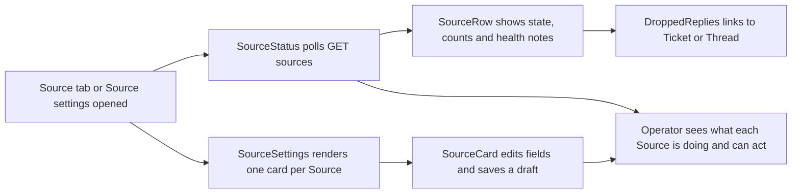

# source.tsx

This file is the panel's "Source" surface: it renders the **Source status page** that tells an operator whether each connected Source is healthy, and the **Source settings cards** used to configure, enable, and save each Source. It is a presentation module — it decides what a person sees and which actions they can take — while the polling, draft saving, and API calls are delegated to sibling modules such as `provider.tsx`, `settings-kit.tsx`, and `draft.tsx`. If you are new to the project and want to know why a Source is quiet, which messages it filtered or dropped, or where to change its configuration, this is the file that draws those answers.

## Whole-unit functional diagram

The left branch is read-only monitoring: a polled status list, one row per Source, each row optionally opening a list of dropped replies. The middle branch is configuration: one editable card per Source that produces a draft the user can save or discard. Both branches converge on the same reader goal — understanding and fixing Source behavior from the panel.

<!-- {
  "mermaid_info": {
    "name": "Source status and settings rendering flow",
    "nodes": [
      {
        "id": "trigger_001",
        "name": "Source tab or Source settings opened",
        "path": "",
        "hint": "The operator switches to the Source tab or to the Source group in settings",
        "isJumpable": false,
        "position": { "startLine": 0, "endLine": 0 },
        "references": []
      },
      {
        "id": "status_002",
        "name": "SourceStatus polls GET sources",
        "path": "src/client/source.tsx",
        "hint": "Page component that polls the status endpoint and renders the source list",
        "isJumpable": true,
        "position": { "startLine": 141, "endLine": 156 },
        "references": []
      },
      {
        "id": "row_003",
        "name": "SourceRow shows state, counts and health notes",
        "path": "src/client/source.tsx",
        "hint": "One status row with state dot, 24-hour counters, and error or paused notes",
        "isJumpable": true,
        "position": { "startLine": 95, "endLine": 139 },
        "references": []
      },
      {
        "id": "dropped_004",
        "name": "DroppedReplies links to Ticket or Thread",
        "path": "src/client/source.tsx",
        "hint": "Collapsible list of dropped replies with navigation to the related Ticket or Thread",
        "isJumpable": true,
        "position": { "startLine": 70, "endLine": 94 },
        "references": []
      },
      {
        "id": "settings_005",
        "name": "SourceSettings renders one card per Source",
        "path": "src/client/source.tsx",
        "hint": "Settings page that maps each Source from the settings payload to a card",
        "isJumpable": true,
        "position": { "startLine": 61, "endLine": 68 },
        "references": []
      },
      {
        "id": "card_006",
        "name": "SourceCard edits fields and saves a draft",
        "path": "src/client/source.tsx",
        "hint": "Editable form card with enable switch, schema fields, and save bar",
        "isJumpable": true,
        "position": { "startLine": 14, "endLine": 59 },
        "references": []
      },
      {
        "id": "result_007",
        "name": "Operator sees what each Source is doing and can act",
        "path": "",
        "hint": "The combined outcome of monitoring and configuration",
        "isJumpable": false,
        "position": { "startLine": 0, "endLine": 0 },
        "references": []
      }
    ]
  }
} -->

    
        <a target="_self" href="#src/client/source.tsx:1?class=graph" style="color: inherit; text-decoration: none;">Graph: Source status and settings rendering flow</a>
    

## At a glance

- **Primary role**: Presentation — the file turns already-fetched Source data into two human-facing surfaces: a health status list and a set of configuration cards.
- **Confidence**: High — both exported components are React views whose complete output is markup plus user-triggered callbacks, and all data loading and persistence happen in imported hooks.

## What this file does

- **Shows the health of every Source at a glance.** Each row presents a state dot and label, how many triggers arrived and were filtered in the last 24 hours, and when the latest one arrived.
- **Explains why a Source is not working.** Setup problems are rendered inline with a "check setup" action; per-part health notes are shown only when they indicate an error or pause, so healthy parts stay quiet.
- **Lists filtered and dropped messages.** Two collapsible disclosures reveal recently filtered triggers (with reason and time) and dropped replies (with a link to the related Ticket, falling back to the Thread).
- **Edits Source configuration in place.** One card per Source renders schema-driven fields, an enable switch, and an "Advanced" disclosure for advanced fields, then saves through a draft with save/discard controls.
- **Warns before a disruptive save.** If a modified field is setup-sensitive and Assignments are currently running, the save bar says how many running Assignments the restart would interrupt.
- **Hands off navigation.** Links route the reader to the offending Source's settings or to the global setup page, depending on where the problem was reported.

## Key functions or classes

### `SourceStatus`

Page-level component for the Source tab: polls `GET sources`, shows a deployment-wide setup problem at the top, and renders one `SourceRow` per Source.

    
        <a target="_self" href="#src/client/source.tsx:141-156?class=code" style="color: inherit; text-decoration: none;">Code: src/client/source.tsx:141-156</a>
    

### `SourceRow`

Renders a single Source's status line: state mark, counters, setup error with an "open settings" link, filtered/error health notes, and the filtered-triggers and dropped-replies disclosures.

    
        <a target="_self" href="#src/client/source.tsx:95-139?class=code" style="color: inherit; text-decoration: none;">Code: src/client/source.tsx:95-139</a>
    

### `DroppedReplies`

Collapsible list of replies the host dropped in the last 24 hours, each showing a marker-readable preview, a reason tag, a timestamp, and a navigation link to its Ticket or Thread.

    
        <a target="_self" href="#src/client/source.tsx:70-94?class=code" style="color: inherit; text-decoration: none;">Code: src/client/source.tsx:70-94</a>
    

### `SourceSettings`

Settings-page component that renders a card for every Source from the loaded settings payload, appends the Source configuration history, and scrolls to the card named by the `focus` query parameter.

    
        <a target="_self" href="#src/client/source.tsx:61-68?class=code" style="color: inherit; text-decoration: none;">Code: src/client/source.tsx:61-68</a>
    

### `SourceCard`

Editable form for one Source: title and description tooltip, installed/not-installed badge, enable switch, schema fields (advanced ones behind a disclosure), a label-refresh action, setup problem messaging, and a save bar bound to its draft.

    
        <a target="_self" href="#src/client/source.tsx:14-59?class=code" style="color: inherit; text-decoration: none;">Code: src/client/source.tsx:14-59</a>
    

## Main inputs and results

- **Inputs**: the polled `GET sources` status rows; the per-Source entries of `GET settings` (title, description, installed flag, current value, revision, restart-sensitive field names, field specs, derived facts, label catalog); global panel data such as the current setup problem and running Assignment count; and an optional `focus` Source id from the route query.
- **Results**: a status list and a settings form rendered as markup, plus user-initiated actions — a settings draft submitted as `PUT settings/:block`, a label refresh issued as `POST sources/:id/labels` followed by a settings reload, and in-panel navigation to a Source's settings, the deployment setup page, a Ticket, or a Thread.
- **Visible side effects**: a save bar appears only while a card is dirty, busy, or reporting an error; a running-restart warning is shown before a disruptive save; a toast confirms that labels were added or were already current; and in the settings group the page scrolls to the Source named in the URL.

## What the user experiences

- **Presents**: two screens. The Source tab lists every Source with a colored state mark (ready, starting, paused, error, off, missing), 24-hour received/filtered counts, and the latest arrival time. The settings Source group shows one card per Source with its name, an optional description tooltip, an enable switch, and the fields the Source declares.
- **Interaction**: toggling the enable switch or editing any field marks the card dirty and reveals a save bar with save and discard; expanding "Advanced" reveals advanced fields; clicking a filtered or dropped summary opens the corresponding list, where entries can be clicked to navigate to the related item; setup errors offer a "check setup" or "open settings" action instead of leaving the reader stuck.
- **Prepared data**: the settings group only renders after the settings payload loads (a loading or error line is shown first), and the status list only renders after the first successful `GET sources` poll. Localization, field rendering, draft handling, and state marks all come from shared modules, so this file assumes those are available.

### Important interaction states

- **Source not installed**: the card hides its fields and switch, shows a warning badge, and explains that the Source is unavailable — configuration cannot be edited until it exists.
- **Setup problem**: a deployment-wide problem appears once at the top of the status page with a link to the deployment setup page, while a Source-specific problem appears on that Source's own row with a link to its settings. When either problem is already explaining the outage, per-part health notes and derived facts are suppressed to avoid repeating the same cause.
- **Unsaved edits**: derived facts for a field are hidden while that field has unsaved changes, so a stale computed value is never read as the effect of an edit that has not been saved yet.
- **Disruptive save**: if the Source declares restart-sensitive fields and any of them changed while Assignments are running, the save bar states how many running Assignments would be interrupted.
- **Focused navigation**: arriving from a status row's "open settings" link carries the Source id, and the matching card is scrolled into view.
- **Empty disclosures**: filtered and dropped sections are only rendered when they actually have entries, so a healthy Source shows a short, quiet row.

---
name: source.tsx

update-time: 2026-11-02 11:04

description: This file is the panel's "Source" surface: it renders the **Source status page** that tells an operator whether each connected Source is healthy, and the **Source settings cards** used to configure, enable, and save each Source. It is a presentation module — it decides what a person sees and which actions they can take — while the polling, draft saving, and API calls are delegated to sibling modules such as `provider.tsx`, `settings-kit.tsx`, and `draft.tsx`. If you are new to the project and want to know why a Source is quiet, which messages it filtered or dropped, or where to change its configuration, this is the file that draws those answers.

---
