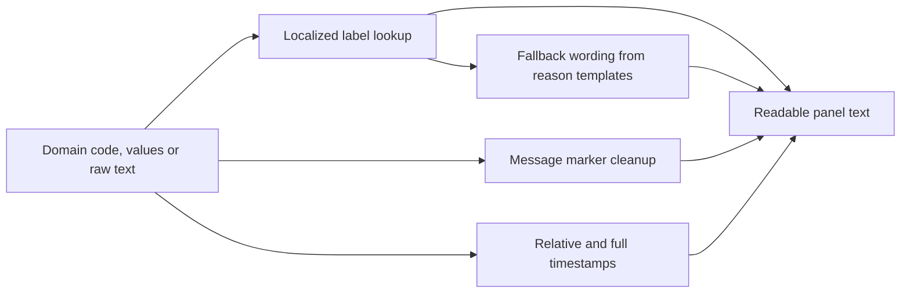

# text.ts

`src/client/text.ts` is the small translation-and-formatting layer that every screen of the dsh-superagent panel talks through. Domain code speaks in stable machine values — `accept`, `policyChanged`, a setup code, an ISO timestamp — and this file turns them into the Chinese or English sentence a person actually reads. It owns no rendering and keeps no state: each helper takes the panel's translate function plus a raw value and returns a finished string, which is why it is imported by almost every other file in `src/client`.

## Whole-unit functional diagram

The main path is a dictionary lookup: a code or a `{ zh, en }` pair arrives together with the panel's `t` function, the matching entry of the panel dictionary is returned, and anything the dictionary does not cover is worded by the core reason templates instead. Two side paths reuse the same inputs — channel message text gets its placeholders replaced, and timestamps get a relative or absolute wording.

<!-- {
  "mermaid_info": {
    "name": "Localization and display formatting flow",
    "nodes": [
      {
        "id": "trigger_001",
        "name": "Domain code, values or raw text",
        "path": "",
        "hint": "Structured values such as decision outcomes, reason codes, setup and health codes, message text and ISO timestamps",
        "isJumpable": false,
        "position": { "startLine": 0, "endLine": 0 },
        "references": []
      },
      {
        "id": "label_002",
        "name": "Localized label lookup",
        "path": "src/client/text.ts",
        "hint": "valueLabel, reasonLabel, setupText and healthText resolve dictionary keys and fill placeholder values",
        "isJumpable": true,
        "position": { "startLine": 15, "endLine": 36 },
        "references": []
      },
      {
        "id": "fallback_003",
        "name": "Fallback wording from reason templates",
        "path": "src/core/reasons.ts",
        "hint": "reasonText renders an English sentence when no dictionary key matches a reason code",
        "isJumpable": true,
        "position": { "startLine": 32, "endLine": 38 },
        "references": []
      },
      {
        "id": "marker_004",
        "name": "Message marker cleanup",
        "path": "src/client/text.ts",
        "hint": "readableMarkers replaces image, card, media, forward and mention placeholders with localized labels",
        "isJumpable": true,
        "position": { "startLine": 38, "endLine": 43 },
        "references": []
      },
      {
        "id": "time_005",
        "name": "Relative and full timestamps",
        "path": "src/client/text.ts",
        "hint": "when and fullTime turn stored timestamps into language-aware time strings",
        "isJumpable": true,
        "position": { "startLine": 44, "endLine": 63 },
        "references": []
      },
      {
        "id": "result_006",
        "name": "Readable panel text",
        "path": "",
        "hint": "Finished strings handed to the React views of the panel",
        "isJumpable": false,
        "position": { "startLine": 0, "endLine": 0 },
        "references": []
      }
    ]
  }
} -->

    
        <a target="_self" href="#src/client/text.ts:1?class=graph" style="color: inherit; text-decoration: none;">Graph: Localization and display formatting flow</a>
    

## At a glance

- **Primary role — presentation**: the file decides how stored values look to a person: which dictionary entry a code maps to, which language wins, and how a long or unparsable value is shown.
- **Confidence**: High — the whole 64-line file was read, together with its dictionary (`src/client/locales.ts`), the core reason templates, the setup and health code tables, and eighteen call sites across the panel.

## What this file does

- **Picks the interface language**: a `Localized` value carries both `zh` and `en`; these helpers read the current language from the dictionary entry `lang` and return the matching half, so views never branch on language themselves.
- **Turns codes into sentences**: decision outcomes, report states, setup problems and health codes are dictionary keys such as `decision.accept` or `setup.gitTooOld`, and the helpers fill their placeholder values (`{ticket}`, `{count}`, `{error}`).
- **Explains why something happened**: `reasonLabel` renders one or many structured reasons in the active language, tolerates plain strings, joins several reasons into one phrase, and shortens multi-line host errors to their first line so a card does not grow a stack trace.
- **Cleans channel noise out of message text**: `readableMarkers` replaces placeholders that Feishu and GitHub put in message bodies — images, chat cards, media, merged forwards and unresolved `@_user_N` mentions — with short localized labels.
- **Makes timestamps human**: `when` shows "just now", minutes or hours for anything within a day, and a short date-time otherwise; `fullTime` renders the exact time used as a tooltip.
- **Never throws at a view**: failures become text (`errorText`), empty inputs become empty strings, and a value that cannot be interpreted is passed through rather than replaced with a guess.

## What the user experiences

- **Presents**: every label, tag, timestamp, filtered-trigger reason and error sentence that appears on the panel's overview, source, trigger, eval, execution and ticket pages.
- **Interaction**: there is no direct interaction here — these are pure conversions. What a person can do changes only indirectly, for example through wording that explains why a Trigger was filtered or which settings page fixes a setup problem.
- **Prepared data**: the panel's `t` translate function (typed as `T` below) and the raw domain value. Nothing is fetched or cached, so a language switch or a new render is immediately reflected.
- **Language source of truth**: the `lang` entry of the dictionary returns `'zh'` or `'en'`, and the timestamp helpers map that to the `zh-CN` or `en` locale for date formatting.

## Key functions or classes

### `T`

A short alias for `Translate<DshSuperagentKey>`: the panel's own translate function, narrowed to the keys the superagent dictionary actually defines, and reused as the first parameter of nearly every helper.

<a target="_self" href="#src/client/text.ts:9?class=code" style="color: inherit; text-decoration: none;">text.ts:9</a>

### `localized`

Chooses the Chinese or English half of a `Localized` value, and passes plain strings straight through, so callers can accept either shape.

### `valueLabel`

Resolves a `group.key` label (for example `outcome.merged`) and falls back to the bare key when the dictionary has no such entry — visible as a raw code rather than a blank cell, which makes missing translations obvious.

### `reasonLabel`

Formats one reason, a list of reasons, or a raw string into a single localized phrase; unlocalized codes reuse the English reason templates from the core module, and long `…Error` output is cut to its first line and capped for display.

<a target="_self" href="#src/client/text.ts:22-33?class=code" style="color: inherit; text-decoration: none;">text.ts:22-33</a>

### `setupText` and `healthText`

Localize a startup/configuration problem or a Source health entry; `healthText` falls back to the host's own English `detail` when no code is reported, so a Source without a coded health state still shows something.

### `readableMarkers`

Rewrites message text so channel-specific placeholders read as short labels such as "[image]" or "@someone" in the chosen language.

<a target="_self" href="#src/client/text.ts:38-43?class=code" style="color: inherit; text-decoration: none;">text.ts:38-43</a>

### `when` and `fullTime`

Render a stored timestamp relatively (within a day) or as a short localized date-time, and as a full localized date-time for tooltips; an unparsable value is returned as-is by `when` and as an empty string by `fullTime`.

<a target="_self" href="#src/client/text.ts:45-63?class=code" style="color: inherit; text-decoration: none;">text.ts:45-63</a>

## Main inputs and results

- **Inputs**: the panel translate function `t`, `Localized` pairs (`{ zh, en }`), structured reasons with codes and placeholder values, setup problem and health codes, raw message text, and ISO timestamp strings.
- **Results**: finished display strings in the active interface language — resolved labels, joined reason phrases, cleaned message text, and relative or absolute times. Empty or absent inputs yield an empty string instead of an error.
- **Visible side effects**: none. The helpers are pure and stateless: they read the dictionary and the clock, but write nothing, cache nothing and make no requests, so identical inputs (within the same rendered moment) always produce identical text.

---
name: text.ts

update-time: 2026-11-02 11:11

description: `src/client/text.ts` is the small translation-and-formatting layer that every screen of the dsh-superagent panel talks through. Domain code speaks in stable machine values — `accept`, `policyChanged`, a setup code, an ISO timestamp — and this file turns them into the Chinese or English sentence a person actually reads. It owns no rendering and keeps no state: each helper takes the panel's translate function plus a raw value and returns a finished string, which is why it is imported by almost every other file in `src/client`.

---
