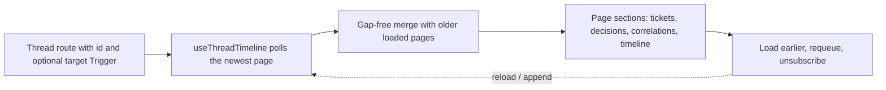

# thread.tsx

This file renders the **Thread detail page** of the orchestrator panel: the full conversation timeline of one Thread, plus its subscribed Tickets, Decisions, correlated Threads and evidence of what happened to each incoming Trigger. It is mounted by the router when a Thread is opened (also from a deep link that points at a specific Trigger), and it owns both the polling of the Thread view and the "load earlier" pagination that keeps the timeline contiguous. Read it when you want to understand what a user actually sees on a Thread page, or how the timeline is kept gap-free while it is being polled live.

## Whole-unit functional diagram

<!-- {
  "mermaid_info": {
    "name": "Thread page data and render flow",
    "nodes": [
      {
        "id": "route_001",
        "name": "Thread route with id and optional target Trigger",
        "path": "src/client/thread.tsx",
        "hint": "ThreadPage receives the Thread key and an optional deep-linked Trigger id",
        "isJumpable": true,
        "position": { "startLine": 108, "endLine": 111 },
        "references": []
      },
      {
        "id": "poll_002",
        "name": "useThreadTimeline polls the newest page",
        "path": "src/client/thread.tsx",
        "hint": "Polls GET threads/:key with a page size of 50 and keeps the last successful value",
        "isJumpable": true,
        "position": { "startLine": 72, "endLine": 78 },
        "references": []
      },
      {
        "id": "merge_003",
        "name": "Gap-free merge with older loaded pages",
        "path": "src/client/thread.tsx",
        "hint": "gapBetween and mergeTimeline decide whether older pages can be joined without a hole",
        "isJumpable": true,
        "position": { "startLine": 58, "endLine": 66 },
        "references": []
      },
      {
        "id": "sections_004",
        "name": "Page sections: tickets, decisions, correlations, timeline",
        "path": "src/client/thread.tsx",
        "hint": "Header metadata, subscribed Tickets, Decisions disclosure, correlated Threads and the Trigger list",
        "isJumpable": true,
        "position": { "startLine": 128, "endLine": 168 },
        "references": []
      },
      {
        "id": "actions_005",
        "name": "Load earlier, requeue, unsubscribe",
        "path": "src/client/thread.tsx",
        "hint": "User actions that append older pages, requeue a Trigger, or drop the subscription",
        "isJumpable": true,
        "position": { "startLine": 102, "endLine": 127 },
        "references": []
      }
    ]
  }
} -->

    
        <a target="_self" href="#src/client/thread.tsx:1?class=graph" style="color: inherit; text-decoration: none;">Graph: Thread page data and render flow</a>
    

The main path is short: a route hands the page a Thread key and an optional Trigger id, the page hook keeps polling the newest slice of the timeline, older slices are merged only when they touch the newest slice, and the result is rendered into a handful of sections. Buttons at the end of the timeline and in the danger zone feed back into the same data path.

## At a glance

- Primary role: Presentation — the file decides what a person sees on a Thread page and which controls they can use, including labels, tags, highlights and hints.
- Secondary roles: Orchestration — before anything is drawn, it coordinates polling, targeted "around" fetches, backfill fetches and actions so the timeline never shows a hole.
- Confidence: High — the full file was read together with the `GET threads/:key` request/response contract, the polling hook and the router that mounts the page.

## What this file does

- **Shows one Thread end to end**: title (with markers resolved for reading), source, latest and creation times, the original external link, an "evaluating" banner while Triggers are still being judged, and a poll-failure notice.
- **Renders the Trigger timeline**: each entry shows the actor, time, message text, handed-back notices, disposition tags (queued, evaluating, filtered with reason, decision outcome, delivered, fanout) and an "open ticket" shortcut.
- **Folds automated runs**: consecutive Triggers from the same non-human actor are collapsed into one visible entry with an expandable "N earlier" list, so a busy bot does not flood the page.
- **Supports deep links to a Trigger**: a `target` Trigger is highlighted, scrolled into view once, and — if the newest page does not contain it — fetched with an anchored request instead of forcing the user to page backwards.
- **Pages backwards without gaps**: "load earlier" appends an older page, and if the newest polled page and the already-loaded older pages no longer touch, the page backfills in between before showing the result.
- **Lists related entities and offers recovery actions**: subscribed Tickets (marking context-only subscriptions), a collapsible Decision list, correlated Threads as navigation links, a requeue control per requeueable Trigger, and a confirmed unsubscribe in a danger zone.

## What the user experiences

- Presents: a single Thread page with a header, a status meta line, optional banners, a Tickets section, a collapsible Decisions section, a correlated-Threads section, the newest-first timeline, and an unsubscribe area.
- Interaction: expanding a folded automated run, loading earlier pages, jumping into a Ticket or a correlated Thread, opening the original source, requeuing a Trigger, and unsubscribing from the Thread.
- Prepared data: the page needs a successful `GET threads/:key` response, the translated strings and API caller from the panel context, and the current route state for the Thread key and target Trigger.

### Important interaction states

- **First load**: while no data exists the page shows only the "Thread" title with a loading indicator; if the host confirmed the Thread is missing, that becomes a localized "not found" hint instead.
- **Live but failing**: once data has arrived, a later poll error is shown as a non-blocking error state above the content, so the last good timeline stays visible.
- **Evaluating**: a banner summarizes how many Triggers are still being evaluated, how long the window is and when it ends.
- **Deep-linked Trigger**: the matching entry carries a highlight and is scrolled into the middle of the viewport exactly once; if it is not part of the newest page, an extra anchored request loads the neighbourhood around it.
- **Busy actions**: the "load earlier" button and the requeue control disable themselves while their action runs, so a second click cannot start a duplicate request.
- **Partial follow-ups**: a requeue that finds nothing new raises a "already queued" notice, and an unsubscribe whose context delivery is still pending raises a pending notice after the page reloads.

## Coordinated flow

1. The route mounts the page with the Thread key and, from the deep link, an optional Trigger id; the page hook starts polling the newest page of the timeline.
2. The polling hook supplies the newest page (page size 50, refreshed on an interval and paused/deferred while the tab is hidden) and the panel context supplies the typed API caller, translations and navigation.
3. If a target Trigger is known but not yet read, a second request fetches the page *around* that Trigger; the returned page becomes the initial "older" slice.
4. On every render the newest page and the older slice are compared: if they touch, they are merged and de-duplicated by Trigger id and ordered by time; if the newest page still advertises more history but no longer touches the older slice, a backfill loop fetches pages *before* the current cursor until the two ranges overlap.
5. The page then renders the merged view and offers the append action that fetches one page *before* the currently shown boundary; requeue and unsubscribe actions go through the shared action runner, which reports failures as notifications and reloads the polled data.

### Important branching or concurrency

The backfill loop can issue several requests in sequence, and each effect guards against writing state after it has been invalidated, so a poll that lands during a backfill replaces the data instead of duplicating it. Merging is refused outright when a page cannot be proven to connect (an exhausted cursor or a missing overlap), which is why a gap is never silently displayed. The automated-run grouping deliberately excludes the deep-linked Trigger, so a linked bot message is never hidden inside a folded run.

## Key functions or classes

### `ThreadPage`

The exported page component: reads the Thread view, wires requeue and unsubscribe actions, and lays out every visible section.

    
        <a target="_self" href="#src/client/thread.tsx:108-176?class=code" style="color: inherit; text-decoration: none;">Code: src/client/thread.tsx:108-176</a>
    

### `useThreadTimeline`

Owns the timeline data: polling, the anchored fetch for a target Trigger, the backfill loop, and the append action.

    
        <a target="_self" href="#src/client/thread.tsx:72-107?class=code" style="color: inherit; text-decoration: none;">Code: src/client/thread.tsx:72-107</a>
    

### `mergeTimeline` and `gapBetween`

Decide whether an older slice may be joined to the newest page and produce the merged, de-duplicated view; `gapBetween` is the safety check that a join would be contiguous.

    
        <a target="_self" href="#src/client/thread.tsx:61-66?class=code" style="color: inherit; text-decoration: none;">Code: src/client/thread.tsx:61-66</a>
    

### `TriggerItem`

Renders one timeline entry: actor, time, clamped message text, earlier-run disclosure, handed-back hints, tags, ticket shortcut and the optional requeue button.

    
        <a target="_self" href="#src/client/thread.tsx:28-56?class=code" style="color: inherit; text-decoration: none;">Code: src/client/thread.tsx:28-56</a>
    

### `triggerTags`

Chooses which disposition tags appear and suppresses noise: the common "ignored" case is omitted, and fanout tags disappear when every target Ticket is already listed as subscribed.

    
        <a target="_self" href="#src/client/thread.tsx:12-26?class=code" style="color: inherit; text-decoration: none;">Code: src/client/thread.tsx:12-26</a>
    

### `Older` and `PAGE`

The local shape of a manually loaded slice (Triggers plus the cursor for the next older page) and the fixed page size used by every timeline request.

    
        <a target="_self" href="#src/client/thread.tsx:57-67?class=code" style="color: inherit; text-decoration: none;">Code: src/client/thread.tsx:57-67</a>
    

## Main inputs and results

- Inputs: the Thread `id` and the optional `target` Trigger id passed by the router; the panel context's translator, typed API caller, navigator and notifier; Trigger-level `actions.requeue` flags coming from the Thread view.
- Requests issued: `GET threads/:key` with a page limit, optionally `around` a target Trigger or `before` a cursor; `POST triggers/:id/requeue`; `POST threads/:key/unsubscribe`.
- Results: a rendered Thread page whose timeline is ordered, de-duplicated and contiguous, with sections hidden when they would be empty (`tickets`, `decisions`, `correlated`, the earlier-pages button and the danger zone all disappear at zero).
- Visible side effects: navigation to a Ticket or correlated Thread, opening the original source link in a new tab, notification toasts for failed or no-op actions, and a refreshed page after a requeue or unsubscribe.

Related reading: the request contract for the responses used here lives in 
<a target="_self" href="#src/app/views/threads.ts:29-54?class=code" style="color: inherit; text-decoration: none;">threads.ts:29-54</a>
, the polling and typed caller in 
<a target="_self" href="#src/client/api.ts:62-117?class=code" style="color: inherit; text-decoration: none;">api.ts:62-117</a>
, and the route that mounts this page in 
<a target="_self" href="#src/client/app.tsx:151?class=code" style="color: inherit; text-decoration: none;">app.tsx:151</a>
.

---
name: thread.tsx

update-time: 2026-11-02 11:06

description: This file renders the **Thread detail page** of the orchestrator panel: the full conversation timeline of one Thread, plus its subscribed Tickets, Decisions, correlated Threads and evidence of what happened to each incoming Trigger. It is mounted by the router when a Thread is opened (also from a deep link that points at a specific Trigger), and it owns both the polling of the Thread view and the "load earlier" pagination that keeps the timeline contiguous. Read it when you want to understand what a user actually sees on a Thread page, or how the timeline is kept gap-free while it is being polled live.

---
