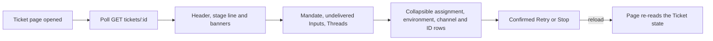

# ticket.tsx

This file renders the detail page for a single Ticket: the work item the orchestrator is handling on someone's behalf. It turns one API payload into a readable status line, the Mandate that authorized the work, the Inputs and Threads feeding it, and the retry/stop controls an operator needs. A newcomer can read this file top-down to learn what information the panel considers essential about a Ticket and how that page keeps itself current.

## Whole-unit functional diagram

<!-- {
  "mermaid_info": {
    "name": "Ticket detail page flow",
    "nodes": [
      {
        "id": "route_001",
        "name": "Ticket page opened",
        "path": "src/client/app.tsx",
        "hint": "The execution route with an id mounts TicketPage",
        "isJumpable": true,
        "position": { "startLine": 155, "endLine": 155 },
        "references": []
      },
      {
        "id": "poll_002",
        "name": "Poll GET tickets/:id",
        "path": "src/client/ticket.tsx",
        "hint": "usePoll keeps the ticket detail view fresh while mounted",
        "isJumpable": true,
        "position": { "startLine": 108, "endLine": 111 },
        "references": []
      },
      {
        "id": "summary_003",
        "name": "Header, stage line and banners",
        "path": "src/client/ticket.tsx",
        "hint": "Title, retry action, stage mark, ended hint and attention banners",
        "isJumpable": true,
        "position": { "startLine": 129, "endLine": 155 },
        "references": []
      },
      {
        "id": "sections_004",
        "name": "Mandate, undelivered Inputs, Threads",
        "path": "src/client/ticket.tsx",
        "hint": "Mandate details and the sections that explain what the Ticket is waiting on",
        "isJumpable": true,
        "position": { "startLine": 156, "endLine": 164 },
        "references": []
      },
      {
        "id": "details_005",
        "name": "Collapsible assignment, environment, channel and ID rows",
        "path": "src/client/ticket.tsx",
        "hint": "Secondary facts kept behind disclosure rows",
        "isJumpable": true,
        "position": { "startLine": 165, "endLine": 191 },
        "references": []
      },
      {
        "id": "action_006",
        "name": "Confirmed Retry or Stop",
        "path": "src/client/ticket.tsx",
        "hint": "The danger zone that mutates the Ticket after confirmation",
        "isJumpable": true,
        "position": { "startLine": 192, "endLine": 196 },
        "references": []
      },
      {
        "id": "view_007",
        "name": "Page re-reads the Ticket state",
        "path": "",
        "hint": "After a mutation the page reloads the same endpoint and shows the new state",
        "isJumpable": false,
        "position": { "startLine": 0, "endLine": 0 },
        "references": []
      }
    ]
  }
} -->

    
        <a target="_self" href="#src/client/ticket.tsx:1?class=graph" style="color: inherit; text-decoration: none;">Graph: Ticket detail page flow</a>
    

The page is one polling loop wrapped in a reading order: fetch the Ticket, summarize where it stands, then go deeper into why — the Mandate, the Inputs that have not been delivered, the Threads being followed. The only writes come from the bottom of the page, and each one reloads the same endpoint so the operator immediately sees the new state.

## At a glance

- Primary role: Presentation — the file decides what a person sees about one Ticket and which controls they can use on it.
- Secondary roles: Orchestration — it owns the small loop of loading the Ticket, running a confirmed retry or stop, and reloading.
- Confidence: High — the whole file was read together with the ticket detail view it consumes, the polling hook, the status-mark mapper and the shared widgets it composes.

## What this file does

- Shows where the Ticket stands: a status line with the stage mark, Mandate strength, the acting sender and the last update time, plus a hint when the Ticket has already ended.
- Surfaces what needs a human now: an attention banner with the pending question and a link to answer it in the source channel, and a blocked/failed banner for a summary that halted the work.
- Explains authority: a Mandate section listing the Trigger and Decision behind the Ticket, the scope, the admission basis facts and a link to the policy version that produced the decision.
- Explains waiting: an undelivered-inputs section with a hint saying whether inputs are waiting normally, because the orchestrator is paused, or because delivery failed.
- Lists what the Ticket is connected to: subscribed Threads, delivered Inputs, environment variables, channel links and identifiers.
- Offers Retry and Stop behind confirmation dialogs, and a session button for opening the worker Session.

## What the user experiences

- Presents: a single Ticket page with a title header, a compact status line, warning banners, up to four named sections, a set of collapsible detail rows, and a danger zone for stopping the Ticket.
- Interaction: the Mandate's Trigger row and input rows that came from a Trigger can be clicked to navigate to the originating Thread; the policy version opens the evaluation settings at that version; Retry and Stop ask for confirmation before changing anything; disclosure rows expand and collapse locally.
- Prepared data: the whole page depends on one `GET tickets/:id` payload. Until it arrives, only the page head and a loading or not-found state are shown, and a saved payload keeps the page readable while a later poll fails.

### Important interaction states

- No data yet: a page head with either a "ticket not found" hint when the server confirms the record is missing, or a generic loading/error state otherwise.
- Stale data with an error: the last good Ticket is still rendered and an error block is added near the top, so an outage does not blank the page.
- A Ticket waiting on a person: the attention banner is the first thing after the status line, and the undelivered-inputs section explains the reason for the wait.
- An error-looking summary: when the Ticket is blocked or failed and the summary reads like a host error, it is shown in monospace so it is not mistaken for prose.
- Only one Assignment: the assignment list stays hidden, because a single Assignment adds nothing beyond the status line.

## Key functions or classes

### `TicketPage`

The exported page component; it loads the Ticket by id, derives every display flag, and lays out all sections and actions.

    
        <a target="_self" href="#src/client/ticket.tsx:108-198?class=code" style="color: inherit; text-decoration: none;">Code: src/client/ticket.tsx:108-198</a>
    

### `MandateDetails`

Renders why the Ticket was accepted or reopened: the Trigger and Decision rows, the scope, the basis facts and the policy version link.

    
        <a target="_self" href="#src/client/ticket.tsx:68-106?class=code" style="color: inherit; text-decoration: none;">Code: src/client/ticket.tsx:68-106</a>
    

### `InputList`

Groups consecutive automated Inputs from the same sender so only the newest is expanded by default, and renders each group as an `InputLine`.

### `InputLine`

One Input row: delivered or undelivered dot, sender and preview (or the Input kind), timestamp, quoted text for text and note inputs, and a hint when a Trigger was handed back.

### `Assignments`

Newest-first list of Assignments with numbering, a dot reflecting the worker report, the time span, the end reason, and a session button when the Assignment ran in another Session.

### `Details`

A small collapsible row used for the secondary sections; it keeps its own open/closed state and can start expanded.

## Coordinated data flow

1. The execution route with an `id` mounts `TicketPage`, so the same component instance is replaced whenever a different Ticket is opened.
2. `usePoll` repeatedly calls the `GET tickets/:id` endpoint through the panel's API caller, keeping the previous payload across errors and slowing down while the browser tab is hidden.
3. The component derives the display facts from that payload: the stage mark, the actor label, the ended-time sentence, the failed-summary flag and the split between delivered and undelivered Inputs.
4. Child sections render those facts with translated labels, and the two confirmed actions run the retry or stop request and then reload, handing the final visible outcome back to the same polling loop.

### Important branching or concurrency

Each action awaits its request and then reloads, so a manually triggered refresh runs after the in-flight mutation instead of racing it. Sections appear conditionally — undelivered Inputs, subscribed Threads, environment variables and delivered Inputs each need at least one entry — which keeps a quiet Ticket page short.

## Main inputs and results

- Inputs: the Ticket `id` from the route, the panel context providing the translator and typed API caller, and the `GET tickets/:id` payload containing the stage, action, Mandate, basis facts, Decision, Inputs, Threads, Assignments, channels, environment, attention question and available actions.
- Results: the rendered Ticket page with its status line, banners, Mandate section, Input sections, Threads, collapsible details and danger zone; navigation to a related Thread, a Session or the policy version in settings when the user follows those links.
- Visible side effects: confirming Retry sends `POST tickets/:id/retry` and confirming Stop sends `POST tickets/:id/stop`, both followed by a reload that shows the changed state.

---
name: ticket.tsx

update-time: 2026-11-02 11:00

description: This file renders the detail page for a single Ticket: the work item the orchestrator is handling on someone's behalf. It turns one API payload into a readable status line, the Mandate that authorized the work, the Inputs and Threads feeding it, and the retry/stop controls an operator needs. A newcomer can read this file top-down to learn what information the panel considers essential about a Ticket and how that page keeps itself current.

---
