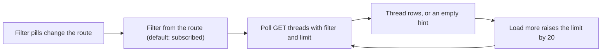

# trigger.tsx

This file renders the **Trigger status** page of the management panel: the list of Threads that the orchestrator is watching, together with the filter pills that narrow that list. It is a small, self-contained view — it asks the host API for one page of Threads, shows them as clickable rows, and lets a person switch filters or load more results. Reading it is the quickest way to understand how a status tab in this panel is assembled from a route value, a polling hook, and shared widgets.

## Whole-unit functional diagram

The page starts from a filter supplied by the current route, turns it into a polling request, and renders whatever comes back as Thread rows. Clicking a filter pill rewrites the route (which restarts the poll with the new filter), while "load more" only enlarges the same request window.

## At a glance

- **Primary role**: Presentation — the file owns what the Trigger tab shows and which interactions it offers, delegating fetching, error text, and row rendering to collaborators.
- **Confidence**: High — the whole component is 28 lines, and every collaborator it imports (`usePoll`, `usePanel`, `Pill`, `ThreadLine`, `StatusHead`, `LoadState`, `LoadMore`, `Hint`) and its single call site were read.

## What this file does

- Shows the Trigger page header through `StatusHead`, using the localized `triggerIntro` hint that explains triggers are grouped by Thread.
- Renders one pill per entry in `THREAD_FILTERS` (`subscribed`, `evaluating`, `recent`, `all`), highlighting whichever filter is active.
- Keeps the browser route in sync with the chosen filter: switching filters navigates with replace semantics, so filter changes never add a back step, and the default `subscribed` filter is omitted from the query entirely.
- Polls `GET threads` with the current `filter` and `limit`, and keeps showing the previous page while a refresh is in flight (behaviour inherited from `usePoll`).
- Covers the three visible outcomes of that request: an error or loading message, the Thread rows, or a "no threads" hint.
- Offers a "load more" control only when the response reports another page, growing the window by 20 rows each time.

The filter values themselves are interpreted on the host side: for example `recent` keeps Threads with activity in the last 24 hours, and `evaluating` keeps Threads that are evaluating or waiting for an Eval (see 
<a target="_self" href="#src/app/views/threads.ts:9-23?class=code" style="color: inherit; text-decoration: none;">threads.ts:9-23</a>
). This component only forwards the filter value.

## Key functions or classes

### `TriggerStatus`

The only export: a React component that takes the active `ThreadFilter` and renders the filtered Thread list with its filter pills, loading/error state, empty hint, and pagination control.

    
        <a target="_self" href="#src/client/trigger.tsx:10-27?class=code" style="color: inherit; text-decoration: none;">Code: src/client/trigger.tsx:10-27</a>
    

## Main inputs and results

- **Inputs**: a `filter` prop of type `ThreadFilter`; the panel context (`t` for translations, `call` for typed API requests, `navigate` for route changes); the client-side `limit` state starting at 20; and the `GET threads` response containing `items` plus an optional `next_offset`.
- **Results**: rendered Thread rows (each row navigates to that Thread's detail page) or a localized "no threads" hint, a filter pill row, and a load-more button when more results exist.
- **Visible side effects**: choosing a filter replaces the current route entry and resets the page size back to 20; pressing "load more" increases the requested limit without touching the route.

## What the user experiences

- **Presents**: a status heading with an explanatory tooltip, a row of filter pills naming the available Thread groupings, one row per Thread with its stage marker and latest-message preview, and short hints for loading, errors, and empty results.
- **Interaction**: tapping a pill immediately selects that filter and reloads the list from the first page; tapping a Thread title opens its detail view; tapping "load more" appends 20 more Threads to the requested window.
- **Prepared data**: the view needs a filter value, a working panel context, and a successful `GET threads` response. Until the first response arrives it shows a loading hint; if the request fails, the error message replaces the list.

### Important interaction states

- **First load**: no data yet, so the loading hint is shown and the list area stays empty.
- **Error**: the request failure message is rendered as an alert paragraph, and no rows or empty hint are shown.
- **Empty page**: a successful response with no items shows the `threadsNone` hint instead of a list.
- **Partially paged list**: `next_offset` being present is the only condition that reveals "load more"; a complete list hides the button entirely.
- **Filter switching**: because navigation replaces the route and resets the limit, each filter always starts from a clean first page rather than continuing the previous scroll window.

---
name: trigger.tsx

update-time: 2026-11-02 11:06

description: This file renders the **Trigger status** page of the management panel: the list of Threads that the orchestrator is watching, together with the filter pills that narrow that list. It is a small, self-contained view — it asks the host API for one page of Threads, shows them as clickable rows, and lets a person switch filters or load more results. Reading it is the quickest way to understand how a status tab in this panel is assembled from a route value, a polling hook, and shared widgets.

---
