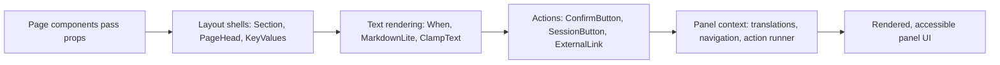

# widgets.tsx

This file is the shared widget shelf for the superagent panel: small, context-aware React components that every page reuses so headers, timestamps, Markdown text and confirmation dialogs look and behave the same everywhere. Each widget receives plain props from a page, pulls translations and navigation from the panel context, and returns finished JSX. It is the place to look when text on a page renders oddly, a "Confirm" dialog appears, or a long event body needs an expand control.

## Whole-unit functional flow

A page supplies content, the layout widgets arrange it, the text widgets turn raw strings into readable localized output, and interactive widgets reach into the panel context for language, routing and action running. Everything observable in the panel — a section heading, a relative timestamp, a confirmation modal — comes out of that chain.

## At a glance

- Primary role: Presentation — the file owns what a person sees and can do inside the panel, not the data or the storage behind it.
- Secondary roles: none
- Confidence: High — all 20 components in the file (18 exported) return JSX and read the panel context, and 12 sibling page modules import them directly.

## What this file does

- **Gives pages consistent furniture.** `Section`, `PageHead` and `StatusHead` define the header shapes used across tabs, each optionally carrying a count, an info tip, an icon, an inline action, or a jump to a settings group.
- **Makes server text human-readable.** `When` shows a localized relative or absolute time, `MarkdownLite` renders a safe Markdown subset, and `ClampText` collapses long event bodies behind an expand control.
- **Explains setup problems in the reader's language.** `SetupMessage` turns a structured setup problem into translated copy and appends the raw host output when one exists, so operators can see both the friendly and the technical reason.
- **Adds a safety step before destructive actions.** `ConfirmButton` opens an accessible modal and only runs the async callback when the reader confirms, disabling the button while the action is in flight.
- **Never trusts markup.** Rendered Markdown and linkified text go through the local parser instead of raw HTML, and every outbound link opens in a new tab with a `noopener noreferrer` relationship.
- **Shows load and failure states uniformly.** `LoadState` renders an alert paragraph for errors and a localized hint while loading, so pages do not each invent their own message.

### Important interaction states

- A closed confirmation dialog renders nothing; while its action is running the confirm button is disabled, and the dialog closes only after the action succeeds.
- Failed actions surface as a toast rather than an inline error, because the action runner reports failures through the panel's `notify`.
- Text is collapsed only when it exceeds the long-content threshold; otherwise no expand control appears at all.
- `CheckSetupButton` asks for confirmation before re-checking setup while executor sessions are running, since the following restart would interrupt them.

## Key functions or classes

### `Section`

Section shell with title, optional count, info tip, badge, icon and a push-right action slot.

<a target="_self" href="#src/client/widgets.tsx:24-35?class=code" style="color: inherit; text-decoration: none;">widgets.tsx:24-35</a>

### `When`

Renders a timestamp as a semantic `<time>` element with a localized relative label and a full-date tooltip.

<a target="_self" href="#src/client/widgets.tsx:12-15?class=code" style="color: inherit; text-decoration: none;">widgets.tsx:12-15</a>

### `MarkdownLite`

Renders the supported Markdown subset — headings, lists, paragraphs, bold, inline code and links — after replacing platform placeholders with localized labels.

<a target="_self" href="#src/client/widgets.tsx:52-60?class=code" style="color: inherit; text-decoration: none;">widgets.tsx:52-60</a>

### `ClampText`

Shows a short body inline and adds a localized expand/collapse toggle for long bodies.

<a target="_self" href="#src/client/widgets.tsx:66-73?class=code" style="color: inherit; text-decoration: none;">widgets.tsx:66-73</a>

### `ConfirmButton`

Button that opens a modal with cancel/confirm buttons and runs the async confirmation callback through the shared action runner.

<a target="_self" href="#src/client/widgets.tsx:75-90?class=code" style="color: inherit; text-decoration: none;">widgets.tsx:75-90</a>

### `SessionButton`

Opens an executor session and reports any failure through the panel's toast notification.

<a target="_self" href="#src/client/widgets.tsx:91-96?class=code" style="color: inherit; text-decoration: none;">widgets.tsx:91-96</a>

### `LoadState`

Renders an error alert, a loading hint, or nothing at all — the standard three-way status strip for data-backed pages.

<a target="_self" href="#src/client/widgets.tsx:108-112?class=code" style="color: inherit; text-decoration: none;">widgets.tsx:108-112</a>

### `CheckSetupButton`

Triggers a host setup re-check and restart, routing through a confirmation dialog when running assignments would be interrupted.

<a target="_self" href="#src/client/widgets.tsx:134-147?class=code" style="color: inherit; text-decoration: none;">widgets.tsx:134-147</a>

## Main inputs and results

- Inputs: plain props from page components (titles, text bodies, counts, hints, icon names, hrefs, session ids, async confirmation callbacks) plus the panel context that provides the translator, `navigate`, `back`, `openSession`, `notify`, `call` and `restart`; `CheckSetupButton` additionally reads the running-session count from panel data.
- Results: ready-to-mount JSX — section and page headers, key/value lists, sanitized Markdown, timestamp elements, loading and error paragraphs, and modal-wrapped confirmation flows.
- Visible side effects: a confirmation modal opening and closing, buttons disabling while an action runs, long text expanding or collapsing, toast messages after failed actions, navigation to a settings group or back to the previous page, and a full panel restart after a setup re-check.

One practical constraint for newcomers: every widget here reads the panel context, so it only renders inside the panel provider. Rendering one outside it fails loudly rather than silently falling back to default text or routes.

---
name: widgets.tsx

update-time: 2026-11-02 11:08

description: This file is the shared widget shelf for the superagent panel: small, context-aware React components that every page reuses so headers, timestamps, Markdown text and confirmation dialogs look and behave the same everywhere. Each widget receives plain props from a page, pulls translations and navigation from the panel context, and returns finished JSX. It is the place to look when text on a page renders oddly, a "Confirm" dialog appears, or a long event body needs an expand control.

---
