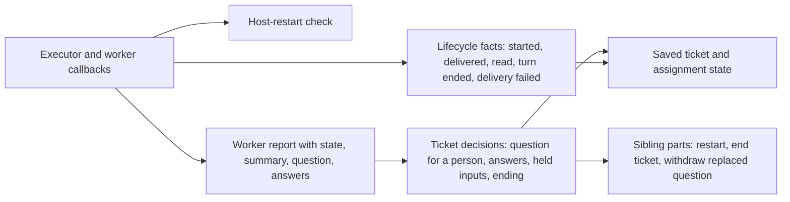

# assignments.ts

`assignments.ts` is where the Engine keeps track of an **Assignment** — the binding between one ticket and one executor instance that works it. It receives every lifecycle fact the Executor and its workers produce (an assignment started, inputs arrived, a turn ended, the host restarted) and every worker report, records them on the ticket, and applies the domain rules about questions for people, held-back automated inputs, and when a ticket is finished. Reading this file tells you what the system considers a well-formed worker report and why a ticket ends, keeps running, or waits for a person.

## Whole-unit functional flow

The Engine routes its Executor callbacks and its workers' reports into this class, which writes the resulting ticket and assignment state back through the repositories. Only the report path makes ticket-level decisions; the plain callback path mostly records facts.

## At a glance

- **Primary role — domain rules**: the file decides what a worker report means for a ticket, which reports are refused, and whether a ticket is done, waiting, or still running.
- **Secondary roles — data contract, state storage**: it defines the `WorkerReport` message a worker sends, and it owns the stored lifecycle fields on `Assignment` (`state`, `startedAt`, `deliveredAt`, `idleAt`, `report`) plus the ticket's `undelivered` queue and open question.
- **Confidence**: High — the whole file was read together with its collaborators (`model.ts`, `tickets.ts`, `replies.ts`, `engine.ts`) and the Executor that calls it.

## What this file does

- **Marks an assignment running.** When the Executor reports an assignment has begun, it becomes `running`, gets a start time the first time, and the ticket's waiting inputs are queued for delivery; an `assignment.started` event is emitted for observers.
- **Tracks input delivery and reading.** Delivered input ids leave the ticket's waiting queue, the assignment records when inputs last reached it, a previous delivery error is cleared, and the worker's Session records when it actually took the messages into a step.
- **Records turn ends and delivery failures.** The end of a worker turn records when the worker went idle; a failed delivery is kept on the ticket so a person can see why the worker got nothing.
- **Applies a worker report.** A report is checked, then written onto the current assignment and the ticket, including a question for a person and the list of people's questions the worker answered.
- **Recovers after a host restart.** An interrupted assignment is either restarted with a recovery instruction or kept as it was, depending on what it last reported.
- **Ends a ticket when the report says so.** A `dropped` report, or a `ready` report once followed threads are finished, closes the ticket with an outcome.

## Key functions or classes

### `Assignments`

The class that owns assignment lifecycle facts and report handling, constructed with the shared Engine options plus the sibling `Tickets` and `Replies` parts it delegates to.

    
        <a target="_self" href="#src/core/assignments.ts:30-140?class=code" style="color: inherit; text-decoration: none;">Code: src/core/assignments.ts:30-140</a>
    

### `WorkerReport`

The shape a worker (or the Executor on its own behalf) reports: a report state, a summary, and optional question, asker, and answered question.

    
        <a target="_self" href="#src/core/assignments.ts:11-20?class=code" style="color: inherit; text-decoration: none;">Code: src/core/assignments.ts:11-20</a>
    

### `started(ticketId, assignmentId)`

Switches a non-ended assignment to `running`, queues delivery of the ticket's waiting inputs when the ticket is open, and emits `assignment.started`; silently ignored for an unknown assignment or one that already ended.

    
        <a target="_self" href="#src/core/assignments.ts:34-43?class=code" style="color: inherit; text-decoration: none;">Code: src/core/assignments.ts:34-43</a>
    

### `delivered(ticketId, assignmentId, inputIds)`

Confirms that inputs reached the running assignment: they leave the waiting queue, the assignment gets a delivery time, the inputs are marked as given to that assignment, and any earlier delivery error is dropped.

    
        <a target="_self" href="#src/core/assignments.ts:48-58?class=code" style="color: inherit; text-decoration: none;">Code: src/core/assignments.ts:48-58</a>
    

### `read(ticketId, inputIds)`

Records when the worker's Session took specific messages into a step, which is the moment the worker's model is deemed to have read them.

    
        <a target="_self" href="#src/core/assignments.ts:60-65?class=code" style="color: inherit; text-decoration: none;">Code: src/core/assignments.ts:60-65</a>
    

### `interrupted(ticketId, assignmentId)`

Decides what a host restart means for a running assignment: restart it with a recovery instruction unless its last report was settled and nothing arrived afterwards, in which case it keeps its session and simply receives the inputs that were still waiting.

    
        <a target="_self" href="#src/core/assignments.ts:83-92?class=code" style="color: inherit; text-decoration: none;">Code: src/core/assignments.ts:83-92</a>
    

### `report(ticketId, report)`

Validates a worker report, updates the ticket's open question and answered-question list, holds back automated inputs after a `blocked` or `failed` report, ends the ticket when the report says the work is done, and returns the stored ticket.

    
        <a target="_self" href="#src/core/assignments.ts:99-134?class=code" style="color: inherit; text-decoration: none;">Code: src/core/assignments.ts:99-134</a>
    

## Main inputs and results

- **Inputs**: ticket and assignment ids from the Executor's callbacks (`assignmentStarted`, `inputsDelivered`, `inputsRead`, `turnEnded`, `deliveryFailed`, `assignmentInterrupted`), a `WorkerReport` from a worker, and the repositories, clock, event sink and `Executor` port supplied through `EngineOptions`.
- **Results**: an updated stored ticket (assignment state and timestamps, reduced waiting-input queue, open question, answered questions, delivery error) and, for `started`, an `assignment.started` domain event; `report` returns the stored ticket.
- **Visible side effects**: the management views can show a running worker, its last report, the current question for a person, a delivery failure, or a finished ticket; a replaced question's unsent reply is withdrawn from the outbox so a person is not asked an outdated question.

## Rules and decisions

- **Decision**: given a fact from the Executor or a worker, what should the ticket's assignment and status be now — still running, waiting for a person, settled, or ended?
- **Important conditions**: `delivered`, `turnEnded`, `deliveryFailed` and `interrupted` apply only while that exact assignment is the running one on an open ticket, and are otherwise ignored. `report` requires an open ticket and applies to the running assignment, or else the most recent one. Only a report whose state is `waiting`, `ready`, `blocked` or `failed`, with nothing delivered after it, counts as settled for restart recovery.
- **Outcomes**: a `dropped` report ends the ticket with `dropped` (or with the outcome of a close it was waiting on); a `ready` report ends it as `completed` when it follows no threads, otherwise once the threads it follows are done; `blocked` and `failed` stop automated inputs from reaching the worker until a person writes; other states leave the ticket open.
- **Invariant**: at most one assignment of a ticket runs, a report's question can never travel together with a ready result or an answer, and a question or answer must name a message written by a person that actually reached this ticket.

### Small example

A worker reports `blocked` with the question "Should I rebase or merge?" and names the person's message that raised it. The question becomes the ticket's attention item and a reply is routed to that person's channel. When the worker later reports again with a different question, the stored question is replaced and the previously queued reply is withdrawn, so the outbox never sends an answer to a question the ticket no longer asks.

## Information contract

- **Represents**: `WorkerReport` — one statement from a worker about the assignment it runs, or the Executor's own statement such as `waiting` after an idle turn or `failed` after an error.
- **Produced by**: a worker or the Executor, delivered through the Engine's `report` entry point inside a repository transaction.
- **Consumed by**: `Assignments.report`, which splits it into the assignment's `report` (`state`, `summary`, and report time), the ticket's `attention` (the open question), and its `answers` list.
- **Behavior-shaping parts**: `state` determines ending, input holding, and restart recovery; `question` asks when it is a new string, clears when `null`, and keeps the current question when omitted; `askedBy` decides where the question is sent and must be a person's message; `answers` records that a person's question was answered and must name a person's message that reached the ticket.

### Compatibility notes

The stored assignment report keeps only `state`, `summary` and the report time — the question itself lives on the ticket as `attention`, so a report's question is the ticket's current question, not a history of every question asked.

## Stored state lifecycle

- **Stores**: assignment `state`, `startedAt`, `deliveredAt`, `idleAt` and last `report`; the ticket's `undelivered` input ids, `attention` question, `answers` list and `delivery` error; and per-input `readAt` / `deliveredTo` marks.
- **Read path**: the Engine and management views read these fields to show whether a ticket has a running worker, what it last said, whether a delivery failed, and what it is waiting for; restart recovery reads the last report and delivery time to decide whether to restart.
- **Write path**: Executor callbacks and worker reports, each applied inside the transaction the Engine opens and persisted through the ticket repository on every change.
- **Visible result**: a ticket's status survives process restarts, so a restart can resume the right assignment and a person sees the same question, failure notice, or completion afterwards.

### Important persistence behavior

Because an end clears the ticket's question and delivery error and ends its assignments together with it, an overview never shows an open question or a pending delivery failure on a ticket that has already ended.

---
name: assignments.ts

update-time: 2026-11-02 11:12

description: `assignments.ts` is where the Engine keeps track of an **Assignment** — the binding between one ticket and one executor instance that works it. It receives every lifecycle fact the Executor and its workers produce (an assignment started, inputs arrived, a turn ended, the host restarted) and every worker report, records them on the ticket, and applies the domain rules about questions for people, held-back automated inputs, and when a ticket is finished. Reading this file tells you what the system considers a well-formed worker report and why a ticket ends, keeps running, or waits for a person.

---
