# core

`src/core` is the reusable domain heart of the proactive agent. It defines the vocabulary the rest of the system exchanges — triggers, threads, evaluations, decisions, mandates, tickets and assignments — and the transactional `Engine` through which every change is accepted. It also states the business rules that turn an external event into authorized work, decide who owns a person's follow-up, and determine when a ticket waits, resumes or ends. Read this directory to understand what the core offers callers and what a host application must supply.

## Whole-unit functional diagram

```mermaid
flowchart LR
  request_001["Source, session, person or executor request"] --> engine_002["Engine command in one transaction"]
  engine_002 --> intake_003["Intake stores and routes a trigger"]
  intake_003 --> evals_004["Evals judges and records a decision"]
  evals_004 --> tickets_005["Tickets owns work-item lifecycle"]
  tickets_005 --> assignments_006["Assignments records worker reports"]
  assignments_006 --> replies_007["Replies queues messages"]
  replies_007 --> result_008["Decision, ticket and message state"]
```

<!-- {
  "mermaid_info": {
    "name": "Core request-to-ticket flow",
    "nodes": [
      {
        "id": "request_001",
        "name": "Source, session, person or executor request",
        "path": "",
        "hint": "An abstract caller outside the core",
        "isJumpable": false,
        "position": { "startLine": 0, "endLine": 0 },
        "references": []
      },
      {
        "id": "engine_002",
        "name": "Engine command in one transaction",
        "path": "src/core/engine.ts",
        "hint": "The single transactional entry point for domain changes",
        "isJumpable": true,
        "position": { "startLine": 24, "endLine": 271 },
        "references": []
      },
      {
        "id": "intake_003",
        "name": "Intake stores and routes a trigger",
        "path": "src/core/intake.ts",
        "hint": "Deduplicates, filters and fans out incoming triggers",
        "isJumpable": true,
        "position": { "startLine": 19, "endLine": 62 },
        "references": []
      },
      {
        "id": "evals_004",
        "name": "Evals judges and records a decision",
        "path": "src/core/evals.ts",
        "hint": "Batches queued triggers and records the decision they end with",
        "isJumpable": true,
        "position": { "startLine": 27, "endLine": 341 },
        "references": []
      },
      {
        "id": "tickets_005",
        "name": "Tickets owns work-item lifecycle",
        "path": "src/core/tickets.ts",
        "hint": "Creates, binds, resumes, retries and ends tickets",
        "isJumpable": true,
        "position": { "startLine": 29, "endLine": 424 },
        "references": []
      },
      {
        "id": "assignments_006",
        "name": "Assignments records worker reports",
        "path": "src/core/assignments.ts",
        "hint": "Tracks assignment progress, questions, delivery and endings",
        "isJumpable": true,
        "position": { "startLine": 30, "endLine": 141 },
        "references": []
      },
      {
        "id": "replies_007",
        "name": "Replies queues messages",
        "path": "src/core/replies.ts",
        "hint": "Enforces reply rules and queues idempotent outbound messages",
        "isJumpable": true,
        "position": { "startLine": 26, "endLine": 96 },
        "references": []
      },
      {
        "id": "result_008",
        "name": "Decision, ticket and message state",
        "path": "",
        "hint": "The observable result the rest of the system reads",
        "isJumpable": false,
        "position": { "startLine": 0, "endLine": 0 },
        "references": []
      }
    ]
  }
} -->

    
        <a target="_self" href="#src/core:1?class=graph" style="color: inherit; text-decoration: none;">Graph: Core request-to-ticket flow</a>
    

A request enters through the `Engine`, which wraps the work in one repository transaction. `Intake` records and fans out the trigger, `Evals` turns queued triggers into a `Decision`, and an accept creates a `Ticket` whose `Assignments` and `Replies` produce the observable work and messages. Ports let the host supply policy, assessment, execution and delivery without the core importing them.

## At a glance

- Main role: Domain rules — it answers whether work is allowed, who decides a message, when a ticket is finished, and what the system may send back.
- Confidence: High — the source contains explicit lifecycle methods, a closed error catalogue, and role-scoped `Engine` interfaces that make the rules directly checkable.
- Also visible here: a public API boundary (`index.ts` and `engine.ts`), a shared information contract (`model.ts` and `ports.ts`), and intentional extension ports for the host application.

## Rules and decisions

- Decision: Does an incoming event become a ticket, and if so under whose authority? Which ticket owns a person's follow-up? Is this ticket waiting on a person, actively working, idle between turns, or ended? May this message be sent to a person?
- Important conditions: A `Trigger` must belong to at least one `Thread`; its id is the deduplication key, and a `SourceScope` rejection records it as `filtered`. A person's follow-up that reached a live ticket — or an ended ticket with a waiting human message — stays with that ticket's worker; the main Session may only stop it, and a worker hand-back returns it to Eval once no ticket still owns it. The `Policy.gate` decides admissibility and whether authority is `explicit` or `inferred`; an inferred accept requires `auto` mode and enabled matching rules, and a Policy version change makes an in-flight Eval reassess. A `ready` report ends a ticket as `completed` unless it follows Threads that are not done; a `dropped` report ends it; a followed Thread's close ends it with the close outcome once `followsDone` holds; a person's stop ends it as `stopped`. A human message can resume an ended ticket under its unchanged Mandate only if the current Policy still revalidates it; while processing is paused, resumption waits. `blocked` or `failed` reports hold back automated inputs until a human message arrives.
- Outcomes: `ReceiveResult` is `stored`, `duplicate` or `filtered`; a `Decision` is `ignore`, `accept`, `stop` or `unavailable`; a ticket ends as `completed`, `merged`, `closed`, `dropped` or `stopped`; `ticketStage` reports `person`, `working`, `idle` or `ended`; refused calls throw `UserError` with a `missing` or `refused` category.
- Invariant: Every `Engine` command runs inside one repository transaction; an accepted ticket carries an immutable Mandate; at most one `Evaluation` runs per Thread; ids are content-derived, so replaying the same input does not create a duplicate.

### Small example

Consider a person commenting on a pull request whose ticket is still open. `Intake` stores the comment and adds it as an Input for that ticket; the ticket's worker decides it, so it does not go to Eval. If the worker hands it back and no other ticket owns it, it is queued for Eval; an accept there creates a new ticket under a fresh Mandate, while an ignore records why the request did not become work.

## Public contract

- Caller: Sources, the main Session, people through the panel or session, the Executor, and Settings. `index.ts` is the import boundary; the internal parts (`part.ts`, `intake.ts`, `evals.ts`, `tickets.ts`, `assignments.ts`, `replies.ts`) are deliberately not exported from it.
- Operation: `Engine` exposes intake and Thread binding, evaluation and decision, attachment, status requests, replies, people actions, executor callbacks, and policy changes. `EngineForSources`, `EngineForMainSession`, `EngineForPeople`, `EngineForSettings` and `EngineForExecutor` are `Pick` types that give each caller only its allowed methods.
- Accepted input: Domain object ids plus `Trigger`, `Outcome`, `WorkerReport`, `ReplyRequest`, `ThreadRef` or `PolicyEffect` as appropriate. Source-provided text and metadata are treated as untrusted external data.
- Result: `ReceiveResult`, `Decision`, `Ticket`, `Reply`, a boolean, or no return value depending on the command. Refusals are `UserError` instances with a stable code.
- Access or validation requirements: Calls are synchronous and transactional. The core rejects unknown or ended tickets, unknown triggers, stale Eval ids, a message that still belongs to another ticket, inferred accepts without the right policy, and reply purposes that are not allowed. The role interfaces are compile-time boundaries, not authentication; the host decides who receives which interface.

Start with 
<a target="_self" href="#src/core/index.ts?class=code" style="color: inherit; text-decoration: none;">index.ts</a>
 for the public surface and 
<a target="_self" href="#src/core/engine.ts?class=code" style="color: inherit; text-decoration: none;">engine.ts</a>
 for the transaction boundary and caller roles.

## Information contract

- Represents: The concepts exchanged across the core and its host: `Trigger`, `Thread`, `Evaluation`, `Decision`, `Mandate`, `Ticket`, `Assignment`, `TicketInput`, `Reason` and `UserError`.
- Produced by: Source adapters produce `Trigger`; the Policy gate produces `GateResult` and mandate basis; the Assessor returns `AssessmentOutcome`; the Executor produces `WorkerReport` and lifecycle callbacks; the Engine produces `Decision`, `Ticket`, `Thread` and `Assignment` state.
- Consumed by: Engine parts, application services, HTTP and tool adapters, and the web panel read these shapes. Tests can drive the same shapes through `MemoryRepositories`.
- Behavior-shaping parts: `Trigger.threads[0]` is the primary Thread; `human` and `addressed` affect ownership and acknowledgement; `TriggerDisposition.fanout`, `context`, `handbacks` and `acked` decide follow-up custody; `Mandate.strength`, `basis` and `policyVersion` bound authority; `Decision.kind` and `reason` drive downstream behavior; `Ticket.ended`, `attention`, `undelivered`, `follows` and `assignments` describe lifecycle; `Thread.pending`/`evaluating` and `Assignment.report.state` drive scheduling and ticket stage.

### Compatibility notes

Optional fields such as `Evaluation.primary` have fallbacks for older records. `Reason` accepts known codes or literal codes emitted by a Policy or Source. `UserError` codes are a closed catalogue, so consumers can branch on the code and its `missing` flag rather than parse prose. Ids are content-derived and should be treated as stable keys, not random tokens.

## How to extend it

- Extension capability: A host can supply its own `SourceScope`, `Policy`, `Assessor`, `Executor`, `Outbox` and `Repositories`, plus the optional `prepareTicket`, `now` and `emit` hooks in `EngineOptions`.
- Contract: `Policy` is versioned and must answer admission, revalidation, inferred acceptance and timeout. `Assessor.request` queues an assessment idempotently, and the outcome returns through `Engine.decide`. `Executor.start`, `deliver` and `stop` queue work and report back through Engine callbacks. `Outbox.send` must be idempotent by message id. `Repositories` is synchronous and provides `atomic`.
- Registration or discovery: There is no registry or discovery mechanism in the core. The host constructs `EngineOptions` and passes implementations directly; `index.ts` exposes the types needed to do that.
- Use path: The `Engine` constructor stores the options and creates the internal parts. Parts call ports during Engine commands, events go out through `emit`, and the host can then hand callers only the matching `EngineFor*` interface.

### Compatibility boundary

Keeping repository calls synchronous is what makes `atomic` a real unit of work. Policy version changes are visible to in-flight Evals, and `MemoryRepositories` is intentionally behavior-compatible with the durable store for read order and rollback.

## Responsibilities and non-responsibilities

- Responsible for: The domain vocabulary and invariants; the transactional `Engine` and role-scoped caller interfaces; the lifecycle rules for Intake, Evals, Tickets, Assignments and Replies; the ports contract; the public exports; the in-memory repository; the shared error and reason catalogues; content-derived ids; and ticket stage and retry classification.
- Kept elsewhere: Source-specific event mapping and scope configuration, concrete Policy rules and admission tables, semantic assessment, workspace and execution management, channel delivery, the durable repository implementation, HTTP routes and agent tool handlers, and the web panel. The core defines the contracts those areas implement or consume; it does not implement them.

## Important direct children

### `assignments.ts`

Records what the Executor and its workers report about an Assignment — start, delivery, read, turn end, failure, interruption and status report — and applies the rules for attention questions, held automated inputs and ticket endings.

### `engine.ts`

Defines `Engine`, the single transactional entry point, and the role-scoped interfaces that give Sources, the main Session, people, Settings and the Executor only the commands each may use.

### `errors.ts`

Holds the closed `USER_ERRORS` catalogue and `UserError`, the structured refusal thrown by core and application services when a request is missing something or is not allowed.

### `evals.ts`

Batches a Thread's queued Triggers into one Eval, takes its authority from the Policy gate, asks the Assessor, protects the deadline, and records the `Decision` it ends with.

### `ids.ts`

Derives stable content-based ids with SHA-256, so equal inputs always produce the same record id and replays or retries can stay idempotent.

### `index.ts`

The public front door: it re-exports the model, ports, `Engine` and role types, errors, reasons, `MemoryRepositories`, stage helpers and `key`, while keeping the internal parts private.

### `intake.ts`

Ingests a Trigger once, applies the Source scope filter, records Thread correlations, fans the Trigger out to subscribed tickets, and queues it for Eval when no ticket's worker owns it.

### `memory.ts`

`MemoryRepositories` implements the `Repositories` port with cloned Map entries and snapshot rollback, matching the durable store's read order for tests and ephemeral engine instances.

### `model.ts`

The shared domain vocabulary and pure helpers: Trigger, Thread, Evaluation, Decision, Mandate, Ticket, Assignment, inputs, follow-up ownership, reachability, and the small lifecycle predicates used everywhere else.

### `part.ts`

Defines `EngineOptions` and the abstract `EnginePart` base, giving every engine part shared access to repositories, clock, policy, event emission, follow-up ownership, hand-back, take-up and Eval queueing.

### `ports.ts`

Declares the contracts the core depends on: `SourceScope`, `Policy`, `Assessor`, `Executor`, `Outbox`, `Repositories`, `DomainEvents`, and the candidate, assessment and reply shapes that cross those boundaries.

### `reasons.ts`

Defines the `Reason` shape, the `REASONS` catalogue, `said`, and `reasonText` for turning reason codes and values into readable explanations of decisions, filtered triggers and ended assignments.

### `replies.ts`

Enforces the rules for acknowledgements, answers, results and attention messages, chooses the conversation each belongs in, and queues it idempotently through the Outbox.

### `stage.ts`

Turns a Ticket record into one of four reader-facing stages — waiting on a person, working or queued, idle, or ended — and says whether a stalled ticket may be retried.

### `tickets.ts`

Owns ticket creation, subscriptions, Thread bindings, Inputs, assignment restarts, retries, resumptions and endings, including the rules for `followsDone`, unfinished work, and letting go of messages that no longer belong to a ticket.

## How the children work together

An external event enters through `Engine.receive`. `Intake` normalizes and deduplicates it, applies the Source scope, records Thread correlations, adds Inputs to subscribed tickets, and queues it for Eval only when no ticket's worker owns it. `Engine.evaluateDue` starts an `Evals` batch on a Thread; `Evals` asks the Policy gate and Assessor and records a `Decision`. An accept calls `Tickets` to create the work item, which starts an `Assignment` through the Executor; worker reports come back through `Assignments`, and `Replies` queues any allowed message through the Outbox. `Tickets` also handles binding, attaching, retrying, resuming and ending, while `stage.ts` gives read-only consumers one classification of the result. Every step is wrapped in `repo.atomic`, and `errors.ts` and `reasons.ts` provide the shared vocabulary for refusals and explanations.

## Recommended starting points

1. `index.ts` — the short public menu; start here to see what the rest of the project may import.
2. `model.ts` — the vocabulary and pure invariant helpers; read it before the lifecycle parts.
3. `engine.ts` — the single mutation entry point and the role-scoped interfaces each caller receives.
4. `ports.ts` — the host-side contracts: what must be supplied before an `Engine` can exist.
5. `tickets.ts` — the deepest lifecycle rules; open it once the model and `Engine` are clear.

For direct source access, open 
<a target="_self" href="#src/core/index.ts?class=code" style="color: inherit; text-decoration: none;">index.ts</a>
, 
<a target="_self" href="#src/core/model.ts?class=code" style="color: inherit; text-decoration: none;">model.ts</a>
, 
<a target="_self" href="#src/core/engine.ts?class=code" style="color: inherit; text-decoration: none;">engine.ts</a>
, or 
<a target="_self" href="#src/core/ports.ts?class=code" style="color: inherit; text-decoration: none;">ports.ts</a>
.

---
name: core

update-time: 2026-11-02 11:51

description: `src/core` is the reusable domain heart of the proactive agent. It defines the vocabulary the rest of the system exchanges — triggers, threads, evaluations, decisions, mandates, tickets and assignments — and the transactional `Engine` through which every change is accepted. It also states the business rules that turn an external event into authorized work, decide who owns a person's follow-up, and determine when a ticket waits, resumes or ends. Read this directory to understand what the core offers callers and what a host application must supply.

---
