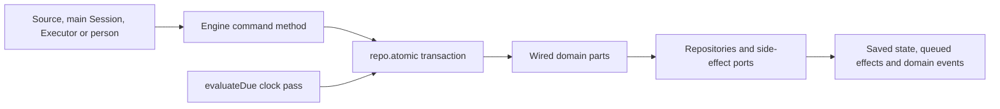

# engine.ts

`src/core/engine.ts` defines the `Engine` class: the single place where the domain core accepts changes, and the only door callers use to reach intake, evaluation, tickets, assignments and replies. Every public method represents one intent from one side of the system — a Source, the main Session, a person, an Executor or Settings — and runs inside one repository transaction. The file also declares the narrow role interfaces (`EngineForSources`, `EngineForMainSession`, `EngineForPeople`, `EngineForSettings`, `EngineForExecutor`) that hand each caller only the methods it is allowed to use. Read it to understand what the system accepts from each side and what it gives back.

## Whole-unit functional diagram

A caller picks one Engine method that matches its role; the Engine opens a single transaction and delegates the actual work to the part that owns that aggregate. The part reads and writes through repositories and queues outward effects through the ports, so the caller either gets a refreshed aggregate back or nothing at all, and the transaction commits once. The `evaluateDue` clock pass enters the same path repeatedly, one transaction per thread or ticket it touches.

<!-- {
  "mermaid_info": {
    "name": "Engine command flow",
    "nodes": [
      {
        "id": "callers_001",
        "name": "Source, main Session, Executor or person",
        "path": "",
        "hint": "The external side that asks the Engine to do something",
        "isJumpable": false,
        "position": { "startLine": 0, "endLine": 0 },
        "references": []
      },
      {
        "id": "command_002",
        "name": "Engine command method",
        "path": "src/core/engine.ts",
        "hint": "One public method per intent, grouped by the caller it serves",
        "isJumpable": true,
        "position": { "startLine": 48, "endLine": 166 },
        "references": []
      },
      {
        "id": "transaction_003",
        "name": "repo.atomic transaction",
        "path": "src/core/engine.ts",
        "hint": "Each mutating command runs inside one repository transaction",
        "isJumpable": true,
        "position": { "startLine": 100, "endLine": 100 },
        "references": []
      },
      {
        "id": "parts_004",
        "name": "Wired domain parts",
        "path": "src/core/engine.ts",
        "hint": "Constructor builds Replies, Tickets, Assignments, Evals and Intake once and shares them",
        "isJumpable": true,
        "position": { "startLine": 31, "endLine": 38 },
        "references": []
      },
      {
        "id": "ports_005",
        "name": "Repositories and side-effect ports",
        "path": "src/core/ports.ts",
        "hint": "Durable state and queue-style side effects the parts write through",
        "isJumpable": true,
        "position": { "startLine": 106, "endLine": 120 },
        "references": []
      },
      {
        "id": "result_006",
        "name": "Saved state, queued effects and domain events",
        "path": "",
        "hint": "What an observer can see after the transaction commits",
        "isJumpable": false,
        "position": { "startLine": 0, "endLine": 0 },
        "references": []
      },
      {
        "id": "clock_007",
        "name": "evaluateDue clock pass",
        "path": "src/core/engine.ts",
        "hint": "Periodic multi-step pass that requeues, wakes and starts evaluations",
        "isJumpable": true,
        "position": { "startLine": 75, "endLine": 85 },
        "references": []
      }
    ]
  }
} -->

    
        <a target="_self" href="#src/core/engine.ts:1?class=graph" style="color: inherit; text-decoration: none;">Graph: Engine command flow</a>
    

## At a glance

- **Primary role — orchestration:** the file does not implement ticket or evaluation rules itself; it decides which part handles a request, in what order, and wraps the whole step in one transaction.
- **Secondary role — API boundary:** the five exported `Pick` aliases are the real contract, giving each caller a deliberately small slice of the class instead of the whole Engine.
- **Confidence:** High — the whole file was read, together with `EngineOptions`, the `Repositories` port, the exported barrel, and the application call sites that construct and consume the Engine.

## What this file does

- **Takes in Source traffic.** `receive` stores a trigger once, fans it out to subscribed tickets and queues it for evaluation; `bindThread` and `threadClosed` let a Source attach a ticket to a Thread and report that a Thread ended.
- **Drives time forward.** `evaluateDue` is the pass a scheduler calls: it requeues overdue evaluations, wakes ended tickets that are holding undelivered messages, and starts evaluations whose triggers are waiting.
- **Serves the main Session.** `candidate` and `candidateDelivered` expose the evaluation the Session is assessing, while `decide`, `attach`, `note`, `reply` and `requestStatus` record what the Session concluded or routed.
- **Serves people.** `stopTicket`, `retryTicket`, `reevaluate`, `unsubscribe` and `dismiss` are the manual overrides a panel exposes.
- **Receives Executor and worker facts.** `assignmentStarted`, `inputsDelivered`, `inputsRead`, `turnEnded`, `deliveryFailed`, `assignmentInterrupted` and `report` feed runtime reality back into the domain; `markUnrelated`, `followForContext` and `handback` are the worker's own requests.
- **Reacts to settings.** `policyChanged` tells open tickets and running evaluations that the Policy version moved.

## Key functions or classes

### `Engine`

The domain's single mutating entry point, holding one instance of each part and routing every public method to the right one inside `repo.atomic`.

    
        <a target="_self" href="#src/core/engine.ts:24-258?class=code" style="color: inherit; text-decoration: none;">Code: src/core/engine.ts:24-258</a>
    

### `receive`

Accepts a Source's trigger and returns whether it was stored, already known, or filtered out, so a Source can retry safely.

    
        <a target="_self" href="#src/core/engine.ts:48?class=code" style="color: inherit; text-decoration: none;">Code: src/core/engine.ts:48</a>
    

### `evaluateDue`

The clock pass: requeues overdue evaluations, stops early while processing is paused, then wakes stalled tickets and starts evaluations whose triggers are queued.

    
        <a target="_self" href="#src/core/engine.ts:75-85?class=code" style="color: inherit; text-decoration: none;">Code: src/core/engine.ts:75-85</a>
    

### `decide`

Records the outcome of an evaluation — ignore, unavailable, accept or stop — and produces the resulting `Decision`, or a direct decision when no evaluation holds the trigger.

    
        <a target="_self" href="#src/core/engine.ts:100?class=code" style="color: inherit; text-decoration: none;">Code: src/core/engine.ts:100</a>
    

### `attach`

Routes a trigger to an existing ticket by coordinating all the parts in order: refuse a handed-back message, withdraw the evaluation, attach the input, mark it routed, wake the ticket, then return the reread ticket.

    
        <a target="_self" href="#src/core/engine.ts:109-121?class=code" style="color: inherit; text-decoration: none;">Code: src/core/engine.ts:109-121</a>
    

### `report`

The Executor's main channel back: records a worker report on the current assignment and returns the ticket in whatever state the report put it, including ended.

    
        <a target="_self" href="#src/core/engine.ts:239?class=code" style="color: inherit; text-decoration: none;">Code: src/core/engine.ts:239</a>
    

### Role interfaces

`EngineForSources`, `EngineForMainSession`, `EngineForPeople`, `EngineForSettings` and `EngineForExecutor` narrow the Engine to the exact methods each side may call.

    
        <a target="_self" href="#src/core/engine.ts:260-270?class=code" style="color: inherit; text-decoration: none;">Code: src/core/engine.ts:260-270</a>
    

## Coordinated flow

1. **A caller names one intent.** A Source calls `receive`; the main Session calls `decide` or `attach`; the Executor calls `report` or one of the delivery facts; a person acts through `stopTicket` or `retryTicket`.
2. **The Engine opens the transaction and picks the owner.** Each method is a one-line delegation inside `repo.atomic`, so a partially applied change is never visible; the constructor has already wired `Replies`, `Tickets`, `Assignments`, `Evals` and `Intake` so they can call each other inside that same transaction.
3. **The part applies the rules and queues effects.** The owning part reads what it needs from repositories, may hand off to a sibling part (for example an attachment withdrawing an evaluation before adding an input), and asks the ports to start an assignment or queue a reply rather than performing those side effects directly.
4. **The caller gets a refreshed view.** Methods that change a ticket return the stored `Ticket`; `receive` returns a `ReceiveResult`, `reply` a `Reply`, and the reporting methods return `void` or a boolean. Refusals surface as `UserError`.

### Important branching and ordering

`evaluateDue` is the one method with real internal sequencing: it handles every thread with an evaluation in progress first, returns immediately when the policy is paused (nothing expires during a pause), then wakes ended tickets holding undelivered messages, and only then starts evaluations for threads whose triggers are still waiting. Each of those units of work gets its own transaction. `attach` also carries an explicit guard: a message this ticket's worker already handed back cannot be re-attached, because no worker would then decide it and it could not be handed back again.

## Main inputs and results

- **Inputs:** one call per intent with small primitive arguments (ticket, trigger, thread, assignment or evaluation identifiers, an `Outcome`, a `WorkerReport`, a `ReplyRequest`), backed by the `EngineOptions` bundle of repositories, current `Policy`, source scope, assessor, executor, outbox, optional ticket preparation, clock and event sink.
- **Results:** the stored aggregate when there is one to return — `Ticket`, `Decision`, `Reply` — or a status such as `ReceiveResult` (`stored` / `duplicate` / `filtered`) and booleans for "was it asked / queued / dropped".
- **Visible side effects:** rows saved through the repositories, messages queued in the outbox, start/deliver/stop calls handed to the Executor and assessor, and domain events emitted for observers.
- **Refusals:** `UserError` with a code, thrown for unknown tickets or triggers, ended objects, actions the current Policy or state forbids, and messages a worker still owns.

## Public contract

- **Callers:** Sources, the main Session, people acting through a panel, Settings, and the Executor with its workers — each typed with its own `Pick` alias, and the application layer really does narrow them further (for example the HTTP surface takes `EngineForPeople` and the DSH executor takes `EngineForExecutor`).
- **Operation:** every boundary is a synchronous command stating one fact or request; there is no batch endpoint and no query surface for lists beyond `candidate`.
- **Accepted input:** identifiers plus the payload that names the intent. Timestamps from a Source are normalized to canonical ISO form (`isoTime`) before use, so Sources sending coarser times such as whole seconds are accepted.
- **Result:** the refreshed aggregate or status, with `UserError` carrying a code such as `unknownTicket`, `handedBackHere` or `workerDecides` for refusals.
- **Validation requirements:** the Engine performs no authentication or authorization of its own; trust comes from wiring. The `Pick` aliases are the access control, which is why the runtime hands each collaborator only its own slice of the same Engine instance.

---
name: engine.ts

update-time: 2026-11-02 11:07

description: `src/core/engine.ts` defines the `Engine` class: the single place where the domain core accepts changes, and the only door callers use to reach intake, evaluation, tickets, assignments and replies. Every public method represents one intent from one side of the system — a Source, the main Session, a person, an Executor or Settings — and runs inside one repository transaction. The file also declares the narrow role interfaces (`EngineForSources`, `EngineForMainSession`, `EngineForPeople`, `EngineForSettings`, `EngineForExecutor`) that hand each caller only the methods it is allowed to use. Read it to understand what the system accepts from each side and what it gives back.

---
