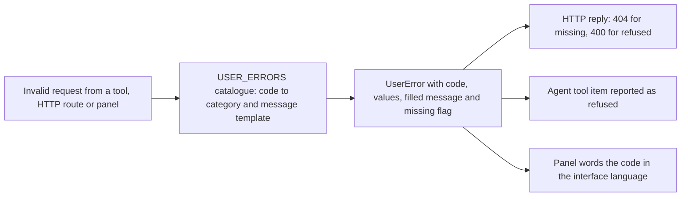

# errors.ts

This file is the single place where the project names every refusal a person or an agent can provoke. It holds a closed catalogue of error codes, each paired with a category (`missing` or `refused`) and an English message template, plus the `UserError` class that turns a code and its interpolation values into a throwable error. Everything that rejects a caller request — engine parts, application services, prompt and settings helpers — throws this type, and the HTTP layer, the agent tool handlers and the web panel all read it back. Reading this file first tells you what can go wrong in this system and how each failure is reported.

## Whole-unit functional diagram

<!-- {
  "mermaid_info": {
    "name": "How a refused request becomes a reported failure",
    "nodes": [
      {
        "id": "request_001",
        "name": "Invalid request from a tool, HTTP route or panel",
        "path": "",
        "hint": "An abstract caller request that the system decides to reject",
        "isJumpable": false,
        "position": { "startLine": 0, "endLine": 0 },
        "references": []
      },
      {
        "id": "catalogue_002",
        "name": "USER_ERRORS catalogue: code to category and message template",
        "path": "src/core/errors.ts",
        "hint": "Every code with its missing/refused category and English template",
        "isJumpable": true,
        "position": { "startLine": 2, "endLine": 47 },
        "references": []
      },
      {
        "id": "error_003",
        "name": "UserError with code, values, filled message and missing flag",
        "path": "src/core/errors.ts",
        "hint": "The thrown error that carries the code and interpolation values",
        "isJumpable": true,
        "position": { "startLine": 54, "endLine": 61 },
        "references": []
      },
      {
        "id": "http_004",
        "name": "HTTP reply: 404 for missing, 400 for refused",
        "path": "src/app/http.ts",
        "hint": "Maps the error to a status code and a JSON body with code and values",
        "isJumpable": true,
        "position": { "startLine": 88, "endLine": 88 },
        "references": []
      },
      {
        "id": "tools_005",
        "name": "Agent tool item reported as refused",
        "path": "src/app/tools/main.ts",
        "hint": "Turns the error message into a per-item refusal in the tool result",
        "isJumpable": true,
        "position": { "startLine": 144, "endLine": 144 },
        "references": []
      },
      {
        "id": "panel_006",
        "name": "Panel words the code in the interface language",
        "path": "src/client/locales.ts",
        "hint": "Localized wording for each user error code",
        "isJumpable": true,
        "position": { "startLine": 683, "endLine": 683 },
        "references": []
      }
    ]
  }
} -->

    
        <a target="_self" href="#src/core/errors.ts:1?class=graph" style="color: inherit; text-decoration: none;">Graph: How a refused request becomes a reported failure</a>
    

A request reaches a decision point, a code is looked up in the catalogue to obtain its category and template, and the resulting `UserError` becomes a status code, a per-item refusal or localized wording depending on who catches it. The text is never the contract: consumers switch on the numeric status or on the code itself.

## At a glance

- Primary role: Data contract — it defines the shared vocabulary of failures exchanged between the engine, the HTTP API, the agent tools and the user interface, rather than performing any behavior of its own.
- Secondary roles: API boundary — the exported `UserError` type is the boundary that core code throws across and that callers catch, translating it into status codes, tool refusals and localized messages.
- Confidence: High — the file is 62 lines and was read in full, and every consumer listed below was confirmed by searching the sources for `UserError`, `USER_ERRORS` and `instanceof UserError`.

## What this file does

- Names every refusal people or agents can trigger, so a failure has one stable identity instead of an ad-hoc string built at the throw site.
- Separates two categories that change behavior: `missing` means referenced state does not exist, while `refused` means the request was understood but is not allowed.
- Keeps message templates with named placeholders (`{block}`, `{part}`, `{reason}`, `{limit}`, `{tickets}` and similar) that are filled from a values record when the error is constructed.
- Preserves diagnosis data on the error object — the code and the raw values stay available, so callers never have to parse the rendered sentence.
- Guarantees at compile time that each entry is exactly a category plus a message text, and derives the allowed code names from the catalogue keys.
- Provides the canonical English wording that the web panel mirrors in each supported language, with a test asserting no code is left untranslated.

## Key functions or classes

### `USER_ERRORS`

The catalogue object mapping each error code to a `[category, English template]` pair, declared `as const` so entry names and message text keep their literal types.

    
        <a target="_self" href="#src/core/errors.ts:2-47?class=code" style="color: inherit; text-decoration: none;">Code: src/core/errors.ts:2-47</a>
    

### `UserErrorCode`

The union type derived from the catalogue's keys, so a code that is not in the catalogue cannot be thrown without a type error.

    
        <a target="_self" href="#src/core/errors.ts:48?class=code" style="color: inherit; text-decoration: none;">Code: src/core/errors.ts:48</a>
    

### `UserError`

The thrown error type that looks up its template, substitutes the supplied values, and exposes `code`, `values` and a boolean `missing` flag for consumers.

    
        <a target="_self" href="#src/core/errors.ts:54-61?class=code" style="color: inherit; text-decoration: none;">Code: src/core/errors.ts:54-61</a>
    

## Main inputs and results

- Inputs: a `UserErrorCode` naming the refusal, and an optional record of string values that fill the template placeholders; a placeholder with no supplied value is left visible as-is.
- Results: an `Error` subclass whose message is the filled English template, carrying the original code, the values and the `missing` flag for programmatic handling.
- Visible side effects: an agent tool reports the message as a refused item and continues with the remaining items; the management API answers a `missing` code with HTTP 404 and others with HTTP 400, returning the message alongside `code` and `values`; the panel shows its own wording for that code in the interface language.

## Information contract

- Represents: the project's vocabulary of caller-caused failures, where each code stands for one specific rejected situation rather than for an implementation detail.
- Produced by: engine parts and application services across the codebase whenever a caller request is invalid or references state that does not exist — for example prompt validation, settings blocks, reply and attachment rules.
- Consumed by: the HTTP failure mapper in the management API, the agent tool handlers that report refusals, the browser client that validates incoming codes against the catalogue, and the localization tables that render them for people.
- Behavior-shaping parts: the `missing`/`refused` category selects the HTTP status and drives the client's "record does not exist" notion; the code string is the localization key and the stable identity clients may branch on; the placeholder names in a template must match the values a throw site supplies or the sentence keeps a raw `{name}`.

### Compatibility notes

Because the code union is derived from the catalogue keys, adding an entry is a purely additive change for TypeScript callers, but it also requires wording for every supported language — a test fails if any code lacks a translation. Renaming or removing a code is a breaking change for anything matching on the string, since the panel wording is keyed by `userError.<code>` and the browser client only accepts codes present in the catalogue.

## Public contract

- Caller: core engine methods and application services that validate a request from an agent tool, an HTTP route or the management panel.
- Operation: signal a rejected request as a typed, self-describing failure instead of a generic exception.
- Accepted input: a code from the catalogue plus optional string values for its placeholders; an unknown code is a compile-time error, not a runtime fallback.
- Result: a catchable error that transports the rendered message and its structured parts, letting each boundary choose its own representation without reinterpreting the wording.

---
name: errors.ts

update-time: 2026-11-02 11:13

description: This file is the single place where the project names every refusal a person or an agent can provoke. It holds a closed catalogue of error codes, each paired with a category (`missing` or `refused`) and an English message template, plus the `UserError` class that turns a code and its interpolation values into a throwable error. Everything that rejects a caller request — engine parts, application services, prompt and settings helpers — throws this type, and the HTTP layer, the agent tool handlers and the web panel all read it back. Reading this file first tells you what can go wrong in this system and how each failure is reported.

---
