# evals.ts

This file is the core's judging bench: it turns the messages queued on a Thread into one recorded `Decision` — accept work, ignore it, stop a ticket, or admit that judgement was unavailable. `Evals` batches a Thread's Triggers, takes its authority from the Policy gate, hands the batch to an assessor, protects the deadline, and writes the Decision that everything downstream reads. Open it when you need to know why a message became a ticket — or why it did not.

## How an evaluation flows

```mermaid
flowchart LR
  queued_001["Triggers queued on a Thread"] --> start_002["start: gate the batch into one Eval"]
  start_002 --> assess_003["Assessor receives a Candidate"]
  assess_003 --> decide_004["decide: apply one outcome"]
  decide_004 --> record_005["Record the Decision and reasons"]
  record_005 --> ticket_006["Tickets create or end the ticket"]
  deadline_007["due: deadline and pause"] --> expire_008["expire: requeue or unavailable"]
  expire_008 --> queued_001
```

The main path runs left to right: queued Triggers are gated into a single Eval, the assessor is asked, and one outcome becomes a Decision that may create or end a ticket. The lower path is the safety net — an Eval that nobody answers is requeued a limited number of times and then recorded as unavailable.

<!-- {
  "mermaid_info": {
    "name": "Eval to Decision flow",
    "nodes": [
      {
        "id": "queued_001",
        "name": "Triggers queued on a Thread",
        "path": "src/core/evals.ts",
        "hint": "A Thread's pending Trigger ids wait for the next Eval",
        "isJumpable": true,
        "position": { "startLine": 79, "endLine": 91 },
        "references": []
      },
      {
        "id": "start_002",
        "name": "start: gate the batch into one Eval",
        "path": "src/core/evals.ts",
        "hint": "Admissible Triggers are batched, the strongest supplies strength and Mandate basis",
        "isJumpable": true,
        "position": { "startLine": 70, "endLine": 119 },
        "references": []
      },
      {
        "id": "assess_003",
        "name": "Assessor receives a Candidate",
        "path": "src/core/evals.ts",
        "hint": "Facts handed to the assessor, never authority",
        "isJumpable": true,
        "position": { "startLine": 237, "endLine": 242 },
        "references": []
      },
      {
        "id": "decide_004",
        "name": "decide: apply one outcome",
        "path": "src/core/evals.ts",
        "hint": "Public entry point that validates and dispatches an assessment outcome",
        "isJumpable": true,
        "position": { "startLine": 125, "endLine": 156 },
        "references": []
      },
      {
        "id": "record_005",
        "name": "Record the Decision and reasons",
        "path": "src/core/evals.ts",
        "hint": "Persists the Decision and updates every Trigger's disposition",
        "isJumpable": true,
        "position": { "startLine": 327, "endLine": 339 },
        "references": []
      },
      {
        "id": "ticket_006",
        "name": "Tickets create or end the ticket",
        "path": "src/core/evals.ts",
        "hint": "An accept creates a ticket under a Mandate; a stop ends one",
        "isJumpable": true,
        "position": { "startLine": 305, "endLine": 316 },
        "references": []
      },
      {
        "id": "deadline_007",
        "name": "due: deadline and pause",
        "path": "src/core/evals.ts",
        "hint": "Checks the deadline, notes processing pauses and shifts it forward on resume",
        "isJumpable": true,
        "position": { "startLine": 30, "endLine": 46 },
        "references": []
      },
      {
        "id": "expire_008",
        "name": "expire: requeue or unavailable",
        "path": "src/core/evals.ts",
        "hint": "Queues the Triggers again a limited number of times, then records unavailable",
        "isJumpable": true,
        "position": { "startLine": 56, "endLine": 69 },
        "references": []
      }
    ]
  }
} -->

    
        <a target="_self" href="#src/core/evals.ts:1?class=graph" style="color: inherit; text-decoration: none;">Graph: Eval to Decision flow</a>
    

## At a glance

- **Primary role — domain rules:** the file holds the project's rules about who may originate work and what a judgement is allowed to do, expressed as an eval lifecycle rather than as a user interface.
- **Secondary role — API boundary:** `decide`, `reevaluate`, `handback` and `dismiss` are the callable contract the Engine forwards to the main Session, people and workers, including the exact refusals each may return.
- **Confidence:** High — the whole file was read together with the shared model, the ports it depends on, the base part class, and the Engine that routes work into it.

## What this file does

- **Batches one Thread's messages into one judgement.** Everything queued on a Thread is judged together, so a burst of related messages produces one decision instead of several.
- **Takes its authority from the gate, not from the assessor.** The Policy gate says which Triggers are admissible and, of those, the strongest supplies the Eval's strength, actor and Mandate basis. An explicit request outranks an inferred one; between equals, the newest wins.
- **Asks the assessor and keeps the deadline honest.** The candidate is handed over as bounded facts; the clock only starts once the candidate actually reached the assessor's session, a processing pause pushes the deadline forward instead of burning it, and an unanswered Eval is retried a couple of times before being written down as unavailable.
- **Refuses authority it cannot justify.** An inferred candidate is only accepted on enabled rules its assessment matched, and a stop needs an explicit request plus a ticket that is still open; anything weaker becomes an `ignore` with the reason that explains it.
- **Prevents the same message working twice.** A Trigger that already started a ticket cannot lend authority to a new evaluation or spawn a duplicate, and replaying its accept returns the earlier Decision.
- **Keeps the Thread's bookkeeping straight.** Routing a message to a ticket, replaying it, a policy change mid-assessment, and a worker handing a message back all have defined effects: the batch is either ended or put back in front of the queue for a fresh Eval.

## Key functions or classes

### `Evals`

The file's only class: a domain part constructed by the Engine with `Tickets` beside it, so an accept can create a ticket and a stop can end one.

    
        <a target="_self" href="#src/core/evals.ts:27-340?class=code" style="color: inherit; text-decoration: none;">Code: src/core/evals.ts:27-340</a>
    

### `start(threadKey, policy)`

Opens exactly one Eval for a Thread's queued Triggers, after removing follow-ups a ticket's worker still decides and Triggers that already started a ticket, then asks the assessor.

    
        <a target="_self" href="#src/core/evals.ts:70-119?class=code" style="color: inherit; text-decoration: none;">Code: src/core/evals.ts:70-119</a>
    

### `due(thread, policy)`

Runs on each pass per Thread: it never expires an Eval whose candidate was not delivered, shifts deadlines across a processing pause, and hands an overdue Eval to `expire`.

    
        <a target="_self" href="#src/core/evals.ts:30-69?class=code" style="color: inherit; text-decoration: none;">Code: src/core/evals.ts:30-69</a>
    

### `decide(triggerId, outcome)`

The main write entry point: it validates the outcome against the Eval that holds the Trigger, refuses duplicates and worker-owned follow-ups, and applies accept, stop, ignore or unavailable.

    
        <a target="_self" href="#src/core/evals.ts:125-156?class=code" style="color: inherit; text-decoration: none;">Code: src/core/evals.ts:125-156</a>
    

### `accept`

Builds the `Mandate` from the Eval's strength, actor, basis and matched rules, records the accept Decision, and has `Tickets` create the ticket under it.

    
        <a target="_self" href="#src/core/evals.ts:305-316?class=code" style="color: inherit; text-decoration: none;">Code: src/core/evals.ts:305-316</a>
    

### `reassess(thread, reason, without)`

Ends the current Eval as unavailable and puts its Triggers back at the front of the queue — the shared move behind a policy change, a routed message, or a trigger already accepted elsewhere.

    
        <a target="_self" href="#src/core/evals.ts:222-230?class=code" style="color: inherit; text-decoration: none;">Code: src/core/evals.ts:222-230</a>
    

### `reevaluate(triggerId)`

A person's replay: it queues a stored Trigger for a fresh Eval and announces it, answering `false` while an Eval still holds that Trigger.

    
        <a target="_self" href="#src/core/evals.ts:157-175?class=code" style="color: inherit; text-decoration: none;">Code: src/core/evals.ts:157-175</a>
    

### `handback(ticketId, triggerId, reason)`

Records that a worker found a message beyond its ticket, and queues it for a fresh Eval once no ticket decides it any more, each ticket handing a message back only once.

    
        <a target="_self" href="#src/core/evals.ts:176-188?class=code" style="color: inherit; text-decoration: none;">Code: src/core/evals.ts:176-188</a>
    

## Main inputs and results

- **Inputs:** a `Thread` with queued Trigger ids, the current `Policy` (its gate, `paused`, `evalTimeoutMs` and `admitsInferred`), an `AssessmentOutcome` from the assessor or the main Session, stored Triggers, Decisions and tickets, and the injected clock.
- **Results:** the Thread's `evaluating` and `pending` state, a stored `Decision` with its reasons, Mandate and optional audit data, a created or ended ticket, and updated `TriggerDisposition` entries naming the Eval and Decision.
- **Visible side effects:** a new ticket appears for an accept; a stopped ticket ends with outcome `stopped`; an unanswered assessment shows up as an `unavailable` problem that a person can dismiss; the assessor is asked for a judgement and told to release whatever it kept for an Eval that ended.

## Rules and decisions

- **Decision:** given a batch of messages on one Thread, should this become authorized work, be dropped, stop existing work, or be admitted as unjudgeable?
- **Important conditions:** whether the gate admits each Trigger and at what strength; whether a Trigger already started a ticket; whether a ticket's worker still decides a person's follow-up (then the main Session may only stop it); whether an inferred candidate came with enabled rules its assessment matched; whether a stop names a ticket that is still open; and whether the Policy version changed while the Eval was running.
- **Outcomes:** `accept` (with a Mandate and a ticket), `ignore` (with a coded reason such as an inadmissible batch, an already-started ticket, or a routed message), `stop` (only explicit, only for a live ticket), and `unavailable` (a timeout or a policy change, which is a problem for a person rather than a judgement).
- **Invariant:** a Thread has at most one Eval in progress, and its Triggers move out of `pending` into that Eval; an Eval's Decision id derives from the Eval, and an ignored batch gets its own id so an earlier Decision for the same Triggers is never overwritten; a Trigger that started a ticket never starts a second one; and an Eval that nothing answered is requeued at most twice before it is written down as unavailable rather than silently dropped.

### A small example

Three messages land on one Thread while nothing is being judged. Two pass the gate and one is refused. The refused message's code is kept only in case nothing is admissible; the other two are judged as one batch, and the explicit mention between them supplies the strength, actor and basis that an accept would put into the Mandate. The accept creates a single ticket, and if the same Trigger is replayed afterwards, `decide` returns that earlier Decision instead of starting a second one. If instead the assessor never answers, the Triggers go back to the front of the queue; after the third expiry the batch is recorded as `unavailable` with a timeout reason.

## Public contract

- **Caller:** the `Engine`, which calls this part inside one transaction per command — the main Session submitting outcomes, a person replaying or dismissing, a worker handing a message back, the pass loop checking deadlines and starting Evals, and the assessor reporting that a candidate was delivered.
- **Operation:** submit an assessment outcome for a Trigger, queue a Trigger for a fresh Eval, hand a message back from a ticket, dismiss an `unavailable` problem, or read the `Candidate` the assessor was given.
- **Accepted input:** a `triggerId` plus an `Outcome`, which is an `AssessmentOutcome` that may also carry `evalId` to say which Eval judged it; an accept must carry `title` and `scope`, a stop must carry `ticketId`, and a `reason` may be plain text, which is stored as a `said` reason. `handback` takes a ticket id, a Trigger id and a written reason; `dismiss` takes a Decision id.
- **Result:** the stored `Decision` for `decide` and `dismiss`, `false` where the honest answer is "not now" (`reevaluate` while an Eval holds the Trigger, `handback` while another ticket still decides it), otherwise a `UserError`.

### Access and validation requirements

There is no authentication at this boundary — it lives inside the engine, and its only refusal mechanism is the `UserError` code. `unknownTrigger` for a Trigger that was never stored, `evalFinished` when the outcome names an Eval that no longer holds the Trigger, `notAdmissible` when a Trigger is judged on its own and the gate refuses it, `notExplicit` when an inferred candidate is accepted without matching enabled rules, `workerDecides` when a ticket's worker still decides a follow-up and the outcome is not a stop, `notReached` and `handedBack` for hand-backs the ticket cannot make, and `unknownProblem` for a Decision that is not an `unavailable` one.

---
name: evals.ts

update-time: 2026-11-02 11:10

description: This file is the core's judging bench: it turns the messages queued on a Thread into one recorded `Decision` — accept work, ignore it, stop a ticket, or admit that judgement was unavailable. `Evals` batches a Thread's Triggers, takes its authority from the Policy gate, hands the batch to an assessor, protects the deadline, and writes the Decision that everything downstream reads. Open it when you need to know why a message became a ticket — or why it did not.

---
