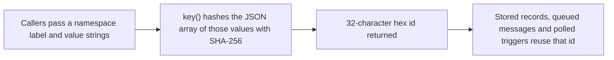

# ids.ts

`src/core/ids.ts` is the smallest file in the core, but it answers a question every other part of the system depends on: *what should this record be called?* Instead of generating random identifiers, it derives an id from the values that identify a thing, so the same inputs always name the same record. That single property is what lets tickets, messages, evaluations and triggers be replayed, retried or polled without creating duplicates.

## Whole-unit functional diagram

A caller hands `key` a short label plus the strings that identify one thing, such as `'ack'` and a trigger id. The helper hashes them and returns a short hex string that the caller then uses as an id, and any later caller that recomputes the same inputs lands on exactly the same value.

## At a glance

- Primary role: Utility — a focused, reusable helper that produces stable identifiers for the rest of the codebase.
- Confidence: High — the whole six-line module was read, together with its exports and many of its call sites across `src/core`, `src/app` and `src/sources`.

## What this file does

- **Makes identifiers reproducible.** The same list of strings always yields the same id, in this run, in the next process, and on another machine.
- **Keeps names collision-free between kinds of records.** The first argument acts as a namespace, so `'ack'` ids, `'ticket'` ids, `'eval'` ids and `'input'` ids live in separate buckets even when they are built from the same trigger.
- **Keeps ids short enough to store and print.** The digest is cut down to 32 hex characters, which stays readable in logs, panel views and resource paths.
- **Gives the engine idempotency for free.** Because ids are derived rather than random, a repeated accept, a re-queued message or a repeated poll of a remote source produces the same id and can be recognised as "already done".
- **Serves as one shared helper instead of many ad-hoc schemes.** The core parts, the app layer and the source adapters all call the same function, and it is re-exported from `src/core/index.ts`.

## Reusable capability

- **Solves:** the recurring problem of needing an identifier that is stable across retries, restarts and repeated polling, without keeping a lookup table or a counter.
- **Input:** one or more strings. By convention the first is a short label naming the kind of record (`'feishu'`, `'github-issue'`, `'eval'`, `'ack'`, `'input'`, …) and the rest are the values that identify it.
- **Result:** a 32-character hexadecimal string, deterministic for equal inputs.
- **Main usage area:** the core parts that create records and messages (`src/core/tickets.ts`, `src/core/evals.ts`, `src/core/intake.ts`, `src/core/assignments.ts`, `src/core/replies.ts`), the source adapters that derive trigger ids from remote message ids, and the app layer for prompt, notice and session request ids.

### Important usage constraint

The helper accepts **strings only** and it hashes the values *as an ordered list*. Callers that need to identify something by a structured value must serialise it themselves first — that is why callers such as the policy version and the PR-notice id pass `JSON.stringify(...)` of an object. Two calls agree only when the label, the order and the exact string forms all match.

## Key functions or classes

### `key(...values: string[]): string`

Derives a stable 32-character hex id from the ordered list of strings it is given.

    
        <a target="_self" href="#src/core/ids.ts:3-5?class=code" style="color: inherit; text-decoration: none;">Code: src/core/ids.ts:3-5</a>
    

## Main inputs and results

- Inputs: the label and identifying strings supplied by a caller, for example a purpose name plus a trigger id, or a ticket id plus the kind of input being added.
- Results: a 32-character hexadecimal id that the caller stores, sends or compares against.
- Visible side effects: none — the helper is pure apart from computing a hash; an id becomes observable only when a caller persists it, queues a message under it, or shows it in a resource path.

Typical consumers are the core parts re-exported from 
<a target="_self" href="#src/core/index.ts?class=code" style="color: inherit; text-decoration: none;">index.ts</a>
, and the architecture table that describes this unit is 
<a target="_self" href="#docs/007-architecture.md?class=text" style="color: inherit; text-decoration: none;">007-architecture.md</a>
.

<!-- {
  "mermaid_info": {
    "name": "How key() turns values into a stable id",
    "nodes": [
      {
        "id": "callers_001",
        "name": "Callers pass a namespace label and value strings",
        "path": "",
        "hint": "Any core part or adapter that needs an id for a record, message or trigger",
        "isJumpable": false,
        "position": { "startLine": 0, "endLine": 0 },
        "references": []
      },
      {
        "id": "hash_002",
        "name": "key() hashes the JSON array of those values with SHA-256",
        "path": "src/core/ids.ts",
        "hint": "The single exported helper; it serialises the argument list and hashes it",
        "isJumpable": true,
        "position": { "startLine": 3, "endLine": 5 },
        "references": []
      },
      {
        "id": "id_003",
        "name": "32-character hex id returned",
        "path": "src/core/ids.ts",
        "hint": "The digest truncated to 32 lower-case hex characters",
        "isJumpable": true,
        "position": { "startLine": 4, "endLine": 4 },
        "references": []
      },
      {
        "id": "reuse_004",
        "name": "Stored records, queued messages and polled triggers reuse that id",
        "path": "",
        "hint": "Equal inputs later in time recompute the same id, which is what makes retries idempotent",
        "isJumpable": false,
        "position": { "startLine": 0, "endLine": 0 },
        "references": []
      }
    ]
  }
} -->

    
        <a target="_self" href="#src/core/ids.ts:1?class=graph" style="color: inherit; text-decoration: none;">Graph: How key() turns values into a stable id</a>
    

---
name: ids.ts

update-time: 2026-11-02 11:15

description: `src/core/ids.ts` is the smallest file in the core, but it answers a question every other part of the system depends on: *what should this record be called?* Instead of generating random identifiers, it derives an id from the values that identify a thing, so the same inputs always name the same record. That single property is what lets tickets, messages, evaluations and triggers be replayed, retried or polled without creating duplicates.

---
