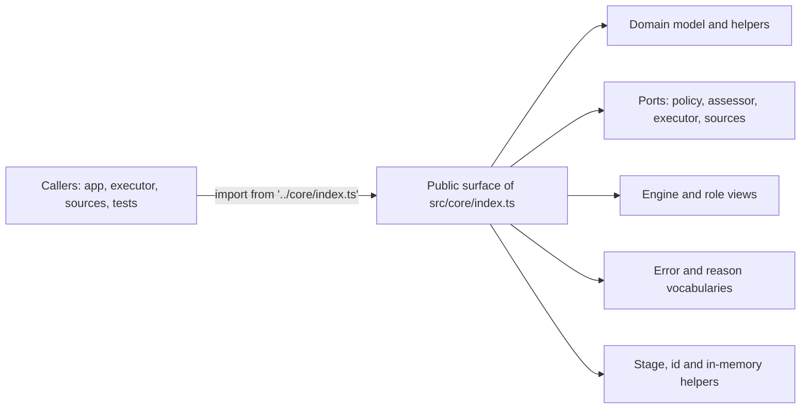

# src/core/index.ts

This file is the public front door of the proactive-agent core. Everything that lives in `src/core` — the domain model, the ports, the `Engine`, the shared error and reason vocabularies, the in-memory repositories and a few small helpers — is meant to be imported from here rather than from individual files. A first-time reader can treat this one short list as the answer to "what does the core offer the rest of the project?"; the parts that are deliberately left out (`part.ts`, `intake.ts`, `evals.ts`, `tickets.ts`, `assignments.ts`, `replies.ts`) are internal machinery.

## Overall flow

Callers never reach into `src/core` one file at a time: they ask the barrel for the vocabulary, the ports they must implement, and the single `Engine` they drive. The barrel itself has no logic — it only decides which of those pieces are public.

<!-- {
  "mermaid_info": {
    "name": "How the core surface is assembled",
    "nodes": [
      {
        "id": "callers_001",
        "name": "Callers: app, executor, sources, tests",
        "path": "",
        "hint": "Modules outside the core that consume its public surface",
        "isJumpable": false,
        "position": { "startLine": 0, "endLine": 0 },
        "references": []
      },
      {
        "id": "barrel_002",
        "name": "Public surface of src/core/index.ts",
        "path": "src/core/index.ts",
        "hint": "The re-export list that decides what the core exposes",
        "isJumpable": true,
        "position": { "startLine": 1, "endLine": 11 },
        "references": []
      },
      {
        "id": "model_003",
        "name": "Domain model and helpers",
        "path": "src/core/model.ts",
        "hint": "Trigger, Thread, Ticket, Decision shapes and model helpers, re-exported wholesale",
        "isJumpable": true,
        "position": { "startLine": 1, "endLine": 60 },
        "references": []
      },
      {
        "id": "ports_004",
        "name": "Ports: policy, assessor, executor, sources",
        "path": "src/core/ports.ts",
        "hint": "The interfaces the project implements and the core depends on, re-exported wholesale",
        "isJumpable": true,
        "position": { "startLine": 1, "endLine": 70 },
        "references": []
      },
      {
        "id": "engine_005",
        "name": "Engine and role views",
        "path": "src/core/engine.ts",
        "hint": "The Engine class and the role-scoped interfaces its callers receive",
        "isJumpable": true,
        "position": { "startLine": 19, "endLine": 38 },
        "references": []
      },
      {
        "id": "errors_006",
        "name": "Error and reason vocabularies",
        "path": "src/core/errors.ts",
        "hint": "User-facing error codes and their categories and message templates",
        "isJumpable": true,
        "position": { "startLine": 1, "endLine": 62 },
        "references": []
      },
      {
        "id": "helpers_007",
        "name": "Stage, id and in-memory helpers",
        "path": "src/core/index.ts",
        "hint": "The export lines that expose ticket stages, content-derived ids and the in-memory repositories",
        "isJumpable": true,
        "position": { "startLine": 8, "endLine": 10 },
        "references": []
      }
    ]
  }
} -->

    
        <a target="_self" href="#src/core/index.ts:1?class=graph" style="color: inherit; text-decoration: none;">Graph: How the core surface is assembled</a>
    

## At a glance

- Primary role: A boundary that states the core's public contract — one stable import path that exposes the operations, types and error codes callers are allowed to rely on.
- Secondary roles: A shared vocabulary of data shapes: every module in the project speaks the same `Trigger`, `Thread`, `Ticket`, `Reason` and `UserErrorCode` because they come through this list.
- Confidence: High — the file is eleven lines of exports, and its wording, its callers across `src/app`, `src/executor`, `src/sources` and `tests/`, and the project architecture document all agree on its purpose.

## What this file does

- Publishes the whole domain model and the whole port set by re-exporting `./model.ts` and `./ports.ts` in full (lines 2–3). Anything added to those two files instantly becomes part of the core's public surface, so they act as the deliberate extension area of this boundary.
- Curates the `Engine` export list by hand (lines 4–5): the class plus the five role-scoped interfaces `EngineForSources`, `EngineForMainSession`, `EngineForPeople`, `EngineForSettings` and `EngineForExecutor`, together with the result and option types callers need (`EngineOptions`, `ReceiveResult`, `Outcome`, `Reply`, `ReplyRequest`, `WorkerReport`). Callers get a narrow view of the engine, not the whole thing.
- Exposes the failure and explanation vocabularies (lines 6–7): `UserError`/`USER_ERRORS` with their `missing` versus `refused` categories, and `REASONS`/`reasonText`/`said` with `Reason` and `ReasonCode`, so a caller can both raise and explain an outcome using codes rather than free text.
- Keeps the core usable without a database: `MemoryRepositories` (line 8) satisfies the repositories port in memory, which is what most domain tests and ephemeral engine instances use.
- Surfaces small projection helpers (lines 9–10): `ticketStage` and `canRetry` summarize where a ticket stands, and `key` derives stable content-based ids. Model-level helpers such as `threadKey`, `liveTicket`, `latestAssignment`, `waitsForPerson` and `followed` come along automatically with the model re-export.
- Withholds the engine's internal parts. `EnginePart`, `Intake`, `Evals`, `Tickets`, `Assignments` and `Replies` are reachable only inside `src/core`, which is what makes the single `Engine` entry point meaningful.

## Key functions or classes

### `Engine`

The core's single transactional entry point: sources call it to receive triggers, and it exposes ticket, assignment, eval and reply operations to the other callers' narrow views.

<a target="_self" href="#src/core/engine.ts:19-38?class=code" style="color: inherit; text-decoration: none;">engine.ts:19-38</a>

### `EngineForSources` and the other role views

`Pick`-based slices of the `Engine` handed to each kind of caller so that a source cannot, for example, decide an eval or end a ticket.

<a target="_self" href="#src/core/engine.ts:261?class=code" style="color: inherit; text-decoration: none;">engine.ts:261</a>

### `Trigger`

The immutable event a source delivers; the core's main input and the object every admission and routing decision is made about.

<a target="_self" href="#src/core/model.ts:23-39?class=code" style="color: inherit; text-decoration: none;">model.ts:23-39</a>

### `Policy`

The versioned rules the project supplies: who may originate work, whether an inferred candidate may be accepted, and how long an assessment may take.

<a target="_self" href="#src/core/ports.ts:16-27?class=code" style="color: inherit; text-decoration: none;">ports.ts:16-27</a>

### `UserError` and `USER_ERRORS`

A refusal or missing-state error carrying a stable code, its category and its message template, so tool handlers, HTTP routes and the panel can react without parsing text.

<a target="_self" href="#src/core/errors.ts:1-62?class=code" style="color: inherit; text-decoration: none;">errors.ts:1-62</a>

### `REASONS`, `reasonText` and `said`

The reason-code vocabulary plus a formatter that turns one or many reasons, prefixed by trigger id when present, into a readable sentence for a model or a person.

<a target="_self" href="#src/core/reasons.ts:5-38?class=code" style="color: inherit; text-decoration: none;">reasons.ts:5-38</a>

### `MemoryRepositories`

An in-memory implementation of the repositories port with snapshot-based rollback, used for tests and ephemeral engines instead of the persistent store.

<a target="_self" href="#src/core/memory.ts:6-24?class=code" style="color: inherit; text-decoration: none;">memory.ts:6-24</a>

### `ticketStage` and `canRetry`

Two read-only projections over a ticket: which stage it is in (waiting on a person, working, idle, ended) and whether an operator may retry it.

<a target="_self" href="#src/core/stage.ts:9-26?class=code" style="color: inherit; text-decoration: none;">stage.ts:9-26</a>

## Main inputs and results

- Inputs: a `Trigger` from a source, ticket ids and thread references from sources and operators, `EngineOptions` (repositories, policy, assessor, executor, outbox, source scope) when constructing the `Engine`, and implementations of the ports by the surrounding project.
- Results: a working `Engine` whose methods return domain values such as `ReceiveResult`, `Ticket` and `Outcome`; classifications and ids from `ticketStage`, `canRetry` and `key`; and `UserError` values with a stable code plus `Reason` values that can be rendered with `reasonText`.
- Visible side effects: a raised `UserError` surfaces its code and its `missing` flag to tool handlers and HTTP routes (missing state versus a refusal), and the panel words each code in its own language. Decisions and the reasons recorded for them reach people through cards and notices rather than through this file.

## Public contract

- Caller: modules in `src/app` (runtime, store, settings, prompts and others), `src/executor/dsh.ts`, the source adapters under `src/sources`, and nearly every test under `tests/`, all importing from `'../core/index.ts'`.
- Operation: the barrel grants access to the core as a whole — construct the `Engine`, receive triggers and drive ticket lifecycle through it, implement the ports the project owes the core, and share the model, error and reason vocabularies.
- Accepted input: nothing at import time; at call time, a `Trigger`, ticket and thread identifiers, and port implementations. Types matter here: the five role interfaces are the intended way to hold an `Engine` reference, not the class itself.
- Result: the exported symbols listed above. Errors at the boundary are `UserError` instances with a `UserErrorCode`, not generic exceptions.

### Access or validation requirements

There is no authentication or versioning at this boundary — it is an in-process module surface. The meaningful rule is import discipline: the barrel is the supported path, while a few modules bypass it (`src/client/api.ts` and `src/client/locales.ts` import `src/core/errors.ts` directly to reuse the error table). Prefer the barrel in new code so this list stays the single answer to "what is public".

## Information contract

- Represents: the shared vocabulary of a proactive agent — triggers from sources, threads and channels, tickets and their assignments and decisions, plus the code-based explanations (`Reason`, `ReasonCode`, `UserErrorCode`) used when the core accepts, refuses or records something.
- Produced by: the files behind this barrel — `model.ts` for domain shapes, `ports.ts` for the interfaces, `errors.ts` and `reasons.ts` for the fixed code tables, and `stage.ts` for ticket stage classification.
- Consumed by: sources that build `Trigger`s and implement `SourceScope`, the runtime and application services, the executor and assessors implementing their ports, and the client/panel that maps error codes to localized text.
- Behavior-shaping parts: on a `Trigger`, the source-declared `human` and `addressed` flags change whether admission lets the event originate work, and `threads[0]` names the thread that hosts its evaluation; on a ticket, `ended` decides whether the projection reports the ticket as finished; in `USER_ERRORS`, the `'missing'` versus `'refused'` category decides how callers report the failure; in `REASONS`, whether a code is a fixed template or a parameterized one such as `said` decides how `reasonText` renders it.

### Compatibility notes

`model.ts` and `ports.ts` are re-exported in full, so adding a type or helper there is automatically public and effectively widens this contract. The explicit lists for `engine.ts`, `errors.ts`, `reasons.ts`, `memory.ts`, `stage.ts` and `ids.ts` mean anything not named on those lines stays internal to `src/core` — including the engine's parts and `EngineOptions`' source in `part.ts`, which is reached through the type re-export on the engine line instead.

---
name: index.ts

update-time: 2026-11-02 11:09

description: This file is the public front door of the proactive-agent core. Everything that lives in `src/core` — the domain model, the ports, the `Engine`, the shared error and reason vocabularies, the in-memory repositories and a few small helpers — is meant to be imported from here rather than from individual files. A first-time reader can treat this one short list as the answer to "what does the core offer the rest of the project?"; the parts that are deliberately left out (`part.ts`, `intake.ts`, `evals.ts`, `tickets.ts`, `assignments.ts`, `replies.ts`) are internal machinery.

---
