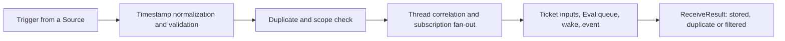

# intake.ts

`src/core/intake.ts` is the point where an event that happened outside the agent becomes part of it. It defines the `Intake` engine part, which takes a `Trigger` from a Source, checks whether it is new and in scope, records which threads it belongs to, delivers it to the tickets that subscribe to those threads, and decides whether it should also be evaluated by the main session. Its single method returns one of three outcomes — `stored`, `duplicate` or `filtered` — so a Source can tell what happened to what it sent.

## Whole-unit functional diagram

The main path is one pass: normalize and validate, reject or record, update the threads the trigger touches, hand the trigger to the reachable tickets, and finally queue it for evaluation when no ticket's worker decides it. Each branch still ends in the same small result type, which is why a Source can treat intake as a single call.

## At a glance

- Primary role: Domain rules — the file holds the real intake policy: what counts as a new trigger, which tickets a trigger reaches, when an ended ticket may resume, and when a message belongs to the main session instead of a ticket.
- Secondary roles: Orchestration — those rules are applied across several collaborators in a fixed order: thread aggregates, the `Tickets` part, the evaluation queue and domain event emission.
- Confidence: High — the whole file was read, together with its base class, sibling parts, the domain model and the single `Engine.receive` call site.

## What this file does

- **Normalizes and validates what arrived.** Source timestamps (for example GitHub's whole seconds) are rewritten into canonical ISO form so stored times compare consistently, and a trigger that names no thread is rejected outright, because a trigger must belong to at least one thread to be routed anywhere.
- **Makes ingestion idempotent.** A trigger whose id is already stored is reported as `duplicate` and changes nothing, so retried deliveries from a Source are safe.
- **Applies the Source's listening scope.** When the configured `SourceScope` says the Source does not listen to the trigger, the trigger is still stored but recorded with a `filtered` disposition carrying the Source's reason, and the call returns `filtered`.
- **Correlates threads and fans the trigger out.** Each thread the trigger belongs to gets its newest timestamp and the keys of the sibling threads it shared the trigger with, and every ticket subscribed to a thread is collected as reached — while tracking whether it was reached only on a thread its worker follows for context.
- **Records the disposition and routes the leftover.** The reached tickets are saved as the trigger's `fanout` (with the context-only ones listed separately), each reached ticket receives the trigger as an input and is woken, and if no ticket's worker decides the trigger it is queued for evaluation on its primary thread.
- **Reports the event.** A `trigger.received` domain event names the trigger and the thread keys it touched, so observers can follow ingestion.

## Key functions or classes

### `Intake`

The engine part that owns trigger reception, constructed with the shared `EngineOptions` and the sibling `Tickets` part it delegates ticket and subscription changes to.

    
        <a target="_self" href="#src/core/intake.ts:16-63?class=code" style="color: inherit; text-decoration: none;">Code: src/core/intake.ts:16-63</a>
    

### `Intake.receive`

The whole intake pass for one trigger: normalize, validate, deduplicate, filter, correlate threads, fan out to tickets, save the disposition, queue for evaluation, wake tickets, emit the event, and return the outcome.

    
        <a target="_self" href="#src/core/intake.ts:19-62?class=code" style="color: inherit; text-decoration: none;">Code: src/core/intake.ts:19-62</a>
    

### `ReceiveResult`

The three-value contract a caller sees — `'stored'`, `'duplicate'` or `'filtered'` — re-exported through the engine so Sources never need the `Intake` class itself.

    
        <a target="_self" href="#src/core/intake.ts:8?class=code" style="color: inherit; text-decoration: none;">Code: src/core/intake.ts:8</a>
    

## Main inputs and results

- Inputs: one `Trigger` (id, source, threads, actor, `human` flag, `addressed`, time, text, optional channel and url, source metadata) plus the engine's shared options — repositories, the `SourceScope` filter, an optional clock and event sink — and the `Tickets` part used for delivery and resume.
- Results: a `ReceiveResult`; the stored trigger and its `TriggerDisposition` (`filtered` reason, or `fanout` with its `context` subset); updated thread records; trigger inputs on reached tickets; and an entry in the primary thread's evaluation queue when no worker decides it.
- Visible side effects: workers of reached tickets are woken (and a person's message can resume an ended ticket), a `trigger.received` domain event is emitted, and filtered triggers are recorded for audit without any ticket or evaluation acting on them.

## Rules and decisions

- Decision: is this incoming event new, does this Source listen to it, and who is responsible for it — a ticket's worker or the main evaluation session?
- Important conditions: a trigger must name at least one thread; an already-stored id wins over everything else; the scope filter decides `filtered` before any fan-out; a ticket is reached only if it subscribes to one of the threads; and, when the ticket already ended, only a person's message resumes it, and never a ticket that a person stopped.
- Outcomes: `duplicate` (nothing changes), `filtered` (stored with a reason, no ticket or evaluation), or `stored` (fan-out saved, tickets woken, evaluation queued only when no worker decides it).
- Invariant: a trigger is stored at most once; a message that reached no deciding ticket still reaches evaluation; and a human-stopped ticket never receives anything, because its mandate was withdrawn.

### Small example

A person comments on a pull request that an ended ticket follows only for context. The trigger is stored, the ticket is noted as reached through a context thread rather than its own, no resume happens because the ticket does not own the thread, and since no worker decides the message it is queued for evaluation on the thread that hosted it.

## Coordinated flow

1. `Engine.receive` opens a single repository transaction and delegates to `Intake.receive`, so the whole intake pass is all-or-nothing (
<a target="_self" href="#src/core/engine.ts:48?class=code" style="color: inherit; text-decoration: none;">engine.ts:48</a>
).
2. `Intake` normalizes and validates the trigger, asks the configured `SourceScope` whether the Source listens, and short-circuits on duplicates or filtered input.
3. It then updates each touched thread aggregate — newest timestamp, correlated thread keys, subscriptions — and hands every still-relevant ticket the trigger through `Tickets.addInput`, which also drives delivery or a resume.
4. The reached set becomes the trigger's disposition; `Intake` asks the shared `followupOwners` rule whether any worker decides the message, queues it for evaluation through the inherited `queueForEval` when none does, wakes the fan-out tickets, and emits the event.

### Important branching

Multiple threads on one trigger are correlated in both directions, but only the primary thread (`threads[0]`) hosts the evaluation queue. Triggers that arrive while an evaluation of that thread is running simply join its pending list and wait for the next evaluation, so intake itself never blocks.

For the surrounding concepts, see the domain model in 
<a target="_self" href="#src/core/model.ts:22-61?class=code" style="color: inherit; text-decoration: none;">model.ts:22-61</a>
, the shared part helpers in 
<a target="_self" href="#src/core/part.ts:24-80?class=code" style="color: inherit; text-decoration: none;">part.ts:24-80</a>
, and the ticket-side effects in 
<a target="_self" href="#src/core/tickets.ts:234-270?class=code" style="color: inherit; text-decoration: none;">tickets.ts:234-270</a>
.

<!-- {
  "mermaid_info": {
    "name": "Trigger intake flow",
    "nodes": [
      {
        "id": "trigger_001",
        "name": "Trigger from a Source",
        "path": "src/core/intake.ts",
        "hint": "Entry point: the receive method that a Source's request reaches.",
        "isJumpable": true,
        "position": { "startLine": 19, "endLine": 19 },
        "references": []
      },
      {
        "id": "normalize_002",
        "name": "Timestamp normalization and validation",
        "path": "src/core/intake.ts",
        "hint": "Canonical ISO timestamps and the requirement of at least one thread.",
        "isJumpable": true,
        "position": { "startLine": 20, "endLine": 22 },
        "references": []
      },
      {
        "id": "filter_003",
        "name": "Duplicate and scope check",
        "path": "src/core/intake.ts",
        "hint": "Already-stored ids and out-of-scope triggers end the pass early.",
        "isJumpable": true,
        "position": { "startLine": 23, "endLine": 29 },
        "references": []
      },
      {
        "id": "correlate_004",
        "name": "Thread correlation and subscription fan-out",
        "path": "src/core/intake.ts",
        "hint": "Updates thread aggregates and collects the reached tickets.",
        "isJumpable": true,
        "position": { "startLine": 31, "endLine": 48 },
        "references": []
      },
      {
        "id": "reached_005",
        "name": "Ticket inputs, Eval queue, wake, event",
        "path": "src/core/intake.ts",
        "hint": "Delivers to tickets, saves the disposition, queues for evaluation and emits.",
        "isJumpable": true,
        "position": { "startLine": 49, "endLine": 61 },
        "references": []
      },
      {
        "id": "results_006",
        "name": "ReceiveResult: stored, duplicate or filtered",
        "path": "",
        "hint": "The observable outcome returned to the calling Source.",
        "isJumpable": false,
        "position": { "startLine": 0, "endLine": 0 },
        "references": []
      }
    ]
  }
} -->

    
        <a target="_self" href="#src/core/intake.ts:1?class=graph" style="color: inherit; text-decoration: none;">Graph: Trigger intake flow</a>
    

---
name: intake.ts

update-time: 2026-11-02 11:16

description: `src/core/intake.ts` is the point where an event that happened outside the agent becomes part of it. It defines the `Intake` engine part, which takes a `Trigger` from a Source, checks whether it is new and in scope, records which threads it belongs to, delivers it to the tickets that subscribe to those threads, and decides whether it should also be evaluated by the main session. Its single method returns one of three outcomes — `stored`, `duplicate` or `filtered` — so a Source can tell what happened to what it sent.

---
