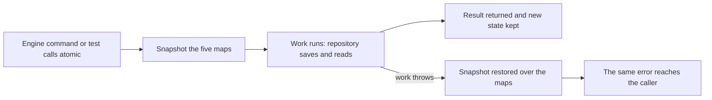

# memory.ts

`memory.ts` provides `MemoryRepositories`, an in-process stand-in for the durable `Repositories` store the agent core depends on. It keeps triggers, trigger dispositions, threads, tickets and decisions in plain maps and returns copies, so an `Engine` can be built, driven and inspected without a database or an on-disk file. Its value is behavioral parity: it keeps the same read order and the same all-or-nothing unit of work as the SQLite store, which lets the core's tests trust what they observe.

## Whole-unit functional diagram

The main path is a single unit of work: the current maps are copied first, the caller's function then reads and writes through the repository groups, and either the new state stays or the copy is written back before the error is rethrown. Reads and writes never hand out the stored object itself, so one caller's later edits cannot leak into state another caller will read.

## At a glance

- Primary role: State storage — it retains the core's aggregates in memory and defines how they are read back, in what order, and how they roll back.
- Confidence: High — the file implements every member of the `Repositories` port from 
<a target="_self" href="#src/core/ports.ts:106-134?class=code" style="color: inherit; text-decoration: none;">ports.ts:106-134</a>
, and the shared store test runs identical expectations against it and against the SQLite `Store`.

## What this file does

- Implements the whole `Repositories` port in memory, so a caller such as an `Engine` can be wired up without the SQLite store or any state directory.
- Groups stored state the way the port does: `triggers` (plus dispositions), `threads`, `tickets` and `decisions`, each with its own get/save and the list queries the core relies on.
- Keeps caller data isolated by deep-cloning every value going in and coming out, so a returned aggregate can be mutated freely without corrupting stored state.
- Offers `atomic(work)` as the unit of work the Engine wraps its commands in: the work either succeeds and its writes remain, or everything it wrote is undone.
- Reproduces the durable store's observable ordering, so tests written against memory see threads oldest-first, tickets newest-first and decisions in the order they were saved.
- Serves as an ephemeral backend for engine instances and as the shared fixture in the store tests.

## Key functions or classes

### `MemoryRepositories`

The class itself, holding five private maps keyed by trigger id, trigger id (dispositions), thread key, ticket id and decision id, and exposing the port's repository groups as readonly objects.

    
        <a target="_self" href="#src/core/memory.ts:10-50?class=code" style="color: inherit; text-decoration: none;">Code: src/core/memory.ts:10-50</a>
    

### `atomic`

Copies all five maps, runs the caller's function, and on an error clears each map back to its snapshot before rethrowing. Nested calls each take their own snapshot, so an inner failure leaves the surrounding work in place.

    
        <a target="_self" href="#src/core/memory.ts:16-24?class=code" style="color: inherit; text-decoration: none;">Code: src/core/memory.ts:16-24</a>
    

### `triggers`

Reads and saves `Trigger`s by id and, separately, the `TriggerDisposition` recorded for a trigger id, so where a trigger went after intake is stored next to it but as its own entry.

### `threads`

Reads a thread by its stable key, saves it, lists every thread oldest-first, and derives the working set: threads with queued triggers or an evaluation in progress.

### `tickets`

Reads and saves tickets, lists them newest-first (the order a save-history reverse produces), and derives both `open` (no `ended` block) and `active` (undelivered inputs, or a pending or running latest assignment).

    
        <a target="_self" href="#src/core/memory.ts:37-44?class=code" style="color: inherit; text-decoration: none;">Code: src/core/memory.ts:37-44</a>
    

### `decisions`

Reads and saves decisions and lists those belonging to one thread key, in the order they were saved.

### `clone`

A one-line wrapper over `structuredClone` used at every boundary, which is what makes stored state and caller state independent.

    
        <a target="_self" href="#src/core/memory.ts:5?class=code" style="color: inherit; text-decoration: none;">Code: src/core/memory.ts:5</a>
    

## Main inputs and results

- Inputs: domain aggregates to save (`Trigger`, `TriggerDisposition`, `Thread`, `Ticket`, `Decision`), lookup keys and ids, and the function passed to `atomic`.
- Results: a stored aggregate's copy or `undefined`, filtered lists in the store's order, and the work function's own return value.
- Visible side effects: none outside the process. Nothing is persisted or shared, so the state exists only as long as the instance does, and dropping it discards everything.

## Stored state lifecycle

- Stores: the core's aggregates and their dispositions, held in five maps whose keys are the identifiers the rest of the core already uses (trigger id, thread key, ticket id, decision id).
- Read path: an engine part or a test reads through the repository groups while a command runs — typically listing `threads.active()` and `tickets.active()` to find work, then loading the aggregates it needs by key.
- Write path: the core saves an aggregate after changing it, always inside `atomic`, so a command's set of writes becomes visible together or not at all.
- Visible result: the core can be exercised end to end — decisions recorded, tickets opened, inputs delivered — with no database, while reads still report the same working sets and ordering a real deployment would.

### Important persistence behavior

Because `atomic` restores map contents rather than replaying a log, a rollback also undoes writes made by nested units of work inside it, while a failure in an inner unit leaves the outer one's earlier writes intact — the same nested behavior the SQLite store gets from savepoints, as the shared store test asserts. Order is stable across re-saves: updating an entry that already exists keeps its original position, matching the SQLite store's upsert in place, so `tickets.list()` stays newest-first by first insertion rather than by last write. The `open`, `active` and `byThread` queries are computed from the stored records at read time instead of being maintained as extra fields, which is why they can never disagree with the saved aggregate. Nothing here is durable or shared across processes; for real runs the SQLite `Store` implements the same port.

---
name: memory.ts

update-time: 2026-11-02 11:17

description: `memory.ts` provides `MemoryRepositories`, an in-process stand-in for the durable `Repositories` store the agent core depends on. It keeps triggers, trigger dispositions, threads, tickets and decisions in plain maps and returns copies, so an `Engine` can be built, driven and inspected without a database or an on-disk file. Its value is behavioral parity: it keeps the same read order and the same all-or-nothing unit of work as the SQLite store, which lets the core's tests trust what they observe.

---
