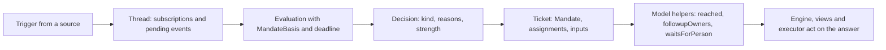

# model.ts

This file is the shared vocabulary of the proactive agent: it names the concepts the rest of the system exchanges — incoming events, assessments, authorizations, threads and work items — and states the invariants those concepts must keep. It depends on no source, policy or executor, so it can be read first when you want to understand what the project talks about before reading how it behaves. Most of the file is TypeScript type declarations; a small set of pure helpers answers recurring domain questions such as "who still owns this person's follow-up?" and "is this ticket waiting for a person?".

## Whole-unit functional diagram

<!-- {
  "mermaid_info": {
    "name": "From trigger to ticket in the domain model",
    "nodes": [
      {
        "id": "trigger_001",
        "name": "Trigger from a source",
        "path": "src/core/model.ts",
        "hint": "The immutable inbound event, declared with its threads, actor and human flag",
        "isJumpable": true,
        "position": { "startLine": 23, "endLine": 39 },
        "references": []
      },
      {
        "id": "thread_002",
        "name": "Thread: subscriptions and pending events",
        "path": "src/core/model.ts",
        "hint": "The thread aggregate that buffers triggers and hosts the active evaluation",
        "isJumpable": true,
        "position": { "startLine": 157, "endLine": 182 },
        "references": []
      },
      {
        "id": "eval_003",
        "name": "Evaluation with MandateBasis and deadline",
        "path": "src/core/model.ts",
        "hint": "The single in-flight assessment of a thread, with its admission basis and deadline",
        "isJumpable": true,
        "position": { "startLine": 136, "endLine": 154 },
        "references": []
      },
      {
        "id": "decision_004",
        "name": "Decision: kind, reasons, strength",
        "path": "src/core/model.ts",
        "hint": "The recorded outcome of an evaluation, with reasons, strength and optional mandate",
        "isJumpable": true,
        "position": { "startLine": 192, "endLine": 209 },
        "references": []
      },
      {
        "id": "ticket_005",
        "name": "Ticket: Mandate, assignments, inputs",
        "path": "src/core/model.ts",
        "hint": "The authorized work item holding assignments, inputs, channels and thread followings",
        "isJumpable": true,
        "position": { "startLine": 277, "endLine": 308 },
        "references": []
      },
      {
        "id": "rule_006",
        "name": "Model helpers: reached, followupOwners, waitsForPerson",
        "path": "src/core/model.ts",
        "hint": "Pure predicates that answer the recurring questions other modules ask of the stored state",
        "isJumpable": true,
        "position": { "startLine": 318, "endLine": 353 },
        "references": []
      },
      {
        "id": "reader_007",
        "name": "Engine, views and executor act on the answer",
        "path": "",
        "hint": "Abstract consumer: modules that import these shapes and helpers to make their own decisions",
        "isJumpable": false,
        "position": { "startLine": 0, "endLine": 0 },
        "references": []
      }
    ]
  }
} -->

    
        <a target="_self" href="#src/core/model.ts:1?class=graph" style="color: inherit; text-decoration: none;">Graph: From trigger to ticket in the domain model</a>
    

The path shows a message entering as a `Trigger`, waiting on its primary `Thread`, being assessed by an `Evaluation`, and being settled by a `Decision` that may authorize a `Ticket`. Everything after that — who owns a follow-up, whether a ticket is open, whether it is blocked on a person — is answered by the pure helpers at the end of the file.

## At a glance

- Primary role: Data contract — it defines the shapes and names that the core, the app layer, the executor and the store all agree on.
- Secondary role: Domain rules — several of its helpers encode real policy decisions (follow-up ownership, what a decision actually settled, when a ticket waits for a person), not just input validation.
- Confidence: High — the file's own header calls it the "domain model … and their invariants", and the exported names are imported across `src/core`, `src/app` and `src/executor`.

## What this file does

- Names identity: `ActorRef`, `ThreadRef`, `ChannelRef` and `threadKey` give every actor, thread and channel a source-scoped identity, so the same numeric id from two different sources never collides.
- Describes the inbound event and its fate: `Trigger` carries the untrusted message text, its threads, whether a person wrote it and whether it addressed the agent; `TriggerDisposition` records what intake did with it, including fan-out, hand-backs and acknowledgements.
- Records assessment and authorization: `Evaluation`, `Decision`, `Mandate` and `MandateBasis` separate "what was judged" from "what was granted", and keep the grant immutable once issued.
- Defines the two aggregates everything mutates: `Thread` (subscriptions, context-only followers, pending triggers, one active evaluation) and `Ticket` (mandate, assignments, inputs, channels, followed threads, ending).
- Supplies read-model helpers used by UI and executor code: `liveTicket`, `ticketOutcome`, `runningAssignment`, `latestAssignment` and `latestReport` answer simple questions without duplicating field knowledge everywhere.
- States cross-cutting rules as pure functions: `followupOwners`, `settled`, `reached`, `readUntil` and `waitsForPerson` turn stored state into a yes/no answer that callers can rely on.

## Key functions or classes

### `threadKey`

Builds the stable `source:id` key used to look up a thread everywhere in the domain.

### `isoTime`

Converts a parseable timestamp into ISO form so stored timestamps compare correctly as strings, and returns anything unparseable unchanged.

### `followupOwners`

Returns the tickets whose worker decides a person's follow-up message, after discounting hand-backs, context-only threads, requeued messages and already-running evaluations.

Open 
<a target="_self" href="#src/core/model.ts:75-88?class=code" style="color: inherit; text-decoration: none;">model.ts:75-88</a>
 to see the full list of exclusions.

### `settled`

Says whether a decision actually settled what a person asked for: a stop, an unavailable assessment or a routed request decides only that ticket's work, not the message.

### `reached`

Answers whether a trigger reached a ticket, either as its origin, as a stored input, or because the ticket subscribes to one of its threads — with the option to ignore threads followed only for context.

### `waitsForPerson`

Reports that the latest assignment ended `blocked` or `failed` and no human message has arrived since, which is what holds automatic inputs and failed launches.

### `readUntil`

Computes the latest moment up to which a ticket's worker had a turn to read what reached it, used to judge what a worker has and has not seen.

### `latestReport`

Returns the most recent report any of a ticket's assignments made, which is what the ticket can be said to have last stated.

## Information contract

- Represents: the domain's concepts — inbound events (`Trigger`, `TriggerDisposition`), assessment and authorization (`Evaluation`, `Decision`, `Mandate`, `MandateBasis`, `Strength`, `AcceptMode`, `AdmissionCell`), execution bindings (`Assignment`, `ReportState`, `Execution`, `Follow`), and the aggregates `Thread` and `Ticket` with their inputs and endings.
- Produced by: sources and adapters (a `Trigger` and its source-declared `human`/`addressed` flags), the policy gate (a `MandateBasis` and `Mandate`), the core engine (`Evaluation`, `Decision`, `Assignment` transitions, `TicketInput`), and the executor (assignment `report`, `idleAt`, `delivery` errors).
- Consumed by: the port interfaces in 
<a target="_self" href="#src/core/ports.ts?class=code" style="color: inherit; text-decoration: none;">ports.ts</a>
, the engine and ticket/assignment logic, read models in `src/app/views`, and the executor — all of which need the same field names to agree.
- Behavior-shaping parts: `Trigger.human` and `Trigger.addressed` decide whether work may be proactive or must be a response; `Trigger.threads[0]` is the primary thread that hosts the evaluation; `Thread.subscriptions` versus `Thread.context` separates tickets that may act from tickets that may only read; `Decision.kind` plus its reasons decide whether something was settled; `Mandate.strength` bounds how far the work may go; `Assignment.report.state` drives what the ticket can do next; `Ticket.undelivered` decides which inputs a worker still has not seen.

### Compatibility notes

Some parts of the contract exist to read data written by earlier versions and are documented as such in the source: `MandateBasis` variant `listed` (used before mandates recorded their basis), its `authority` field, `TicketInput` entries without an `effect` or with a `deliveredAt` from an earlier hand-off, and `TicketInput.readAt` being `null` while a message still waits in a session. Treat these as optional/backward-compatible surface rather than current practice.

## Rules and decisions

- Decision: which tickets are still responsible for a person's follow-up message, and therefore whether the message goes to a new assessment at all.
- Important conditions: only messages a person wrote qualify; a requeued message, a message handed back by a ticket, and a message that reached a ticket only on a context thread never create an owner; a thread that is already evaluating the trigger yields none either. An owner must be live, or ended by something other than a person while that trigger still sits undelivered in its inputs.
- Outcomes: a list of ticket ids (possibly empty). An empty list means the message is nobody's and can be routed to assessment; a non-empty list means the main session may only stop the work on it.
- Invariant: at most one `Evaluation` exists per thread; a `Mandate` never changes after it is issued; an assignment's thread keys and subscriptions are the only way a thread's messages reach a ticket; inputs listed in `Ticket.undelivered` are exactly those not yet handed to a running assignment.

### Small example

A person replies in a thread where a ticket is still open and subscribed. `followupOwners` returns that ticket id, so the reply is not queued as a new proactive candidate — the existing worker answers it. If that worker had handed the same message back as beyond the ticket, the id is filtered out and the message becomes eligible for assessment again.

## Main inputs and results

- Inputs: `Trigger`, `Thread`, `Ticket`, `Decision` and `Assignment` values, plus the small lookup interfaces (`FollowupRecords`, a thread getter) that let a helper read stored state without depending on the store implementation.
- Results: type declarations other modules compile against, and pure answers — booleans, ticket-id lists, thread keys and normalized timestamps.
- Visible side effects: none. The file imports only a `Reason` type from 
<a target="_self" href="#src/core/reasons.ts?class=code" style="color: inherit; text-decoration: none;">reasons.ts</a>
, performs no I/O, and changes behavior only through the code that imports it.

---
name: model.ts

update-time: 2026-11-02 11:18

description: This file is the shared vocabulary of the proactive agent: it names the concepts the rest of the system exchanges — incoming events, assessments, authorizations, threads and work items — and states the invariants those concepts must keep. It depends on no source, policy or executor, so it can be read first when you want to understand what the project talks about before reading how it behaves. Most of the file is TypeScript type declarations; a small set of pure helpers answers recurring domain questions such as "who still owns this person's follow-up?" and "is this ticket waiting for a person?".

---
