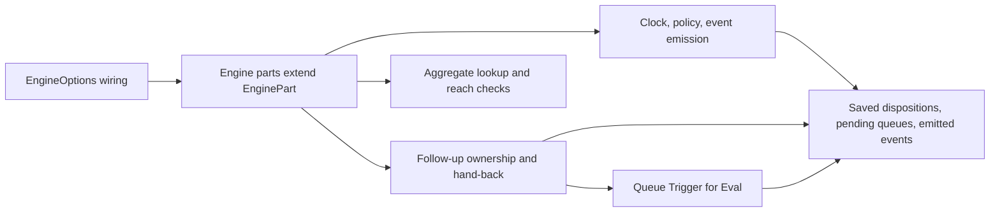

# part.ts

`src/core/part.ts` defines the shared foundation of the domain Engine: the `EngineOptions` bundle that every part is constructed with, and the abstract `EnginePart` class they all extend. It exists so that Intake, Evals, Tickets, Assignments and Replies agree on where repositories, policy, clock and events come from, instead of each part wiring its own. Its most consequential contribution is a small set of shared domain behaviours around follow-up messages — who owns them, who hands them back, and when they go to Eval.

## Whole-unit functional diagram

The runtime assembles an `EngineOptions` object, `Engine` hands it to each part, and each part inherits the same accessors. From there the shared domain helpers either update stored state (trigger dispositions, a thread's pending Eval queue, emitted events) or refuse the call with a `UserError`, which is what callers actually observe.

## At a glance

- Primary role: **Runtime support** — it provides the common dependencies and behaviour every Engine part runs on, rather than performing a feature of its own.
- Secondary roles: **Domain rules** — it also encodes the real rule about which worker decides a person's follow-up message, and what a hand-back or acknowledgement means.
- Confidence: **High** — the whole file, its dependency ports and model helpers, and each subclass that consumes it were read directly.

## What this file does

- Declares `EngineOptions`, the one object describing everything a part may use: durable repositories, a *getter* for the current policy, the source scope filter, assessor, executor, outbox, and optional hooks for preparing a ticket, supplying a clock and emitting events.
- Gives every part the same read paths for state, so `Tickets` and `Evals` never reach for a different store handle.
- Centralises the clock (`now`) and policy lookup (`policy`), so timestamps and the active rules stay consistent within one part and one transaction.
- Provides the follow-up ownership helpers — `owners`, `leftToWorkers`, `handBack`, `takeUp` — that decide whether a person's message belongs to a ticket's worker or to the main Session.
- Provides `queueForEval`, the single place that puts a Trigger on its primary thread's pending queue without duplicating work already queued or held by a running Eval.
- Uniformly refuses invalid requests through `UserError` (for example `unknownTicket`, `workerDecides`) so tool handlers and HTTP routes can present a structured reason.

## Runtime support

- Provides: a base class plus a typed dependency bundle that every Engine part shares — repository access, current policy, timestamps, event emission, and lookup of tickets/threads/triggers.
- Starts or activates: nothing on its own. `EnginePart` becomes available when `Engine` is constructed with an options object and each part is created in turn (see the constructor in 
<a target="_self" href="#src/core/engine.ts:31-38?class=code" style="color: inherit; text-decoration: none;">engine.ts:31-38</a>
); the runtime supplies the ports at 
<a target="_self" href="#src/app/runtime.ts:137-139?class=code" style="color: inherit; text-decoration: none;">runtime.ts:137-139</a>
.
- Used by: `Intake`, `Evals`, `Tickets`, `Assignments` and `Replies` in `src/core`, plus the tests that build an `Engine` with a stubbed clock.
- Operational effect: the clock is injectable, so tests and operators see stable timestamps; the policy is read on each call, so a policy change takes effect for the next part call; events flow only through an optional `emit` hook, which means the core behaves identically whether or not a host is listening.

## Rules and decisions

- Decision: for a person's follow-up message, does a ticket's worker decide it, or does it belong to the main Session / Eval?
- Important conditions: only human triggers can have owners; a message a person already re-sent to Eval has none; tickets that handed the message back or follow the thread only for context do not count; while an Eval holds the message, no ticket owns it; an ended ticket still owns it only when a person did not end it and its Input is still undelivered (`followupOwners`).
- Outcomes: `leftToWorkers` refuses any non-stop routing with the `workerDecides` error, naming the tickets; `handBack` records who gave the message back and why, and returns `true` only when this ticket decided it and no other ticket still does — in which case it is queued for Eval; `takeUp` marks that a worker acknowledged or answered the message, so it counts as within the ticket.
- Invariant: the same Trigger is never queued twice — `queueForEval` returns `false` if it is already pending on the primary thread or inside a running Eval.

A short example: a person replies on a thread where ticket A is running. The main Session tries to route that reply to ticket B; `leftToWorkers` stops it with `workerDecides`. If A's worker reports the message as beyond the ticket, `handBack` stores the hand-back; because no other ticket still decides it, the Trigger joins the primary thread's pending queue and `true` is returned.

## Key functions or classes

### `EngineOptions`

The complete contract a part receives: required ports (`repo`, `policy`, `scope`, `assessor`, `executor`, `outbox`) and optional `prepareTicket`, `now` and `emit` hooks.

### `EnginePart`

The abstract base every domain part extends; it stores the options, exposes `repo` to subclasses and holds the shared helpers below.

### `owners` / `leftToWorkers`

Ask `followupOwners` which tickets' workers decide a message, and refuse main-Session routing while any of them still does.

### `handBack`

Records that a worker returned a message as beyond the ticket, and queues it for Eval once nothing else decides it.

    
        <a target="_self" href="#src/core/part.ts:42-48?class=code" style="color: inherit; text-decoration: none;">Code: src/core/part.ts:42-48</a>
    

### `takeUp`

Marks a message as acknowledged or answered by a ticket's worker, which is how the ticket claims it as its own work.

### `queueForEval`

Adds a Trigger to its primary thread's pending list exactly once, skipping work already queued or in progress.

    
        <a target="_self" href="#src/core/part.ts:56-63?class=code" style="color: inherit; text-decoration: none;">Code: src/core/part.ts:56-63</a>
    

### `require` / `thread`

Load a ticket that must exist (raising `unknownTicket` otherwise), or return a stored thread — or an empty, unsaved one for a thread never seen before.

### `reaches`

Answers whether a Trigger reached a ticket, optionally ignoring threads the ticket follows only for read-only context.

## Main inputs and results

- Inputs: the `EngineOptions` object built by the runtime; trigger, ticket and thread identifiers passed in by subclasses; the newest policy, clock value and scope decision read at call time.
- Results: `Policy` objects, ISO timestamps, saved trigger dispositions (fan-out, context, hand-backs, acknowledgements), updated thread pending queues, emitted domain events, and boolean answers from `handBack` and `queueForEval`.
- Visible side effects: a follow-up is either taken up by a ticket's worker, handed back and evaluated, or refused with a localisable error code; and a hand-back, acknowledgement or re-queue leaves a recorded reason on the trigger's disposition that operators can inspect afterwards.

---
name: part.ts

update-time: 2026-11-02 11:14

description: `src/core/part.ts` defines the shared foundation of the domain Engine: the `EngineOptions` bundle that every part is constructed with, and the abstract `EnginePart` class they all extend. It exists so that Intake, Evals, Tickets, Assignments and Replies agree on where repositories, policy, clock and events come from, instead of each part wiring its own. Its most consequential contribution is a small set of shared domain behaviours around follow-up messages — who owns them, who hands them back, and when they go to Eval.

---
