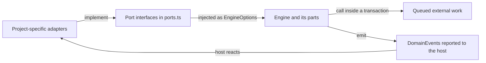

# ports.ts

`src/core/ports.ts` is the contract layer of the proactive-agent core: it declares the interfaces the `Engine` depends on, while every concrete source, rule set, assessor, executor and channel stays outside the core. Nothing here runs — the file exists so the domain can call storage, policy judgement, semantic assessment, work execution and message delivery without importing any of them. Read it when you need to know what a host application must supply before an `Engine` can be constructed.

## Whole-unit functional diagram

The Engine never builds its collaborators; it receives them. Adapters implement these ports, the Engine calls them while mutating domain aggregates, and the resulting work (an Eval request, an assignment launch, a channel message) happens later in the adapter. The event vocabulary on the right is how the host learns what changed.

<!-- {
  "mermaid_info": {
    "name": "How ports connect adapters to the Engine",
    "nodes": [
      {
        "id": "adapters_001",
        "name": "Project-specific adapters",
        "path": "",
        "hint": "Storage, policy, assessor, executor, outbox and source scope supplied by a host application",
        "isJumpable": false,
        "position": { "startLine": 0, "endLine": 0 },
        "references": []
      },
      {
        "id": "ports_002",
        "name": "Port interfaces in ports.ts",
        "path": "src/core/ports.ts",
        "hint": "The interfaces and result shapes declared by this file",
        "isJumpable": true,
        "position": { "startLine": 6, "endLine": 134 },
        "references": []
      },
      {
        "id": "engine_003",
        "name": "Engine and its parts",
        "path": "src/core/engine.ts",
        "hint": "The domain entry point that receives the ports and delegates to its parts",
        "isJumpable": true,
        "position": { "startLine": 24, "endLine": 38 },
        "references": []
      },
      {
        "id": "effects_004",
        "name": "Queued external work",
        "path": "",
        "hint": "Eval requests, assignment launches and deliveries, and queued channel messages carried out after commit",
        "isJumpable": false,
        "position": { "startLine": 0, "endLine": 0 },
        "references": []
      },
      {
        "id": "events_005",
        "name": "DomainEvents reported to the host",
        "path": "src/core/ports.ts",
        "hint": "The named events the Engine emits after a change",
        "isJumpable": true,
        "position": { "startLine": 85, "endLine": 103 },
        "references": []
      }
    ]
  }
} -->

    
        <a target="_self" href="#src/core/ports.ts:1?class=graph" style="color: inherit; text-decoration: none;">Graph: How ports connect adapters to the Engine</a>
    

## At a glance

- **Primary role**: Extension point — the file defines the interfaces a host application implements to plug storage, rules, assessment, execution, delivery and source listening into the core.
- **Secondary role**: Data contract — it also fixes the result and message shapes (`GateResult`, `ScopeResult`, `AssessmentOutcome`, `OutboundMessage`, `ReplyStatus`, `DomainEvent`) exchanged across that boundary.
- **Confidence**: High — every port is consumed by core parts such as `part.ts`, `evals.ts` and `tickets.ts`, and each has a verified implementation outside the core (`Store`, `settingsPolicy`, `MasterAssessor`, `DshExecutor`, `Outbox`, `SourceRegistry`).

## What this file does

- **Names the collaborators the core may use and no others.** `Repositories`, `Policy`, `SourceScope`, `Assessor`, `Executor` and `Outbox` are the entire outside world as the domain sees it; a source, model provider or database only enters through one of them.
- **Keeps real-world judgement with the implementer.** `Policy.gate` decides who may originate work and answers with a strength and a recorded basis, `SourceScope` decides whether a source is listened to at all, and `Assessor` answers with accept, ignore, stop or unavailable. The core records those answers rather than inventing rules of its own.
- **Makes every state access synchronous and transactional.** `Repositories.atomic` wraps a unit of work, which is why every repository method returns a value instead of a promise. This is the constraint a persistence implementation must respect.
- **Defers slow work instead of blocking a command.** `Assessor.request`, `Executor.start`/`deliver`/`stop` and `Outbox.send` only queue; the outcome arrives later through Engine callbacks, so a domain command stays fast and consistent.
- **Publishes the observable event vocabulary.** Every `DomainEvents` entry is one fact a host can react to — a trigger received, an eval started, a decision recorded, a ticket ended, a policy changed — and `DomainEvent` pairs the type name with a timestamp and its data.
- **Conventions over machinery for retries.** `Outbox.send` keeps the first message for an id and `Assessor.request` is idempotent per `evalId`, so a repeated call is safe rather than a second delivery.

## Key functions or classes

### `SourceScope`

Decides whether a trigger on a given source is listened to, and optionally which receiving scope the policy's admission table should be read from.

<a target="_self" href="#src/core/ports.ts:11-14?class=code" style="color: inherit; text-decoration: none;">ports.ts:11-14</a>

### `Policy`

Carries the versioned rules: the gate that admits a trigger, `revalidate` for an existing mandate, `admitsInferred` for accepting an inferred candidate, the pause switch and the eval timeout.

<a target="_self" href="#src/core/ports.ts:16-27?class=code" style="color: inherit; text-decoration: none;">ports.ts:16-27</a>

### `Candidate`

The bounded facts an assessor receives for one eval: the eval id, the thread, queued triggers, the gate's strength, the policy version and every ticket on the thread. It deliberately carries no authority.

<a target="_self" href="#src/core/ports.ts:29-38?class=code" style="color: inherit; text-decoration: none;">ports.ts:29-38</a>

### `AssessmentOutcome` and `Assessor`

The four answers an assessment can give, and the port that queues the work and optionally releases the eval when it ends either way.

<a target="_self" href="#src/core/ports.ts:40-53?class=code" style="color: inherit; text-decoration: none;">ports.ts:40-53</a>

### `Executor`

Starts, feeds and stops assignments; concurrency, sessions and workspaces are its own concern, and every method only queues work that reports back through the Engine.

<a target="_self" href="#src/core/ports.ts:55-69?class=code" style="color: inherit; text-decoration: none;">ports.ts:55-69</a>

### `Outbox`

Queues outbound channel messages idempotently, reports what became of a message id, and withdraws one that has not gone out yet.

<a target="_self" href="#src/core/ports.ts:71-83?class=code" style="color: inherit; text-decoration: none;">ports.ts:71-83</a>

### `Repositories`

Durable state for triggers and their dispositions, threads, tickets and decisions, plus `atomic` around a unit of work.

<a target="_self" href="#src/core/ports.ts:105-134?class=code" style="color: inherit; text-decoration: none;">ports.ts:105-134</a>

### `DomainEvents` and `DomainEvent`

The event type map the Engine reports after each change, and the union of the events it produces.

<a target="_self" href="#src/core/ports.ts:85-103?class=code" style="color: inherit; text-decoration: none;">ports.ts:85-103</a>

## How to extend it

- **Extension capability**: A host can replace storage, admission and mandate rules, semantic assessment, work execution, channel delivery and per-source listening independently. The core also accepts an optional `prepareTicket`, clock and event sink through `EngineOptions` in 
<a target="_self" href="#src/core/part.ts:7-18?class=code" style="color: inherit; text-decoration: none;">part.ts:7-18</a>
.
- **Contract**: Implement every member of the chosen interface and respect its timing rules — repository methods are synchronous and safe inside `atomic`; `Executor` and `Outbox` methods only queue; ids must be treated as idempotency keys; an assessment is reported with a `kind` the core understands (`ignore`, `unavailable`, `accept`, `stop`).
- **Registration or discovery**: The file has no registry. Adapters are constructed in the composition root and handed to `new Engine(...)` — in this project `Store`, `SourceRegistry`, `settingsPolicy`, `MasterAssessor`, `DshExecutor` and `Outbox` are wired this way in 
<a target="_self" href="#src/app/runtime.ts:128-138?class=code" style="color: inherit; text-decoration: none;">runtime.ts:128-138</a>
. For tests and ephemeral engines, `MemoryRepositories` is the ready-made in-memory implementation.
- **Use path**: A source calls `Engine.receive`, and `Intake` asks `SourceScope` whether to listen before anything is stored. An eval asks `Policy.gate`, then hands a `Candidate` to `Assessor`. An accept creates a ticket whose first assignment goes to `Executor`. Every reply rule ends in `Outbox.send`. Every mutation reads and writes through `Repositories` inside `atomic`. The active policy is re-read per call rather than captured, so a settings change takes effect on the next decision.

### Compatibility boundary

- `Repositories` must stay synchronous: wrapping a unit of work in `atomic` only holds together if no method yields.
- `Outbox.send` must keep the first message queued for an id, and `Assessor.request` must be safe to repeat for the same `evalId`; the Engine relies on that instead of tracking duplicates itself.
- `Assessor.release` is optional, but when implemented it is called for every finished eval, decided or not, so that per-eval state is dropped.
- Messages queued through a port are performed by an adapter after the transaction commits; a port that performs its work inline breaks the assumption that a domain command can be rolled back.

## Information contract

- **Represents**: The values exchanged across the core boundary — whether a trigger is admissible and on what basis, whether a source listens and in which scope, what an assessment decided, a message to send to a channel and its fate, and each fact the Engine reports after a change.
- **Produced by**: Adapters produce `GateResult` (via `Policy`), `ScopeResult` (via `SourceScope`), `AssessmentOutcome` (via `Assessor`), and `OutboundMessage`/`ReplyStatus` (via `Outbox`). The Engine produces `DomainEvent` values.
- **Consumed by**: The Engine parts read them to record decisions, tickets and assignments; the host consumes events, for example turning them into main-session notices in 
<a target="_self" href="#src/app/notices.ts:48?class=code" style="color: inherit; text-decoration: none;">notices.ts:48</a>
.
- **Behavior-shaping parts**: The `admissible` branch decides whether an eval exists at all; `observed` decides whether unaddressed messages count, and `row` selects the admission-table row; the assessment's `kind` chooses between ignoring, recording unavailability, accepting into a ticket, or stopping one; on an `accept`, `rules` is what `Policy.admitsInferred` checks before an inferred candidate becomes a ticket, and `strength`/`basis` are recorded so a mandate can be revalidated later; `OutboundMessage.kind` and `ticketId` decide where a message goes and which ticket it belongs to.

### Compatibility notes

Optional members carry meaning rather than convenience: `scope.row` appears only when a source names a receiving scope, `release` only when an assessor keeps per-eval state, and `rules`, `name`, `note` and `acknowledgement` only on an accept. `ReplyStatus` distinguishes `pending` from `dropped` (never deliverable) and `sent`, which is what makes a replayed reply report `reused` instead of sending twice.

## Main inputs and results

- **Inputs**: Domain values from `model.ts` (`Trigger`, `Thread`, `Ticket`, `Assignment`, `Mandate`, `ChannelRef`) and `Reason` codes, passed to the Engine or handed to an adapter; the adapters themselves are supplied when the `Engine` is constructed.
- **Results**: Return values such as `GateResult`, `ScopeResult`, `AssessmentOutcome`, `ReplyStatus | undefined`, plus emitted `DomainEvent`s and the values the Engine returns to sources, people and workers.
- **Visible side effects**: Messages actually delivered to a channel, tickets created, resumed or ended, assignment launches and cancellations taken up by the executor, and evals recorded as `unavailable` when an assessor misses its deadline.

    
        <a target="_self" href="#src/core/ports.ts?class=code" style="color: inherit; text-decoration: none;">Code: src/core/ports.ts</a>
    

    
        <a target="_self" href="#src/app/runtime.ts:128-138?class=code" style="color: inherit; text-decoration: none;">Code: src/app/runtime.ts:128-138</a>
    

    
        <a target="_self" href="#docs/007-architecture.md?class=text" style="color: inherit; text-decoration: none;">Document: docs/007-architecture.md</a>
    

---
name: ports.ts

update-time: 2026-11-02 11:15

description: `src/core/ports.ts` is the contract layer of the proactive-agent core: it declares the interfaces the `Engine` depends on, while every concrete source, rule set, assessor, executor and channel stays outside the core. Nothing here runs — the file exists so the domain can call storage, policy judgement, semantic assessment, work execution and message delivery without importing any of them. Read it when you need to know what a host application must supply before an `Engine` can be constructed.

---
