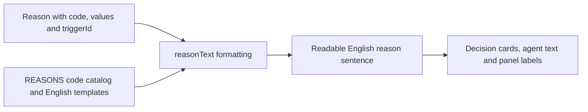

# reasons.ts

`src/core/reasons.ts` is the small vocabulary behind every "why" the system records: why an assessment accepted, ignored or refused a request, why a trigger was filtered, or why an assignment ended. It defines the shared `Reason` shape, a catalog of known reason codes with their English wording (`REASONS`), and `reasonText`, which turns codes plus values into one readable sentence. The file itself has no dependencies, so it is safe to read first when you want to understand decision outcomes before diving into the engine.

## Whole-file functional diagram

<tag value="graph" />

A producer (an assessment outcome, a policy gate or a migrated record) supplies a reason; `reasonText` looks the code up in the catalog, fills the template placeholders from `values`, adds the `triggerId` prefix when present, and returns a single string that later surfaces to agents and in the panel.

<!-- {
  "mermaid_info": {
    "name": "Reason code to readable sentence",
    "nodes": [
      {
        "id": "reason_001",
        "name": "Reason with code, values and triggerId",
        "path": "src/core/reasons.ts",
        "hint": "The shared Reason shape and the said helper that builds free-text reasons",
        "isJumpable": true,
        "position": { "startLine": 28, "endLine": 30 },
        "references": []
      },
      {
        "id": "catalog_002",
        "name": "REASONS code catalog and English templates",
        "path": "src/core/reasons.ts",
        "hint": "Known reason codes paired with English templates that may contain {name} placeholders",
        "isJumpable": true,
        "position": { "startLine": 5, "endLine": 26 },
        "references": []
      },
      {
        "id": "format_003",
        "name": "reasonText formatting",
        "path": "src/core/reasons.ts",
        "hint": "Accepts one reason, many reasons or undefined, fills templates and joins results",
        "isJumpable": true,
        "position": { "startLine": 32, "endLine": 38 },
        "references": []
      },
      {
        "id": "sentence_004",
        "name": "Readable English reason sentence",
        "path": "",
        "hint": "The abstract finished text handed to callers",
        "isJumpable": false,
        "position": { "startLine": 0, "endLine": 0 },
        "references": []
      },
      {
        "id": "consumers_005",
        "name": "Decision cards, agent text and panel labels",
        "path": "src/app/cards.ts",
        "hint": "Where formatted reasons are shown, for example in decision summaries",
        "isJumpable": true,
        "position": { "startLine": 79, "endLine": 79 },
        "references": []
      }
    ]
  }
} -->

    
        <a target="_self" href="#src/core/reasons.ts:1?class=graph" style="color: inherit; text-decoration: none;">Graph: Reason code to readable sentence</a>
    

## At a glance

- Primary role — data contract: it defines the `Reason` shape and the recognized `ReasonCode` set that the engine, app layer and client all exchange.
- Secondary role — presentation: it also owns the English phrasing of those codes and the function that renders them into text a person or an agent reads.
- Confidence: High — the file is short and fully read, and its exports are used across the app layer and covered by locale tests.

## What this file does

- Defines one shared shape for a reason: a `code`, optional `values` for placeholders, and an optional `triggerId` when the reason applies to one trigger in a batch.
- Publishes a catalog of core codes and their English templates, such as `timeout`, `policyChanged`, `routed`, `startedTicket` and `ignoredFromCard`, so wording lives in one place.
- Accepts reason codes it does not know: gates and sources can emit their own literal codes (for example `not_a_member`), and an unknown code simply prints as itself.
- Provides `said` for free-form wording written by an assessor or a person, keeping human text separate from catalog codes.
- Renders reasons for readers through `reasonText`, handling a single reason, a list, or `undefined` in one call.
- Keeps the human-visible panel path honest: the panel localizes each code as `reason.<code>` and falls back to `reasonText` when no translation exists.

## Key functions or classes

### `REASONS`

The catalog object mapping every core reason code to its English template; placeholders such as `{ticket}` or `{text}` mark where values are inserted.

    
        <a target="_self" href="#src/core/reasons.ts:5-26?class=code" style="color: inherit; text-decoration: none;">Code: src/core/reasons.ts:5-26</a>
    

### `ReasonCode` and `Reason`

`ReasonCode` is derived from the catalog keys, while `Reason` stays open to any string code so external policies are not blocked by a fixed list.

    
        <a target="_self" href="#src/core/reasons.ts:27-29?class=code" style="color: inherit; text-decoration: none;">Code: src/core/reasons.ts:27-29</a>
    

### `said`

A one-line helper that packages free text as a `said` reason, used wherever an assessor or a human writes the explanation instead of picking a catalog code.

    
        <a target="_self" href="#src/core/reasons.ts:30?class=code" style="color: inherit; text-decoration: none;">Code: src/core/reasons.ts:30</a>
    

### `reasonText`

The formatting entry point: normalizes its argument to a list, resolves each code to a template, substitutes available values, prefixes `triggerId` when present, and joins multiple reasons with `; `.

    
        <a target="_self" href="#src/core/reasons.ts:32-38?class=code" style="color: inherit; text-decoration: none;">Code: src/core/reasons.ts:32-38</a>
    

## Main inputs and results

- Inputs: a `Reason` (or a list of them, or nothing at all), each carrying a `code`, optional `values` used for template placeholders, and an optional `triggerId` that scopes the reason to one trigger in a batch.
- Results: a single English string; `undefined` and empty lists produce an empty string rather than an error, and multiple reasons are separated by `; `.
- Visible side effects: none on its own — the text only becomes visible when a caller such as a decision summary, an agent prompt or a panel row renders it.

## Information contract

- Represents: the recorded explanation for a decision, a filtered trigger, or an ended assignment — the "why" attached to an outcome.
- Produced by: the evaluation and decision flow (for example `timeout` when an assessment expires), gates and source scopes that define their own literal codes, the legacy-record migration that maps old English sentences back to codes, and people or assessors through `said`.
- Consumed by: the app layer, which formats reasons into decision summaries, tool responses, overview text and ticket ended reasons, and the client, which localizes each code as `reason.<code>` and falls back to `reasonText` when no translation exists. The core barrel re-exports the three public pieces.
- Behavior-shaping parts: `code` decides whether known wording, a raw code, or free text is shown; `values` decides whether placeholders become concrete identifiers or stay as literal braces; `triggerId` decides whether the sentence is prefixed with a trigger name.

### Compatibility notes

- `Reason.code` deliberately accepts arbitrary strings beyond `ReasonCode`, so a new gate or source code is always type-valid while simply printing as itself until it earns a template.
- Because `ReasonCode` is derived from the catalog, adding an entry to `REASONS` automatically widens the type — and the project's locale check expects a matching `reason.<code>` translation for every catalog entry except `said`.
- An unmatched placeholder is left unchanged in the output, so a missing `values` entry shows up as visible `{name}` text rather than disappearing.
- Legacy records keep working: the migration helper recognizes previous English wording (including per-trigger prefixes) and converts it back into structured reasons, so older stored decisions still render through the same path.

## What the user experiences

- Presents: readable English reason sentences attached to decisions, filtered triggers and ticket endings — both in agent-facing text and, after localization, in the panel.
- Interaction: there is no direct control here; a person sees the result of a decision and its reason in the panel, while an agent reads the same sentence as part of its instructions.
- Prepared data: the caller must supply a reason code with any values the template needs, plus a `triggerId` when only one trigger of a batch is meant.

### Important interaction states

- A `said` reason shows the written text verbatim instead of catalog wording, so free-form explanations stay intact.
- An unknown code shows the raw code string, which is how source- and gate-specific codes remain meaningful without new templates.
- Several reasons on one decision appear as one joined sentence, which keeps a multi-step explanation compact.

---
name: reasons.ts

update-time: 2026-11-02 11:20

description: `src/core/reasons.ts` is the small vocabulary behind every "why" the system records: why an assessment accepted, ignored or refused a request, why a trigger was filtered, or why an assignment ended. It defines the shared `Reason` shape, a catalog of known reason codes with their English wording (`REASONS`), and `reasonText`, which turns codes plus values into one readable sentence. The file itself has no dependencies, so it is safe to read first when you want to understand decision outcomes before diving into the engine.

---
