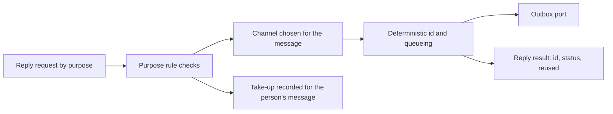

# replies.ts

This file holds the Engine's rules for the messages it sends back to people. It decides whether a requested message is allowed at all — an acknowledgement, an answer, a result, or a question needing attention — chooses the conversation it belongs in, and queues it through the Outbox port under an id that prevents it from being sent twice. The Engine routes its `reply` command here, and two sibling parts also rely on it: Tickets asks for the acknowledgement an accept carries, and Assignments asks it to withdraw a question a newer report replaced.

## Whole-unit functional diagram

The main path takes a request, checks the rule that applies to its purpose against the ticket and the person's message, picks a channel, then queues one message and reports what became of it. Acknowledging a person's message additionally records that the ticket's worker took that message up, so routing decisions elsewhere know the message is being handled inside the ticket.

<!-- {
  "mermaid_info": {
    "name": "Reply request to queued channel message",
    "nodes": [
      {
        "id": "request_001",
        "name": "Reply request by purpose",
        "path": "src/core/replies.ts",
        "hint": "The discriminated request type callers pass in",
        "isJumpable": true,
        "position": { "startLine": 14, "endLine": 18 },
        "references": []
      },
      {
        "id": "rules_002",
        "name": "Purpose rule checks",
        "path": "src/core/replies.ts",
        "hint": "Ticket, trigger, question and readiness checks per purpose",
        "isJumpable": true,
        "position": { "startLine": 48, "endLine": 78 },
        "references": []
      },
      {
        "id": "channel_003",
        "name": "Channel chosen for the message",
        "path": "src/core/replies.ts",
        "hint": "Where an answer, result or attention message is posted",
        "isJumpable": true,
        "position": { "startLine": 83, "endLine": 85 },
        "references": []
      },
      {
        "id": "id_004",
        "name": "Deterministic id and queueing",
        "path": "src/core/replies.ts",
        "hint": "Content-derived id, reuse detection, outbox send",
        "isJumpable": true,
        "position": { "startLine": 79, "endLine": 91 },
        "references": []
      },
      {
        "id": "outbox_005",
        "name": "Outbox port",
        "path": "src/core/ports.ts",
        "hint": "The port that queues channel messages idempotently",
        "isJumpable": true,
        "position": { "startLine": 76, "endLine": 83 },
        "references": []
      },
      {
        "id": "takeup_006",
        "name": "Take-up recorded for the person's message",
        "path": "src/core/part.ts",
        "hint": "Shared part helper that records which ticket acknowledged or answered a trigger",
        "isJumpable": true,
        "position": { "startLine": 49, "endLine": 55 },
        "references": []
      },
      {
        "id": "status_007",
        "name": "Reply result: id, status, reused",
        "path": "src/core/replies.ts",
        "hint": "What the caller learns about the queued message",
        "isJumpable": true,
        "position": { "startLine": 17, "endLine": 18 },
        "references": []
      }
    ]
  }
} -->

    
        <a target="_self" href="#src/core/replies.ts:1?class=graph" style="color: inherit; text-decoration: none;">Graph: Reply request to queued channel message</a>
    

## At a glance

- Primary role: Domain rules — the file is the single gate that says which of the Engine's outbound messages may be written to a conversation, and under which conditions.
- Secondary role: API boundary — it publishes the request shape callers use and the small result they get back, and it is the only way the Engine queues replies.
- Confidence: High — the whole file was read along with the Outbox port, the error catalogue, and all three call sites (Engine, Tickets, Assignments).

## What this file does

- Gates four kinds of messages by purpose: an acknowledgement of a person's request, the answer to a person's question, the result of a finished ticket, and a ticket's current question for a person (`attention`).
- Picks the conversation each message belongs in: an acknowledgement or answer goes where the person wrote, a question goes where the message that raised it was written (or the ticket's starting conversation), and a result goes to the conversation the ticket started in.
- Prevents duplicates: ids are derived from the message's own content, so a repeated request reuses the earlier message instead of posting again, and the result tells the caller whether it was reused.
- Refuses messages that break the rules with a coded `UserError`, such as acknowledging a message that never reached the ticket, or reporting a result for a ticket that is not ready.
- Serves siblings inside the same transaction: the acknowledgement an accept carries, and the withdrawal of a question that a newer report replaced.

## Key functions or classes

### `ReplyRequest`

The caller-facing request type: `purpose` plus the ticket, trigger, question and text that identify the message. Only field combinations that make sense per purpose are allowed, and `ticketId` may be omitted when the trigger already points at the ticket.

### `Reply`

The small result record: the queued message's id, its current `ReplyStatus` (`pending`, `sent`, or `dropped`), and whether an earlier request had already queued this message.

### `Replies.reply()`

The single entry point. It routes an acknowledgement to the acknowledgement path and everything else to the answer/result/attention path, returns the `Reply`, and throws a coded error when the purpose's rule refuses the request.

    
        <a target="_self" href="#src/core/replies.ts:36-38?class=code" style="color: inherit; text-decoration: none;">Code: src/core/replies.ts:36-38</a>
    

### `Replies.acknowledgeAccepted()`

The path Tickets uses when an accept carries an acknowledgement string: it queues one acknowledgement where the accepted person's message was written, but only when that message has a channel and was written by a person.

### `Replies.withdrawAttention()`

The path Assignments uses when a report replaces or clears a ticket's open question: it withdraws the pending question message, which does nothing if that message already went out.

### `Replies` (class)

The Engine part that owns these rules; it inherits repository access, ticket lookup and thread-reach checks from `EnginePart` and depends on the Outbox port for all actual queueing.

    
        <a target="_self" href="#src/core/replies.ts:26-95?class=code" style="color: inherit; text-decoration: none;">Code: src/core/replies.ts:26-95</a>
    

## Main inputs and results

- Inputs: a `ReplyRequest`; the stored Trigger and Ticket records looked up by id; the ticket's current open question and its list of questions its worker already answered; the content-derived `key()` helper; and the Outbox port for queueing and status.
- Results: a `Reply` (`id`, `status`, `reused`), or a `UserError` whose code names the refusal such as `ackEnded`, `notReached`, `ackNoChannel`, `ackNotPerson`, `notReady`, `notAttention`, `notQuestion`, `noAnswer`, or `noChannel`.
- Visible side effects: a message queued for a channel shows up as pending and later `sent` or `dropped`; an acknowledgement marks the ticket as having taken that person's message up; sending an answer removes that question from the ticket's answered list so it cannot be answered twice.

## Rules and decisions

- Decision: may this message be written to a conversation on behalf of this ticket? Each purpose answers a different aspect of that question.
- Important conditions: an acknowledgement needs an open ticket plus a person's message that actually reached the ticket on a writable (non context-only) thread, and that message must have a channel. An answer needs the person's message to be the one the ticket's worker reported answering. A result needs the ticket to have ended as `merged`, `completed`, or `dropped`, or to be open with a `ready` latest report. A question message must quote the ticket's currently open question exactly.
- Outcomes: the message is queued (possibly reusing an earlier identical one), or the request is refused with a specific error code.
- Invariant: every outbound message is keyed by its own content, so the same request can never post twice; and the first acknowledgement queued for a person's message keeps its text, even when a worker acknowledges later.
- Invariant: a ticket only reports a result once it is genuinely ready, which keeps ordinary progress out of people's conversations.

### Small example

A worker acknowledges a person's request twice with different wording. The first call queues the message and records the take-up. The second call finds the same content-derived id already in the outbox, leaves the original text in place, records the take-up again harmlessly, and returns `reused: true` — the person still sees exactly one acknowledgement.

## Public contract

- Caller: the Engine's `reply` command (exposed to the main Session and its reply tool), Tickets on accept, and Assignments on report.
- Operation: queue one channel message for a ticket or a person's message, queue the acknowledgement an accept carries, or withdraw a pending question message.
- Accepted input: `purpose` plus `text`; `ticketId` (optional when a trigger identifies the ticket), `triggerId` (required for acknowledgements, and for answers it must be the person's original question), and `question` (required for `attention` and must equal the ticket's open question).
- Result: the `Reply` record with its current outbox status and reuse flag; invalid or disallowed requests raise `UserError` values whose `missing` flag distinguishes unknown state from a refused rule.
- Access or validation requirements: the Engine wraps this call in one repository transaction, so the checks and the queueing happen atomically; the Outbox's own status is the source of truth for whether a message is pending, sent, or dropped.

---
name: replies.ts

update-time: 2026-11-02 11:22

description: This file holds the Engine's rules for the messages it sends back to people. It decides whether a requested message is allowed at all — an acknowledgement, an answer, a result, or a question needing attention — chooses the conversation it belongs in, and queues it through the Outbox port under an id that prevents it from being sent twice. The Engine routes its `reply` command here, and two sibling parts also rely on it: Tickets asks for the acknowledgement an accept carries, and Assignments asks it to withdraw a question a newer report replaced.

---
