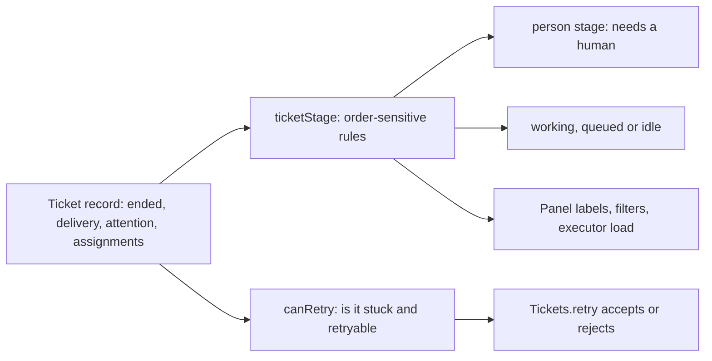

# stage.ts

This file turns a raw Ticket record into one plain-language answer: is this work waiting on a person, actively running, resting until the next trigger, or finished? It implements the "Ticket stages" table from the execution design document as a single ordered classifier, and adds a companion check for whether a stuck Ticket may be retried. Anything that lists, labels, filters, groups or unsticks Tickets — dashboard views, ticket cards, the retry command — reads its verdict instead of re-deriving the rules. If you need to know what "awaiting review", "queued" or "blocked" mean in this codebase, this is the definition.

## Whole-unit functional diagram

The classifier reads one Ticket snapshot and emits a stage variant; independent of that, `canRetry` decides whether the retry command is allowed to replace the stalled assignment. Both answers flow outward only as data, so all the wording a person eventually sees is produced by the view layer.

<!-- {
  "mermaid_info": {
    "name": "Ticket stage classification flow",
    "nodes": [
      {
        "id": "ticket_001",
        "name": "Ticket record: ended, delivery, attention, assignments",
        "path": "src/core/model.ts",
        "hint": "The aggregate read by the classifier: end marker, failed delivery, open question and assignment history",
        "isJumpable": true,
        "position": { "startLine": 277, "endLine": 308 },
        "references": []
      },
      {
        "id": "classify_002",
        "name": "ticketStage: order-sensitive rules",
        "path": "src/core/stage.ts",
        "hint": "Checks the documented rows in order and returns the first match",
        "isJumpable": true,
        "position": { "startLine": 9, "endLine": 21 },
        "references": []
      },
      {
        "id": "person_003",
        "name": "person stage: needs a human",
        "path": "src/core/stage.ts",
        "hint": "Delivery, answer, review, blocked or failed actions",
        "isJumpable": true,
        "position": { "startLine": 11, "endLine": 17 },
        "references": []
      },
      {
        "id": "work_004",
        "name": "working, queued or idle",
        "path": "src/core/stage.ts",
        "hint": "The executor can continue on its own, either now, after a slot, or on the next trigger",
        "isJumpable": true,
        "position": { "startLine": 18, "endLine": 20 },
        "references": []
      },
      {
        "id": "retry_005",
        "name": "canRetry: is it stuck and retryable",
        "path": "src/core/stage.ts",
        "hint": "Open ticket waiting for a person, or with a failed input delivery",
        "isJumpable": true,
        "position": { "startLine": 24, "endLine": 26 },
        "references": []
      },
      {
        "id": "ui_006",
        "name": "Panel labels, filters, executor load",
        "path": "src/app/views/records.ts",
        "hint": "Ticket summaries, stage filters and the queued-slot count read the stage",
        "isJumpable": true,
        "position": { "startLine": 118, "endLine": 131 },
        "references": []
      },
      {
        "id": "gate_007",
        "name": "Tickets.retry accepts or rejects",
        "path": "src/core/tickets.ts",
        "hint": "Throws 'notRetryable' when canRetry is false",
        "isJumpable": true,
        "position": { "startLine": 168, "endLine": 180 },
        "references": []
      }
    ]
  }
} -->

    
        <a target="_self" href="#src/core/stage.ts:1?class=graph" style="color: inherit; text-decoration: none;">Graph: Ticket stage classification flow</a>
    

## At a glance

- **Primary role**: Domain rules — the file states, in one place, what "waiting for a person", "queued", "idle" and "ended" mean for a Ticket, and when a human may retry it.
- **Secondary roles**: Data contract — it publishes the shared `TicketStage` shape that every screen and card switches on.
- **Confidence**: High — the rules match the documented stage table, are exercised row by row in `tests/stage.spec.ts`, and their consumers are visible in the app views and the retry command.

## What this file does

- **Classifies a Ticket into one stage.** Instead of asking a screen to combine end markers, reports and input state, callers ask once and switch on a single value.
- **Encodes the priority of signals.** Delivery failures outrank questions, questions outrank ready reports, and a ready report outranks a blocked or failed one. Order is the actual rule, so moving a line changes who a person sees first.
- **Separates "needs a person" from "can continue alone".** The `person` stage means work cannot progress without human input; `working` and `idle` mean the executor still owns the next move.
- **Lets a person's reply release a stuck Ticket.** A blocked or failed report only counts while no newer human message has reached the Ticket, so an answered Ticket falls through to a normal working stage and a retry would only interrupt it.
- **Decides retry eligibility.** `canRetry` is the guard the retry command consults before ending the stalled assignment and starting a fresh one.
- **Supplies the dashboard's vocabulary.** Stage names back the ticket list filters, the "person" bucket on the overview, the count of Tickets queued for a worker slot, and the retry action shown in a summary.

## Key functions or classes

### `TicketStage`

The result shape: either a `person` stage with one of five actions (`delivery`, `answer`, `review`, `blocked`, `failed`), a `working` stage that may carry the optional `queued` action, or the bare `idle` and `ended` stages.

### `ticketStage`

Reads a Ticket and returns the first matching row of the documented table, from "ended" through to the fallback "working".

### `canRetry`

Returns true when an open Ticket is waiting for a person because of a blocked or failed report, or because delivering an input to its worker failed.

<a target="_self" href="#src/core/stage.ts:24-26?class=code" style="color: inherit; text-decoration: none;">stage.ts:24-26</a>

The file deliberately owns no logic of its own beyond these two functions; it borrows `latestAssignment` and `waitsForPerson` from the domain model to ask "what did the most recent assignment report, and has a person replied since?".

## Main inputs and results

- **Inputs**: one Ticket value, in practice its end marker, its last failed delivery, its open question, and the state and report of its latest assignment together with the human inputs that arrived after that report.
- **Results**: a `TicketStage` value describing the waiting state, and for `canRetry` a plain boolean.
- **Visible side effects**: none directly — the file writes no state. What a person observes is downstream: the ticket's panel label ("Awaiting review", "Queued", "Waiting for a Trigger"), which stage filter a ticket appears under, the queued count against worker slots, whether the retry action is offered, and the `notRetryable` error when a retry is refused.

## Rules and decisions

- **Decision**: given everything known about a Ticket right now, what is it waiting for — and may a person unstick it with a retry?
- **Important conditions**, in priority order: the Ticket has ended; an input delivery to its worker failed; it holds an open question for a person; its latest report is `ready`; its latest report is `blocked` or `failed` *and* no person's message reached it since; it has no assignment or only a pending one; its latest report is `waiting` or its assignment ended. Everything else is actively working.
- **Outcomes**: `person/delivery`, `person/answer`, `person/review`, `person/blocked`, `person/failed`, `working/queued`, `idle`, and plain `working`. The `ended` stage is reported separately and the Ticket's outcome word (`completed`, `merged`, `closed`, `dropped`, `stopped`) is read from the Ticket itself, not from this file.
- **Invariant**: an ended Ticket is always classified `ended`, no matter what attention, delivery failure or report it still carries — the ticket card and summary views rely on that ordering.
- **Invariant**: a `blocked` or `failed` stage is only reported while the ticket still genuinely waits for a person; once a non-context human message arrives after the report, the same Ticket moves to a working stage and retry eligibility drops unless delivery of that message itself failed.

### Small example

A Ticket whose latest report is `failed` shows as waiting for a person with the `failed` action, and retry is offered. A person then replies on its thread: the stage falls through to `working` and retry is withdrawn, because the worker now has that message. If delivering the reply to the executor fails instead, the Ticket shows `person/delivery`, the panel surfaces the delivery error, and retry becomes available again — a new assignment restarts the worker and takes the message with it.

## Information contract

- **Represents**: a normalized snapshot of a Ticket's current waiting state, expressed as a discriminator plus at most one action, rather than as a set of raw flags.
- **Produced by**: `ticketStage` and `canRetry` in this file, and re-exported from `src/core/index.ts` as part of the core's public surface.
- **Consumed by**: the ticket card projection, which flattens a stage into strings such as `person/review` or `working/queued`; the ticket summary view, which uses the action to choose a one-line note and decides whether to offer retry; the ticket list filter, which compares against `open`, `person`, `working`, `idle` or `ended`; the overview, which buckets the `person` stage and counts `idle` tickets; the executor-load helper, which counts `working/queued` tickets; and the retry command, which refuses anything `canRetry` rejects.
- **Behavior-shaping parts**: the `stage` discriminator selects the branch every consumer takes; `action` is required for `person` and meaningful only for `working` when it equals `queued`; `canRetry` is a single boolean gate rather than a richer verdict.

### Compatibility notes

The card projection keeps its own list of accepted state strings and the client keeps one translation key per action (`stage.answer`, `stage.review`, `stage.blocked`, `stage.failed`, `stage.delivery`, `stage.queued`, `stage.working`, `stage.idle`). Adding a new stage or action therefore needs the translation key and that list updated alongside this file, or a ticket will render with a missing label.

---
name: stage.ts

update-time: 2026-11-02 11:19

description: This file turns a raw Ticket record into one plain-language answer: is this work waiting on a person, actively running, resting until the next trigger, or finished? It implements the "Ticket stages" table from the execution design document as a single ordered classifier, and adds a companion check for whether a stuck Ticket may be retried. Anything that lists, labels, filters, groups or unsticks Tickets — dashboard views, ticket cards, the retry command — reads its verdict instead of re-deriving the rules. If you need to know what "awaiting review", "queued" or "blocked" mean in this codebase, this is the definition.

---
