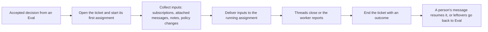

# tickets.ts

This file is the part of the engine that owns the life of a *ticket* — the unit of authorized work that an accepted decision creates. It opens tickets, keeps their thread subscriptions and inputs in order, decides when they end, ends them, and brings one back when a person's message arrives after it ended. If you want to know why a ticket is still open, why a message never reached the worker, or why an ended ticket woke up again, the answer is usually a rule encoded here.

## Whole-unit functional diagram

<!-- {
  "mermaid_info": {
    "name": "Ticket lifecycle in tickets.ts",
    "nodes": [
      {
        "id": "accept_001",
        "name": "Accepted decision from an Eval",
        "path": "",
        "hint": "An Eval accepts work and grants a mandate; this file receives that decision",
        "isJumpable": false,
        "position": { "startLine": 0, "endLine": 0 },
        "references": []
      },
      {
        "id": "create_002",
        "name": "Open the ticket and start its first assignment",
        "path": "src/core/tickets.ts",
        "hint": "create builds the ticket, subscribes its threads and queues the first assignment",
        "isJumpable": true,
        "position": { "startLine": 37, "endLine": 56 },
        "references": []
      },
      {
        "id": "inputs_003",
        "name": "Collect inputs: subscriptions, attached messages, notes, policy changes",
        "path": "src/core/tickets.ts",
        "hint": "bind, attach, subscribe and policyChanged record what the worker may see",
        "isJumpable": true,
        "position": { "startLine": 121, "endLine": 144 },
        "references": []
      },
      {
        "id": "deliver_004",
        "name": "Deliver inputs to the running assignment",
        "path": "src/core/tickets.ts",
        "hint": "addInput queues an input once and asks the Executor to deliver or launch",
        "isJumpable": true,
        "position": { "startLine": 234, "endLine": 245 },
        "references": []
      },
      {
        "id": "close_005",
        "name": "Threads close or the worker reports",
        "path": "src/core/tickets.ts",
        "hint": "threadClosed and followsDone decide whether the ticket is done with its threads",
        "isJumpable": true,
        "position": { "startLine": 77, "endLine": 101 },
        "references": []
      },
      {
        "id": "end_006",
        "name": "End the ticket with an outcome",
        "path": "src/core/tickets.ts",
        "hint": "end records how the ticket ended and returns unread messages",
        "isJumpable": true,
        "position": { "startLine": 345, "endLine": 363 },
        "references": []
      },
      {
        "id": "resume_007",
        "name": "A person's message resumes it, or leftovers go back to Eval",
        "path": "src/core/tickets.ts",
        "hint": "wake resumes an ended ticket under its mandate; refuse and letGo hand messages back",
        "isJumpable": true,
        "position": { "startLine": 252, "endLine": 270 },
        "references": []
      }
    ]
  }
} -->

    
        <a target="_self" href="#src/core/tickets.ts:1?class=graph" style="color: inherit; text-decoration: none;">Graph: Ticket lifecycle in tickets.ts</a>
    

The main path runs from an accept decision to a ticket with a mandate, then to inputs delivered to a worker, and finally to an end recorded with an outcome. The loop back is the interesting part: an ended ticket can be resumed by a person's message, and messages nobody took up are handed back to Eval instead of being lost.

## At a glance

- **Primary role: Domain rules** — the file answers lifecycle questions: which messages a ticket may still take, when its threads decide that it is done, and when it must end.
- **Secondary role: State storage** — it is the only place that writes the ticket aggregate and the thread-subscription side of the relationship, including the `undelivered` delivery queue.
- **Confidence**: High — the whole class, its doc comments and its callers in `engine.ts`, `evals.ts`, `intake.ts` and `assignments.ts` agree on a single responsibility: ticket lifecycle mutations.

## What this file does

- **Opens tickets.** `create` turns an accepted decision into a ticket: it copies the channels of the triggers the Eval held, subscribes the ticket to their threads, adds a first assignment, sends the accept's acknowledgement through `Replies`, and queues the launch.
- **Binds threads.** `bind`, `attach` and `followForContext` subscribe a ticket to a thread; `markUnrelated` and `dropSubscriptions` take subscriptions away again, for one ticket or for everyone.
- **Feeds the worker.** `attach`, `note`, `requestStatus` and `policyChanged` add inputs; `addInput` records each input once by its id and then asks the Executor to deliver it or to launch a pending assignment.
- **Ends tickets.** `threadClosed` plus `followsDone` and `unfinished` decide when followed threads make a ticket done, and `end` records the outcome, releases the remaining messages and stops the assignments that were running.
- **Resumes and gives back.** `wake` reopens an ended ticket when a person's message still waits for it and its mandate still revalidates; `refuse` and `letGo` handle the opposite case by returning untaken messages to Eval.
- **Serves people and the Executor.** `stop`, `retry`, `requestStatus`, `note` and `markUnrelated` are the ticket-level operations that the engine exposes to people, the main Session and workers.

The vocabulary used here (Trigger, Ticket, Mandate, Assignment, Subscription) is defined in 
<a target="_self" href="#docs/001-domain.md?class=text" style="color: inherit; text-decoration: none;">001-domain.md</a>
.

## Rules and decisions

- **Decision**: may this ticket take the message or the new work at all, and when is it finished?
- **Important conditions**:
  - A ticket a person stopped takes nothing more (`attachable` refuses with `ticketStopped`), and an ended ticket may only be reopened after its mandate revalidates against the current policy, otherwise `mandateRevoked`.
  - Only a *person's* trigger message resumes an ended ticket; bot and CI messages wait alongside older inputs.
  - Automated inputs are held back while the worker waits for a person, so a bot or CI note cannot answer a question meant for a human.
  - `followsDone` prefers the threads the ticket opened itself; only when it opened none does every followed thread have to close. A close that arrives while work resumed afterwards does not end the ticket until that work reports ready.
  - `markUnrelated` refuses the origin thread, a thread a source bound, and any thread the ticket is not subscribed to.
- **Outcomes**: a ticket ends as `completed`, `merged`, `closed`, `dropped` or `stopped`, recorded with who ended it (`executor` or `human`) and an optional reason; or it goes on with a new assignment (`retry`, `restart`) or a resumed one (`wake`).
- **Invariant**: an input id is added at most once, so repeated fan-out, re-attachment or repeated policy transitions between the same two versions cannot duplicate an input — while `policyChanged` deliberately includes the timestamp so a genuine second transition still produces a new one.
- **Invariant**: a ticket's end never rewrites history backwards; an ending dated earlier, such as a pull-request merge, leaves the ticket's `updatedAt` at the moment of recording.

### Small example

A worker is still finishing its work when its pull request merges. `threadClosed` marks the follow as closed and `followsDone` now holds, but `unfinished` reports that the worker took up a person's message after its last report — so the ticket stays open. When that worker next reports `ready`, `Assignments` asks `followsDone` again and the ticket ends as `merged`.

## Key functions or classes

### `Tickets`

The domain part that manages every ticket lifecycle mutation; it extends `EnginePart` for shared access to repositories, policy, clock and event emission, and receives `Replies` for the acknowledgement an accept carries.

    
        <a target="_self" href="#src/core/tickets.ts:29-56?class=code" style="color: inherit; text-decoration: none;">Code: src/core/tickets.ts:29-56</a>
    

### `create`

Builds the ticket for an accepted decision — title, mandate, channels from the evaluation's triggers, first pending assignment — then subscribes its threads, sends the acceptance reply and queues the launch.

### `attachable` and `attach`

`attachable` is the gate that decides whether a message may be attached at all; `attach` then subscribes the trigger's threads, records the fan-out disposition and adds the message as an input, including the cases where the worker must receive it again.

    
        <a target="_self" href="#src/core/tickets.ts:106-144?class=code" style="color: inherit; text-decoration: none;">Code: src/core/tickets.ts:106-144</a>
    

### `addInput`

The single entry point for giving a ticket content: it deduplicates by input id, updates the ticket, decides whether the input may be delivered now, and either delivers to the running assignment or launches a pending one.

### `threadClosed` and `followsDone`

Together they turn a thread's close into a decision: `followsDone` returns the closing outcome that makes the ticket done, and `threadClosed` ends the ticket unless its work has not finished.

    
        <a target="_self" href="#src/core/tickets.ts:77-101?class=code" style="color: inherit; text-decoration: none;">Code: src/core/tickets.ts:77-101</a>
    

### `end`

Ends a live ticket once: it records `ended`, clears the delivery queue and attention, ends the assignments still running, releases the messages the worker never received or never read, and emits `ticket.ended`.

    
        <a target="_self" href="#src/core/tickets.ts:345-363?class=code" style="color: inherit; text-decoration: none;">Code: src/core/tickets.ts:345-363</a>
    

### `wake`

Reopens an ended ticket when a person's message on one of its threads still waits for it: it rechecks the policy, keeps the ticket ended when the mandate no longer holds, and otherwise creates a fresh assignment with a `resumed` input placed ahead of the waiting messages.

### `policyChanged` and `dropSubscriptions`

`policyChanged` tells every open ticket, oldest first, how a policy change bears on it; `dropSubscriptions` removes a thread's subscriptions, for one ticket or all, and reports whether anything was dropped.

## Stored state lifecycle

- **Stores**: the ticket aggregate itself (assignments, inputs, the `undelivered` queue, `follows`, `channels`, `origin`, `ended`) and the thread side of every subscription, including the `context` marks that say a thread is followed for reading only.
- **Read path**: sibling parts and the engine read tickets through the repositories (`get`, `open`, `active`); `require` turns a missing ticket into the `unknownTicket` error, and opened tickets are iterated oldest first where delivery order matters.
- **Write path**: every mutation here goes through `repo.tickets.save` or `repo.threads.save`, and the engine wraps each public call in a repository transaction, so a ticket change and the events or thread changes around it stay together.
- **Visible result**: the panel and the main Session see current ticket state, an extended overview shows which tickets ended and why, and an ended ticket can still be found by id and resumed.

### Important persistence behavior

Adding an input twice with the same id is a no-op, which is what makes re-attaching a message, re-fanning out a trigger or resuming a ticket safe to retry. Ending or refusing a ticket empties `undelivered` and detaches the ticket from the message dispositions it no longer decides, so a later resume starts from a clean queue rather than redelivering messages that went back to Eval.

## Main inputs and results

- **Inputs**: an accept decision with its mandate and evaluation, trigger and thread references, thread-close facts, people's requests (`stop`, `retry`, `requestStatus`, notes), executor facts, policy transitions with per-ticket effects, and the injected `EngineOptions` (`executor`, `outbox`, `policy`, optional `prepareTicket` hook and clock).
- **Results**: updated and persisted tickets, `boolean` answers where a request may be a no-op (status requests, subscription drops, context follows), `UserError` refusals with codes such as `unknownTicket`, `ticketEnded`, `ticketStopped`, `mandateRevoked`, `unknownTrigger`, `notRetryable`, `sourceThread`, `followedThread` and `notFollowing`.
- **Visible side effects**: `ticket.created`, `ticket.ended`, `ticket.resumed`, `thread.subscribed`, `thread.unsubscribed` and `assignment.ended` events; executor calls that start, deliver to or stop an assignment; and the acknowledgement or status request that reaches the outbox.

---
name: tickets.ts

update-time: 2026-11-02 11:23

description: This file is the part of the engine that owns the life of a *ticket* — the unit of authorized work that an accepted decision creates. It opens tickets, keeps their thread subscriptions and inputs in order, decides when they end, ends them, and brings one back when a person's message arrives after it ended. If you want to know why a ticket is still open, why a message never reached the worker, or why an ended ticket woke up again, the answer is usually a rule encoded here.

---
