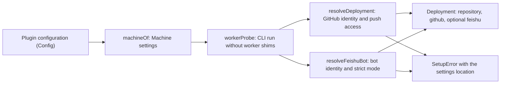

# deployment.ts

This file is the control surface of the `dsh-superagent` plugin: it declares the plugin's own configuration, turns it into the machine settings the rest of the plugin reads, and then verifies — by actually running the configured command-line tools — which GitHub repository and which accounts the agent is allowed to act as. `src/index.ts` calls `machineOf` on every start, and the setup class calls `resolveDeployment` and `resolveFeishuBot`, so anything an operator sees as "waiting for setup" starts here. The useful takeaway is that no person, account or organisation is hardcoded: identities are discovered from the CLIs, and every failure is reported as a structured problem naming the settings place the operator has to fix.

## How configuration becomes a verified deployment

Configuration enters as a validated schema value, becomes a `Machine` (state directory plus live limit references), and is then probed through the DSH subprocess service with the worker shim directory removed from `PATH`. Each probe ends either in a `Deployment` — the canonical repository name, the agent's GitHub account and an optional Feishu bot — or in a `SetupError` that points the operator at the GitHub or Feishu settings.

<!-- {
  "mermaid_info": {
    "name": "Configuration to verified deployment",
    "nodes": [
      {
        "id": "trigger_001",
        "name": "Plugin configuration (Config)",
        "path": "src/deployment.ts",
        "hint": "The schemastery schema of the plugin's own settings",
        "isJumpable": true,
        "position": { "startLine": 15, "endLine": 23 },
        "references": []
      },
      {
        "id": "process_002",
        "name": "machineOf: Machine settings",
        "path": "src/deployment.ts",
        "hint": "Rejects unknown keys and returns the machine settings",
        "isJumpable": true,
        "position": { "startLine": 38, "endLine": 43 },
        "references": []
      },
      {
        "id": "process_003",
        "name": "workerProbe: CLI run without worker shims",
        "path": "src/deployment.ts",
        "hint": "Builds the probe that runs a CLI the way workers do",
        "isJumpable": true,
        "position": { "startLine": 73, "endLine": 76 },
        "references": []
      },
      {
        "id": "process_004",
        "name": "resolveDeployment: GitHub identity and push access",
        "path": "src/deployment.ts",
        "hint": "Verifies the agent CLI account and repository push access",
        "isJumpable": true,
        "position": { "startLine": 87, "endLine": 106 },
        "references": []
      },
      {
        "id": "process_005",
        "name": "resolveFeishuBot: bot identity and strict mode",
        "path": "src/deployment.ts",
        "hint": "Verifies the optional bot CLI identity and strict mode",
        "isJumpable": true,
        "position": { "startLine": 114, "endLine": 131 },
        "references": []
      },
      {
        "id": "result_006",
        "name": "Deployment: repository, github, optional feishu",
        "path": "src/deployment.ts",
        "hint": "The resolved deployment shape consumed by the app and executors",
        "isJumpable": true,
        "position": { "startLine": 53, "endLine": 58 },
        "references": []
      },
      {
        "id": "problem_007",
        "name": "SetupError with the settings location",
        "path": "src/setup.ts",
        "hint": "Structured setup problem that names its settings place",
        "isJumpable": true,
        "position": { "startLine": 30, "endLine": 39 },
        "references": []
      }
    ]
  }
} -->

    
        <a target="_self" href="#src/deployment.ts:1?class=graph" style="color: inherit; text-decoration: none;">Graph: Configuration to verified deployment</a>
    

## At a glance

- **Primary role — Configuration**: defines the plugin's configurable surface (one required state directory plus three bounded limits), their defaults, and whether a change needs a restart.
- **Secondary role — Data contract**: publishes the shared `Machine`, `Deployment` and `FeishuBot` shapes and the Source-settings schemas that the app, executor and source modules all agree on.
- **Secondary role — External adapter**: bridges to the GitHub CLI and the Feishu/Lark CLI, turning their JSON output into project-level outcomes or structured setup problems.
- **Confidence**: High — the whole file was read, together with its two consumers (`src/index.ts`, `src/app/setup.ts`), the error catalogue it throws, and its test suite.

## What this file does

- Declares the plugin settings: `stateDir` is required and must be an absolute path, while `promptMaxChars`, `admissionContextMaxPages` and `admissionContextTimeoutMs` have defaults and are marked volatile so new values apply the next time they are read.
- Refuses configuration keys the plugin does not use, and in the same message tells the operator where an older key's value lives now (for example `repository` → on the GitHub Source, `blockedCommands` → in the Execution settings).
- Resolves which GitHub repository the agent works on and which account its `gh` CLI is signed in as, then requires push access; the repository name is taken from GitHub's own answer, so a renamed repository still matches incoming notifications.
- Resolves the optional Feishu bot and refuses models where that CLI can also act as a human user, because workers invoke it by bare name.
- Runs every probe exactly as worker shells do — through the DSH subprocess service, with the worker shim directory stripped from `PATH` — so a wrapper script for `gh` still reaches the real binary.
- Publishes `SETUP_FIELDS`, the list of Source-settings fields whose change means setup must run again, and the type contract the rest of the plugin imports.

    
        <a target="_self" href="#src/deployment.ts?class=code" style="color: inherit; text-decoration: none;">Code: src/deployment.ts</a>
    

## Configurable behavior

- **Controls**: the state directory that holds the database, locks, worker command shims, the agent's git configuration and, by default, the ticket directories; plus three machine limits — the largest saved prompt, how many pages of thread context one assessment may read, and how long one of those context reads may take.
- **Value source**: the plugin configuration supplied by the DeepSeek Harness host, edited in the management panel's Deployment settings or the Plugin Manager. Defaults (100 000 characters, 10 pages, 15 000 ms) come from the schema, and the accepted bounds come from `LIMITS` in 
<a target="_self" href="#src/limits.ts:1-11?class=code" style="color: inherit; text-decoration: none;">limits.ts:1-11</a>
.
- **Takes effect**: an invalid value or an unknown key stops startup and the log names the key. The three limits are volatile, so a change applies in place without a restart; `stateDir` is not volatile, so changing it remounts the plugin and re-runs setup.

### Common adjustment

`promptMaxChars` — raise it when saved prompts of long tickets are being cut short, or lower it to keep prompts small; the accepted range is 1 000 to 1 000 000 characters and no restart is needed. The two `admissionContext*` limits behave the same way, bounding how much context one assessment may read and for how long before it gives up.

## Information contract

- **Represents**: the deployment facts the rest of the plugin needs — where its files live (`Machine.stateDir`), which live limit values to read (`Machine` holds references, not copies), which repository is canonical (`Deployment.repository`), which executable acts as the agent (`Deployment.github.cli`), the commit identity to use (`Deployment.github.noreply`), and whether a Feishu bot participates at all (the presence or absence of `Deployment.feishu`).
- **Produced by**: `machineOf`, `resolveDeployment` and `resolveFeishuBot` in this file. The two Zod schemas `GithubAccountsSchema` and `FeishuBotSchema` describe the Source-settings blocks and are reused by the source modules, so panel forms, synced settings and setup agree on the same field names.
- **Consumed by**: setup, runtime, the HTTP layer, the executor and the source modules, which import these types instead of defining their own notion of a repository or account.
- **Behavior-shaping parts**: `repository` is the name GitHub returns, not the one typed in; `github.cli` is an absolute path, so it can serve as the git credential helper; a Feishu bot only exists when the Source names a CLI that passes every check.

### Compatibility notes

Top-level keys are strict: the plugin accepts only `stateDir`, `promptMaxChars`, `admissionContextMaxPages` and `admissionContextTimeoutMs`. Keys from earlier layouts are recognised by name only so the error can say where their values moved; the operator-facing key list lives in 
<a target="_self" href="#docs/006-deployment.md?class=text" style="color: inherit; text-decoration: none;">006-deployment.md</a>
.

## External connection

- **External system**: the agent's GitHub CLI (`gh`) and the optional Feishu/Lark CLI (`lark-cli`) — real programs on the operator's machine, never bundled.
- **Outbound translation**: a probe becomes `env PATH=<PATH without worker shims> <cli> …`, so the tool runs with the environment workers will have. The questions asked are: who am I signed in as, can I read and push to this repository, is the bot identity ready, which strict mode is in force, and what is this bot's `open_id`.
- **Inbound translation**: each answer is parsed as JSON and validated; a match becomes a project-level fact (canonical repository name, login, numeric account id, app id, brand, bot id and name), while anything else becomes a `SetupError` such as "cannot read the repository", "cannot push", "the bot identity is not ready" or "the bot CLI allows user identities".

### Operating requirements

The CLIs must be installed and executable — by command name on `PATH` or by absolute path — and the GitHub CLI must be signed in with push permission on the configured repository. The Feishu CLI must have its own bot-only configuration in strict mode `bot`, since workers call it as `lark-cli`; otherwise the deployment is rejected rather than silently acting as a person. Each probe is bounded at 60 seconds and is cancelled with the plugin's lifetime.

## Key functions or classes

### `Config`

The schemastery schema of the plugin's own settings: one required absolute `stateDir` and three bounded, volatile limits with defaults.

    
        <a target="_self" href="#src/deployment.ts:15-23?class=code" style="color: inherit; text-decoration: none;">Code: src/deployment.ts:15-23</a>
    

### `machineOf`

Validates a loaded configuration, rejects unknown keys with a message pointing older keys to their new home, and returns the `Machine` the plugin actually uses.

### `GithubAccountsSchema` / `FeishuBotSchema`

The Source-settings contracts: an optional `owner/name` repository plus a CLI name for GitHub, and just a CLI name for Feishu.

### `SETUP_FIELDS`

Names the Source-settings keys setup reads, so a change to a repository or CLI can trigger a restart while unrelated edits do not.

### `executable`

Resolves a command name or absolute path to a real executable file, skipping the worker shim directory so the plugin never re-enters its own shims.

### `workerProbe`

Builds the probe used for all startup checks: it strips the shim directory from `PATH`, then runs the command through the DSH subprocess service with a 60-second limit.

### `resolveDeployment`

Verifies the GitHub CLI identity and push access to the configured repository, and returns the deployment with the canonical repository name and the agent's commit email.

    
        <a target="_self" href="#src/deployment.ts:87-106?class=code" style="color: inherit; text-decoration: none;">Code: src/deployment.ts:87-106</a>
    

### `resolveFeishuBot`

Returns `undefined` when the Feishu Source names no CLI, and otherwise verifies a ready bot identity restricted to strict mode `bot` before returning the bot's identifiers.

    
        <a target="_self" href="#src/deployment.ts:114-131?class=code" style="color: inherit; text-decoration: none;">Code: src/deployment.ts:114-131</a>
    

## Main inputs and results

- **Inputs**: the plugin configuration from the host, the GitHub and Feishu Source-settings blocks, the `PATH` of the host process, an abort signal from the plugin lifetime, and a probe function (production uses `workerProbe`, tests inject a local one).
- **Results**: a `Machine`, a `Deployment` with the canonical repository, the agent's login, executable path and `users.noreply.github.com` commit address, and optionally a `FeishuBot`; failures arrive as `SetupError` values carrying a `github` or `feishu` place, a message code and its values.
- **Visible side effects**: nothing is written to disk here. The operator observes the outcome as startup readiness — the log line stating the plugin is ready or is waiting for setup — and as a localized problem in the management panel naming the settings place to fix.

---
name: deployment.ts

update-time: 2026-11-02 14:09

description: This file is the control surface of the `dsh-superagent` plugin: it declares the plugin's own configuration, turns it into the machine settings the rest of the plugin reads, and then verifies — by actually running the configured command-line tools — which GitHub repository and which accounts the agent is allowed to act as. `src/index.ts` calls `machineOf` on every start, and the setup class calls `resolveDeployment` and `resolveFeishuBot`, so anything an operator sees as "waiting for setup" starts here. The useful takeaway is that no person, account or organisation is hardcoded: identities are discovered from the CLIs, and every failure is reported as a structured problem naming the settings place the operator has to fix.

---
