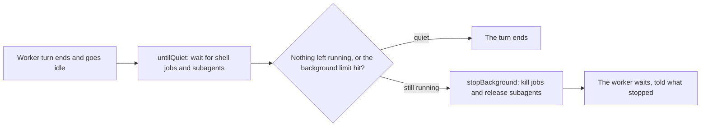

# background.ts

This file holds everything the Executor knows about a worker's *background* work inside DeepSeek Harness (DSH): the shell jobs a worker Session owns (`ctx.jobs`) and its subagents (`ctx.subagents`), which keep running after the worker's turn has ended. It provides the wait, kill, collect and release operations the Executor calls when a turn goes idle or an Assignment ends. Each operation is quiet by design — a job end it caused must not wake the worker — and every wait is bounded so a shutdown can never hang on a task that refuses to finish. Nothing here renders or stores anything; it is the coordination layer between the Executor's lifecycle decisions and DSH's services.

## Whole-unit functional diagram

The executor starts a look when a worker goes idle; `untilQuiet` is the only place that decides whether the worker's background work is over. A quiet result ends the turn normally, while a limit that expires hands the work to `stopBackground`, which kills what remains. The turn/report side of the path lives in the executor, not in this file.

<!-- {
  "mermaid_info": {
    "name": "Worker background work lifecycle",
    "nodes": [
      {
        "id": "trigger_001",
        "name": "Worker turn ends and goes idle",
        "path": "src/executor/dsh.ts",
        "hint": "The executor starts a bounded look at the worker's background work after its turn goes idle",
        "isJumpable": true,
        "position": { "startLine": 629, "endLine": 642 },
        "references": []
      },
      {
        "id": "wait_002",
        "name": "untilQuiet: wait for shell jobs and subagents",
        "path": "src/executor/background.ts",
        "hint": "Waits until no owned shell job and no subagent of the worker still runs",
        "isJumpable": true,
        "position": { "startLine": 96, "endLine": 104 },
        "references": []
      },
      {
        "id": "branch_003",
        "name": "Nothing left running, or the background limit hit?",
        "path": "",
        "hint": "The decision between an ended turn and a stop",
        "isJumpable": false,
        "position": { "startLine": 0, "endLine": 0 },
        "references": []
      },
      {
        "id": "quiet_004",
        "name": "The turn ends",
        "path": "src/executor/dsh.ts",
        "hint": "A quiet result lets the executor close the turn",
        "isJumpable": true,
        "position": { "startLine": 642, "endLine": 642 },
        "references": []
      },
      {
        "id": "stop_005",
        "name": "stopBackground: kill jobs and release subagents",
        "path": "src/executor/background.ts",
        "hint": "Stops everything a Session runs in the background, collecting one failure without stopping the rest",
        "isJumpable": true,
        "position": { "startLine": 159, "endLine": 165 },
        "references": []
      },
      {
        "id": "report_006",
        "name": "The worker waits, told what stopped",
        "path": "src/executor/dsh.ts",
        "hint": "The executor reports the worker as waiting with what was killed or still runs",
        "isJumpable": true,
        "position": { "startLine": 643, "endLine": 671 },
        "references": []
      }
    ]
  }
} -->

    
        <a target="_self" href="#src/executor/background.ts:1?class=graph" style="color: inherit; text-decoration: none;">Graph: Worker background work lifecycle</a>
    

## At a glance

- **Primary role**: Orchestration — the file sequences bounded waits, kills, drains and cancellations across DSH's job registry and subagent service so a worker's background work ends in a defined order.
- **Secondary roles**: External adapter — it declares the narrow `Jobs` and `Subagents` views it needs from DSH and treats both services as optional, so a profile without them simply has no background work.
- **Confidence**: High — the whole 166-line module was read, together with its call sites in `src/executor/dsh.ts` and its tests in `tests/background.spec.ts`.

## What this file does

- **Decides when a worker is truly finished.** A turn may end while a shell job or a subagent still runs; `untilQuiet` is the answer to "is anything still going?" and only reports quiet when the worker stayed idle throughout.
- **Names the work that still runs.** `runningJobs` gives the Executor readable `id (first line of label)` names for the shell jobs a Session owns, so a person can be told exactly what was killed.
- **Stops without waking the worker.** `killJobs` starts waiting for each job's end *before* killing it, so the ends count as already collected and the worker is not woken by the stop it caused.
- **Leaves jobs to a person.** `collectJob` keeps waiting on a job that a handing-off worker left behind, and reports how it ended so the Executor can tell the worker at its next turn.
- **Releases subagents, bounded.** `stopSubagents` drains the worker's live subagents for a limited time, then cancels the turn their ends woke, optionally keeping the inbox.
- **Stops everything in one call.** `stopBackground` is the entry point for the end of an Assignment: kill the Session's jobs, release the loaded worker's subagents, and report all failures together.

## Coordinated flow

1. **The trigger.** The executor notices a worker turn has gone idle and starts a bounded look, passing its DSH `Context`, the `Agent`, an abort signal that fires on host shutdown, a per-look abort and the background limit, plus the set of job ids already left to a person.
2. **Waiting on both kinds of work.** `untilQuiet` first joins the worker's subagents through `childrenEnd`, which caches the pending join per worker because DSH cannot cancel it, then waits for the owned shell jobs through a subscription to job `settled`/`removed` events — job output alone never shortens the wait.
3. **Deciding.** After each pass it re-checks the abort signal and the agent's status: if the worker runs again, an end woke it and its own next idle will look afresh. Only an idle worker with nothing left yields `true`.
4. **Handing the outcome back.** The Executor owns what happens next — closing the turn, or calling `killJobs` for jobs that ran past the limit and reporting them; here in this file, the stop path ends with `stopBackground`, which collects failures into an `AggregateError` instead of letting one failure skip the rest.

### Important branching and concurrency

The `except` set is the main branch: jobs left to a person are excluded from both the wait and the kill, so they run past any limit until the Assignment ends. Concurrency is handled with two per-worker caches — a `WeakMap` of the pending subagent join so repeated looks do not stack uncancellable joins, and an exported `WeakSet` named `cancelled` that records workers whose turn a subagent stop cancelled, so the executor can ignore that idle as not the worker's own turn.

## Key functions or classes

### `untilQuiet(ctx, agent, signal, except?)`

Loops over subagent join and job wait until everything a worker runs has ended, returning `false` as soon as the worker runs again or the signal aborts.

<a target="_self" href="#src/executor/background.ts:96-104?class=code" style="color: inherit; text-decoration: none;">background.ts:96-104</a>

### `stopBackground(ctx, sessionId, reason, keepInbox?)`

The single stop call at the end of an Assignment: kills the Session's shell jobs, then releases the subagents of the loaded worker, gathering failures into one `AggregateError`.

<a target="_self" href="#src/executor/background.ts:159-165?class=code" style="color: inherit; text-decoration: none;">background.ts:159-165</a>

### `killJobs(ctx, sessionId, reason, except?)`

Starts a bounded wait on every live job before killing it, so each end is collected rather than delivered to the worker; one failed kill stops no other.

<a target="_self" href="#src/executor/background.ts:110-119?class=code" style="color: inherit; text-decoration: none;">background.ts:110-119</a>

### `collectJob(ctx, sessionId, job, signal)`

Waits, in repeated bounded waits, for one job's end and returns its name and status — or `undefined` when the signal aborts first.

<a target="_self" href="#src/executor/background.ts:125-134?class=code" style="color: inherit; text-decoration: none;">background.ts:125-134</a>

### `stopSubagents(ctx, agent, keepInbox = false)`

Lists the worker's subagents that still have a live agent, drains them for a bounded time, then cancels the turn their ends woke and waits for idle.

<a target="_self" href="#src/executor/background.ts:141-153?class=code" style="color: inherit; text-decoration: none;">background.ts:141-153</a>

### `runningJobs(ctx, sessionId, except?)`

Returns the Session-owned jobs that still run, each with its id and the first line of its label, for messages and reports.

<a target="_self" href="#src/executor/background.ts:61-64?class=code" style="color: inherit; text-decoration: none;">background.ts:61-64</a>

### `until(work, signal?, ms?)`

Races a promise against an abort listener and a timer, resolving to `false` instead of leaving the caller to hang.

<a target="_self" href="#src/executor/background.ts:36-44?class=code" style="color: inherit; text-decoration: none;">background.ts:36-44</a>

### `cancelled`

An exported `WeakSet` of the workers whose turn a subagent stop cancelled, which the executor uses to discard that turn's idle.

<a target="_self" href="#src/executor/background.ts:46?class=code" style="color: inherit; text-decoration: none;">background.ts:46</a>

## External connection

- **External system**: DSH's job registry (`ctx.jobs`) and subagent service (`ctx.subagents`), reached through the Cordis `Context`; the file imports only types from `cordis`, `dsh-agent` and `dsh-session`.
- **Outbound translation**: the `Jobs` and `Subagents` interfaces at the top of the file declare exactly the calls used — `list`, `wait`, `kill`, an `events` subscription filtered by owner for jobs; `waitForChildren`, `listChildren`, `drainChildren` for subagents — with the Session id passed as the caller so DSH scopes each operation to the right worker.
- **Inbound translation**: DSH's raw `status` strings and job events become project-level answers: `running`/`stopping` means "still live", a `settled` or `removed` event means "may be over", a waited view becomes a `{ name, status }` result, and repeated failures become one `AggregateError`.
- **Operating requirements**: both services are optional — a profile without them reports no running jobs and no subagents, and every wait aborts on its signal, so a host shutdown cannot be blocked by a job or subagent that never ends.

## Main inputs and results

- **Inputs**: a DSH `Context` (services, `agents`, `sessions`), a worker Session id or `Agent`, an `AbortSignal` bounding each wait, and optional knobs — an `except` set of job ids left to a person, a `reason` string for kills, and `keepInbox` for cancellations.
- **Results**: `untilQuiet` yields `true` only when the worker's background work ended while it stayed idle and `false` when it runs again or the signal aborts; `runningJobs` yields a list of named jobs; `collectJob` yields a job name and final status; the stop functions yield nothing and throw an `AggregateError` when part of the stop failed.
- **Visible side effects**: shell jobs are killed with the given reason, subagent work is released, and a worker turn may be cancelled — with the executor turning those outcomes into next-turn notices and a `waiting` report.

---
name: background.ts

update-time: 2026-11-02 11:21

description: This file holds everything the Executor knows about a worker's *background* work inside DeepSeek Harness (DSH): the shell jobs a worker Session owns (`ctx.jobs`) and its subagents (`ctx.subagents`), which keep running after the worker's turn has ended. It provides the wait, kill, collect and release operations the Executor calls when a turn goes idle or an Assignment ends. Each operation is quiet by design — a job end it caused must not wake the worker — and every wait is bounded so a shutdown can never hang on a task that refuses to finish. Nothing here renders or stores anything; it is the coordination layer between the Executor's lifecycle decisions and DSH's services.

---
