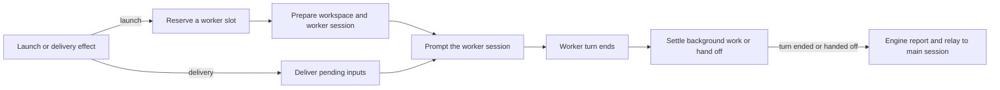

# dsh.ts

This file is the executor of dsh-superagent: it turns an accepted ticket into real work by running one persistent DSH worker session inside that ticket's own workspace directory. It implements the core `Executor` port (`start`, `deliver`, `stop`) on top of a durable effect queue, so the orchestrating Engine can stay fast while launches and input deliveries happen in the background. It also decides how many workers run at once, when a worker is woken, and what the Engine and the main session are told when a worker finishes, hands off to a person, or fails.

## Whole-unit functional diagram

<!-- {
  "mermaid_info": {
    "name": "Ticket assignment execution flow",
    "nodes": [
      {
        "id": "effect_001",
        "name": "Launch or delivery effect",
        "path": "src/app/effects.ts",
        "hint": "Durable queue rows that the executor registers handlers for",
        "isJumpable": true,
        "position": { "startLine": 61, "endLine": 70 },
        "references": []
      },
      {
        "id": "slots_002",
        "name": "Reserve a worker slot",
        "path": "src/executor/dsh.ts",
        "hint": "Concurrency accounting before a worker is started or woken",
        "isJumpable": true,
        "position": { "startLine": 171, "endLine": 199 },
        "references": []
      },
      {
        "id": "prepare_003",
        "name": "Prepare workspace and worker session",
        "path": "src/executor/dsh.ts",
        "hint": "Runs the prepare command, then ensures the worker session exists",
        "isJumpable": true,
        "position": { "startLine": 424, "endLine": 441 },
        "references": []
      },
      {
        "id": "prompt_004",
        "name": "Prompt the worker session",
        "path": "src/executor/dsh.ts",
        "hint": "Hands the assignment card or an input message to the worker",
        "isJumpable": true,
        "position": { "startLine": 451, "endLine": 469 },
        "references": []
      },
      {
        "id": "inputs_005",
        "name": "Deliver pending inputs",
        "path": "src/executor/dsh.ts",
        "hint": "Steers waiting triggers, notes and notices into the running worker",
        "isJumpable": true,
        "position": { "startLine": 290, "endLine": 328 },
        "references": []
      },
      {
        "id": "idle_006",
        "name": "Worker turn ends",
        "path": "src/executor/dsh.ts",
        "hint": "Reacts to the worker going idle",
        "isJumpable": true,
        "position": { "startLine": 601, "endLine": 618 },
        "references": []
      },
      {
        "id": "settle_007",
        "name": "Settle background work or hand off",
        "path": "src/executor/dsh.ts",
        "hint": "Watches leftover jobs and subagents, or releases the worker to a person",
        "isJumpable": true,
        "position": { "startLine": 619, "endLine": 656 },
        "references": []
      },
      {
        "id": "report_008",
        "name": "Engine report and relay to main session",
        "path": "src/executor/dsh.ts",
        "hint": "Records the waiting status and relays it to the orchestrating session",
        "isJumpable": true,
        "position": { "startLine": 663, "endLine": 671 },
        "references": []
      }
    ]
  }
} -->

    
        <a target="_self" href="#src/executor/dsh.ts:1?class=graph" style="color: inherit; text-decoration: none;">Graph: Ticket assignment execution flow</a>
    

Both entry paths start from the queue: a `launch` effect starts a pending assignment, while a `delivery` effect pushes waiting inputs into a worker that is already running. A launch reserves a slot, prepares the workspace and session, and prompts the worker; when the worker later goes idle, the executor either watches its leftover background work or releases it to a person, and reports the resulting status back through the Engine and the main session.

## At a glance

- Primary role: Orchestration — the file sequences slot reservation, workspace preparation, session creation, message delivery, idle handling and shutdown, and reports each outcome through the Engine.
- Secondary roles: Domain rules — it decides what counts as a retryable failure, when a worker has handed off to a person, and when a turn really ended. External adapter — it translates tickets and inputs into DSH agent-session messages and translates DSH agent events back into Engine callbacks.
- Confidence: High — the whole file was read, and its main collaborators (`Executor` port, `Effects`, `Sessions`, `background.ts`) were verified in source.

## What this file does

- **Starts a ticket's assignment** when a worker slot is free: the workspace directory is created and prepared, the worker session is ensured, and the assignment card is queued to it.
- **Feeds a running worker** with pending inputs — human triggers, orchestrator notes, policy-change notices, resume notices and plain text — one at a time, with the full text reachable through a resource path when the inline copy is capped.
- **Caps concurrency** at the configured maximum number of workers, while keeping one extra slot so a person's follow-up never waits behind new launches.
- **Separates recoverable failures from real ones**: transient network or model-provider errors are retried with backoff, while a failed prepare command or a permanent error is reported as `failed` and waits for a person.
- **Recognizes a finished turn**: it distinguishes a worker that handed off (its last word was a result, a question, or a blocked report) from one whose shell jobs or subagents are still running after the turn.
- **Recovers and shuts down cleanly**: `resume()` reconciles tickets after a restart by interrupting running assignments and re-queueing pending launches, and `shutdown()` stops worker background work within a bounded time.

## Key functions or classes

### `DshExecutor`

The class that implements the core `Executor` port plus the executor-facing helpers `prepare`, `resume`, `install`, `dispose`, `shutdown` and `activeCount`.

<a target="_self" href="#src/executor/dsh.ts:207-673?class=code" style="color: inherit; text-decoration: none;">dsh.ts:207-673</a>

### `ExecutorHost`

The dependency bundle the runtime hands in: DSH context, Engine callbacks, Store, Effects, health entry, machine paths, lifetime signal, Sessions, pause/closing flags and source helpers.

<a target="_self" href="#src/executor/dsh.ts:59-82?class=code" style="color: inherit; text-decoration: none;">dsh.ts:59-82</a>

### `WorkerSlots`

Accounts for slots held by running workers and by starts in flight, and throws `Later` when no slot is free so the queue simply reschedules the work.

<a target="_self" href="#src/executor/dsh.ts:171-199?class=code" style="color: inherit; text-decoration: none;">dsh.ts:171-199</a>

### `ticketExecution`

Builds the ticket's execution metadata — worktree-style name, workspace directory under the execution root, and the assignment text including matched policy rules and the routing note.

<a target="_self" href="#src/executor/dsh.ts:97-111?class=code" style="color: inherit; text-decoration: none;">dsh.ts:97-111</a>

### `launch`

Re-checks that the ticket is still live and the assignment is still the latest, prepares the workspace if needed, then queues the assignment message to the worker session.

<a target="_self" href="#src/executor/dsh.ts:424-470?class=code" style="color: inherit; text-decoration: none;">dsh.ts:424-470</a>

### `deliverQueued`

Delivers waiting inputs one by one, re-reading ticket state before each delivery so a delivery stops as soon as the ticket ends or another assignment takes over.

<a target="_self" href="#src/executor/dsh.ts:290-328?class=code" style="color: inherit; text-decoration: none;">dsh.ts:290-328</a>

### `install`

Subscribes to `agent/status`, `agent/inbox/claimed`, `session/event` and `agent/error`, which is how the executor learns that a worker went idle, that a person typed into a session, that inputs were read, or that a turn failed.

<a target="_self" href="#src/executor/dsh.ts:477-512?class=code" style="color: inherit; text-decoration: none;">dsh.ts:477-512</a>

### `workerIdle`

Decides what an idle worker means: hand off to a person and end the turn, or keep the slot while its background work finishes, then report `waiting` with the worker's last words.

<a target="_self" href="#src/executor/dsh.ts:601-672?class=code" style="color: inherit; text-decoration: none;">dsh.ts:601-672</a>

## Main inputs and results

- Inputs: `Executor.start`/`deliver`/`stop` calls from the Engine, persisted `launch` and `delivery` effect rows, DSH agent events, open tickets and their assignments/inputs from the Store, `executor.maxWorkers` and `executor.prepare` from settings, and the host dependencies in `ExecutorHost`.
- Results: worker-session messages (assignment cards, steering inputs, retry and background-job notices), Engine callbacks such as `assignmentStarted`, `inputsDelivered`, `inputsRead`, `turnEnded`, `deliveryFailed`, `report` and `assignmentInterrupted`, and relayed status text for the main session.
- Visible side effects: one workspace directory per ticket, created and optionally prepared by the configured shell command; per-ticket worker sessions named `worker-<ticketId>`; and a `worker` health entry that turns to `error` when background event handling throws.

## Coordinated flow

1. **Queue an intent.** `start` enqueues a `launch` effect keyed by assignment ID; `deliver` enqueues a `delivery` effect keyed by ticket ID. Both handlers are registered in the constructor with concurrency limits that drop to zero while processing is paused.
2. **Take a slot.** The launch handler verifies that the ticket is open and that this is still the latest pending assignment, then reserves a slot from `WorkerSlots` before any async work, so two starts cannot claim the same last slot.
3. **Prepare and hand over.** The workspace directory is prepared once (an existing directory counts as prepared), the worker session is ensured in that directory, and a JSON assignment card — request text, origin trigger, batch peers, optional routing note — is prompted into the session, after which `Engine.assignmentStarted` is reported.
4. **Keep the worker fed, then settle it.** Delivery iterates the ticket's undelivered inputs, waking an idle worker first if needed, and marks each input delivered. When the worker goes idle, the executor either ends the turn and hands off to a person, or holds the slot while background jobs and subagents finish, finally reporting `waiting` through the Engine and relaying the summary.

### Important branching and concurrency

- A start that cannot proceed throws `Later` (from [effects.ts](src/app/effects.ts) 
<a target="_self" href="#src/app/effects.ts:1-5?class=code" style="color: inherit; text-decoration: none;">effects.ts:1-5</a>
), which reschedules the row without counting it as a failure — used for a paused host, a full slot table, or a running stop of the worker's background work.
- Launch retries use backoff for transient errors; a failed prepare command is deliberately never retried automatically, because the leftover directory would otherwise be mistaken for a prepared workspace.
- A wake caused by a person's message may use one slot beyond the configured limit, and the launch limit itself is computed from free slots so wakes are not starved by new launches.
- Every step re-checks that the ticket is still open and the assignment is still the running one; a stop or handback that happened meanwhile simply ends the flow.

## Rules and decisions

- Decision: **is this failure worth retrying?** The executor treats HTTP 408/429/5xx statuses and typical connection failures as passing, retries them a limited number of times with growing delays, and sends the worker a "continue where you stopped" message.
- Decision: **has the worker finished, or is it just between turns?** A worker has handed off when its report says `ready` or the ticket carries an open question, or when the ticket waits for a person — unless new inputs were delivered at or after that report, which makes them new work.
- Decision: **is a person's message more important than a launch?** Inputs from a human trigger or a direct text input are recognized as personal, so their wake is prioritized and allowed into the extra slot.
- Outcomes: the executor reports `progress`/`waiting`/`ready`/`dropped` states coming from the worker, records `failed` with a summary on unrecoverable errors, and asks the Engine to mark a running assignment interrupted after a restart.
- Invariant: one ticket never holds more than one worker slot, and no launch, delivery or retry happens for a ticket that has ended or whose assignment has been replaced.

### Small example

A worker's turn ends with a `503` from the model provider. Because the error is transient and this is the first attempt, the executor schedules a retry after a short backoff instead of failing the ticket. If the provider keeps failing on every attempt, the ticket is finally reported `failed` with the error text, and it waits for a person to retry. If instead the ticket's prepare command fails, the ticket is reported `failed` immediately — no automatic retry — and an empty leftover workspace directory is removed so a later person-driven retry starts clean.

## External connection

- External system: the DSH runtime reached through Cordis — agent sessions (`dsh-agent`, `dsh-session`), the subprocess service used to run prepare commands, and the optional job registry and subagent services handled in [background.ts](src/executor/background.ts) 
<a target="_self" href="#src/executor/background.ts?class=code" style="color: inherit; text-decoration: none;">background.ts</a>
.
- Outbound translation: a ticket becomes a compact JSON card (`ticket_id`, `title`, capped assignment text with a read path, origin trigger card, batch previews, routing note, retry note); a ticket input becomes either a trigger card, a policy-change brief, a resume instruction, an orchestrator note, or its own text; all of it is delivered with a stable request ID so redelivery stays idempotent.
- Inbound translation: DSH events are turned back into project-level outcomes — a claimed user message in a worker session marks the input as read, a failed agent turn becomes a retry or a `failed` report, and an idle agent becomes `turnEnded`, `waiting`, or a hand-off.
- Operating requirements: the prepare command runs through `sh -c` with the ticket's execution environment variables and is bounded by a timeout, so a prompt that hangs on credentials fails the ticket instead of holding a slot; the directory is then verified as the worker sees it, and the worker session is created with the `worker` role by the session manager.

For the surrounding components, see the session manager and durable queue that this file depends on.

---
name: dsh.ts

update-time: 2026-11-02 11:20

description: This file is the executor of dsh-superagent: it turns an accepted ticket into real work by running one persistent DSH worker session inside that ticket's own workspace directory. It implements the core `Executor` port (`start`, `deliver`, `stop`) on top of a durable effect queue, so the orchestrating Engine can stay fast while launches and input deliveries happen in the background. It also decides how many workers run at once, when a worker is woken, and what the Engine and the main session are told when a worker finishes, hands off to a person, or fails.

---
