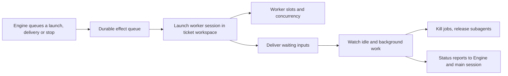

# Executor

This directory holds the part of dsh-superagent that actually does the work: it turns an accepted ticket into one persistent DSH worker session running inside that ticket's own workspace directory, hands the worker the messages the ticket receives, and tears everything down when the assignment ends. The two files split the job deliberately — one owns the lifecycle and the `Executor` contract the Engine talks to, the other owns the shell jobs and subagents a worker leaves running after its turn. Read this directory when you want to know what happens between "a ticket was accepted" and "a worker reported back".

## Whole-unit functional diagram

<!-- {
  "mermaid_info": {
    "name": "Worker execution lifecycle",
    "nodes": [
      {
        "id": "entry_001",
        "name": "Engine queues a launch, delivery or stop",
        "path": "src/core/ports.ts",
        "hint": "The Executor port the Engine calls: start, deliver, stop",
        "isJumpable": true,
        "position": { "startLine": 59, "endLine": 69 },
        "references": []
      },
      {
        "id": "queue_002",
        "name": "Durable effect queue",
        "path": "src/app/effects.ts",
        "hint": "Launches and input deliveries are persisted and dispatched after commit",
        "isJumpable": true,
        "position": { "startLine": 42, "endLine": 74 },
        "references": []
      },
      {
        "id": "launch_003",
        "name": "Launch worker session in ticket workspace",
        "path": "src/executor/dsh.ts",
        "hint": "Prepares the workspace, ensures the worker session and delivers the assignment card",
        "isJumpable": true,
        "position": { "startLine": 424, "endLine": 470 },
        "references": []
      },
      {
        "id": "slots_004",
        "name": "Worker slots and concurrency",
        "path": "src/executor/dsh.ts",
        "hint": "Tracks running and starting workers against the configured limit",
        "isJumpable": true,
        "position": { "startLine": 171, "endLine": 199 },
        "references": []
      },
      {
        "id": "deliver_005",
        "name": "Deliver waiting inputs",
        "path": "src/executor/dsh.ts",
        "hint": "Steers the ticket's undelivered inputs into the running worker session",
        "isJumpable": true,
        "position": { "startLine": 290, "endLine": 328 },
        "references": []
      },
      {
        "id": "idle_006",
        "name": "Watch idle and background work",
        "path": "src/executor/dsh.ts",
        "hint": "Decides between handing off to a person and waiting for background work to end",
        "isJumpable": true,
        "position": { "startLine": 601, "endLine": 672 },
        "references": []
      },
      {
        "id": "background_007",
        "name": "Kill jobs, release subagents",
        "path": "src/executor/background.ts",
        "hint": "Stops a worker's shell jobs and subagents quietly and within a bound",
        "isJumpable": true,
        "position": { "startLine": 159, "endLine": 165 },
        "references": []
      },
      {
        "id": "result_008",
        "name": "Status reports to Engine and main session",
        "path": "",
        "hint": "The observable outcome: assignment transitions and reports the orchestrator can see",
        "isJumpable": false,
        "position": { "startLine": 0, "endLine": 0 },
        "references": []
      }
    ]
  }
} -->

    
        <a target="_self" href="#src/executor:1?class=graph" style="color: inherit; text-decoration: none;">Graph: Worker execution lifecycle</a>
    

The Engine never waits on a model or on workspace setup: it only queues work, and the durable effect queue runs that work after the ticket's transaction commits. `DshExecutor` translates each queued item into one worker session per ticket, `WorkerSlots` bounds how many workers are busy at once, and anything a worker leaves running after its turn is finished by `background.ts` before the ticket's status is reported.

## At a glance

- Main role: Coordinates a multi-step worker lifecycle — prepare a workspace, start a session, deliver messages, watch for idleness, stop background work, report back — for every accepted ticket.
- Confidence: High — both files directly implement or support the `Executor` port (`start`, `deliver`, `stop`) declared in 
<a target="_self" href="#src/core/ports.ts:59-69?class=code" style="color: inherit; text-decoration: none;">ports.ts:59-69</a>
, and the runtime wires the class in at startup.

## Coordinated flow

1. The Engine calls `start`, `deliver` or `stop` inside its own domain command. This directory does not do the work inline: `start` and `deliver` only enqueue a durable `launch` (keyed by assignment ID) or `delivery` (keyed by ticket ID) effect, and `stop` defers its teardown until the transaction commits.
2. The effect queue invokes the handlers registered in the constructor, with concurrency ceilings that come from this directory: launches are limited by the free worker slots and held at zero while processing is paused, input deliveries default to four at a time. Transport failures are retried by the queue; the executor signals "not now" with `Later` rather than counting a failure.
3. A launch checks that the ticket is still live and the assignment still current, reserves a slot, prepares the workspace directory once (running the configured `prepare` command in the parent directory and verifying the directory's git config as the worker would see it), ensures the `worker-<ticketId>` session exists, waits out any stop still running for the old assignment, and delivers the assignment card — the first assignment carries the full assignment text, source trigger and sibling triggers, later ones announce only what is new.
4. Delivery loops over the ticket's undelivered inputs, re-reading ticket state before each one, waking an idle worker in a reserved slot first, recreating a session that was deleted externally, and formatting each input (trigger card, policy change, resume notice, orchestrator note or plain text) before steering it into the worker. Reading is confirmed separately once the session records the message, so a step that fails first does not mark input as read.
5. The Engine keeps ownership of ticket state: this directory only reports through callbacks — assignment started, inputs delivered or read, turn ended, delivery failed — and records `failed` or `waiting` reports that are then relayed to the main session. The Engine, not the executor, decides whether the ticket continues, waits for a person, or ends.

### Important branching or concurrency

A ticket holds a worker slot while its turn runs, while its shell jobs or subagents still run after that turn, and while its launch or wake is starting. Slots are reserved synchronously before awaiting any launch work, so two starts cannot both take the last one, and a person's follow-up may use one extra slot beyond the configured maximum so it never queues behind new launches. When a turn goes idle the worker either hands off to a person (its subagents stop, its shell jobs are left running for the person, and their ends are collected so they do not wake it outside a slot) or waits for its own background work to finish; that wait is bounded, and jobs still running past the bound are killed and reported to the worker at its next turn. Transient network or provider failures are retried a few times with growing backoff instead of failing the ticket, while a failed `prepare` command fails the ticket immediately and waits for a person, because an existing directory counts as an already-prepared workspace.

## Responsibilities and non-responsibilities

- Responsible for: one persistent worker session and one workspace directory per ticket; queued launches and input deliveries; the concurrency limit and its slot bookkeeping; reacting to host agent events (turn status, claimed messages, recorded messages, errors); stopping shell jobs and subagents when an assignment ends or the host stops; reconciling interrupted and pending assignments after a restart.
- Kept elsewhere: the domain decisions themselves live in `src/core` (ticket and assignment state, what "ended" means, when a person must be involved); session creation, model wiring and at-most-once message delivery belong to `src/app/sessions.ts`; queue persistence, ordering and backoff to `src/app/effects.ts`; the worker's prompt and its tools to the prompts and tools modules; worker settings schema to `src/policy.ts`; the dashboard's view of running and queued workers to the HTTP/views layer, which only reads `activeCount()`.

## Important direct children

### `dsh.ts`

The `DshExecutor` class: it implements the `Executor` port, registers the `launch` and `delivery` effect handlers, holds the `WorkerSlots` bookkeeping, subscribes to host agent events in `install()`, and decides when a worker has handed off, gone quiet, or must be reported as waiting — plus the shutdown and restart-reconciliation entry points. Its exported helpers also build the per-ticket execution metadata and format triggers, inputs and policy notices into the text a worker actually receives.

    
        <a target="_self" href="#src/executor/dsh.ts.info.md?class=text" style="color: inherit; text-decoration: none;">Document: src/executor/dsh.ts.info.md</a>
    

### `background.ts`

The narrow layer over DSH's job registry and subagent service: it lists the shell jobs a worker's session owns, waits for all of them and for its subagents to end, kills jobs while collecting their ends so the worker is not woken to hear of them, releases subagents, and combines those into a single bounded background stop. It never renders or stores anything.

    
        <a target="_self" href="#src/executor/background.ts.info.md?class=text" style="color: inherit; text-decoration: none;">Document: src/executor/background.ts.info.md</a>
    

## How the children work together

`dsh.ts` makes the lifecycle decisions; `background.ts` carries them out against the DSH services. A stop after an assignment ends, a restart, or a host shutdown is turned into a tracked promise via `stopBackground`, and launches and deliveries of the same ticket wait for that promise so a cancel does not drop a message delivered meanwhile. When a worker goes idle with work still running, `untilQuiet` keeps the worker's slot until its own jobs and subagents finish; when it hands off to a person, `stopSubagents` releases the subagents while `collectJob` watches the jobs that were left running, feeding each ending back into the worker's next turn as a note.

## External connection

- External system: the DSH runtime behind the Cordis context — the agent/session controller (`agents`, `sessions`), the per-session job registry (`ctx.jobs`), the subagent service (`ctx.subagents`) and the subprocess service used to run the workspace `prepare` command.
- Outbound translation: a ticket's assignment and inputs become deduplicated session messages — `queue` for a launch or a retry, `steer` for a ticket input, `inject` for a background note that must not wake the worker — while shell jobs and subagents are addressed by the worker's own session or agent ID, and the prepare command runs as `sh -c` in the workspace's parent directory with the ticket's environment.
- Inbound translation: host events become domain callbacks. A turn that starts ends the current background look; an idle turn is classified as a handoff or as a wait; a `user/message` recorded by a session marks the matching ticket inputs as read; an agent error becomes either a bounded retry or a `failed` report on the ticket and a relay to the main session.

### Operating requirements

The worker model, the maximum number of concurrent workers, the workspace root and the optional `prepare` command all come from the saved executor settings, so a profile without them still launches workers, just with defaults. A DSH profile that exposes neither the job registry nor the subagent service simply has no background work to stop. Background event handling is reported through the `worker` health entry, which turns to `error` when a handler throws and back to `ready` on the next successful pass.

## Recommended starting points

1. `src/executor/dsh.ts` — open the `DshExecutor` class first: the constructor's two effect handlers, then `install()`, `launch()` and `workerIdle()` give the whole lifecycle in reading order.
2. `src/executor/background.ts` — read after `dsh.ts` to see exactly what "background work" means and why every wait there is bounded and quiet.

---
name: executor

update-time: 2026-11-02 11:49

description: This directory holds the part of dsh-superagent that actually does the work: it turns an accepted ticket into one persistent DSH worker session running inside that ticket's own workspace directory, hands the worker the messages the ticket receives, and tears everything down when the assignment ends. The two files split the job deliberately — one owns the lifecycle and the `Executor` contract the Engine talks to, the other owns the shell jobs and subagents a worker leaves running after its turn. Read this directory when you want to know what happens between "a ticket was accepted" and "a worker reported back".

---
