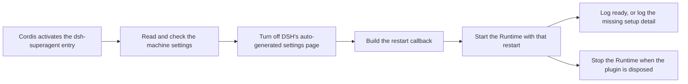

# index.ts

This file is the plugin entry point of `dsh-superagent`: it is the one module the DeepSeek Harness (DSH) loader calls when the profile activates the plugin. It reads and validates the machine settings, mounts the orchestration `Runtime`, and hands that runtime the restart callback used when a Source's account settings change. Reading it tells you what happens between “the plugin is enabled” and “the sidebar entry opens the management panel”.

## Whole-unit functional diagram

<!-- {
  "mermaid_info": {
    "name": "Plugin activation and runtime startup",
    "nodes": [
      {
        "id": "loader_001",
        "name": "Cordis activates the dsh-superagent entry",
        "path": "src/index.ts",
        "hint": "The apply export is the plugin's activation hook",
        "isJumpable": true,
        "position": { "startLine": 10, "endLine": 10 },
        "references": []
      },
      {
        "id": "config_002",
        "name": "Read and check the machine settings",
        "path": "src/deployment.ts",
        "hint": "machineOf rejects unknown keys and narrows the configuration to stateDir and the volatile limits",
        "isJumpable": true,
        "position": { "startLine": 38, "endLine": 43 },
        "references": []
      },
      {
        "id": "settings_003",
        "name": "Turn off DSH's auto-generated settings page",
        "path": "src/index.ts",
        "hint": "The management panel supplies its own settings UI",
        "isJumpable": true,
        "position": { "startLine": 13, "endLine": 13 },
        "references": []
      },
      {
        "id": "restart_004",
        "name": "Build the restart callback",
        "path": "src/index.ts",
        "hint": "Restarts the plugin fiber and then re-reads the settings descriptor",
        "isJumpable": true,
        "position": { "startLine": 18, "endLine": 20 },
        "references": []
      },
      {
        "id": "runtime_005",
        "name": "Start the Runtime with that restart",
        "path": "src/index.ts",
        "hint": "The Runtime is constructed with the context, machine settings and restart callback",
        "isJumpable": true,
        "position": { "startLine": 21, "endLine": 21 },
        "references": []
      },
      {
        "id": "ready_006",
        "name": "Log ready, or log the missing setup detail",
        "path": "src/index.ts",
        "hint": "Startup always ends in one of two operator-facing log lines",
        "isJumpable": true,
        "position": { "startLine": 23, "endLine": 24 },
        "references": []
      },
      {
        "id": "stop_007",
        "name": "Stop the Runtime when the plugin is disposed",
        "path": "src/index.ts",
        "hint": "An effect closes the runtime on plugin disposal",
        "isJumpable": true,
        "position": { "startLine": 22, "endLine": 22 },
        "references": []
      }
    ]
  }
} -->

    
        <a target="_self" href="#src/index.ts:1?class=graph" style="color: inherit; text-decoration: none;">Graph: Plugin activation and runtime startup</a>
    

The horizontal path is the whole startup story: the loader calls `apply`, the settings are checked before anything is registered, and the file then wires three things into the runtime — the settings-page opt-out, the restart callback and the shutdown effect — before awaiting readiness and logging the outcome.

## At a glance

- Primary role (entry): the file is the activation hook that starts the plugin's runtime and reports whether it is ready or still needs setup.
- Secondary roles (configuration): it also re-exports the plugin `Config` schema and decides how configuration changes take effect (in place, or through a restart).
- Confidence: High — the entry contract is confirmed by the source itself, the test file that drives `apply`, and the architecture document's module table.

## What this file does

- **Publishes the plugin identity.** `name` gives the entry its `dsh-superagent` name, so DSH's profile configuration addresses it by that name.
- **Declares required host services.** `inject` lists the DSH services the plugin needs (agents, session controller and persistence, workspace registry, tools, prompt, skills, web server, model access, subprocesses) before it is allowed to start.
- **Validates machine settings first.** The configuration is collapsed into the small `Machine` shape, and keys the plugin no longer uses stop startup with a message naming where each key moved.
- **Takes over the settings UI.** DSH is told to generate no settings page (`configure({ auto: false })`), because the management panel ships its own.
- **Supplies the deployment restart.** Saving a Source's account settings restarts this plugin, so the entry owns the callback that restarts the fiber and then asks DSH to re-read the settings descriptor, keeping open configuration forms editable without a page reload.
- **Starts and stops the runtime.** It constructs `Runtime`, registers an effect that stops it on disposal, and logs either readiness or the exact reason setup is still pending.
- **Re-exports the package surface.** `Config`, `Deployment` / `DeploymentConfig` and the whole `core/index.ts` barrel are forwarded, so consumers can import the schema, the deployment types and the core domain API from the package entry.

## Key functions or classes

### `apply(ctx, config)`

The activation hook: validates the configuration, mounts `Runtime`, wires its restart and shutdown, and logs the startup outcome.

<a target="_self" href="#src/index.ts:10-25?class=code" style="color: inherit; text-decoration: none;">index.ts:10-25</a>

### `inject`

The static list of host services that must be available; it is the plugin's declared dependency contract with DSH.

<a target="_self" href="#src/index.ts:8?class=code" style="color: inherit; text-decoration: none;">index.ts:8</a>

### `Config` (re-exported)

The plugin's configuration schema — the required absolute `stateDir` plus the three volatile limits — re-exported from the deployment module.

<a target="_self" href="#src/deployment.ts:15-23?class=code" style="color: inherit; text-decoration: none;">deployment.ts:15-23</a>

### `machineOf`

Turns a raw configuration into the `Machine` record the runtime uses and rejects unsupported keys with their new locations.

<a target="_self" href="#src/deployment.ts:38-43?class=code" style="color: inherit; text-decoration: none;">deployment.ts:38-43</a>

## How the flow begins

- Trigger: the host loader activates the `dsh-superagent` entry once the services listed in `inject` exist, passing a Cordis `Context` and the resolved `DeploymentConfig`.
- First meaningful step: `machineOf(config)` reduces and validates the configuration. If a removed key is present, activation fails before any handler, effect or service is registered — the test suite asserts exactly that.
- Outcome: either an `info` log saying the plugin is ready and that the Superagent sidebar entry opens the management panel, or an `info` log saying it waits for setup, carrying the setup problem's detail. The runtime keeps its HTTP routes available in both cases so operators can finish setup from the panel.

The file is built as the bundle's `index` entry, and the runtime it starts is the composition root described in 
<a target="_self" href="#src/app/runtime.ts?class=code" style="color: inherit; text-decoration: none;">runtime.ts</a>
.

## Configurable behavior

- Controls: `stateDir` chooses where the database, lock, worker command shims, the agent's git configuration and the default ticket directories live; `promptMaxChars`, `admissionContextMaxPages` and `admissionContextTimeoutMs` bound saved prompt size and how much thread context one assessment may read.
- Value source: the plugin entry's configuration in the DSH profile (`cordis.patch.yml`), or the Plugin Manager and the panel's Deployment settings after the first start. A copy is documented in the deployment guide; the schema lives in 
<a target="_self" href="#src/deployment.ts?class=code" style="color: inherit; text-decoration: none;">deployment.ts</a>
.
- Takes effect: the three limits are marked volatile and are read on each use, so new values apply without a restart; changing `stateDir` remounts the plugin. Account fields of the GitHub and Feishu Sources are not part of this schema — saving them restarts the plugin through the callback created here.

### Common adjustment

`promptMaxChars` — raise it when long standing instructions are being cut short, lower it to cap what the agent may persist; the next prompt built after the save uses the new limit, with no restart and no page reload.

## Main inputs and results

- Inputs: a Cordis `Context`, the `DeploymentConfig` object from the profile (only `stateDir` is required), and the host services declared in `inject`.
- Results: the plugin's exported surface (`name`, `inject`, `apply`, `Config`, `Deployment`/`DeploymentConfig`, and the `core` barrel), a mounted `Runtime` service named `orchestrator`, and one startup log line describing readiness or the pending setup step.
- Visible side effects: DSH's auto-generated settings page is switched off in favour of the management panel, the runtime's HTTP routes and panel become reachable, and disposing the plugin stops the runtime and releases the state directory.

---
name: index.ts

update-time: 2026-11-02 10:17

description: This file is the plugin entry point of `dsh-superagent`: it is the one module the DeepSeek Harness (DSH) loader calls when the profile activates the plugin. It reads and validates the machine settings, mounts the orchestration `Runtime`, and hands that runtime the restart callback used when a Source's account settings change. Reading it tells you what happens between “the plugin is enabled” and “the sidebar entry opens the management panel”.

---
