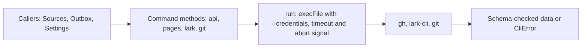

# commands.ts

`src/infra/commands.ts` is the single doorway through which this project talks to command-line tools: the agent's GitHub CLI (`gh`), the Feishu bot's `lark-cli`, and `git`. Every subprocess runs with the configured deployment accounts, a fixed time limit and the caller's abort signal, and every failure is translated into a `CliError` that carries the remote error code. Sources, the assessor, the outbox and settings code all depend on it, so reading this file first explains how the outside world is reached and how its answers and errors come back.

## Whole-unit functional flow

A caller such as a GitHub Source asks for an API path, the wrapper turns it into a `gh` invocation bounded to the configured repository, the CLI's output is parsed and validated against a schema, and any failure comes back as a `CliError` whose `code` tells the caller whether to skip, retry or stop.

## At a glance

- Primary role: Infrastructure — shared runtime support (subprocess execution, credentials, timeouts, cancellation) that all product behavior relies on.
- Secondary role: External adapter — it bridges the project to GitHub's CLI, Feishu's bot CLI and `git`, translating both directions.
- Confidence: High — the whole file was read together with its constructor call site in `src/app/runtime.ts` and several consumer modules and tests.

## What this file does

- Runs any program with the deployment's environment: process environment is the base, per-command overrides are layered on top (an override set to `undefined` removes that variable), and prompt/update notifications of `gh` and `lark-cli` are turned off so output stays parseable.
- Keeps every call bounded: a 90-second timeout, a large output buffer, and the lifetime or round signal, so stopping or restarting the plugin ends running subprocesses.
- Confines GitHub calls to one repository: `api` and `pages` accept only paths inside the configured `owner/name`, rejecting absolute paths, scheme-like prefixes and `..` traversal.
- Validates output where a schema is supplied, and tolerates partial data where a whole list is fetched, counting what it skipped instead of failing the round.
- Unwraps Feishu's JSON envelope and rewrites the "bot is not in the chat" error into a hint that says what to do next.
- Never echoes command arguments in error messages, because arguments may contain the very message text the project is sending; only the program name, exit status, signal, timeout or sanitized CLI diagnostic appears.

## Runtime support

- Provides: the only supported way to launch a subprocess, with account credentials, time limits, cancellation and error translation attached.
- Starts or activates: `new Commands(...)` is created during runtime assembly (the deployment is passed as a thunk because it resolves only after setup succeeds); no background work starts, each call is on demand.
- Used by: GitHub and Feishu sources, the master assessor, the outbox, resource and link reading, and settings; most callers ask for a narrowed copy with `withSignal(...)` so each round has its own cancellation.
- Operational effect: subprocesses die with the plugin lifetime, and long runs are capped at 90 seconds instead of hanging a polling round.

    
        <a target="_self" href="#src/infra/commands.ts:59-115?class=code" style="color: inherit; text-decoration: none;">Code: src/infra/commands.ts:59-115</a>
    

## External connection

- External system: the agent's `gh` binary, the Feishu bot's `lark-cli`, and the `git` on `PATH`.
- Outbound translation: project arguments become CLI arguments (`api <repo path> --paginate --slurp`, or `… --as bot --format json` for Feishu), with the executable path, environment and working directory taken from the deployment.
- Inbound translation: stdout becomes a string, parsed JSON, or schema-validated data; Feishu's `{ ok, data, error }` envelope is unwrapped to `data`; failures become `CliError` with the GitHub HTTP status or Feishu error code as `code` and the process status as `exitCode`. Statuses and codes are preserved deliberately — a `304` means an unchanged ETag poll, and `232011` means the bot was removed from a chat.
- Operating requirements: GitHub and Feishu calls use only the CLI paths and identities resolved by deployment setup; `lark` refuses to run when the deployment has no Feishu bot.

### `Commands`

Holds the resolved deployment, the environment overrides and the abort signal, and exposes the typed entry points below.

    
        <a target="_self" href="#src/infra/commands.ts:59-67?class=code" style="color: inherit; text-decoration: none;">Code: src/infra/commands.ts:59-67</a>
    

### `run`

Runs a program with the deployment environment, timeout and signal, returning raw stdout — the escape hatch for a Source that needs its own CLI.

    
        <a target="_self" href="#src/infra/commands.ts:68-74?class=code" style="color: inherit; text-decoration: none;">Code: src/infra/commands.ts:68-74</a>
    

### `api`

Calls the GitHub API on a path inside the configured repository, either validated by a schema or returned raw (useful for `--include` headers and file bodies).

    
        <a target="_self" href="#src/infra/commands.ts:82-88?class=code" style="color: inherit; text-decoration: none;">Code: src/infra/commands.ts:82-88</a>
    

### `pages`

Fetches every page of a GitHub list and returns the items that match the item schema, adding rejected items to the optional skip tally.

    
        <a target="_self" href="#src/infra/commands.ts:90-93?class=code" style="color: inherit; text-decoration: none;">Code: src/infra/commands.ts:90-93</a>
    

### `lark`

Runs the Feishu bot CLI as the bot in JSON mode and returns the `data` payload, raising a `CliError` with Feishu's code on failure.

    
        <a target="_self" href="#src/infra/commands.ts:103-112?class=code" style="color: inherit; text-decoration: none;">Code: src/infra/commands.ts:103-112</a>
    

### `git`

Runs `git` in a given directory with the isolated environment prepared by deployment setup.

### `CliError`

The error type callers branch on: a sanitized message plus the remote API/HTTP code and the process exit status, without command arguments.

    
        <a target="_self" href="#src/infra/commands.ts:14-16?class=code" style="color: inherit; text-decoration: none;">Code: src/infra/commands.ts:14-16</a>
    

### `validItems`

Parses a list against a schema, silently dropping items that do not fit and reporting how many were skipped.

    
        <a target="_self" href="#src/infra/commands.ts:44-48?class=code" style="color: inherit; text-decoration: none;">Code: src/infra/commands.ts:44-48</a>
    

## Main inputs and results

- Inputs: a program name and argument list (or an API path plus flags), the resolved `Deployment` supplying CLI paths, repository and bot identity, an optional zod schema, an optional skip counter, environment overrides, and an `AbortSignal`.
- Results: stdout text, parsed JSON, schema-validated objects or arrays, Feishu payload data — or a thrown `CliError` carrying `code` and `exitCode`.
- Visible side effects: comments, replies, issue data and chat messages are created in the outside system under the configured accounts; stopping or restarting the plugin aborts in-flight tools; error text shown to users names the failing tool and remedy but never the message arguments.

    
        <a target="_self" href="#docs/008-cookbook.md?class=text" style="color: inherit; text-decoration: none;">Document: docs/008-cookbook.md</a>
    

<!-- {
  "mermaid_info": {
    "name": "Subprocess command flow",
    "nodes": [
      {
        "id": "callers_001",
        "name": "Callers: Sources, Outbox, Settings",
        "path": "",
        "hint": "Project areas that need a CLI result",
        "isJumpable": false,
        "position": { "startLine": 0, "endLine": 0 },
        "references": []
      },
      {
        "id": "methods_002",
        "name": "Command methods: api, pages, lark, git",
        "path": "src/infra/commands.ts",
        "hint": "Repository-restricted GitHub path, schema validation, Feishu envelope handling",
        "isJumpable": true,
        "position": { "startLine": 82, "endLine": 114 },
        "references": []
      },
      {
        "id": "exec_003",
        "name": "run: execFile with credentials, timeout and abort signal",
        "path": "src/infra/commands.ts",
        "hint": "Environment overrides, 90-second limit, plugin lifetime signal",
        "isJumpable": true,
        "position": { "startLine": 68, "endLine": 74 },
        "references": []
      },
      {
        "id": "cli_004",
        "name": "gh, lark-cli, git",
        "path": "",
        "hint": "External command-line tools acting as the configured accounts",
        "isJumpable": false,
        "position": { "startLine": 0, "endLine": 0 },
        "references": []
      },
      {
        "id": "result_005",
        "name": "Schema-checked data or CliError",
        "path": "src/infra/commands.ts",
        "hint": "Parsed stdout, validated values, or an error carrying the remote code",
        "isJumpable": true,
        "position": { "startLine": 14, "endLine": 16 },
        "references": []
      }
    ]
  }
} -->

    
        <a target="_self" href="#src/infra/commands.ts:1?class=graph" style="color: inherit; text-decoration: none;">Graph: Subprocess command flow</a>
    

---
name: commands.ts

update-time: 2026-11-02 11:25

description: `src/infra/commands.ts` is the single doorway through which this project talks to command-line tools: the agent's GitHub CLI (`gh`), the Feishu bot's `lark-cli`, and `git`. Every subprocess runs with the configured deployment accounts, a fixed time limit and the caller's abort signal, and every failure is translated into a `CliError` that carries the remote error code. Sources, the assessor, the outbox and settings code all depend on it, so reading this file first explains how the outside world is reached and how its answers and errors come back.

---
