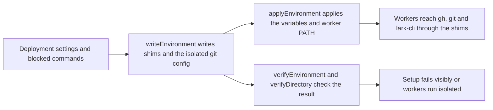

# environment.ts

This file builds the runtime environment that lets worker processes act as the deployment's own accounts instead of the operator's. It writes small `gh` and `lark-cli` shims plus an isolated git configuration into the state directory, applies git and credential variables to the running process, and offers the shared subprocess runner that startup checks and worker commands use. It is deliberately a default-path guardrail, not an OS-level security boundary: workers still run as the operator's user.

## Worker environment setup flow

<!-- {
  "mermaid_info": {
    "name": "Worker environment setup flow",
    "nodes": [
      {
        "id": "setup_001",
        "name": "Deployment settings and blocked commands",
        "path": "",
        "hint": "The resolved repository, GitHub CLI, optional Feishu CLI and blocked command names that start the work",
        "isJumpable": false,
        "position": { "startLine": 0, "endLine": 0 },
        "references": []
      },
      {
        "id": "write_002",
        "name": "writeEnvironment writes shims and the isolated git config",
        "path": "src/infra/environment.ts",
        "hint": "Creates the worker shim directory and the isolated git configuration file",
        "isJumpable": true,
        "position": { "startLine": 79, "endLine": 116 },
        "references": []
      },
      {
        "id": "apply_003",
        "name": "applyEnvironment applies the variables and worker PATH",
        "path": "src/infra/environment.ts",
        "hint": "Sets git and credential variables on the process and prepends the shim directory to PATH",
        "isJumpable": true,
        "position": { "startLine": 119, "endLine": 125 },
        "references": []
      },
      {
        "id": "worker_004",
        "name": "Workers reach gh, git and lark-cli through the shims",
        "path": "",
        "hint": "Worker processes that inherit the prepared environment",
        "isJumpable": false,
        "position": { "startLine": 0, "endLine": 0 },
        "references": []
      },
      {
        "id": "verify_005",
        "name": "verifyEnvironment and verifyDirectory check the result",
        "path": "src/infra/environment.ts",
        "hint": "Reads the effective git configuration back through the worker environment",
        "isJumpable": true,
        "position": { "startLine": 138, "endLine": 157 },
        "references": []
      },
      {
        "id": "result_006",
        "name": "Setup fails visibly or workers run isolated",
        "path": "",
        "hint": "Either setup reports a structured problem, or workers run with the agent's accounts",
        "isJumpable": false,
        "position": { "startLine": 0, "endLine": 0 },
        "references": []
      }
    ]
  }
} -->

    
        <a target="_self" href="#src/infra/environment.ts:1?class=graph" style="color: inherit; text-decoration: none;">Graph: Worker environment setup flow</a>
    

The main path is short: settings are turned into files and environment entries, the host process adopts those entries, and workers inherit them. Verification reads the effective git configuration back, so a git that ignores what was written fails setup instead of silently using the operator's credentials.

## At a glance

- Primary role: Infrastructure — it supplies the prepared process environment, command shims and shared subprocess runner that setup, deployment checks and the executor all depend on.
- Secondary roles: Configuration — it decides how deployment settings and the blocked-command list take effect inside worker processes, including what is cleared from the inherited environment.
- Confidence: High — the whole file was read together with its callers in `src/app/setup.ts`, `src/deployment.ts` and `src/executor/dsh.ts`, and its behavior is pinned by `tests/environment.spec.ts`.

## What this file does

- Publishes a `worker-bin` directory in the state directory containing executable `gh` and `lark-cli` shims that point at the deployment's CLIs, a failing `lark-cli` shim when no Feishu bot is configured, and failing shims for every blocked command other than the ones workers need.
- Writes `worker-gitconfig`, an isolated git configuration that sends GitHub HTTPS traffic through the agent CLI's credential helper, rewrites SSH-style `github.com` URLs to HTTPS, requires an explicit commit identity, and keeps Git LFS filters available.
- Keeps writes safe for concurrent workers and for the operator's files: each file is written to a temporary name and renamed into place, and any file in its places that the project did not write — including files written under the project's earlier names — blocks setup with a `foreignFile` problem.
- Derives environment overrides that strip ambient GitHub tokens, host git repository variables, operator git identity and environment git configuration, and disable interactive prompts so git fails instead of asking. Variable names avoid credential-shaped words because DSH strips them from child environments.
- Provides one subprocess runner for work that must run "as a worker": startup probes, prepare commands, and the verification checks in this file, with bounded output and structured `CliError` results.
- Verifies the result: git must report the written credential helper (otherwise setup reports that git is too old), and a ticket directory must not define its own `credential.*` or `http.*.extraheader` keys that the agent's git would also read.

## Runtime support

- Provides: a prepared `PATH` plus environment overrides that make every worker command use the deployment's accounts, and a single runner for commands that need that environment.
- Starts or activates: when setup resolves a deployment — the environment is written and then applied on the host process — and again whenever the blocked command list changes, so new failing shims appear without resolving accounts again.
- Used by: `Setup` in 
<a target="_self" href="#src/app/setup.ts:91-92?class=code" style="color: inherit; text-decoration: none;">setup.ts:91-92</a>
 for startup and settings changes, deployment probing in 
<a target="_self" href="#src/deployment.ts:73-76?class=code" style="color: inherit; text-decoration: none;">deployment.ts:73-76</a>
, and the executor's prepare step in 
<a target="_self" href="#src/executor/dsh.ts:254-261?class=code" style="color: inherit; text-decoration: none;">dsh.ts:254-261</a>
.
- Operational effect: the host can still call the real binaries (the shim directory is removed from its own `PATH`), while workers cannot accidentally reach the operator's GitHub token, git repository selection, commit identity, signing or credential configuration.

## Key functions or classes

### `writeEnvironment`

Creates or refreshes the shim directory and the isolated git configuration, removes shims that are no longer wanted, and refuses to overwrite anything it did not write.

    
        <a target="_self" href="#src/infra/environment.ts:79-116?class=code" style="color: inherit; text-decoration: none;">Code: src/infra/environment.ts:79-116</a>
    

### `agentVariables`

Returns the environment override map that clears ambient credentials, host git location variables, operator identity and environment git configuration, and disables prompts.

    
        <a target="_self" href="#src/infra/environment.ts:45-58?class=code" style="color: inherit; text-decoration: none;">Code: src/infra/environment.ts:45-58</a>
    

### `applyEnvironment`

Applies those overrides and prepends the shim directory to `PATH`, returning a callback that restores the previous values.

    
        <a target="_self" href="#src/infra/environment.ts:119-125?class=code" style="color: inherit; text-decoration: none;">Code: src/infra/environment.ts:119-125</a>
    

### `runAsWorker`

Spawns a command through the DSH subprocess service, returns its standard output on success, and otherwise throws the command's trimmed error text as a `CliError` carrying the exit status.

    
        <a target="_self" href="#src/infra/environment.ts:128-135?class=code" style="color: inherit; text-decoration: none;">Code: src/infra/environment.ts:128-135</a>
    

### `verifyEnvironment`

Runs `git config` from the state directory and requires the reported credential helper to be exactly the written file plus the GitHub CLI helper; any other answer becomes a "git is too old" setup problem.

    
        <a target="_self" href="#src/infra/environment.ts:138-143?class=code" style="color: inherit; text-decoration: none;">Code: src/infra/environment.ts:138-143</a>
    

### `verifyDirectory`

Inspects a ticket directory's own git configuration and refuses directories whose local or worktree scope sets `credential.*` or `http.*.extraheader` keys, naming the offending keys.

    
        <a target="_self" href="#src/infra/environment.ts:149-157?class=code" style="color: inherit; text-decoration: none;">Code: src/infra/environment.ts:149-157</a>
    

### `withoutDirectory` and `sameDirectory`

Compare directories by their real paths (falling back to a resolved path when the target does not exist) and remove every spelling of a directory from a `PATH` value, which is how a stale shim directory is dropped from the host's own path.

    
        <a target="_self" href="#src/infra/environment.ts:25-31?class=code" style="color: inherit; text-decoration: none;">Code: src/infra/environment.ts:25-31</a>
    

### `workerBin`, `workerGitConfig` and `credentialHelper`

Name the two files this module owns inside the state directory (the shim directory and the git configuration) and build the credential-helper command line that hands git credentials to the deployment's GitHub CLI.

    
        <a target="_self" href="#src/infra/environment.ts:19-23?class=code" style="color: inherit; text-decoration: none;">Code: src/infra/environment.ts:19-23</a>
    

## Configurable behavior

- Controls: which binaries workers reach as `gh` and `lark-cli`, which extra command names fail immediately, and how isolated git behaves (explicit identity required, GitHub URLs rewritten to HTTPS, LFS filters preserved). `WORKER_COMMANDS` marks `gh`, `git` and `lark-cli` as unblockable, so blocking them never breaks the worker's toolchain.
- Value source: the resolved deployment (state directory, GitHub CLI path and login, optional Feishu CLI) plus the executor's blocked-command list coming from plugin settings; `GIT_LOCATION` lists the host variables that must never be inherited.
- Takes effect: the files are rewritten at every start and whenever the blocked-command list changes; the environment overrides apply to the host process from setup until the returned restore callback runs, and to each worker through its inherited environment.

### Common adjustment

`executor.blockedCommands` — add a command name and the next environment write installs a shim that exits with an explanation pointing at `gh` and the agent's login, so workers cannot fall back to a differently authenticated CLI.

## Main inputs and results

- Inputs: a resolved deployment (`stateDir`, `repository`, `github.cli`/`github.login`, optional `feishu.cli`), the blocked command names, the current `PATH`, and — for the subprocess helpers — a DSH `SubprocessRuntime`, `cwd`, optional extra variables and an `AbortSignal`.
- Results: a populated shim directory, a written git configuration file, an environment override map, a restore callback, standard output from `runAsWorker`, and either a silent success or a structured problem from the verification checks.
- Visible side effects: files created or replaced under the state directory (foreign files are reported instead of overwritten), the host process environment temporarily changed, blocked commands failing with a readable reason, and setup errors such as a foreign file or an unsupported git version surfacing in the management overview rather than as a crash.

---
name: environment.ts

update-time: 2026-11-02 11:26

description: This file builds the runtime environment that lets worker processes act as the deployment's own accounts instead of the operator's. It writes small `gh` and `lark-cli` shims plus an isolated git configuration into the state directory, applies git and credential variables to the running process, and offers the shared subprocess runner that startup checks and worker commands use. It is deliberately a default-path guardrail, not an OS-level security boundary: workers still run as the operator's user.

---
