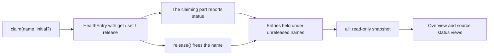

# health.ts

`src/infra/health.ts` is the small shared registry that lets every part of the application publish a piece of status — "runtime is ready", "this model failed", "this source reported a poll error" — in one place. It provides the `HealthBoard` class and the `HealthEntry` writer contract, and it enforces a single-writer rule so two parts can never silently overwrite each other's status. Its most useful takeaway: health is not a free-for-all map; a part must *claim* a name first, writes only through the entry it received, and must release it when it goes away.

## Whole-unit functional diagram

A part claims a name once, writes status through the returned entry while it owns it, and readers such as the management HTTP views simply read the whole board. Releasing removes the name, so a stopped or unregistered component disappears from the snapshot instead of showing stale status.

<!-- {
  "mermaid_info": {
    "name": "Health board claim, report and read flow",
    "nodes": [
      {
        "id": "claim_001",
        "name": "claim(name, initial?)",
        "path": "src/infra/health.ts",
        "hint": "The only way to obtain a writable health entry",
        "isJumpable": true,
        "position": { "startLine": 18, "endLine": 21 },
        "references": []
      },
      {
        "id": "entry_002",
        "name": "HealthEntry with get / set / release",
        "path": "src/infra/health.ts",
        "hint": "The writer contract handed back to the claiming part",
        "isJumpable": true,
        "position": { "startLine": 4, "endLine": 9 },
        "references": []
      },
      {
        "id": "owner_003",
        "name": "The claiming part reports status",
        "path": "",
        "hint": "Runtime, Effects, Sessions, executor, Settings and Source kinds write their own entries",
        "isJumpable": false,
        "position": { "startLine": 0, "endLine": 0 },
        "references": []
      },
      {
        "id": "entries_004",
        "name": "Entries held under unreleased names",
        "path": "src/infra/health.ts",
        "hint": "Current status keyed by entry name",
        "isJumpable": true,
        "position": { "startLine": 16, "endLine": 17 },
        "references": []
      },
      {
        "id": "all_005",
        "name": "all: read-only snapshot",
        "path": "src/infra/health.ts",
        "hint": "Read access used by the management views and tests",
        "isJumpable": true,
        "position": { "startLine": 34, "endLine": 34 },
        "references": []
      },
      {
        "id": "panels_006",
        "name": "Overview and source status views",
        "path": "src/app/http.ts",
        "hint": "The overview, sources and settings responses read the whole board",
        "isJumpable": true,
        "position": { "startLine": 157, "endLine": 161 },
        "references": []
      },
      {
        "id": "release_007",
        "name": "release() frees the name",
        "path": "src/infra/health.ts",
        "hint": "Drops the claim and the status so later writes do nothing",
        "isJumpable": true,
        "position": { "startLine": 26, "endLine": 31 },
        "references": []
      }
    ]
  }
} -->

    
        <a target="_self" href="#src/infra/health.ts:1?class=graph" style="color: inherit; text-decoration: none;">Graph: Health board claim, report and read flow</a>
    

## At a glance

- Primary role: Infrastructure — it is shared runtime support that carries status reports, rather than product behavior itself.
- Secondary roles: API boundary — the claim / write / release contract is what the rest of the application programs against.
- Confidence: High — the file is short and complete, and its comments plus the claiming call sites in `runtime.ts`, `effects.ts`, `settings.ts` and `sources/registry.ts` confirm the intended usage.

## What this file does

- Gives each component a named health slot: entries such as `runtime`, `models`, `worker`, `evals`, per-effect names and per-source names all live in one readable map.
- Enforces exclusive ownership: a second `claim` for a name that is already held throws, so two writers cannot fight over the same status line.
- Hands out a narrow writer object (`HealthEntry`) instead of the board itself, keeping writes scoped to the name a part was granted.
- Supports honest teardown: `release()` frees the name and removes its status, and any later write through the old entry is silently ignored — this is what keeps an unregistered Source kind from leaving stale status behind.
- Exposes the full current picture as a read-only record for the HTTP views and the runtime's own `health` getter.

## Key functions or classes

### `HealthEntry`

The three-method contract a caller receives: read the current status, publish a new one, and give the name back when finished.

<a target="_self" href="#src/infra/health.ts:4-9?class=code" style="color: inherit; text-decoration: none;">health.ts:4-9</a>

### `HealthBoard.claim`

The single entry point into the board: reserves a name (optionally seeding an initial status) and returns the exclusive writer, or throws when the name already belongs to another part.

<a target="_self" href="#src/infra/health.ts:18-33?class=code" style="color: inherit; text-decoration: none;">health.ts:18-33</a>

### `HealthBoard.all`

The read side: every currently held name mapped to its latest status, returned as a read-only record for display code.

<a target="_self" href="#src/infra/health.ts:34?class=code" style="color: inherit; text-decoration: none;">health.ts:34</a>

## Main inputs and results

- Inputs: an entry name and an optional starting status when claiming; a status value (`state`, human-readable `detail`, and optionally a timestamp, code, or template values) whenever a holder publishes.
- Results: a writable entry for the claimed name, and an up-to-date read-only map of all live statuses exposed through `all`.
- Visible side effects: the overview, source status and settings panels display exactly the entries that are currently claimed, so a released part vanishes from those panels and a reporting part changes what an operator sees there.

## Runtime support

- Provides: an in-memory status registry every component reports into, with ownership checking built in rather than left to convention.
- Starts or activates: it has no startup of its own — a single board is created by the runtime, passed to the parts it constructs, and each part claims its entry when it is constructed; `Settings` even claims `sync:<id>` entries lazily, and `SourceRegistry` claims a kind's declared entries while registering it.
- Used by: the runtime (`runtime`, `evals`), model `Sessions` (`models`), `Effects` for each effect kind, the executor (`worker`), `Settings` for per-source syncs, and `SourceRegistry` on behalf of each Source kind; the management HTTP routes read the result.
- Operational effect: status reports are simple in-memory writes, so a claim conflict surfaces immediately as a startup error instead of a silently duplicated status line, and a released entry stops accepting writes without needing any coordinated shutdown.

## Public contract

- Caller: the application wiring in the runtime and its collaborators, plus tests that build a board directly and drive the parts against it.
- Operation: claim a name to get an exclusive writer, publish statuses through it, and read the aggregated board.
- Accepted input: an unused entry name; a name that is already claimed is rejected, and callers are expected to release it when their part ends. The initial status argument is optional, so an entry can exist without a value until the first report.
- Result: the claimed entry, or an error naming the conflicting entry when ownership is refused; `all` returns the live mapping, which is empty for names that were never claimed or have been released.

---
name: health.ts

update-time: 2026-11-02 11:23

description: `src/infra/health.ts` is the small shared registry that lets every part of the application publish a piece of status — "runtime is ready", "this model failed", "this source reported a poll error" — in one place. It provides the `HealthBoard` class and the `HealthEntry` writer contract, and it enforces a single-writer rule so two parts can never silently overwrite each other's status. Its most useful takeaway: health is not a free-for-all map; a part must *claim* a name first, writes only through the entry it received, and must release it when it goes away.

---
