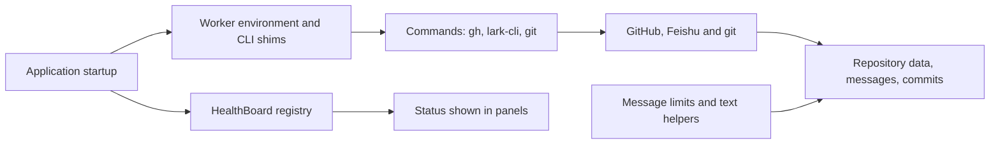

# infra

`src/infra` is the shared lower layer that everything else in `dsh-superagent` stands on. It is the only place that reaches command-line tools (`gh`, the Feishu bot's `lark-cli`, and `git`), it builds the isolated account-bound environment those tools run in, and it keeps a few small registries and helpers that the rest of the code calls instead of re-implementing. Nothing here decides product behaviour: it makes the outside world reachable, consistent, and reportable.

## Whole-unit functional diagram

<!-- {
  "mermaid_info": {
    "name": "How src/infra supports the running application",
    "nodes": [
      {
        "id": "runtime_001",
        "name": "Application startup",
        "path": "src/app/runtime.ts",
        "hint": "Creates the command wrapper, the health board and runs setup",
        "isJumpable": true,
        "position": { "startLine": 87, "endLine": 106 },
        "references": []
      },
      {
        "id": "environment_002",
        "name": "Worker environment and CLI shims",
        "path": "src/infra/environment.ts",
        "hint": "Writes gh and lark-cli shims plus an isolated git configuration",
        "isJumpable": true,
        "position": { "startLine": 79, "endLine": 116 },
        "references": []
      },
      {
        "id": "health_003",
        "name": "HealthBoard registry",
        "path": "src/infra/health.ts",
        "hint": "Single-writer registry of component status entries",
        "isJumpable": true,
        "position": { "startLine": 15, "endLine": 35 },
        "references": []
      },
      {
        "id": "commands_004",
        "name": "Commands: gh, lark-cli, git",
        "path": "src/infra/commands.ts",
        "hint": "Runs subprocesses with the deployment's accounts, timeouts and error translation",
        "isJumpable": true,
        "position": { "startLine": 59, "endLine": 114 },
        "references": []
      },
      {
        "id": "service_005",
        "name": "GitHub, Feishu and git",
        "path": "",
        "hint": "External command-line tools reached through the shims",
        "isJumpable": false,
        "position": { "startLine": 0, "endLine": 0 },
        "references": []
      },
      {
        "id": "result_006",
        "name": "Repository data, messages, commits",
        "path": "",
        "hint": "Typed data and text that sources, assessments and the outbox consume",
        "isJumpable": false,
        "position": { "startLine": 0, "endLine": 0 },
        "references": []
      },
      {
        "id": "status_007",
        "name": "Status shown in panels",
        "path": "",
        "hint": "Health entries rendered by the overview and source status views",
        "isJumpable": false,
        "position": { "startLine": 0, "endLine": 0 },
        "references": []
      },
      {
        "id": "text_008",
        "name": "Message limits and text helpers",
        "path": "src/infra/text.ts",
        "hint": "Word limits, template filling and name comparison",
        "isJumpable": true,
        "position": { "startLine": 3, "endLine": 19 },
        "references": []
      }
    ]
  }
} -->

    
        <a target="_self" href="#src/infra:1?class=graph" style="color: inherit; text-decoration: none;">Graph: How src/infra supports the running application</a>
    

Startup writes the account-bound environment, then hands every component a `Commands` instance that runs the external tools; results flow back as parsed JSON, raw CLI text, or a `CliError` carrying the remote error code. In parallel, each part claims a named entry on the `HealthBoard` so its state can be shown in the panels.

## At a glance

- Main role: infrastructure — shared runtime support (subprocess execution, an isolated tool environment, a status registry, packaged-asset lookup and text limits) that product behaviour is built on top of.
- Confidence: High — the five files are small, import no domain modules of their own, and are consumed directly by setup, runtime, settings, sources, the executor and the tools layer.

## Runtime support

- Provides: one consistent way to run `gh`, `lark-cli` and `git` as the deployment's own accounts; a health registry with one writer per entry; and the small text/path helpers the product needs everywhere.
- Starts or activates: `Runtime` constructs `Commands` and the `HealthBoard` during its constructor, and `Setup.run` writes the worker shims and git configuration, then verifies the credential helper resolves before any source polls or ticket executes. Changing the blocked-command list rewrites the shims immediately.
- Used by: setup and runtime wiring, the outbox and assessment, the GitHub and Feishu sources, the DSH executor, and the tool/prompt layer.
- Operational effect: every subprocess runs with a fixed 90-second limit, the caller's abort signal and a bounded output buffer; overruns surface as "timed out" errors rather than hanging work. Health writes from a part that has released its entry become no-ops, so a stopped component cannot resurrect its status.

<a target="_self" href="#src/infra/health.ts:15-35?class=code" style="color: inherit; text-decoration: none;">health.ts:15-35</a>

## Responsibilities and non-responsibilities

- Responsible for: running external command-line tools and translating their output and failures; preparing the environment those tools run in; owning the health entry registry; locating packaged prompt and skill files; enforcing the chat message word limit and providing template/name helpers.
- Kept elsewhere: deployment resolution and account probing (`src/deployment.ts`, `src/app/setup.ts`), repository and conversation parsing with its API schemas (`src/sources`), settings and policy (`src/policy.ts`, `src/app/settings.ts`), and HTTP routes and UI views (`src/app`, `src/client`). Domain rules such as who may be picked for work live in the admission and policy code, not here.

## Important direct children

### `commands.ts`

The single doorway to external tools: `Commands.run` executes a program with the deployment's environment, and `api`, `pages`, `lark` and `git` give callers repository-scoped GitHub access, Feishu JSON payloads, and git commands, with failures translated into `CliError`.

<a target="_self" href="#src/infra/commands.ts.info.md?class=text" style="color: inherit; text-decoration: none;">commands.ts.info.md</a>

### `environment.ts`

Builds the guarded runtime environment: it writes `gh` and `lark-cli` shims and an isolated git configuration into the state directory, strips ambient tokens and operator git settings, blocks disallowed command names, and offers the shared worker subprocess runner and its startup verification checks.

<a target="_self" href="#src/infra/environment.ts.info.md?class=text" style="color: inherit; text-decoration: none;">environment.ts.info.md</a>

### `health.ts`

The shared status registry: a component claims a name, writes status only through the returned entry, and releases it when it goes away, so two parts can never silently overwrite each other's state.

<a target="_self" href="#src/infra/health.ts.info.md?class=text" style="color: inherit; text-decoration: none;">health.ts.info.md</a>

### `paths.ts`

Answers "where does this package's own files live?" by walking up from the executing module to the `package.json` named `dsh-superagent`, so packaged `prompts/*.md` and skill files are found from both the `src/` tree and the compiled `lib/` output.

<a target="_self" href="#src/infra/paths.ts.info.md?class=text" style="color: inherit; text-decoration: none;">paths.ts.info.md</a>

### `text.ts`

Keeps text-shaped decisions in one place: the enforced chat message word limits, `{name}` template filling, and case-insensitive comparison for GitHub logins and repository names.

<a target="_self" href="#src/infra/text.ts.info.md?class=text" style="color: inherit; text-decoration: none;">text.ts.info.md</a>

## How the children work together

Setup resolves the accounts, then `writeEnvironment` writes the shims and git configuration that `applyEnvironment` places on `PATH` and in `process.env`. `Commands` is then constructed with those overrides and the application lifetime signal, so every later call — a GitHub page fetch, a Feishu message send, a git push — goes through the same wrapper and produces either typed data or a `CliError` whose `code` the callers inspect. `health.ts` is independent of that path and runs alongside it, while `text.ts` and `paths.ts` are pure helpers that the surrounding components import directly.

## External connection

- External system: the GitHub CLI (`gh`), the Feishu bot CLI (`lark-cli`) and `git` on `PATH`.
- Outbound translation: `run` launches the program with the deployment environment merged over `process.env`, plus non-interactive flags so no tool waits for input; `api` prefixes the path with the configured repository and refuses paths that leave it; `lark` always appends `--as bot --format json` so calls act as the bot, not an operator.
- Inbound translation: GitHub JSON is validated against a Zod schema (paginated list items that fail validation are skipped and counted), raw CLI text is returned unchanged when no schema is given, and Feishu replies are unwrapped from their `data` field; any failure becomes a `CliError` carrying the HTTP status or Feishu error code, with the "bot not in the chat" case rewritten into an actionable hint.

### Operating requirements

Setup must have resolved the deployment accounts before `Commands` can be used — while setup is pending, reading the deployment throws a waiting-for-setup message, and Feishu calls fail if the installation has no bot. GitHub work is restricted to the single configured repository, and no command may run longer than the fixed time limit.

## Reusable capability

- Solves: recurring text questions in one place — how many words a message has, what a template becomes once values are filled in, and whether two names refer to the same account.
- Input: a message, template and value map, or two names.
- Result: a word count over mixed Chinese/English text, the unchanged text or a clear "too long" error, a filled string, or a boolean comparison.
- Main usage area: the outbox and assessment check the 100-word chat limit before sending, the Feishu and GitHub channels compare and validate, and the tool layer reuses the same limits in its own descriptions.

### Important usage constraint

The limit is enforced, not advisory: an over-long chat message throws with the count and the maximum instead of being truncated, and callers are expected to rewrite it as one shorter update rather than split it into several messages. Link labels and URLs both count toward the limit.

## Recommended starting points

1. 
Start with 
<a target="_self" href="#src/infra/commands.ts:59-114?class=code" style="color: inherit; text-decoration: none;">commands.ts:59-114</a>
, the `Commands` class, to see exactly how the outside world is reached and how results and errors come back.

2. 
Continue with 
<a target="_self" href="#src/infra/environment.ts:79-116?class=code" style="color: inherit; text-decoration: none;">environment.ts:79-116</a>
 to understand which accounts those calls act as and why the shims exist.

3. 
Read 
<a target="_self" href="#src/infra/health.ts:15-35?class=code" style="color: inherit; text-decoration: none;">health.ts:15-35</a>
 last, since most components you meet elsewhere write their status through it.

---
name: infra

update-time: 2026-11-02 11:51

description: `src/infra` is the shared lower layer that everything else in `dsh-superagent` stands on. It is the only place that reaches command-line tools (`gh`, the Feishu bot's `lark-cli`, and `git`), it builds the isolated account-bound environment those tools run in, and it keeps a few small registries and helpers that the rest of the code calls instead of re-implementing. Nothing here decides product behaviour: it makes the outside world reachable, consistent, and reportable.

---
