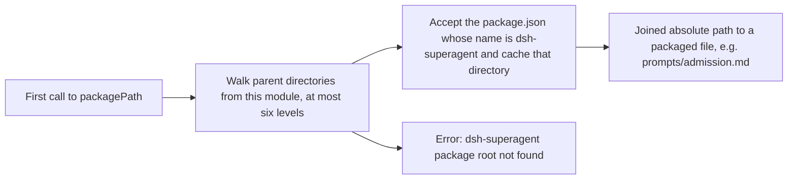

# paths.ts

`src/infra/paths.ts` is a small helper that answers one question: "where does this package's own `package.json` live?" The answer matters because `dsh-superagent` ships non-code assets (`prompts/*.md`, `skills/dsh-superagent-*/SKILL.md`) next to its code, and those assets must be found whether the file being executed lives in the `src/` source tree during development or in the compiled `lib/` output after packaging. Instead of hard-coding a relative offset, the file walks upward from its own location and returns an absolute path that the rest of the codebase joins into asset paths.

## Whole-unit functional diagram

<!-- {
  "mermaid_info": {
    "name": "Package root resolution flow",
    "nodes": [
      {
        "id": "trigger_001",
        "name": "First call to packagePath",
        "path": "src/infra/paths.ts",
        "hint": "Callers ask for an asset path, which triggers root resolution on first use",
        "isJumpable": true,
        "position": { "startLine": 20, "endLine": 20 },
        "references": []
      },
      {
        "id": "search_002",
        "name": "Walk parent directories from this module, at most six levels",
        "path": "src/infra/paths.ts",
        "hint": "Starts at the directory of the running module and inspects each parent package.json",
        "isJumpable": true,
        "position": { "startLine": 9, "endLine": 17 },
        "references": []
      },
      {
        "id": "match_003",
        "name": "Accept the package.json whose name is dsh-superagent and cache that directory",
        "path": "src/infra/paths.ts",
        "hint": "Only a manifest whose name field matches this package counts; the result is memoized",
        "isJumpable": true,
        "position": { "startLine": 6, "endLine": 13 },
        "references": []
      },
      {
        "id": "result_004",
        "name": "Joined absolute path to a packaged file, e.g. prompts/admission.md",
        "path": "src/infra/paths.ts",
        "hint": "packagePath joins the resolved root with the caller's path segments",
        "isJumpable": true,
        "position": { "startLine": 20, "endLine": 20 },
        "references": []
      },
      {
        "id": "error_005",
        "name": "Error: dsh-superagent package root not found",
        "path": "src/infra/paths.ts",
        "hint": "Raised when no matching manifest is found within the search depth",
        "isJumpable": true,
        "position": { "startLine": 18, "endLine": 18 },
        "references": []
      }
    ]
  }
} -->

    
        <a target="_self" href="#src/infra/paths.ts:1?class=graph" style="color: inherit; text-decoration: none;">Graph: Package root resolution flow</a>
    

The main path is deliberately location-independent: the file does not assume it sits at `src/infra` or `lib/infra`, it searches upward for the manifest that names this package, remembers the answer for the rest of the process, and hands back a joined absolute path. If nothing matches within the search limit, the request fails loudly instead of resolving to a wrong directory.

## At a glance

- Primary role: Utility — a focused, reusable helper whose only job is turning relative asset names into absolute paths.
- Confidence: High — the file is 21 lines with two exports, and both consumers use it in exactly the way the source and comments describe.

## What this file does

- Finds the package root at runtime by inspecting each parent directory's `package.json` and comparing its `name` field with `dsh-superagent`.
- Works the same from source and from compiled output, which is why the search starts at the running module rather than at a fixed relative offset.
- Ignores unrelated `package.json` files encountered on the way up, and tolerates unreadable or invalid JSON while searching.
- Caches the resolved root so repeated asset lookups cost a directory join rather than another filesystem walk.
- Provides `packagePath(...parts)` as the everyday entry point: callers name a shipped asset such as `prompts` plus `admission.md` and receive an absolute path.

## Reusable capability

- Solves: reaching files that are published alongside the code (`prompts/`, `skills/`) without knowing whether the current process runs from the source tree or from `lib/`.
- Input: relative path segments, for example `('skills', 'dsh-superagent-feishu', 'SKILL.md')`.
- Result: one absolute, OS-joined path string pointing at the requested asset.
- Main usage area: packaged content loading. Built-in skills and prompt templates resolve their files through this helper, and the prompt tests use it to locate the shipped `prompts/` directory.

### Important usage constraint

The search matches the literal `name` value `dsh-superagent` and stops after six directory levels. A fork or renamed copy of the package must adjust this check, otherwise every asset lookup fails with "dsh-superagent package root not found". Because the resolved root is cached on first success, moving the package files after startup is not reflected.

## Key functions or classes

### `packageRoot()`

Returns the absolute directory that contains this package's `package.json`, walking upward from the current module and caching the result; throws if no matching manifest is found.

    
        <a target="_self" href="#src/infra/paths.ts:7-19?class=code" style="color: inherit; text-decoration: none;">Code: src/infra/paths.ts:7-19</a>
    

### `packagePath(...parts)`

Joins the resolved package root with the caller's path segments, giving a single absolute path to a packaged asset.

    
        <a target="_self" href="#src/infra/paths.ts:20?class=code" style="color: inherit; text-decoration: none;">Code: src/infra/paths.ts:20</a>
    

## Main inputs and results

- Inputs: the path segments each caller supplies (for example a folder name plus a filename), and the runtime location of the currently executing module.
- Results: an absolute path string for the requested packaged file.
- Visible side effects: a thrown error naming the missing package root when resolution fails, which surfaces to users as a failure to load built-in prompts or skills; and a per-process cache of the resolved root.

The most direct consumer is 
<a target="_self" href="#src/app/skill-files.ts:8-23?class=code" style="color: inherit; text-decoration: none;">skill-files.ts:8-23</a>
, which turns these paths into built-in skill definitions and prompt text.

---
name: paths.ts

update-time: 2026-11-02 11:29

description: `src/infra/paths.ts` is a small helper that answers one question: "where does this package's own `package.json` live?" The answer matters because `dsh-superagent` ships non-code assets (`prompts/*.md`, `skills/dsh-superagent-*/SKILL.md`) next to its code, and those assets must be found whether the file being executed lives in the `src/` source tree during development or in the compiled `lib/` output after packaging. Instead of hard-coding a relative offset, the file walks upward from its own location and returns an absolute path that the rest of the codebase joins into asset paths.

---
