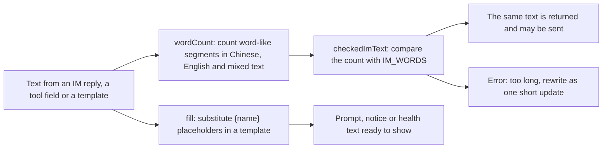

# text.ts

`src/infra/text.ts` is a small shared helper file that keeps text-shaped decisions in one place: how long a message may be, how a template gets its values filled in, and how names are compared. It has no dependencies of its own and is used by the outbox, the Feishu channel, the model tools, prompt building and the GitHub sources, so a change here is felt across the whole product. The most useful takeaway is that the chat message limit is a real enforced rule, not just documentation: an over-long Feishu reply fails instead of being silently truncated.

## Whole-unit functional diagram

The main path is the word-count branch: any caller that needs a length guarantee gets a count from `wordCount` and either the original text back or a refusal that explains the limit. The lower branch is the independent formatting helper used where templates contain `{placeholders}`.

<!-- {
  "mermaid_info": {
    "name": "Text helper flow in text.ts",
    "nodes": [
      {
        "id": "caller_001",
        "name": "Text from an IM reply, a tool field or a template",
        "path": "",
        "hint": "Text supplied by chat senders, model tool arguments and prompt templates",
        "isJumpable": false,
        "position": { "startLine": 0, "endLine": 0 },
        "references": []
      },
      {
        "id": "segment_002",
        "name": "wordCount: count word-like segments in Chinese, English and mixed text",
        "path": "src/infra/text.ts",
        "hint": "Segments the text and counts only word-like pieces, ignoring punctuation",
        "isJumpable": true,
        "position": { "startLine": 6, "endLine": 10 },
        "references": []
      },
      {
        "id": "limit_003",
        "name": "checkedImText: compare the count with IM_WORDS",
        "path": "src/infra/text.ts",
        "hint": "The single gate for the chat message length rule",
        "isJumpable": true,
        "position": { "startLine": 12, "endLine": 16 },
        "references": []
      },
      {
        "id": "accepted_004",
        "name": "The same text is returned and may be sent",
        "path": "",
        "hint": "The helper never rewrites or truncates accepted text",
        "isJumpable": false,
        "position": { "startLine": 0, "endLine": 0 },
        "references": []
      },
      {
        "id": "rejected_005",
        "name": "Error: too long, rewrite as one short update",
        "path": "src/infra/text.ts",
        "hint": "The refusal message reported to the caller",
        "isJumpable": true,
        "position": { "startLine": 14, "endLine": 14 },
        "references": []
      },
      {
        "id": "fill_006",
        "name": "fill: substitute {name} placeholders in a template",
        "path": "src/infra/text.ts",
        "hint": "Replaces named placeholders with supplied values",
        "isJumpable": true,
        "position": { "startLine": 17, "endLine": 17 },
        "references": []
      },
      {
        "id": "rendered_007",
        "name": "Prompt, notice or health text ready to show",
        "path": "",
        "hint": "The finished string handed back to the caller",
        "isJumpable": false,
        "position": { "startLine": 0, "endLine": 0 },
        "references": []
      }
    ]
  }
} -->

    
        <a target="_self" href="#src/infra/text.ts:1?class=graph" style="color: inherit; text-decoration: none;">Graph: Text helper flow in text.ts</a>
    

## At a glance

- Primary role: Utility — a focused set of reusable string helpers that many unrelated parts of the project call.
- Secondary roles: Domain rules — the file owns the word limits that decide whether a chat message may be sent at all.
- Confidence: High — the file is read in full and every exported symbol has verified call sites in `src/`.

## What this file does

- Counts words in a way that works for Chinese, English and mixed text, so a "short message" means the same thing in every language the bot speaks.
- Enforces the chat message limit in one place, so replies, acknowledgements and model tool arguments all fail with the same message instead of drifting apart.
- Publishes the two limits as named constants (`IM_WORDS` for a chat message, `NOTE_WORDS` for a routing note) so callers can quote the number in their own validation messages.
- Fills `{placeholder}` templates, which is how prompt parts, setup sentences and health notices get their runtime values.
- Compares GitHub logins and repository names case-insensitively, which matters because people type `OctoCat` and `octocat` for the same account.
- Escapes literal text before it is embedded in a regular expression, used when a login becomes part of a mention pattern.

## Key functions or classes

### `wordCount`

Returns the number of word-like segments in a string, so punctuation and whitespace do not inflate the count.

<a target="_self" href="#src/infra/text.ts:6-10?class=code" style="color: inherit; text-decoration: none;">text.ts:6-10</a>

### `checkedImText`

Returns the text unchanged when it fits within `IM_WORDS`; otherwise it throws an error that states the actual count and tells the author to rewrite as one short high-level update. Callers use it as a pass-through guard, for example before a Feishu reply is sent and before an acknowledgement is recorded.

<a target="_self" href="#src/infra/text.ts:12-16?class=code" style="color: inherit; text-decoration: none;">text.ts:12-16</a>

### `fill`

Replaces every `{name}` placeholder with the matching value from a record. A placeholder with no matching key becomes an empty string rather than being left visible.

<a target="_self" href="#src/infra/text.ts:17?class=code" style="color: inherit; text-decoration: none;">text.ts:17</a>

### `sameName`

Answers "are these the same GitHub login or repository name?" ignoring letter case.

<a target="_self" href="#src/infra/text.ts:19?class=code" style="color: inherit; text-decoration: none;">text.ts:19</a>

### `escapeRegExp`

Makes a literal string safe to paste into a regular expression, used when building a mention check from a configured login.

<a target="_self" href="#src/infra/text.ts:20?class=code" style="color: inherit; text-decoration: none;">text.ts:20</a>

## Reusable capability

- Solves: the recurring "how long is this text, and does it fit?" problem, plus small string formatting chores that would otherwise be copy-pasted across modules.
- Input: a plain string, plus for `fill` a record of placeholder values and for `sameName` a second name to compare against.
- Result: a number for `wordCount`, the original string back or a thrown error for `checkedImText`, a rendered string for `fill`, and a boolean for `sameName`.
- Main usage area: chat delivery and model-facing message validation (
<a target="_self" href="#src/app/outbox.ts:29?class=code" style="color: inherit; text-decoration: none;">outbox.ts:29</a>
, 
<a target="_self" href="#src/app/tools/main.ts:18?class=code" style="color: inherit; text-decoration: none;">main.ts:18</a>
), prompt and notice rendering (
<a target="_self" href="#src/app/prompts.ts:96?class=code" style="color: inherit; text-decoration: none;">prompts.ts:96</a>
), and identity checks in the GitHub sources and policy (
<a target="_self" href="#src/policy.ts:120?class=code" style="color: inherit; text-decoration: none;">policy.ts:120</a>
).

### Important usage constraint

`checkedImText` never shortens anything. If a caller wants a message delivered, the text must already be within the limit; the only outcome of an over-long message is an error, and the caller is expected to rewrite it rather than split it into several messages. Because the limit counts link labels and URLs as words, a message that looks short but carries a long address can still fail.

## Rules and decisions

- Decision: may this outgoing chat message be sent as written? The file answers by comparing a language-aware word count against a fixed ceiling.
- Important conditions: the count is word-based, not character-based, so Chinese text is segmented rather than measured in bytes; both the visible label and the target of a link count toward the same budget; Feishu replies are checked when queued and again when actually sent.
- Outcomes: within the limit, the identical text is sent and delivered; above the limit, sending fails with an error naming the real count and the maximum.
- Invariant: a chat message never leaves the system longer than `IM_WORDS` words, and the routing note fields that models produce never exceed `NOTE_WORDS`.

### Small example

A model returns an acknowledgement of `IM_WORDS + 1` words. The acknowledgement is rejected with a message naming the maximum, and the model is told to write one short sentence instead. At exactly `IM_WORDS` words the same text is accepted and returned untouched. The project's own tests pin both sides of that boundary.

## Main inputs and results

- Inputs: plain strings from chat replies, model tool arguments, acknowledgements, prompt parts, setup sentences, health notices, and GitHub logins or repository names to compare.
- Results: a word count, the original text returned unchanged when it fits the limit, a thrown error when it does not, a rendered string with placeholders substituted, and a case-insensitive equality answer.
- Visible side effects: an over-long Feishu reply is refused at delivery time instead of being truncated or delivered, and unresolved template placeholders disappear from the rendered output rather than showing as raw `{name}` text.

---
name: text.ts

update-time: 2026-11-02 11:29

description: `src/infra/text.ts` is a small shared helper file that keeps text-shaped decisions in one place: how long a message may be, how a template gets its values filled in, and how names are compared. It has no dependencies of its own and is used by the outbox, the Feishu channel, the model tools, prompt building and the GitHub sources, so a change here is felt across the whole product. The most useful takeaway is that the chat message limit is a real enforced rule, not just documentation: an over-long Feishu reply fails instead of being silently truncated.

---
