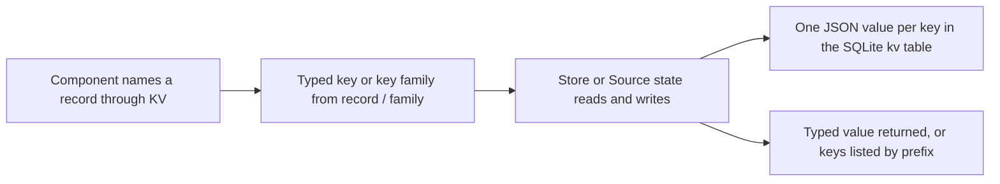

# src/kv.ts

`src/kv.ts` is the single dictionary of every retained key-value record in the project. Instead of scattering key strings like `'settings-revision'` or `'feishu-history:'` through the code, each one is declared once here together with the type of the value it holds, grouped by the component that writes it. Readers and writers import `KV` so a record is spelled in one place and a wrong value type is caught by TypeScript. The file stores nothing itself: it defines the naming and typing contract, while `Store` and Source state perform the actual persistence.

## Whole-unit functional diagram

A caller picks a declared entry such as `KV.settings.revision` or builds one from a family such as `KV.feishu.history(chatId)`. That typed key travels to `Store` or to a Source's `ctx.state`, which reads and writes a single JSON value per key and hands the value back with the type the registry promised.

<!-- {
  "mermaid_info": {
    "name": "KV key contract flow",
    "nodes": [
      {
        "id": "entry_001",
        "name": "Component names a record through KV",
        "path": "src/kv.ts",
        "hint": "The registry where each record is declared once",
        "isJumpable": true,
        "position": { "startLine": 21, "endLine": 58 },
        "references": []
      },
      {
        "id": "contract_002",
        "name": "Typed key or key family from record / family",
        "path": "src/kv.ts",
        "hint": "The Key and Family types plus their two constructors",
        "isJumpable": true,
        "position": { "startLine": 11, "endLine": 19 },
        "references": []
      },
      {
        "id": "access_003",
        "name": "Store or Source state reads and writes",
        "path": "src/app/store.ts",
        "hint": "KV accessors that accept the typed key",
        "isJumpable": true,
        "position": { "startLine": 163, "endLine": 181 },
        "references": []
      },
      {
        "id": "stored_004",
        "name": "One JSON value per key in the SQLite kv table",
        "path": "",
        "hint": "The persisted form of a declared record",
        "isJumpable": false,
        "position": { "startLine": 0, "endLine": 0 },
        "references": []
      },
      {
        "id": "value_005",
        "name": "Typed value returned, or keys listed by prefix",
        "path": "",
        "hint": "What the caller observes after a read or a family listing",
        "isJumpable": false,
        "position": { "startLine": 0, "endLine": 0 },
        "references": []
      }
    ]
  }
} -->

    
        <a target="_self" href="#src/kv.ts:1?class=graph" style="color: inherit; text-decoration: none;">Graph: KV key contract flow</a>
    

## At a glance

- **Primary role — Data contract**: the file fixes the name and value type of every key-value record the application keeps, so independent writers and readers agree without repeating string literals.
- **Secondary role — Extension point**: `record` and `family` are exported so a Source plugin or an external package can declare and type its own keys outside this registry.
- **Confidence**: High — the source itself carries the ownership rule, and the main consumers (`Store`, `Versions`, `SourceContext.state`) all import `Key`/`Family` from here.

## What this file does

- **Names each record once, grouped by owner.** `KV` is split into the components that write a family of records: `store` holds the database schema version, `settings` and `prompts` hold revisions and saved snapshots, `runtime` holds the main session ID, `sessions` holds per-session prompt revisions, `sources` holds resolved display labels, and `github`/`feishu` hold their cursors and checkpoints.
- **Attaches a value type to every name.** Because the entry is a `Key<V>`, a read of `KV.store.schema` is typed `number`, `KV.feishu.seen(thread)` is typed `string[]`, and `KV.sources.labels(id)` is a name-to-name map — a mismatched write fails to compile instead of storing the wrong JSON shape.
- **Separates single records from key families.** `record` declares one fixed key, while `family` builds a callable whose keys join a prefix and its name parts with `:`, so per-revision, per-chat, per-thread or per-pull-request records are generated rather than listed.
- **Makes families listable.** Each family also exposes `prefix`, which is what lets a component enumerate its own records — for example collecting every stored session's prompt revisions or every known Feishu topic.
- **Carries the documented meaning of the stored value** where the shape alone is not self-explanatory, such as the last element of `KV.sessions.prompts` being a session's active prompt revision, or the GitHub CI `revision` counting reported changes so each yields a distinct trigger ID.
- **Keeps legacy schema-11 keys reachable.** `KV.queues` still describes the old main-session relay, subscription, prompt and settings notification keys, so the migration code can import them instead of hard-coding strings.

## Key functions or classes

### `Key<V>`

The type of a record whose value is `V`; at runtime it is an ordinary string, so it can be passed straight to the storage layer.

### `Family<V, A>`

The type of a group of records sharing a prefix: calling it with name parts returns a `Key<V>`, and its `prefix` property is used for listing.

### `record`

Declares a single typed key and returns it unchanged, which is why it costs nothing at runtime.

    
        <a target="_self" href="#src/kv.ts:15?class=code" style="color: inherit; text-decoration: none;">Code: src/kv.ts:15</a>
    

### `family`

Builds a typed key family from a string prefix and an optional formatter, defaulting to joining the name parts with `:`; the resulting function and its `prefix` share the same callable object.

    
        <a target="_self" href="#src/kv.ts:17-19?class=code" style="color: inherit; text-decoration: none;">Code: src/kv.ts:17-19</a>
    

### `KV`

The registry object that holds every declared record and family, organised by the component that owns them.

    
        <a target="_self" href="#src/kv.ts:21-58?class=code" style="color: inherit; text-decoration: none;">Code: src/kv.ts:21-58</a>
    

## Main inputs and results

- **Inputs**: the key literal and value type given to `record`, the prefix plus name parts given to `family` (and an optional custom formatter), and the imports of `KV` made by the components that read or write the records.
- **Results**: branded key strings and callable key families that `Store`'s typed accessors, `Versions`, and a Source's `ctx.state` accept, each returning the value type declared in the registry.
- **Visible side effects**: none on its own — the file is declarations only. When these keys are used, the observable results are the values that show up as settings revisions, prompt versions, session prompt histories, Source display labels, and GitHub/Feishu read cursors.

## Information contract

- **Represents**: the identity and payload type of every retained key-value record — schema version, settings revisions and per-block revision counters, prompt revisions and their built-in baselines, the main session ID, per-session prompt revision lists, per-Source display labels, GitHub cursors/retries/stream state/CI fingerprints, Feishu chat, history, topic and thread checkpoints, and the pre-migration queue records.
- **Produced by**: this file alone, and in practice extended by whoever adds a new record — the surrounding components (`src/app/store.ts`, `src/app/versions.ts`, `src/sources/host.ts`) accept these types rather than defining their own.
- **Consumed by**: `Store.get`/`set`/`keys`, the `Versions` helper that keeps a revision pointer plus numbered snapshots, the `SourceContext.state` view offered to Source plugins, the migration code that renames and drops legacy keys, and the settings and session views that read labels and histories.
- **Behavior-shaping parts**:
  - The value type parameter decides the stored JSON shape, and reads parse it straight back, so it must match what writers put in.
  - `record` versus `family` decides whether a record is a fixed key or a key per named item; only families can be enumerated by prefix.
  - The prefix text is the listing boundary, which is why families end their prefix with `:` while single keys do not.
  - Some entries carry meaning beyond shape: `KV.sessions.prompts` is ordered oldest first so the last element is the active revision, and `KV.settings.block` keys its concurrency counter by the saved settings block, giving each configuration page its own revision guard.

### Compatibility notes

Key strings are persisted data, so renaming or re-spelling an entry orphans what is already stored; the migration module handles such changes explicitly by deleting or rewriting old prefixes. The project also enforces the "spelled once" rule mechanically: a test asserts that key literals containing `-` or `:` appear only in this registry, with `src/app/migration.ts` excluded because it must still name retired keys. Only `import type` statements connect this file to the rest of the app, so importing it adds no runtime dependency and creates no runtime cycle back into `Store`, which imports `KV` in return.

    
        <a target="_self" href="#tests/store.spec.ts:133-145?class=code" style="color: inherit; text-decoration: none;">Code: tests/store.spec.ts:133-145</a>
    

## How to extend it

- **Extension capability**: `record` and `family` are exported precisely so a new Source kind — or an external package — can declare and type its own records without editing this file. The project's cookbook shows the intended shape, a small registry object such as `webhook: { cursor: record<number>('webhook-cursor') }` alongside the shared `KV` group it belongs to.
- **Contract**: provide, for each record, a unique key string and the value type that will be JSON-serialised; for a family, provide a prefix and the ordered list of name parts used to build keys. Prefixes are combined with the name parts using `:` by default, and a custom formatter can replace that joining rule.
- **Registration or discovery**: there is no central registration step — the typed key object itself is the registration. Passing it to `Store.get`/`set`/`keys` or to a Source's `ctx.state` is enough; inside this repository the plainest form is adding an entry to a `KV` group, which is also what the key-literal test expects.
- **Use path**: import the registry, select a declared entry or call a family with its name parts, then read or write through the storage you were given. To enumerate a component's own records, pass the family itself to `keys(...)`; to remove a record through a Source context, set it to `undefined`.

### Compatibility boundary

Because both declaration styles produce plain strings, the value type is a compile-time promise only: readers receive whatever JSON was stored, so keeping the declared type in step with the writer is the extension author's responsibility. Removing a record is expressed by writing `undefined` through a Source context, while `Store` uses an explicit delete; the registry itself never deletes anything.

---
name: kv.ts

update-time: 2026-11-02 10:14

description: `src/kv.ts` is the single dictionary of every retained key-value record in the project. Instead of scattering key strings like `'settings-revision'` or `'feishu-history:'` through the code, each one is declared once here together with the type of the value it holds, grouped by the component that writes it. Readers and writers import `KV` so a record is spelled in one place and a wrong value type is caught by TypeScript. The file stores nothing itself: it defines the naming and typing contract, while `Store` and Source state perform the actual persistence.

---
