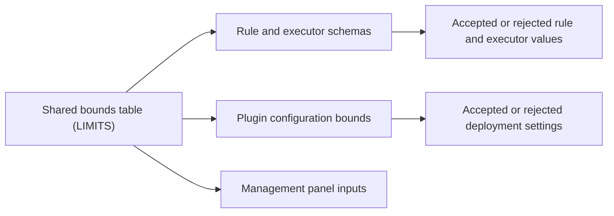

# limits.ts

This file is a tiny, dependency-free module whose whole job is to publish a single table of validation bounds. Its comment says the numbers are "shared between host schemas and management panel forms", so it exists to keep server-side validation and browser-side input limits in agreement. If you are reading this project for the first time, treat it as the named source of truth for "how long / how large / how many" a rule, a prompt or a worker pool may be.

## Whole-unit functional diagram

<!-- {
  "mermaid_info": {
    "name": "Shared validation bounds flow",
    "nodes": [
      {
        "id": "shared_001",
        "name": "Shared bounds table (LIMITS)",
        "path": "src/limits.ts",
        "hint": "The exported constant object that holds every numeric bound",
        "isJumpable": true,
        "position": { "startLine": 2, "endLine": 11 },
        "references": []
      },
      {
        "id": "schema_002",
        "name": "Rule and executor schemas",
        "path": "src/policy.ts",
        "hint": "Zod schemas for rules, evaluation settings and executor settings apply these bounds",
        "isJumpable": true,
        "position": { "startLine": 67, "endLine": 96 },
        "references": []
      },
      {
        "id": "config_003",
        "name": "Plugin configuration bounds",
        "path": "src/deployment.ts",
        "hint": "The plugin configuration schema uses the prompt and admission context ranges",
        "isJumpable": true,
        "position": { "startLine": 15, "endLine": 23 },
        "references": []
      },
      {
        "id": "schema_004",
        "name": "Accepted or rejected rule and executor values",
        "path": "",
        "hint": "Result of validating stored policy and executor settings against the bounds",
        "isJumpable": false,
        "position": { "startLine": 0, "endLine": 0 },
        "references": []
      },
      {
        "id": "config_005",
        "name": "Accepted or rejected deployment settings",
        "path": "",
        "hint": "Result of validating machine settings for prompt size and admission context",
        "isJumpable": false,
        "position": { "startLine": 0, "endLine": 0 },
        "references": []
      },
      {
        "id": "forms_006",
        "name": "Management panel inputs",
        "path": "src/client/eval.tsx",
        "hint": "Form inputs take their maxLength, min and max attributes from the same table",
        "isJumpable": true,
        "position": { "startLine": 52, "endLine": 55 },
        "references": []
      }
    ]
  }
} -->

    
        <a target="_self" href="#src/limits.ts:1?class=graph" style="color: inherit; text-decoration: none;">Graph: Shared validation bounds flow</a>
    

The table is written once and then read in three directions: the policy and executor schemas decide which stored values are legal, the plugin configuration schema decides which machine settings are legal, and the management panel closes the loop by preventing a person from typing something the backend would reject anyway.

## At a glance

- **Primary role**: Data contract — it defines the numeric boundaries that other components agree on when they exchange rule text, executor settings and deployment settings.
- **Secondary role**: Configuration — three of its entries bound values an operator sets in the plugin configuration (`promptMaxChars`, `admissionContextMaxPages`, `admissionContextTimeoutMs`).
- **Confidence**: High — the file is twelve lines read in full, and every bound was matched to a concrete consumer in the source.

## What this file does

- Publishes one exported constant, `LIMITS`, holding every numeric bound the project enforces; there are no imports, functions or side effects. Open the whole file: 
<a target="_self" href="#src/limits.ts?class=code" style="color: inherit; text-decoration: none;">limits.ts</a>

- Keeps long free-text fields in check: rule names, rule instructions and the prepare command each get a fixed maximum length.
- Turns three settings into *ranges* rather than single maxima: evaluation timeout, worker concurrency, prompt size, admission context pages and admission context milliseconds each carry a `min` and a `max`.
- Prevents the backend and the UI from drifting, because the schemas and the form inputs read the same numbers instead of repeating them.
- Chooses to be read-only: the object is declared `as const`, so consumers can rely on the bounds but cannot reassign them at runtime.

## Information contract

- **Represents**: Validation boundaries for user- and operator-supplied configuration, grouped by the field they constrain.
- **Produced by**: This file alone — the values are literals hand-written in the source, not derived from the environment or a file.
- **Consumed by**: The policy and executor schemas in 
<a target="_self" href="#src/policy.ts:67-96?class=code" style="color: inherit; text-decoration: none;">policy.ts:67-96</a>
, the plugin configuration schema in 
<a target="_self" href="#src/deployment.ts:15-23?class=code" style="color: inherit; text-decoration: none;">deployment.ts:15-23</a>
, and the management panel inputs in `src/client/`.
- **Behavior-shaping parts**: A plain number caps a length (`ruleName: 100`, `ruleInstruction: 2000`, `prepareCommand: 4000`), while a `{ min, max }` pair constrains a numeric setting (`evalTimeoutSeconds`, `maxWorkers`, `promptMaxChars`, `admissionContextMaxPages`, `admissionContextTimeoutMs`). Changing a value here changes what a save or a config load accepts everywhere at once.

### Compatibility notes

Every key is a required part of the exported object, and the `as const` assertion makes each value a literal type. Consumers therefore read both the runtime numbers and the compile-time literal types from the same place, so renaming or removing a key breaks the importing schemas at build time rather than silently widening their bounds.

## Key functions or classes

### `LIMITS`

The single exported constant: one frozen-by-typing object whose entries are either a maximum length or a `{ min, max }` range.

    
        <a target="_self" href="#src/limits.ts:2-11?class=code" style="color: inherit; text-decoration: none;">Code: src/limits.ts:2-11</a>
    

| Entry | Shape | What it bounds |
| --- | --- | --- |
| `ruleName` | length cap | The display name of an assessment rule |
| `ruleInstruction` | length cap | The instruction text of an assessment rule |
| `evalTimeoutSeconds` | range | Evaluation timeout for one assessment |
| `maxWorkers` | range | Concurrent worker pool size |
| `prepareCommand` | length cap | The prepare command run for a ticket |
| `promptMaxChars` | range | The largest saved prompt configuration |
| `admissionContextMaxPages` | range | Pages of thread context one assessment may read |
| `admissionContextTimeoutMs` | range | Time limit for one context read, in milliseconds |

## Configurable behavior

- **Controls**: How large prompt configuration may grow, how much thread context an assessment may read, and how long that context read may take.
- **Value source**: The plugin configuration validated in `deployment.ts`, whose schema applies these bounds and supplies defaults (`100000` characters, `10` pages, `15000` ms); rule and executor bounds are enforced when stored settings are validated.
- **Takes effect**: These three deployment fields are declared volatile, so a change applies on the next use without restarting the plugin — whereas changing `stateDir` remounts the plugin.

### Common adjustment

`promptMaxChars` — raise it when large prompt templates are rejected as too long; the observable effect is a higher accepted maximum in settings validation and in the panel's numeric input.

## Main inputs and results

- **Inputs**: Edits to this file only — there are no arguments, environment variables or imports. At runtime the module simply yields its constant object to whoever imports it.
- **Results**: A typed table of bounds that other modules read as `.min`, `.max`, `maxLength` or `.max(...)` arguments inside schema and form definitions.
- **Visible side effects**: Values outside the bounds are refused — a save or configuration load fails in the schemas, and the management panel's inputs adopt the same numeric constraints so the refusal is visible before submitting.

---
name: limits.ts

update-time: 2026-11-02 10:15

description: This file is a tiny, dependency-free module whose whole job is to publish a single table of validation bounds. Its comment says the numbers are "shared between host schemas and management panel forms", so it exists to keep server-side validation and browser-side input limits in agreement. If you are reading this project for the first time, treat it as the named source of truth for "how long / how large / how many" a rule, a prompt or a worker pool may be.

---
