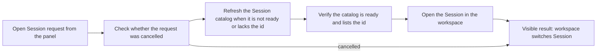

# navigation.ts

This file provides the small piece of logic that lets the management panel jump from its own views into a specific DSH Session in the workspace. Because the Session catalog may still be loading when a link is clicked, `openKnownSession` waits for the catalog, checks that the requested Session really exists, and only then hands the id to the workspace. If the user has meanwhile closed the panel or clicked a different link, it quietly gives up instead of navigating.

## Whole-unit functional diagram

The main path is: a panel link asks for a Session, the catalog is refreshed only when necessary, membership is verified, and the workspace is finally asked to open that exact id. The cancellation check sits at the start and after the optional refresh, so a superseded or unmounted panel never changes the visible workspace state.

<!-- {
  "mermaid_info": {
    "name": "Session open flow with catalog readiness",
    "nodes": [
      {
        "id": "request_001",
        "name": "Open Session request from the panel",
        "path": "src/client/index.tsx",
        "hint": "The mounted panel creates an AbortController and calls the navigation helper",
        "isJumpable": true,
        "position": { "startLine": 34, "endLine": 38 },
        "references": []
      },
      {
        "id": "guard_002",
        "name": "Check whether the request was cancelled",
        "path": "src/navigation.ts",
        "hint": "Early abort checks decide whether navigation should still happen",
        "isJumpable": true,
        "position": { "startLine": 15, "endLine": 17 },
        "references": []
      },
      {
        "id": "refresh_003",
        "name": "Refresh the Session catalog when it is not ready or lacks the id",
        "path": "src/navigation.ts",
        "hint": "A single refresh is requested only when the catalog cannot answer yet",
        "isJumpable": true,
        "position": { "startLine": 16, "endLine": 16 },
        "references": []
      },
      {
        "id": "verify_004",
        "name": "Verify the catalog is ready and lists the id",
        "path": "src/navigation.ts",
        "hint": "Readiness and membership produce the two navigation error codes",
        "isJumpable": true,
        "position": { "startLine": 18, "endLine": 20 },
        "references": []
      },
      {
        "id": "open_005",
        "name": "Open the Session in the workspace",
        "path": "src/navigation.ts",
        "hint": "The caller-supplied open callback performs the actual selection",
        "isJumpable": true,
        "position": { "startLine": 21, "endLine": 22 },
        "references": []
      },
      {
        "id": "outcome_006",
        "name": "Visible result: workspace switches Session",
        "path": "",
        "hint": "Either the workspace shows the Session, nothing happens, or the panel shows a localized message",
        "isJumpable": false,
        "position": { "startLine": 0, "endLine": 0 },
        "references": []
      }
    ]
  }
} -->

    
        <a target="_self" href="#src/navigation.ts:1?class=graph" style="color: inherit; text-decoration: none;">Graph: Session open flow with catalog readiness</a>
    

## At a glance

- Primary role: Orchestration — the file sequences catalog refresh, readiness/membership verification, and the final workspace hand-off in one guarded flow.
- Secondary roles: API boundary — it publishes a narrow callable contract with a boolean outcome and two named error codes that the panel translates.
- Confidence: High — the complete file is short and self-contained, and both its consumer (the mounted panel) and its dedicated tests were read to confirm the behavior.

## What this file does

- Lets a panel view open a Session it only knows by id, without first waiting for the Session catalog to finish loading.
- Avoids unnecessary network work: a refresh happens only when the catalog is not ready or does not yet contain the requested id.
- Refuses to navigate to Sessions the catalog does not list, so links to deleted or unknown Sessions cannot select an invalid target.
- Honors cancellation, so a closed panel or a newer navigation request never steals focus afterwards.
- Reports the two failure reasons as typed error codes (`not-ready`, `not-listed`) that the UI turns into localized messages instead of raw ids.

## Key functions or classes

### `openKnownSession`

Coordinates catalog readiness with the actual workspace navigation and resolves to `true` when it opened the Session or `false` when the request was cancelled.

    
        <a target="_self" href="#src/navigation.ts:14-23?class=code" style="color: inherit; text-decoration: none;">Code: src/navigation.ts:14-23</a>
    

### `SessionNavigationError`

A small error type carrying a `code` field so callers can distinguish "the catalog is not usable yet" from "the catalog is ready but this Session is unknown".

    
        <a target="_self" href="#src/navigation.ts:9-11?class=code" style="color: inherit; text-decoration: none;">Code: src/navigation.ts:9-11</a>
    

## Main inputs and results

- Inputs: a narrowed Session controller exposing `list` and `refresh`, the target `SessionId`, an `open(id)` callback that performs the workspace switch, and an `AbortSignal` owned by the caller.
- Results: a promise resolving to `true` when the Session was opened, `false` when the request was cancelled before the hand-off, or a rejected `SessionNavigationError` with code `not-ready` / `not-listed`.
- Visible side effects: the workspace selects the requested Session; on failure the caller decides what the user sees, which in this project is a localized "session list not ready" or "session not listed" message.

## Coordinated flow

1. The panel's mounted wrapper aborts any previous pending navigation, creates a fresh `AbortController`, and calls `openKnownSession` with the Session id and context sources.
2. The helper first checks the abort signal; if the request is already cancelled it returns `false` without touching the catalog.
3. It reads the catalog snapshot and asks the Session controller to refresh when the catalog is not `ready` or does not contain the id — a ready catalog that already lists the Session costs no extra request.
4. After the refresh it checks cancellation again, then re-reads the snapshot: a still-unready catalog raises `not-ready`, a ready catalog without the id raises `not-listed`.
5. Only when both checks pass does it invoke the caller's `open(id)` callback, which delegates to `uiWorkspace.openSession`, and resolves `true`.

### Important branching and concurrency

The function is re-entrant and race-safe by construction: the caller cancels the previous request before starting a new one, and the abort checks bracket the only `await`. The panel also aborts the pending request when it unmounts, so a late-arriving refresh result can never navigate a panel the user has already left.

## Public contract

- Caller: the management panel wrapper in the client entry point, which passes the client context's Session controller, a target id, and a workspace-opening callback.
- Operation: "open this known Session, refreshing the catalog first if necessary".
- Accepted input: any object with `list.getSnapshot()` and `refresh()` (only `phase` and `byId` are inspected, not Session summary fields), a `SessionId` string, a non-throwing `open` callback, and an `AbortSignal`.
- Result: `true` on navigation, `false` on cancellation, or `SessionNavigationError` with `code` `not-ready` / `not-listed`; the panel maps those codes to localized text before rethrowing, so end users never see the raw ids.

Related source: the calling wrapper is in 
<a target="_self" href="#src/client/index.tsx:30-46?class=code" style="color: inherit; text-decoration: none;">index.tsx:30-46</a>
, and the behavior is pinned down by 
<a target="_self" href="#tests/navigation.spec.ts:16-41?class=code" style="color: inherit; text-decoration: none;">navigation.spec.ts:16-41</a>
.

---
name: navigation.ts

update-time: 2026-11-02 10:18

description: This file provides the small piece of logic that lets the management panel jump from its own views into a specific DSH Session in the workspace. Because the Session catalog may still be loading when a link is clicked, `openKnownSession` waits for the catalog, checks that the requested Session really exists, and only then hands the id to the workspace. If the user has meanwhile closed the panel or clicked a different link, it quietly gives up instead of navigating.

---
