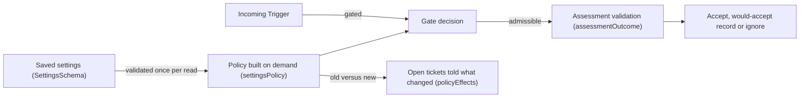

# policy.ts

`src/policy.ts` is where this project decides **who is allowed to start work** and **how much authority an incoming message carries**. It validates the entire settings document (rules, accept mode, executor limits, per-Source sender lists and admission tables), then builds the stateless `Policy` object that the engine uses to gate messages and re-check existing authorization. It also converts the main Session's assessment into an engine outcome and reports which open tickets a settings change affects. Read it when you need to know why a message was accepted, ignored or rejected.

## Whole-unit functional diagram

The upper path shows how a stored settings document becomes a fresh `Policy` on every read, and how that policy turns an incoming message into admission strength plus a recorded basis. The lower-right branch shows the change path: when settings are saved, `policyEffects` compares the old and new policies and names the open tickets whose authorization or matched rules actually moved.

<!-- {
  "mermaid_info": {
    "name": "Policy settings, gating and change effects",
    "nodes": [
      {
        "id": "settings_001",
        "name": "Saved settings (SettingsSchema)",
        "path": "src/policy.ts",
        "hint": "The zod schema and inferred type of the validated settings document",
        "isJumpable": true,
        "position": { "startLine": 99, "endLine": 106 },
        "references": []
      },
      {
        "id": "policy_002",
        "name": "Policy built on demand (settingsPolicy)",
        "path": "src/policy.ts",
        "hint": "Turns settings plus a Source scope into a stateless Policy object",
        "isJumpable": true,
        "position": { "startLine": 167, "endLine": 242 },
        "references": []
      },
      {
        "id": "trigger_003",
        "name": "Incoming Trigger",
        "path": "",
        "hint": "A message recorded by a Source, with actor, addressed flag and meta",
        "isJumpable": false,
        "position": { "startLine": 0, "endLine": 0 },
        "references": []
      },
      {
        "id": "gate_004",
        "name": "Gate decision",
        "path": "src/policy.ts",
        "hint": "The gate method that returns admission strength or a rejection reason",
        "isJumpable": true,
        "position": { "startLine": 191, "endLine": 211 },
        "references": []
      },
      {
        "id": "assess_005",
        "name": "Assessment validation (assessmentOutcome)",
        "path": "src/policy.ts",
        "hint": "Checks the main Session's assessment and converts it into an engine outcome",
        "isJumpable": true,
        "position": { "startLine": 40, "endLine": 61 },
        "references": []
      },
      {
        "id": "result_006",
        "name": "Accept, would-accept record or ignore",
        "path": "",
        "hint": "The visible decision an operator sees for each candidate",
        "isJumpable": false,
        "position": { "startLine": 0, "endLine": 0 },
        "references": []
      },
      {
        "id": "effects_007",
        "name": "Open tickets told what changed (policyEffects)",
        "path": "src/policy.ts",
        "hint": "Maps a settings change to the open tickets it bears on",
        "isJumpable": true,
        "position": { "startLine": 144, "endLine": 165 },
        "references": []
      }
    ]
  }
} -->

    
        <a target="_self" href="#src/policy.ts:1?class=graph" style="color: inherit; text-decoration: none;">Graph: Policy settings, gating and change effects</a>
    

## At a glance

- **Primary role**: Domain rules — this file answers "may this message start work, and with what authority?", including the invariants that keep that answer consistent over time.
- **Secondary roles**: Data contract — it also owns the settings document schema and the assessment shapes exchanged with the main Session and the engine.
- **Confidence**: High — the gate, revalidation and assessment logic are fully readable here, and the callers (`src/app/runtime.ts`, `src/app/settings.ts`, `src/app/assessment.ts`) confirm how the pieces are used.

## What this file does

- Defines the validated settings document with defaults: pause flag, per-Source instances, acceptance rules, eval mode and timeout, executor model/concurrency/directory/prepare command/blocked commands — including the two built-in rules "Copy fixes" and "Visual fixes".
- Defines per-Source authorization data: who is an allowed sender, which bots are listed, and an admission table that maps "listed or not × addressed or not" to explicit, inferred or ignore for each receiving scope.
- Builds the active `Policy` from settings, providing `gate`, `revalidate`, `admitsInferred`, `version`, `paused` and `evalTimeoutMs`.
- Re-checks an existing mandate's basis, so work accepted earlier stops being valid when its sender, scope, admission cell, accept mode or matched rules no longer hold.
- Validates the main Session's assessment: exactly one judgement per enabled rule, settled direction, at least one matched rule, and intent evidence before anything is accepted.
- Computes a `policyVersion` hash over the parts that affect authorization, and maps a settings change onto the open tickets it actually affects.

## Rules and decisions

- **Decision**: may this incoming message originate work on its Source, and does previously accepted work remain authorized?
- **Important conditions**:
  - A sender on that Source's allowed list who addresses the agent is always explicit and never uses an admission table cell; a message that does not address the agent can never be explicit on its own.
  - Otherwise the receiving scope's admission row decides, with defaults: listed-but-unaddressed becomes an inferred candidate, and unlisted senders are ignored.
  - Unaddressed messages only reach the agent when the Source observes all messages in that scope; a message on a thread that already has tickets can also arrive as a follow-up.
  - Explicit admission cells are checked before follow-ups, so a thread's existing tickets cannot downgrade an explicit request.
  - Non-human senders are limited to listed bots, which are inferred candidates at most; unknown bots and unlistened system events are rejected.
  - The accept mode matters: `off` ignores inferred candidates, `observe` records what would have been accepted, and only `auto` can accept inferred work.
  - The Policy never maps a person across Sources — authority is per Source, in that Source's own identities.
- **Outcomes**: either `{ admissible: true, strength, basis }` with strength `explicit` or `inferred`, or `{ admissible: false, reason }` using codes such as `not_human`, `not_a_member`, `no_mention` and `admission_ignored`.
- **Invariant**: acceptance requires a settled direction, at least one matched *enabled* rule, and intent evidence; a disabled or unknown rule id can never carry an acceptance, and an inferred acceptance outside `auto` mode is downgraded to a would-accept record instead of creating work.

### Small example

A teammate on a Source's allowed list mentions the agent in a group the Source observes fully: the gate returns `explicit` with an `addressed` basis and no table cell is consulted. The same teammate later posts in that group without mentioning the agent: the default admission row makes it an inferred candidate, so in `observe` mode the assessment is recorded as a would-accept proposal and no ticket appears, while in `auto` mode with a matched rule it can become real work.

### `settingsPolicy`

Builds the stateless `Policy` for the current settings, including the machine gate for bots and system events and the revalidation rules for existing mandates.

    
        <a target="_self" href="#src/policy.ts:167-242?class=code" style="color: inherit; text-decoration: none;">Code: src/policy.ts:167-242</a>
    

### `assessmentOutcome`

Validates the main Session's assessment against the enabled rules and turns it into an accept, ignore or unavailable outcome, or throws when the rule coverage or evidence is wrong.

    
        <a target="_self" href="#src/policy.ts:40-61?class=code" style="color: inherit; text-decoration: none;">Code: src/policy.ts:40-61</a>
    

### `directionAllowed`

Decides whether a stated direction is actually settled: implementation was requested, the target is not undetermined, and no design decision is still open.

### `SettingsSchema` and the block schemas

The single validated shape of everything configurable, with defaults applied, plus the per-block schemas (`PolicyConfigSchema`, `EvalConfigSchema`, `ExecutorConfigSchema`) that the settings panel and store parse separately.

    
        <a target="_self" href="#src/policy.ts:79-106?class=code" style="color: inherit; text-decoration: none;">Code: src/policy.ts:79-106</a>
    

### `allowedSender` and `listedBot`

Look an actor up in that actor's own Source lists by case-insensitive identity, which is what separates explicit authority from inferred bot candidates.

    
        <a target="_self" href="#src/policy.ts:119-126?class=code" style="color: inherit; text-decoration: none;">Code: src/policy.ts:119-126</a>
    

### `policyVersion`

Hashes the parts of settings that affect authorization — rules, accept mode and the Sources' policy parts — so model, concurrency and pause changes do not invalidate existing decisions.

    
        <a target="_self" href="#src/policy.ts:116-118?class=code" style="color: inherit; text-decoration: none;">Code: src/policy.ts:116-118</a>
    

### `policyEffects`

Compares the old and new policy per open ticket and reports changed or disabled rules, a sender that may no longer start work, or inferred work that is no longer accepted.

    
        <a target="_self" href="#src/policy.ts:144-165?class=code" style="color: inherit; text-decoration: none;">Code: src/policy.ts:144-165</a>
    

### `SourcePolicySchema` and the admission table schemas

Describe one Source's authorization section: its allowed senders, its admission rows keyed by scope, and any Source-specific extras such as bot lists.

## Information contract

- **Represents**: one settings document (pause state, per-Source instances, policy, eval, executor) plus the two exchange shapes this file validates — a rule-by-rule assessment with a direction, and the per-Source policy section including the admission table.
- **Produced by**: `SettingsSchema.parse` and the block schemas when settings are loaded, saved or synced through the settings service, and by the main Session when it submits an assessment; `policyEffects` produces a per-ticket view of a change.
- **Consumed by**: the Source registry when it validates each Source's policy part, the engine through the `Policy` port, the management panel and settings views, and the migration of stored settings at startup.
- **Behavior-shaping parts**: `eval.mode` (`off` / `observe` / `auto`) decides whether inferred candidates can become work; which rules are `enabled` and what their `instruction` says decides what may be matched; `sources[*].allowed`, `sources[*].bots` and `sources[*].admission` decide gate outcomes; `paused` and `executor` settings are exposed but deliberately left out of the policy version; source ids must be lowercase and the documents are strict, so unknown fields are rejected rather than silently ignored.

The conceptual rules behind the admission table are documented in 
<a target="_self" href="#src/admission.ts?class=text" style="color: inherit; text-decoration: none;">admission.ts</a>
, and the policy's place in the overall design is described in 
<a target="_self" href="#docs/007-architecture.md?class=text" style="color: inherit; text-decoration: none;">007-architecture.md</a>
.

## Main inputs and results

- **Inputs**: a validated `Settings` value, a `Trigger` with its actor, addressed flag and Source meta, the `Thread` and its `Ticket`s, a `SourceScope` that answers whether a Source listens to a scope and which admission row it names, the main Session's assessment, and an old/new settings pair for change effects.
- **Results**: a `Policy` with `gate`, `revalidate`, `admitsInferred`, `version`, `paused` and `evalTimeoutMs`; a validated settings document or a schema error; an `AssessmentOutcome` (accept with rules and audit, ignore with a reason, or unavailable); a `policyVersion` hash; and a map of ticket id to `PolicyEffect`.
- **Visible side effects**: none in this file — it is pure validation and decision logic. Saving, notifications, restarts and ticket updates happen in the callers, which use these results to decide what operators and the main Session see.

---
name: policy.ts

update-time: 2026-11-02 10:17

description: `src/policy.ts` is where this project decides **who is allowed to start work** and **how much authority an incoming message carries**. It validates the entire settings document (rules, accept mode, executor limits, per-Source sender lists and admission tables), then builds the stateless `Policy` object that the engine uses to gate messages and re-check existing authorization. It also converts the main Session's assessment into an engine outcome and reports which open tickets a settings change affects. Read it when you need to know why a message was accepted, ignored or rejected.

---
